# Reference process: Retire a Tool

`ref/rev/retire-a-tool v1`

**value stream:** [Signal-to-System](../../streams/revenue-operations/signal-to-system.md)
A decision has been made to switch a tool off, and this process gets it
off without losing the data it holds or the process that ran inside it.
Everything that depends on the tool is found first, the process is
given a new home before the old one closes, and what has to be kept is
named with how long it is kept for. The export is taken while the tool
still runs and is read back before anything is switched off. The run
closes when the accounts are shut, the supplier has confirmed deletion
in writing, and the stack record says the tool is gone.

## The activities

| # | Activity | What happens | Agents |
|---|---|---|---|
| 1 | Take in the Decision to Retire | which tool, why, and by what date | [stack-planner](../../agents/stack-planner.md) |
| 2 | Find What Depends on It | the processes, reports and links that use it | [integration-keeper](../../agents/integration-keeper.md) · [analytics](../../agents/analytics.md) |
| 3 | Name Where the Process Goes | the process gets a home before the tool closes | stack-planner · revenue operations lead (person) |
| 4 | Say What Data Is Kept | what is kept, for how long, and where it sits | [standards-keeper](../../agents/standards-keeper.md) · data owner (person) |
| 5 | Tell the People Who Use It | the date, and where the work goes instead | [tool-administrator](../../agents/tool-administrator.md) |
| 6 | Move the Process to Its New Home | the work runs in the new place before the cut | stack-planner · tool-administrator |
| 7 | Take the Export | a full export pulled while the tool still runs | tool-administrator · integration-keeper |
| 8 | Check the Export Reads | the export opened, counted and compared | analytics · standards-keeper |
| 9 | Turn Off the Links | the links either side are stopped and recorded | integration-keeper · tool-administrator |
| 10 | Stop New Work Going In | the tool goes read only on a stated date | tool-administrator |
| 11 | Review before Switch-Off | what is kept, what is going, and what is owed | security reviewer (person) · data owner (person) · standards-keeper |
| 12 | Close the Accounts and the Licence | accounts shut, and the agreement ended on notice | tool-administrator · procurement lead (person) |
| 13 | Get the Deletion in Writing | the supplier confirms what it destroyed, and when | [supplier-check](../../agents/supplier-check.md) · procurement lead (person) |
| 14 | Update the Stack Record | the entry closed, with what replaced it | stack-planner |
| 15 | Record What Was Learned | what to repeat, what to avoid | stack-planner · tool-administrator |

## The graph

```mermaid
flowchart LR
  T([a decision to retire a tool is recorded]) --> A1[1. Take in the Decision to Retire]
  A1 --> A2[2. Find What Depends on It]
  A2 -. something depends on it that nobody knew about .-> A1
  A2 --> A3[3. Name Where the Process Goes]
  A3 -. the process has nowhere to go .-> A1
  A3 --> A4[4. Say What Data Is Kept]
  A4 --> A5[5. Tell the People Who Use It]
  A4 --> A7[7. Take the Export]
  A5 --> A6[6. Move the Process to Its New Home]
  A6 -. the new home cannot carry the work .-> A3
  A6 --> A9[9. Turn Off the Links]
  A7 --> A8[8. Check the Export Reads]
  A8 -. the export does not read back .-> A7
  A8 --> A9
  A9 --> A10[10. Stop New Work Going In]
  A10 --> A11[11. Review before Switch-Off]
  A11 -. findings to clear before switch-off .-> A7
  A11 --> A12[12. Close the Accounts and the Licence]
  A12 --> A13[13. Get the Deletion in Writing]
  A13 -. the supplier will not confirm .-> A12
  A13 --> A14[14. Update the Stack Record]
  A14 --> A15[15. Record What Was Learned]
  A15 --> DONE([the tool is off, the data is kept and the process runs elsewhere])
```



## The document, with the blanks marked

```
PROCESS: retire a tool                id: <team>/retire-a-tool   v1
from: ref/rev/retire-a-tool v1
owner: <who>                          effective: <date>
trigger: a review or a renewal decides a tool comes out of the stack in
         <your tool administration process>
         watch: record=<the stack entry for the tool>
                system=<your tool administration process>
                change=<the entry is marked to come out, with a date>
concurrency: runs may overlap - <how many> retirements open at once,
             and one system is changed by one run at a time
goal: the tool switched off with the process it ran already running
      somewhere else, the data kept for as long as it has to be kept,
      and the supplier's deletion confirmed in writing
phases:
  take-in-decision - human: read the decision as it was recorded: which
                     tool, why, by what date, and what replaces it
                     owner: stack-planner        after: trigger
                     automation: <level>
  find-dependents  - runs collect-and-report: every process, report,
                     link and person that touches the tool, each with
                     what it would lose
                     owner: integration-keeper   after: take-in-decision
                     by: <days>                  automation: <level>
  name-new-home    - convenes decide-and-announce: where each process
                     the tool ran will run instead. <who> decides where
                     no home is obvious
                     owner: stack-planner        after: find-dependents
                     by: <days>                  automation: <level>
  say-what-is-kept - human: what has to be kept, for how long, in what
                     form, and where it will sit after the tool is gone
                     owner: <your data owner role>
                     after: name-new-home
                     by: <days>                  automation: never
  tell-users       - human: everyone who works in the tool hears the
                     date, what happens to their work, and where it goes
                     instead, at least <days> before the cut
                     owner: tool-administrator   after: say-what-is-kept
                     by: <days>                  automation: <level>
  move-process     - human: the work runs in its new home, alongside the
                     old one, until it runs there without help
                     owner: stack-planner        after: tell-users
                     by: <weeks>                 automation: <level>
  take-export      - human: a full export taken while the tool still
                     runs, including the attachments, the history and
                     anything the tool holds that is not in a table
                     owner: tool-administrator   after: say-what-is-kept
                     by: <days>                  automation: <level>
  check-export     - runs assessment: the export opened where it will be
                     kept, counted against the tool, and compared field
                     by field on a sample of <n> records
                     owner: analytics            after: take-export
                     by: <days>                  automation: <level>
  turn-off-links   - human: every link either side stopped, and what
                     each one was carrying recorded before it stops
                     owner: integration-keeper
                     after: move-process + check-export
                     by: <days>                  automation: <level>
  read-only        - human: the tool takes no new work from a stated
                     date, and stays readable for <days> after it
                     owner: tool-administrator   after: turn-off-links
                     automation: <level>
  review-switch-off - convenes approval: what is kept, what is going,
                     what is still owed to anyone, and what the
                     agreement requires. Named people sign
                     owner: <your security role> after: read-only
                     by: <days>                  automation: never
  close-accounts   - human: every account closed, the agreement ended on
                     the notice it requires, and the final invoice
                     agreed
                     owner: tool-administrator
                     after: review-switch-off
                     by: <days>                  automation: <level>
  confirm-deletion - runs assessment: the supplier confirms in writing
                     what it destroyed, when, and what it is still
                     holding and why
                     owner: supplier-check       after: close-accounts
                     by: <weeks>                 automation: <level>
  update-stack     - human: the entry closed with the date, what
                     replaced it, and where the kept data now sits
                     owner: stack-planner        after: confirm-deletion
                     automation: <level>
  record-learnings - convenes debrief: what to repeat, what to avoid
                     owner: stack-planner        after: update-stack
                     automation: <level>
run-scoped:
  status - runs roll-call                     owner: stack-planner
           every: <cadence>
           from: name-new-home   until: close-accounts
  spend  - runs allocate-and-reconcile        owner: <your finance role>
           from: close-accounts   until: run close
handoffs:
  take-in-decision -> find-dependents [retirement-decision]: which
    tool, why, by what date, and what was said would replace it
  find-dependents -> name-new-home [dependency-list]: every process,
    report, link and person that touches the tool, and what each would
    lose
  name-new-home -> say-what-is-kept [new-homes]: where each process
    will run instead, and who agreed to take it
  say-what-is-kept -> tell-users [retention-list]: what is kept, for
    how long, in what form and where, and what is not being kept at all
  say-what-is-kept -> take-export [export-scope]: the same list, as
    the thing the export has to produce
  tell-users -> move-process [who-was-told]: who was told, on what
    date, and every question they asked that is still open
  move-process -> turn-off-links [work-moved]: the work running in
    its new home, with the date it last needed the old tool
  take-export -> check-export [export-taken]: the export, where it
    is held, and everything the tool holds that the export could not
    take
  check-export -> turn-off-links [export-counts]: the counts from the
    export against the counts in the tool, and every difference
  turn-off-links -> read-only [links-stopped]: every link stopped,
    with what it was carrying and where that now comes from
  read-only -> review-switch-off [read-only-date]: the date the tool
    stopped taking work, and anything still being written to it after
    that date
  review-switch-off -> close-accounts [cleared-review]: the cleared
    review, the signers, and every finding accepted rather than fixed
  close-accounts -> confirm-deletion [accounts-closed]: the closed
    accounts, the notice given, the end date and the final invoice
  confirm-deletion -> update-stack [deletion-confirmed]: what the
    supplier destroyed, when, and what it is still holding with the
    reason
  update-stack -> record-learnings [closed-entry]: the closed entry,
    and where the kept data now sits
deviations:
  find-dependents -> take-in-decision [unknown-dependency]: something
    depends on the tool that nobody knew about, so the decision is
    taken in again with the dependency named
  name-new-home -> take-in-decision [nowhere-to-go]: the process the
    tool ran has nowhere to go, so the decision is taken in again and
    the date moves
  move-process -> name-new-home [new-home-cannot-carry]: the new home
    cannot carry the work, so where the process goes is named again
  check-export -> take-export [export-will-not-read]: the export does
    not read back, so it is taken again against the counts that differed
  review-switch-off -> take-export [findings-to-clear]: the review
    leaves findings to clear before switch-off, so the export is taken
    again while the tool is still readable
  confirm-deletion -> close-accounts [supplier-will-not-confirm]: the
    supplier will not confirm what it destroyed, so the closing is
    worked again against the agreement
bindings:
  roster:  <who holds each role - agents claiming the abstract agents
           above, and named people for the data owner, the security
           reviewer, procurement and the revenue operations lead>
  systems: the tool (read), the stack record (write),
           the flow record (write), <your archive> (write),
           <your system of record> (write), the account record (write),
           the budget record (write)
  data:    the entry in the stack record, the record of what flows
           where, <your data retention rules>, <your security and
           privacy standards> <version>, the licence agreement and the
           notice it requires
policy:
  the process the tool ran has a named new home before the tool stops
    taking work
  nothing is switched off until the export has been read back where it
    will be kept and counted against the tool
  data that has to be kept is kept in a form somebody can read without
    the tool that wrote it
  the people who use the tool are told at least <days> before it stops
    taking work, and told again on the day
  the review before switch-off is a human gate and is never delegated
    to an agent
  the agreement is ended on the notice it requires, and the notice date
    is recorded before the accounts are closed
  the run stays open until the supplier has confirmed in writing what
    it destroyed and what it still holds
measures:
  cycle time: <target> from the decision to the closed entry
  coverage: <share> of the dependents found at the start that were
            settled before the tool stopped taking work
  quality gate: nothing is switched off without a read-back export and
                a signed review
```

## The failure edges

- **Something depends on the tool that nobody knew about.** The run goes
  back to the decision with the dependency named and what it would lose.
  The date moves, or the dependency is settled, and which one happens is
  recorded. A retirement that runs to a date by leaving a report broken
  has not finished.
- **The process has nowhere to go.** The run stops. The tool stays on
  until a home is named and someone has agreed to take the work, because
  switching the tool off does not remove the work that ran in it, it
  only removes the place it was done.
- **The export will not read back.** The run returns to the export with
  the counts and the fields that differed. A tool is not switched off on
  the strength of an export nobody has opened, and an export missing
  attachments or history is an incomplete export, not a complete one.
- **The tool holds something the export cannot take.** The
  standards-keeper agent names it, and it is either recreated in the new
  home, kept another way, or accepted as lost in writing by the data
  owner. Nobody discovers it after the accounts are closed.
- **The new home cannot carry the work.** The run goes back to the
  choice of home. The old tool keeps running, its accounts stay open,
  and the retirement date moves rather than the work being done by hand
  in the gap.
- **Somebody is still writing to the tool after the read-only date.**
  The tool-administrator agent finds it in the read-only period, the
  records written after the date are exported again, and the person is
  pointed at the new home. This is why the tool stays readable for a
  stated period rather than being switched off the same day.
- **The supplier will not confirm what it destroyed.** The run stays
  open. Procurement puts the request in writing against the agreement,
  and what the supplier is still holding is recorded against the entry
  in the stack record. An unanswered request is not a deletion.
- **The final invoice does not match what was agreed.** The accounts
  still close on the notice date. The disagreement goes to procurement
  with the term it is being argued under, and the spend line reconciles
  when it settles.
- **The trigger fires while runs are in flight.** Retirements overlap
  normally, and the concurrency line says how many. One system is
  changed by one run at a time, so two retirements that would stop the
  same link are ordered rather than run together.
- **A run is abandoned.** The tool stays on and stays writable, and the
  people who were told it was going are told it is staying, with the
  date it will be looked at again. The export already taken is kept and
  dated, the links that were stopped are started again or recorded as
  stopped on purpose, and the entry in the stack record says the
  retirement did not complete, so the next renewal is not signed as if
  the tool were already going.
