# Reference process: Review a Non-Standard Deal

`ref/rev/review-a-non-standard-deal v1`

**value stream:** [Deal-to-Approval](../../streams/revenue-operations/deal-to-approval.md)
A seller asks for something the standard paper does not cover. The desk
takes the request, checks it is complete, and tells the seller the time
it will answer in. Every non-standard item is named on its own, tested
against the terms in force, and priced for what it risks. The people
who carry each risk give their read in writing. The desk decides item
by item and hands back an approved shape, or a refusal that says what
would change it. An item that outruns the promised time escalates.

## The activities

| # | Activity | What happens | Agents |
|---|---|---|---|
| 1 | Take in the Request | what is asked for, on which deal, and by when | [deal-desk-reviewer](../../agents/deal-desk-reviewer.md) · seller (person) |
| 2 | Check the Request Is Complete | the deal, the paper, the ask and the date, all present | deal-desk-reviewer |
| 3 | Start the Clock | the response time promised, in writing, to the seller | deal-desk-reviewer |
| 4 | Read the Deal as It Stands | the configuration, the price, the term and the paper | deal-desk-reviewer |
| 5 | Name Every Non-Standard Item | each item separated out and written down on its own | deal-desk-reviewer |
| 6 | Test the Terms Against the Standard | each term scored against the paper in force | [terms-check](../../agents/terms-check.md) |
| 7 | Price What Each Item Risks | revenue, margin, delivery and precedent, per item | deal-desk-reviewer · [analytics](../../agents/analytics.md) |
| 8 | Say Who Carries Each Risk | the owner of each risk named against each item | deal-desk-reviewer |
| 9 | Get the Reads Back | each read, dated, with the reason behind it | finance approver (person) · legal reviewer (person) · delivery lead (person) |
| 10 | Look Up the Precedent | what was decided the last time this was asked | analytics · deal-desk-reviewer |
| 11 | Shape What the Desk Would Approve | the alternative that carries less risk, priced | deal-desk-reviewer |
| 12 | Hold the Review | the items decided in one sitting, one at a time | deal-desk-reviewer · finance approver (person) · sales leader (person) |
| 13 | Escalate What Ran Past the Clock | an item past its promised time goes up the line | deal-desk-reviewer · sales leader (person) |
| 14 | Record the Decision and the Reason | per item, at a version, against the deal record | deal-desk-reviewer |
| 15 | Hand the Shape Back | an approved shape, or a refusal and what changes it | deal-desk-reviewer · seller (person) |
| 16 | Feed the Pattern to the Standards | an ask that keeps coming becomes a rule or a term | [standards-keeper](../../agents/standards-keeper.md) · deal-desk-reviewer |

## The graph

```mermaid
flowchart LR
  T([a deal asks for terms the standard ones do not cover]) --> A1[1. Take in the Request]
  A1 --> A2[2. Check the Request Is Complete]
  A2 -. the request is missing what it needs .-> A1
  A2 --> A3[3. Start the Clock]
  A3 --> A4[4. Read the Deal as It Stands]
  A4 --> A5[5. Name Every Non-Standard Item]
  A5 --> A6[6. Test the Terms Against the Standard]
  A5 --> A7[7. Price What Each Item Risks]
  A6 -. a term nobody has scored before .-> A5
  A6 --> A8[8. Say Who Carries Each Risk]
  A7 --> A8
  A8 --> A9[9. Get the Reads Back]
  A9 -. the item has to be restated .-> A5
  A9 -. the promised time has run out .-> A13[13. Escalate What Ran Past the Clock]
  A9 --> A10[10. Look Up the Precedent]
  A10 --> A11[11. Shape What the Desk Would Approve]
  A11 --> A12[12. Hold the Review]
  A12 -. an item needs a different shape .-> A11
  A12 -. a read is missing .-> A9
  A12 -. the promised time has run out .-> A13
  A13 -. settled above the desk .-> A12
  A12 --> A14[14. Record the Decision and the Reason]
  A14 --> A15[15. Hand the Shape Back]
  A15 -. the seller comes back with a changed ask .-> A1
  A15 --> A16[16. Feed the Pattern to the Standards]
  A16 --> DONE([the ask is decided and the seller has a shape or a reason])
```



## The document, with the blanks marked

```
PROCESS: review a non-standard deal    id: <team>/review-a-non-standard-deal   v1
from: ref/rev/review-a-non-standard-deal v1
owner: <who>                           effective: <date>
trigger: a deal in <your quoting process> asks for a term, a structure
         or an exception the standard paper does not cover
         watch: record=<the deal> system=<the quoting system>
                change=<a request is raised for a term, a structure or
                an exception the standard paper does not cover>
concurrency: runs may overlap - <how many> requests are live at the
             desk at once, and one deal has one open request at a time
goal: every non-standard item decided, with the risk priced, the person
      who carries it named, the reason recorded, and the answer back to
      the seller inside the time the desk promised
phases:
  take-in-request   - human: read what is being asked for, on which
                      deal, for which customer, and the date the seller
                      needs an answer
                      owner: deal-desk-reviewer   after: trigger
                      automation: assisted
  check-complete    - runs assessment: the request tested for the deal
                      record, the paper it sits on, the ask itself, and
                      the date it is needed
                      owner: deal-desk-reviewer   after: take-in-request
                      by: <hours>                 automation: <level>
  start-clock       - system: the level is read off the published
                      table, the time that level promises is stamped on
                      the request, and the seller is told both
                      owner: deal-desk-reviewer   after: check-complete
                      automation: autonomous
  read-deal         - runs collect-and-report: the configuration, the
                      price, the term, the paper it sits on, and what
                      the customer already owns
                      owner: deal-desk-reviewer   after: start-clock
                      by: <hours>                 automation: <level>
  name-items        - human: every item that is not standard written
                      down on its own, so each one can be decided
                      without the others
                      owner: deal-desk-reviewer   after: read-deal
                      automation: assisted
  test-terms        - runs assessment: each term scored against the
                      standard paper at the version in force and
                      against <your contract policy>
                      owner: terms-check          after: name-items
                      automation: <level>
  price-risk        - runs assessment: what each item costs if it goes
                      wrong. Revenue, margin, delivery effort, and the
                      precedent it sets for the next deal
                      owner: deal-desk-reviewer   after: name-items
                      by: <hours>                 automation: <level>
  assign-risk       - human: the person or the function that carries
                      each risk is named against the item, so no item
                      is decided by somebody who does not carry it
                      owner: deal-desk-reviewer
                      after: test-terms + price-risk
                      automation: assisted
  get-reads         - convenes collect-and-report: each risk owner
                      gives their read in writing, dated, with the
                      reason behind it
                      owner: <your deal desk role>
                      after: assign-risk
                      by: <hours>                 automation: <level>
  find-precedent    - runs collect-and-report: what was decided the
                      last time this was asked, on which deal, by whom,
                      and what happened to that deal afterwards
                      owner: analytics            after: get-reads
                      automation: <level>
  shape-alternative - human: the shape the desk would approve instead,
                      priced, so a refusal is never the only answer the
                      seller is given
                      owner: deal-desk-reviewer   after: find-precedent
                      automation: assisted
  hold-review       - convenes decide-and-announce: the items decided
                      one at a time, each against the read it was
                      decided on. <who> chairs and <who> signs
                      owner: <your deal desk role>
                      after: shape-alternative
                      by: <days>                  automation: never
  escalate-clock    - human: an item that has passed the time its level
                      promised goes to <who> with what it is waiting on
                      and who it is waiting for
                      owner: <your deal desk role>
                      after: any phase whose promised time has run out
                      by: <hours>                 automation: never
  record-decision   - system: the decision, the reason, the signer, and
                      the version of the deal it was decided against
                      owner: deal-desk-reviewer   after: hold-review
                      automation: autonomous
  hand-back         - human: the seller gets the approved shape, or the
                      refusal with what would change it, at a version
                      they can quote from
                      owner: deal-desk-reviewer   after: record-decision
                      automation: assisted
  feed-standards    - convenes debrief: an ask that keeps arriving
                      becomes a standard term, a published rule, or a
                      new band on the approval table
                      owner: standards-keeper     after: hand-back
                      automation: <level>
run-scoped:
  clock    - runs roll-call                    owner: deal-desk-reviewer
             every: <cadence>
             from: start-clock   until: hand-back
  risk-log - runs collect-and-report            owner: analytics
             every: <cadence>
             from: price-risk   until: run close
handoffs:
  take-in-request -> check-complete [seller-ask]: the ask as the seller
    wrote it, and the deal record it belongs to
  check-complete -> start-clock [complete-request]: the complete
    request, with anything that was missing and has since arrived
  start-clock -> read-deal [promised-time]: the level, the time
    promised, and the date and hour the seller was told
  read-deal -> name-items [deal-as-it-stands]: the deal as it stands,
    dated, with the system every line was read from
  name-items -> test-terms [non-standard-items]: each non-standard item
    on its own, in the words the customer used
  name-items -> price-risk [items-to-price]: the same list of items.
    Both branches read one list
  test-terms -> assign-risk [term-scores]: each term scored, with the
    clause it departs from named
  price-risk -> assign-risk [risk-pricing]: what each item risks, with
    the number behind the risk wherever there is one
  assign-risk -> get-reads [risk-owners]: the item, the risk it
    creates, and the person who carries it
  get-reads -> find-precedent [written-reads]: the reads as written,
    dated, with the reason each one gave and the items nobody read
  find-precedent -> shape-alternative [precedent]: what was decided
    before, and what happened to the deals it was decided on
  shape-alternative -> hold-review [ask-and-alternative]: the ask and
    the alternative, priced side by side, item by item
  hold-review -> record-decision [item-decisions]: the decision per
    item, the reason, and the signer, against a version of the deal
  escalate-clock -> hold-review [escalation-answer]: the item, what it
    waited on, and what was decided above the desk
  record-decision -> hand-back [decided-shape]: the decided shape at its
    version, with every approval attached
  hand-back -> feed-standards [ask-and-outcome]: what was asked, what
    was decided, and how long the answer took
deviations:
  check-complete -> take-in-request [request-incomplete]: the request is
    missing the deal, the paper, the ask or the date it is needed
  test-terms -> name-items [term-never-scored]: a term turns up that the
    standard paper has no clause to score, so it is restated
  get-reads -> name-items [item-restated]: a risk owner's read shows the
    item has to be restated before anybody can answer it
  hold-review -> shape-alternative [item-needs-new-shape]: an item needs
    a different shape before the desk will decide it
  hold-review -> get-reads [read-missing]: an item reaches the review
    with a read nobody gave
  escalate-clock -> hold-review [settled-above-the-desk]: the escalation
    settles the item above the desk, so the review takes it up again
  hand-back -> take-in-request [ask-changed]: the seller comes back with
    a changed ask, which is a new ask rather than an edit
bindings:
  roster:  <who holds each role - agents claiming the abstract agents
           above, and named people for the seller, the finance
           approver, the legal reviewer, the delivery lead, and the
           sales leader who hears an escalation>
  systems: the CRM (read), the quoting system (read),
           the deal desk queue (write), the approval record (write),
           the contract record (read), the standard terms store (read),
           the notification channel (write)
  data:    the standard terms <version>, the approval table <version>,
           the delegation of authority <version>,
           the cost model <version>, the precedent log
policy:
  every request is answered inside the time its level promises, and an
    item that passes <hours> escalates to <who> without the seller
    having to ask for it
  no item is decided by somebody who does not carry the risk it creates
  a refusal names what would change it, or it is not a refusal, it is a
    delay
  approval is a human gate and is never delegated to an agent
  a decision is recorded against a version of the deal, and a later
    change to that version voids it
  an incomplete request goes back inside <hours> with what is missing,
    and the clock starts again when it returns
  the same ask arriving <n> times in <period> goes to the standards
    review rather than being decided again from nothing
  a request is never closed by going quiet. It closes with a decision,
    a refusal, or a withdrawal the seller wrote
measures:
  response time: <target> from a complete request to a decision, per
                 item, reported every <cadence>
  first answer: <hours> from the request landing to the seller being
                told the clock or told what is missing
  breach rate: <target> share of requests that pass their promised
               time, with the item each breach waited on named
  volume: <requests per period>
  quality gate: no item closes without a decision, a reason and a
                signer, and no request closes with an item unanswered
```

## The failure edges

- **The request arrives incomplete.** No deal record, no paper, or an
  ask written as a feeling rather than a term. It goes back to the
  seller inside the time the policy names, with the missing pieces
  listed. The clock starts again when it comes back, and the desk says
  so rather than letting the seller believe it kept running.
- **A term nobody has scored before turns up.** The terms-check agent
  reports that the standard paper has no clause to score it against.
  The item goes back to be restated in terms that can be tested, and
  the gap is carried into the standards review at the end of the run.
- **A risk owner never gives their read.** The item sits unanswered
  with the owner named, and when the promised time runs out it
  escalates with what it was waiting on and who it was waiting for.
  Deciding the item without the read is not one of the choices, and
  neither is letting it sit.
- **The clock is missed.** The escalation is the answer, not an
  apology. The item goes to the named leader with the delay, the
  reason, and what the desk recommends, and the seller is told it went
  up. A desk that lets requests age teaches sellers to route around it,
  which is the failure this edge exists to prevent.
- **The review refuses the ask.** The seller gets the refusal and the
  shape the desk would approve instead, priced. If the refusal makes
  the deal unsellable, the account owner takes the change to the
  customer rather than the desk relitigating it.
- **The seller changes the ask after the review.** The run does not
  reopen at the review. It goes back to the request, because a changed
  ask is a new ask, and the decision already recorded stays attached to
  the version it was made against.
- **The same exception keeps arriving.** The precedent lookup shows it
  has been decided before, several times, the same way. That is a
  signal about the standard paper rather than about this deal, and it
  goes to the standards-keeper agent as a candidate term or a new band
  on the table.
- **The deal closes before the desk answers.** The signed paper is read
  against the open items, and any item that went out unapproved is
  recorded as an exception taken without approval. Who signed it, and
  under what pressure, goes to the sales leader and into the review.
- **A run is abandoned.** The deal is lost, paused, or the seller
  withdraws the ask. The open items are closed as withdrawn with the
  reason, the reads already given are kept so the next ask starts from
  them, the approvals granted so far are voided so no later deal
  inherits them, and the seller is told the request is closed.
