# Reference process: Review Adoption

`ref/rev/review-adoption v1`

**value stream:** [Process-to-Adoption](../../streams/revenue-operations/process-to-adoption.md)
The instrumentation has been running for a period, and somebody has to
read what it says and decide. The run checks the measure before it
trusts the numbers, ranks the steps people depart from, separates a real
change in behavior from a change in counting, and asks the people who
departed why they did. Each departure is sorted into a process that is
wrong or a process that is ignored, and costed. The review then decides
one of three things per departure: change the process, change the
enforcement, or accept the departure and say so out loud.

## The activities

| # | Activity | What happens | Agents |
|---|---|---|---|
| 1 | Take in the Period's Numbers | the adoption numbers, per step and per team | [reporting-manager](../../agents/reporting-manager.md) · revenue operations lead (person) |
| 2 | Check the Measure Still Measures | the instrumentation checked before the numbers are read | [adoption-monitor](../../agents/adoption-monitor.md) |
| 3 | Rank the Departures | which steps are departed from most, and by whom | adoption-monitor |
| 4 | Separate Noise from Behavior | a real change in behavior against a change in counting | [analytics](../../agents/analytics.md) |
| 5 | Ask the People Who Departed Why | the people who departed say why, in their own words | adoption-monitor · sales manager (person) |
| 6 | Sort the Reasons | the process is wrong, or the process is ignored | [process-librarian](../../agents/process-librarian.md) · process owner (person) |
| 7 | Cost the Departure | what the departure costs, in money and in rework | analytics |
| 8 | Read the Exceptions Already Granted | the exceptions granted, and who granted each one | [standards-keeper](../../agents/standards-keeper.md) |
| 9 | Draft the Options | change the process, change the enforcement, or neither | [decision-coordinator](../../agents/decision-coordinator.md) |
| 10 | Convene the Review | the review hears the evidence in one sitting | decision-coordinator · revenue operations lead (person) |
| 11 | Decide Each Departure | one decision per departure, with a named owner | process owner (person) · revenue operations lead (person) |
| 12 | Record the Decision and Its Owner | the decision written where anyone can find it | reporting-manager · decision-coordinator |
| 13 | Open the Process Amendments | process changes go back to be documented again | process-librarian |
| 14 | Open the Enforcement Changes | gates, blocks and training are changed instead | standards-keeper · adoption-monitor |
| 15 | Tell the People What Changed | everyone who follows the process hears what changed | reporting-manager · sales manager (person) |
| 16 | Set the Next Review | when the next review runs, and what would move it | decision-coordinator |

## The graph

```mermaid
flowchart LR
  T([an adoption period closes, or a signal crosses its threshold]) --> A1[1. Take in the Period's Numbers]
  A1 --> A2[2. Check the Measure Still Measures]
  A2 -. the instrumentation was broken .-> A1
  A2 --> A3[3. Rank the Departures]
  A3 --> A4[4. Separate Noise from Behavior]
  A4 -. the change is in the counting .-> A2
  A4 --> A5[5. Ask the People Who Departed Why]
  A5 --> A6[6. Sort the Reasons]
  A6 -. nobody will say why .-> A5
  A6 --> A7[7. Cost the Departure]
  A6 --> A8[8. Read the Exceptions Already Granted]
  A7 --> A9[9. Draft the Options]
  A8 --> A9
  A9 --> A10[10. Convene the Review]
  A10 -. the evidence is not enough to decide .-> A7
  A10 --> A11[11. Decide Each Departure]
  A11 -. no decision was reached .-> A9
  A11 --> A12[12. Record the Decision and Its Owner]
  A12 --> A13[13. Open the Process Amendments]
  A12 --> A14[14. Open the Enforcement Changes]
  A13 --> A15[15. Tell the People What Changed]
  A14 --> A15
  A15 --> A16[16. Set the Next Review]
  A16 --> DONE([every departure has a decision, an owner and a date])
```



## The document, with the blanks marked

```
PROCESS: review adoption              id: <team>/review-adoption   v1
from: ref/rev/review-adoption v1
owner: <who>                          effective: <date>
trigger: an adoption period closes on <your cadence>, or a signal
         crosses the threshold <your instrumentation> was given
concurrency: runs never overlap for one process - a period is reviewed
             once, and <how many> processes may be reviewed in the same
             sitting
goal: every departure the period showed carries a decision, an owner and
      a date, and the decision is either a change to the process, a
      change to the enforcement, or an accepted departure written down
      as accepted
phases:
  take-in-numbers      - runs collect-and-report: the period's adoption
                         numbers, per step, per team and per period,
                         against the baseline
                         owner: reporting-manager
                         after: trigger
                         automation: supervised
  check-the-measure    - runs assessment: the instrumentation checked
                         for gaps, renamed fields and dead signals
                         before a single number is read out
                         owner: adoption-monitor
                         after: take-in-numbers
                         automation: <level>
  rank-departures      - runs collect-and-report: the watched steps
                         ordered by how far the period sat from the
                         process, with the teams behind each one
                         owner: adoption-monitor
                         after: check-the-measure
                         automation: <level>
  separate-noise       - runs assessment: whether a moved number is a
                         change in behavior or a change in counting,
                         with the volume behind each rate
                         owner: analytics
                         after: rank-departures
                         automation: <level>
  ask-why              - runs collect-and-report: <how many> of the
                         people who departed say why, in their own
                         words, without the answer being scored
                         owner: adoption-monitor
                         after: separate-noise
                         by: <days>
                         automation: <level>
  sort-reasons         - human: each departure sorted into the process
                         being wrong, the process being unknown, or the
                         process being knowingly ignored
                         owner: process-librarian
                         after: ask-why
                         automation: never
  cost-departure       - runs assessment: what each departure costs, in
                         money, rework and risk, over the period
                         owner: analytics
                         after: sort-reasons
                         by: <days>
                         automation: <level>
  read-exceptions      - runs collect-and-report: the exceptions already
                         granted against this process, who granted each
                         one, and which have outlived their reason
                         owner: standards-keeper
                         after: sort-reasons
                         automation: <level>
  draft-options        - human: for each departure, what changing the
                         process would cost and what changing the
                         enforcement would cost, side by side
                         owner: decision-coordinator
                         after: cost-departure + read-exceptions
                         by: <days>
                         automation: assisted
  convene-review       - convenes briefing: the review hears every
                         ranked departure, its cost and its options in
                         one sitting, on <your cadence>
                         owner: decision-coordinator
                         after: draft-options
                         automation: <level>
  decide-departures    - convenes decide-and-announce: one decision per
                         departure, each with a named owner and a date.
                         <who> decides where the review does not agree
                         owner: <your process owner role>
                         after: convene-review
                         automation: never
  record-decisions     - human: the decisions written to <your decision
                         record>, each carrying the evidence it was made
                         on and the person who made it
                         owner: reporting-manager
                         after: decide-departures
                         by: <days>
                         automation: <level>
  open-amendments      - human: every decision that changes the process
                         opens an amendment against the process document
                         at its version
                         owner: process-librarian
                         after: record-decisions
                         by: <days>
                         automation: <level>
  open-enforcement     - human: every decision that changes the
                         enforcement opens a change to the gates, the
                         blocks, the training or the thresholds
                         owner: standards-keeper
                         after: record-decisions
                         by: <days>
                         automation: <level>
  tell-the-people      - convenes briefing: everyone who follows the
                         process hears what changed, what did not, and
                         what was accepted as it is
                         owner: reporting-manager
                         after: open-amendments + open-enforcement
                         by: <days>
                         automation: <level>
  set-next-review      - convenes debrief: when the next review runs,
                         and what would pull it forward
                         owner: decision-coordinator
                         after: tell-the-people
                         automation: <level>
run-scoped:
  open-decisions - runs collect-and-report      owner: reporting-manager
                   every: <cadence>
                   from: record-decisions   until: run close
  status         - runs roll-call               owner: decision-coordinator
                   every: <cadence>
                   from: take-in-numbers   until: decide-departures
handoffs:
  take-in-numbers -> check-the-measure: the period's numbers, and the
    process version each one measures
  check-the-measure -> rank-departures: the numbers with every gap,
    outage and renamed field marked, so a hole is not read as compliance
  rank-departures -> separate-noise: the ordered departures, each with
    the count behind its rate
  separate-noise -> ask-why: the departures that are real changes in
    behavior, and the ones that were changes in counting, kept apart
  ask-why -> sort-reasons: what people said, attributed to a role rather
    than to a name, with the ones who would not answer counted
  sort-reasons -> cost-departure: each departure with its sort, so a
    wrong process is not costed as disobedience
  sort-reasons -> read-exceptions: the same sort, so an exception that
    covers a departure is found before it is costed as one
  cost-departure -> draft-options: what each departure cost over the
    period, and what it would cost if it kept going
  read-exceptions -> draft-options: the standing exceptions, who granted
    each one, and the ones that have outlived their reason
  draft-options -> convene-review: for each departure, the two options
    costed, and the recommendation with the reason for it
  convene-review -> decide-departures: the evidence as the room heard
    it, and the questions the room could not answer
  decide-departures -> record-decisions: one decision per departure,
    each with an owner, a date and the option it chose
  record-decisions -> open-amendments: the decisions that change the
    process, and the step of the process each one touches
  record-decisions -> open-enforcement: the decisions that change the
    gate, the block, the training or the threshold
  open-amendments -> tell-the-people: the amendments as raised, with the
    date each one is expected to publish
  open-enforcement -> tell-the-people: what will start being blocked,
    and from when
  tell-the-people -> set-next-review: the announcement as sent, and the
    questions it came back with
bindings:
  roster:  <who holds each role - the agent claiming adoption-monitor,
           the agent claiming analytics, the named process owner, and
           the managers of the teams the numbers are read out about>
  systems: <your reporting tool> (read), <your decision record> (write),
           the process register (write), the CRM (read),
           <your announcement channel> (write)
  data:    the process document <version>, the measure and its baseline,
           the exception register, <your cost model>
policy:
  the instrumentation is checked before the numbers are read, and a
    period with a broken measure is reported as broken rather than as
    compliant
  a departure is asked about before it is judged, and what people said
    is recorded in their words
  every departure leaves the review with a decision, an owner and a
    date. Carrying a departure to the next review unchanged happens at
    most <how many> times, and then it is decided
  accepting a departure is a decision like the other two, and it is
    written down as accepted rather than left unenforced
  the review reads rates and counts, not a ranked list of named people,
    unless <who> asks for names in writing
  a decision that changes the process is an amendment with a version,
    and it goes back through the documenting process
measures:
  cycle time: <target> from the period closing to the decisions being
              recorded
  closure: <target> share of ranked departures that left with a decision
  adoption: <target> share of runs following the process, per step,
            after <how many> periods
  quality gate: no decision is recorded without the evidence it was made
                on, and no period is reviewed on an unchecked measure
```

## The failure edges

- **The instrumentation was broken for part of the period.** The check
  finds the outage before anything is read out, and the affected steps
  are reported as unmeasured rather than as compliant. The review is
  held on what is left, and the steps with no numbers are carried to the
  next period with the outage named.
- **The number moved but the behavior did not.** The analytics agent
  finds a renamed field, a new team loaded into the denominator, or a
  threshold somebody changed. The run goes back to the measure, and the
  departure comes off the ranked list. Deciding on a counting change is
  the most expensive mistake this review makes.
- **The departure turns out to be the better way to work.** People are
  routing around a step because the step is wrong. The decision is to
  change the process, the amendment opens against the process document,
  and the enforcement is left alone until the amendment publishes.
  Enforcing a step the review just agreed was wrong is not one of the
  choices.
- **Nobody will say why they departed.** The refusals are counted and
  reported as refusals. If a step's reasons cannot be gathered at all,
  it is decided on cost and on the exception record alone, and the
  document says the decision was made without the reasons.
- **The review will not decide.** The run goes back to the options with
  the question the room could not answer. If the second sitting also
  fails, the named owner decides alone and the disagreement is recorded
  beside the decision. A departure that leaves the review undecided is
  the thing this process exists to stop.
- **The same departure arrives review after review.** After <how many>
  periods carrying the same departure unchanged, the carry stops being
  available. The review chooses between changing the process and
  changing the enforcement, and records which one it chose.
- **The exceptions have quietly become the process.** The standards-keeper
  agent finds that most runs are covered by a standing exception. The
  finding goes to the review as a process question rather than a
  compliance one, and the exception either publishes into the process or
  is withdrawn on a date.
- **The cost of the departure cannot be estimated.** The analytics agent
  says so rather than producing a number nobody can trace. The review
  decides on the reasons and the risk, and the decision records that the
  cost was unknown.
- **A run is abandoned.** The period's numbers stay in the record and
  are marked as read but not decided, every departure that was ranked
  carries forward to the next review with its evidence attached, the
  people who were asked why are told the review did not conclude, and no
  enforcement change goes out on a decision nobody made.
