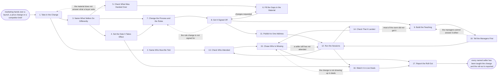

# Reference process: Roll Out a Change

`ref/rev/roll-out-a-change v1`

**value stream:** [Hire-to-Productive](../../streams/revenue-operations/hire-to-productive.md)
Something changed that every seller has to act on at once: a launch, a
new price, a competitor who has started turning up in deals. Marketing's
launch, pricing and battlecard work sits upstream and this run does not
repeat it. What this run does is name who must be told and what they do
differently, check the handover against what a seller actually needs,
fill the gaps, bring the process and the price rules in line, teach it
once to everybody, and then prove it landed. Attendance is checked by
name and understanding is checked separately, because a full room is not
evidence. The run closes when the change has been seen in live deals and
the roll-out has been reported.

## The activities

| # | Activity | What happens | Agents |
|---|---|---|---|
| 1 | Take in the Change | what changed, from when, and who it lands on | [sales-enablement-manager](../../agents/sales-enablement-manager.md) · product marketing lead (person) |
| 2 | Name Who Must Be Told | the roles the change reaches, listed by name | sales-enablement-manager · sales operations (person) |
| 3 | Name What Sellers Do Differently | the behaviour that has to change, in plain words | sales-enablement-manager · sales manager (person) |
| 4 | Set the Date It Takes Effect | the day sellers start acting on the change | sales-enablement-manager · product marketing lead (person) |
| 5 | Check What Was Handed Over | the material set against what a seller needs | sales-enablement-manager · [curriculum-manager](../../agents/curriculum-manager.md) |
| 6 | Fill the Gaps in the Material | what a seller says, sends and answers with | sales-enablement-manager · product marketing lead (person) |
| 7 | Change the Process and the Rules | stages, approvals and price rules brought in line | [standards-keeper](../../agents/standards-keeper.md) · sales operations (person) |
| 8 | Get It Signed Off | a person signs before anything reaches a seller | product marketing lead (person) · legal reviewer (person) |
| 9 | Build the Teaching | the session, the exercise, and the short version | curriculum-manager · sales-enablement-manager |
| 10 | Tell the Managers First | managers hear it before their teams do | sales-enablement-manager · sales manager (person) |
| 11 | Publish to One Address | one place every seller can find it afterwards | sales-enablement-manager · [onboarding-manager](../../agents/onboarding-manager.md) |
| 12 | Run the Sessions | every named seller sits through it once | curriculum-manager · sales manager (person) |
| 13 | Check Who Attended | roll call against the list of who must be told | [certification-check](../../agents/certification-check.md) · sales manager (person) |
| 14 | Check That It Landed | a short check that the change is understood | certification-check · curriculum-manager |
| 15 | Chase Who Is Missing | a person chases whoever did not attend or pass | sales manager (person) · sales-enablement-manager |
| 16 | Watch It in Live Deals | does the new price, pitch or answer show up | [analytics](../../agents/analytics.md) · standards-keeper |
| 17 | Report the Roll-Out | what landed, what did not, and what to change | sales-enablement-manager · analytics |

Activity 11 is where the change reaches the people who have not joined
yet: the same material becomes what a new seller is taught, so the
onboarding curriculum does not quietly go on teaching last quarter's
price.

## The graph



## The document, with the blanks marked

```
PROCESS: roll out a change            id: <team>/roll-out-a-change   v1
from: ref/rev/roll-out-a-change v1
owner: <who>                          effective: <date>
trigger: <your product launch, pricing change or competitive battlecard
         process> hands over a change every seller has to act on, or
         <who> declares one
         watch: record=<the change as handed over> system=<the
                enablement library>
                change=<a launch, a price change or a battlecard is
                handed over at a signed version>
         or watch: record=<a declared change> system=<the notification
                channel>
                change=<a change every seller must act on is declared
                outside the handover>
concurrency: runs may overlap - <how many> changes are taught at once,
             and one change is rolled out by one run at a time
goal: every named seller taught the change once before it takes effect,
      the material at one address, attendance checked by name,
      understanding checked separately, and the change seen in live
      deals within <days>
phases:
  take-in-change   - human: read what changed, from when, who decided
                     it, and which deals it lands on
                     owner: sales-enablement-manager  after: trigger
                     automation: assisted
  name-audience    - human: the roles the change reaches, turned into a
                     list of named people with their managers
                     owner: <your sales operations role>
                     after: take-in-change       by: <days>
                     automation: <level>
  name-behaviour   - convenes decide-and-announce: what a seller says,
                     prices or does differently, in plain words
                     owner: sales-enablement-manager
                     after: take-in-change       by: <days>
                     automation: <level>
  set-live-date    - convenes decide-and-announce: the day sellers act
                     on the change, and what happens to deals in flight
                     owner: <who>                after: name-behaviour
                     automation: never
  check-handover   - runs assessment: the material marketing handed
                     over, set against what a seller is asked in a room
                     owner: curriculum-manager   after: name-behaviour
                     by: <days>                  automation: <level>
  fill-gaps        - runs build-by-talent: what a seller says, sends
                     and answers with, written for the gaps found
                     owner: sales-enablement-manager
                     after: check-handover       by: <days>
                     automation: <level>
  change-rules     - human: the stages, approvals, price rules and
                     fields the change touches, brought in line
                     owner: standards-keeper
                     after: name-behaviour + set-live-date
                     by: <days>                  automation: <level>
  sign-off         - convenes approval: <who> signs the material and
                     <who> signs the rule change, as named signers
                     owner: <your legal role>
                     after: fill-gaps + change-rules
                     by: <days>                  automation: never
  build-teaching   - runs build-by-talent: the session, the exercise
                     the seller does in it, and the one-page version
                     owner: curriculum-manager   after: sign-off
                     by: <days>                  automation: <level>
  tell-managers    - convenes briefing: managers hear it before their
                     teams, and say back what they will be asked
                     owner: sales-enablement-manager
                     after: build-teaching       by: <days>
                     automation: <level>
  publish          - system: one address holds the material at a
                     version, and <your onboarding curriculum> is
                     updated from the same source
                     owner: onboarding-manager   after: sign-off
                     by: <days>                  automation: <level>
  run-sessions     - convenes briefing: every named seller sits through
                     it once, in groups of no more than <n>
                     owner: curriculum-manager
                     after: tell-managers + publish
                     by: <days>                  automation: <level>
  check-attendance - runs roll-call: who attended, set against the list
                     of who must be told
                     owner: certification-check
                     after: run-sessions + name-audience
                     automation: supervised
  check-landed     - runs assessment: a short check that the change is
                     understood, not that the room was full
                     owner: certification-check  after: run-sessions
                     by: <days>                  automation: <level>
  chase-missing    - human: a person chases whoever did not attend or
                     did not pass, until <date>
                     owner: <your sales manager role>
                     after: check-attendance + check-landed
                     by: <days>                  automation: never
  watch-deals      - runs collect-and-report: whether the new price,
                     pitch or answer shows up in deals opened since
                     owner: analytics
                     after: set-live-date + run-sessions
                     every: <cadence>            automation: assisted
  report-rollout   - convenes debrief: what landed, what did not, and
                     what the next roll-out does differently
                     owner: sales-enablement-manager
                     after: chase-missing + watch-deals
                     by: <weeks>                 automation: <level>
run-scoped:
  coverage - runs roll-call                   owner: certification-check
             every: <cadence>
             from: run-sessions   until: run close
  questions - runs collect-and-report         owner: curriculum-manager
              every: <cadence>
              from: tell-managers   until: run close
handoffs:
  take-in-change -> name-audience [change-scope]: what changed, from
    when, and which parts of the business it touches
  take-in-change -> name-behaviour [handed-over-change]: the change as
    marketing handed it over, at the version they signed
  name-audience -> check-attendance [named-list]: the list of who must
    be told, by name, with the manager each one reports to
  name-behaviour -> set-live-date [new-behaviour]: what sellers will be
    asked to do differently, so the date is set against real work
  name-behaviour -> check-handover [behaviour-to-judge-by]: the
    behaviour that has to change, so the handover is judged against it
    rather than against itself
  name-behaviour -> change-rules [rules-the-behaviour-breaks]: the
    stages, fields, approvals and price rules the new behaviour will not
    fit inside
  set-live-date -> change-rules [live-date]: the date, and what happens
    to deals already in flight on that date
  check-handover -> fill-gaps [material-gaps]: what a seller needs and
    does not have, gap by gap, with the question that exposed each one
  fill-gaps -> sign-off [material-for-signing]: the material at a
    version, with every claim traced to something marketing already
    signed
  change-rules -> sign-off [rule-change-for-signing]: the rule change as
    configured, with what it does to deals in flight
  sign-off -> build-teaching [signed-material]: the signed material. A
    later change voids the sign-off and it runs again
  sign-off -> publish [signed-version-to-publish]: the same signed
    version, so the library and the session never differ
  build-teaching -> tell-managers [teaching-materials]: the session, the
    exercise and the one-page version, at a version
  tell-managers -> run-sessions [manager-questions]: the questions the
    managers asked, and the answers the session now has to carry
  publish -> run-sessions [published-address]: the address the session
    points at, live, with the version stamped on it
  run-sessions -> check-attendance [session-attendance]: who sat in
    which session, with the date
  run-sessions -> check-landed [what-was-taught]: what was taught, so
    the check tests the change and not general product knowledge
  run-sessions -> watch-deals [teaching-dates]: the date each group was
    taught, so live behaviour is read against when they heard it
  check-attendance -> chase-missing [missing-by-name]: who is missing,
    by name, with their manager
  check-landed -> chase-missing [who-did-not-pass]: who did not pass,
    and which part of the change they got wrong
  chase-missing -> report-rollout [chase-outcome]: who was caught up, on
    what date, and who never was
  watch-deals -> report-rollout [live-deal-evidence]: the deals opened
    since the date, and whether the new price, pitch or answer is in
    them
deviations:
  check-handover -> take-in-change [handover-does-not-answer]: the
    material does not answer what a buyer asks, so the questions go back
    to whoever handed the change over
  sign-off -> fill-gaps [material-changes-requested]: the signers come
    back with changes to the material
  sign-off -> change-rules [rule-change-refused]: the rule change is not
    signed for, so it is configured again
  tell-managers -> build-teaching [managers-cannot-answer]: the managers
    cannot say the change back, so the teaching is built again before
    any seller sits in a session
  check-landed -> build-teaching [teaching-did-not-land]: most of the
    room did not understand it, so the teaching is built again
  chase-missing -> run-sessions [seller-still-missing]: a seller has
    still not attended, so a session runs for them
  watch-deals -> chase-missing [change-not-in-deals]: the change is not
    showing up in live deals, so the chase reopens by team
bindings:
  roster:  <who holds each role - agents claiming the abstract agents
           above, and named people for the product marketing lead, the
           sales managers, sales operations, the legal signer and the
           person who sets the date>
  systems: the enablement library (write), the learning system (write),
           the CRM (write), the quoting system (write),
           the price rules (write), the notification channel (write),
           the call recording system (read), analytics (read)
  data:    the change as handed over, at a version,
           <your price book> <version>, <your battlecard set>,
           <your onboarding curriculum> <version>, the list of who must
           be told, the material at a version
policy:
  nothing reaches a seller unsigned, and material changed after sign-off
    goes back through sign-off
  the material and the session are published from one version. Two
    versions of the same change is the failure this process exists to
    prevent
  attendance is checked by name against a list, not counted
  understanding is checked separately from attendance
  managers are told before their teams, and a manager who has not been
    told does not run the session
  a price rule takes effect on the date it was signed for, and deals
    already in flight follow <your transition rule>
  the onboarding curriculum is updated in the same run. A change taught
    to today's sellers and not to next month's is not rolled out
  a seller who has not been taught by <date> is escalated to <who>
measures:
  cycle time: <days> from the handover to the last session
  coverage: <target> share of the named list taught before the change
            takes effect
  volume: <changes per period>
  quality gate: no unsigned material published, and understanding
                checked on <sample size> of those taught
```

## The failure edges

- **The handover does not answer what buyers ask.** The check finds
  questions the material has no answer for. The run goes back to the
  change itself with those questions attached, so marketing answers them
  rather than the enablement team inventing answers and calling them
  positioning.
- **Sign-off comes back with changes.** Only the piece the signers named
  reopens, and anything already published at the old version is pulled
  down rather than left beside the new one. Sellers taught from the old
  version are named and taught again.
- **The managers cannot answer it either.** The manager briefing is the
  tripwire. If managers cannot say the change back, the teaching goes
  back to be built again before any seller sits in a session, because a
  manager who cannot answer it will not enforce it.
- **The room was full and nobody got it.** Attendance passes and the
  understanding check fails. The run reopens the teaching rather than
  the roll call. Counting the full room as coverage is what this failure
  edge exists to stop.
- **A seller never attends.** The chase runs until the date, and a
  seller still missing after it is escalated to their manager by name.
  The run does not close by marking them taught, and the report says how
  many were never reached.
- **The date arrives before the teaching does.** The change takes effect
  anyway, because the price rule and the contract do not wait for a
  training schedule. Deals in flight follow the transition rule, the
  sessions run late, and the report records the gap in days.
- **The change does not show up in live deals.** Sellers were taught and
  are still doing the old thing. The analytics agent reports it by team,
  the run goes back to chasing, and if a whole team is missing it the
  behaviour goes back to be named again in words that fit the work.
- **A second change lands on the same sellers.** Runs overlap and the
  concurrency line says how many. Two changes that touch the same price
  rule or the same pitch are merged into one run rather than taught in
  two sessions a week apart.
- **A run is abandoned.** The material is unpublished, the rule change
  is rolled back or held at its old version, and every seller already
  taught is told plainly that the change is not happening. The
  onboarding curriculum is put back to what it said before, and the
  report is still written with the reason the roll-out stopped.
