# Reference process: Set the Quotas

`ref/rev/set-the-quotas v1`

**value stream:** [Number-to-Territory](../../streams/revenue-operations/number-to-territory.md)
The map is fixed, and every patch on it now needs a number. This
process reads what each territory carried before, models the attainment
the plan is built on, and drafts a quota per patch. Each draft is
tested against the seat time behind it, against what actually closed,
and against the ramp cases nobody remembers until payday. The quotas
add up to more than the number on purpose, and the over-assignment is a
decision somebody signs rather than a rounding habit. The run ends when
a named person approves the set and what it rests on is written down.

## The activities

| # | Activity | What happens | Agents |
|---|---|---|---|
| 1 | Take in the Map and the Number | the territories, the target, and when quotas are due | [quota-setter](../../agents/quota-setter.md) · [territory-modeler](../../agents/territory-modeler.md) |
| 2 | Set the Over-Assignment | how much more than the number gets assigned | sales leader (person) · finance partner (person) · quota-setter |
| 3 | Read What Each Patch Carried | what closed in each territory, period by period | [analytics](../../agents/analytics.md) · territory-modeler |
| 4 | Read Who Is In Seat | who holds each patch, from when, and for how long | [capacity-manager](../../agents/capacity-manager.md) · sales operations (person) |
| 5 | Model the Attainment Curve | what share of sellers land at which level | [statistician](../../agents/statistician.md) · analytics |
| 6 | Draft a Quota per Territory | a first number on every patch, from the model | quota-setter |
| 7 | Test Against Seat Time | whether the seat behind the patch can work it | capacity-manager · quota-setter |
| 8 | Test Against History | the draft set beside what that patch actually closed | statistician · analytics |
| 9 | Work the Ramp Cases | new hires, transfers and part periods get their own | quota-setter · compensation partner (person) |
| 10 | Check Every Patch Has One | no patch unquoted, no patch quoted twice | [coverage-check](../../agents/coverage-check.md) |
| 11 | Roll Up and Name the Gap | the sum against the number, and the distance stated | quota-setter · analytics |
| 12 | Adjust and Test Again | the numbers move once, and the tests run again | quota-setter · regional manager (person) |
| 13 | Cost the Plan with Finance | what the plan pays at the modelled attainment | finance partner (person) · quota-setter |
| 14 | Approve the Quotas | a named person signs the set, not the average | sales leader (person) |
| 15 | Record What the Quotas Rest On | the curve, the history and the assumptions used | quota-setter · statistician |

## The graph

```mermaid
flowchart LR
  T([the territory map is fixed for the period]) --> A1[1. Take in the Map and the Number]
  A1 --> A2[2. Set the Over-Assignment]
  A1 --> A3[3. Read What Each Patch Carried]
  A1 --> A4[4. Read Who Is In Seat]
  A3 --> A5[5. Model the Attainment Curve]
  A2 --> A6[6. Draft a Quota per Territory]
  A5 --> A6
  A4 --> A7[7. Test Against Seat Time]
  A6 --> A7
  A6 --> A8[8. Test Against History]
  A7 --> A9[9. Work the Ramp Cases]
  A8 --> A9
  A8 -. the draft is nowhere near what the patch closed .-> A6
  A9 --> A10[10. Check Every Patch Has One]
  A10 -. a patch has no quota, or two .-> A6
  A10 --> A11[11. Roll Up and Name the Gap]
  A11 -. the sum does not clear the number .-> A12[12. Adjust and Test Again]
  A12 -. the draft changed, so the tests run again .-> A7
  A11 --> A13[13. Cost the Plan with Finance]
  A12 --> A13
  A13 -. the plan pays more than the number funds .-> A12
  A13 --> A14[14. Approve the Quotas]
  A14 -. the signer will not sign this set .-> A12
  A14 --> A15[15. Record What the Quotas Rest On]
  A15 --> DONE([every territory carries a signed quota])
```



## The document, with the blanks marked

```
PROCESS: set the quotas               id: <team>/set-the-quotas   v1
from: ref/rev/set-the-quotas v1
owner: <who>                          effective: <date>
trigger: the territory map for <period> is fixed at a version
concurrency: one run per period per segment - quotas for a segment are
             set once, and a change inside the period is a new version
             of the same run
goal: one signed quota on every territory, adding up to <over-assignment
      target> of the number, each one tested against the seat behind it
      and against what the patch has actually closed
phases:
  take-in-map        - human: the territories at their fixed version,
                       the target for the period, and the date the
                       quotas are due to the people they bind
                       owner: quota-setter        after: trigger
                       automation: assisted
  set-over-assignment - convenes decide-and-announce: how much more than
                       the number is assigned, decided by <who> and
                       written down as a figure with a reason
                       owner: <your sales leadership role>
                       after: take-in-map         automation: never
  read-history       - runs collect-and-report: what closed in each
                       territory for the last <periods>, mapped onto the
                       new boundaries rather than the old ones
                       owner: analytics           after: take-in-map
                       by: <days>                 automation: autonomous
  read-seats         - runs collect-and-report: who holds each patch,
                       the date they took it, their notice and leave,
                       and how much of the period they are actually in
                       owner: capacity-manager    after: take-in-map
                       by: <days>                 automation: autonomous
  model-attainment   - runs build-by-talent: what share of sellers land
                       at which level of quota, built from the last
                       <periods> and reported with its range
                       owner: statistician        after: read-history
                       by: <days>                 automation: supervised
  draft-quotas       - runs build-by-talent: a first number on every
                       patch, from the carrying model and the curve
                       owner: quota-setter
                       after: set-over-assignment + model-attainment
                       by: <days>                 automation: supervised
  test-seat-time     - runs assessment: whether the seat behind the
                       patch can work the number in the time it is
                       actually in seat, at <coverage per account>
                       owner: capacity-manager
                       after: read-seats + draft-quotas
                       automation: supervised
  test-history       - runs assessment: each draft set beside what that
                       patch closed, with every number more than
                       <percent> away from history named
                       owner: statistician        after: draft-quotas
                       automation: supervised
  ramp-cases         - human: new hires, transfers, leave and part
                       periods each get their own number under a written
                       rule, not a share of somebody else's
                       owner: <your compensation role>
                       after: test-seat-time + test-history
                       by: <days>                 automation: assisted
  check-coverage     - runs assessment: every territory carries exactly
                       one quota, and every quota names one territory
                       owner: coverage-check      after: ramp-cases
                       automation: autonomous
  roll-up            - human: the quotas added up and set against the
                       number, with the distance stated as an amount
                       owner: quota-setter        after: check-coverage
                       automation: assisted
  adjust-retest      - human: the numbers move once, by <how much> at
                       most per patch, and every test the change touches
                       runs again on the changed set
                       owner: quota-setter        after: roll-up
                       by: <days>                 automation: assisted
  cost-plan          - runs allocate-and-reconcile: what the plan pays
                       at the modelled attainment, at target, and at the
                       high case, priced against <your pay plan>
                       owner: <your finance role>
                       after: roll-up + adjust-retest
                       by: <days>                 automation: supervised
  approve-quotas     - convenes approval: <who> signs the set as one
                       thing, with their name and the hour they signed
                       owner: <your sales leadership role>
                       after: cost-plan
                       by: <days>                 automation: never
  record-basis       - human: the curve, the history and the assumption
                       under every number, written where the next round
                       reads it
                       owner: quota-setter        after: approve-quotas
                       automation: assisted
run-scoped:
  seat-watch - runs roll-call                   owner: capacity-manager
               every: <cadence>
               from: read-seats   until: approve-quotas
handoffs:
  take-in-map -> set-over-assignment: the target, and what the map says
    each patch can carry
  take-in-map -> read-history: the new territory boundaries, so history
    is read on the boundaries the quotas will use
  take-in-map -> read-seats: the same boundaries, and the date the
    quotas take effect
  set-over-assignment -> draft-quotas: the assigned total, as a figure,
    with who decided it and why
  read-history -> model-attainment: what closed per patch per period,
    mapped onto the new boundaries, with every remapping marked
  read-seats -> test-seat-time: who is in each seat, from when, and how
    much of the period they are in it for
  model-attainment -> draft-quotas: the attainment curve with its range,
    and the data it was computed from
  draft-quotas -> test-seat-time: a number on every patch, with the
    carrying figure and the curve behind it
  draft-quotas -> test-history: the same drafts, at one version
  test-seat-time -> ramp-cases: every patch whose seat cannot work its
    number, with the hours the finding rests on
  test-history -> ramp-cases: every number more than <percent> away from
    what the patch closed, with the history beside it
  ramp-cases -> check-coverage: the ramped numbers, each naming the rule
    that produced it and the dates it covers
  check-coverage -> roll-up: every territory with its one quota, and any
    patch that has none named
  roll-up -> adjust-retest: the sum, the number, and the distance
    between them
  roll-up -> cost-plan: the same sum, at the version it was rolled up at
  adjust-retest -> cost-plan: what moved, on which patch, and by how
    much, with the tests rerun on the changed set
  cost-plan -> approve-quotas: what the plan pays at each attainment
    case, and what it costs if everybody hits
  approve-quotas -> record-basis: the signed set, who signed it, and
    when
bindings:
  roster:  <who holds each role - agents claiming the abstract agents
           above, and named people for the leader who signs, the finance
           partner, the compensation partner and the regional managers>
  systems: the territory map (read), the CRM (read),
           the quota record (write), the pay plan record (read),
           the reporting warehouse (read), the model store (write)
  data:    the target for the period, the map at its fixed version, the
           last <periods> of closed revenue, <your pay plan> at a
           version, <your ramp rules>
policy:
  the quotas add up to more than the number by a figure a named person
    decided. An over-assignment nobody signed is not one
  no quota is set on a patch whose seat time was never checked
  a number more than <percent> away from what the patch closed carries
    the reason for the difference beside it
  a seller in seat for part of the period gets a number built from the
    written ramp rule, never a pro-rated share applied afterwards
  the quota set is approved as one thing by one person. Approving patch
    by patch lets the total drift and is not allowed
  a quota changed after approval is a new version saying what moved and
    who decided it, and the version it replaces stays where it was
measures:
  cycle time: <days> from the fixed map to the signed quota set
  spread: share of sellers modelled to land between <low> and <high>
  accuracy: the attainment curve against what sellers actually attained
  quality gate: no quota published without its seat-time test and its
                history test attached
```

## The failure edges

- **History does not map onto the new boundaries.** The patches were
  cut differently last year, so what closed cannot be read per
  territory. The analytics agent remaps what it can and marks every
  remapped figure as remapped. Patches with no readable history are
  quoted from the carrying model alone, and the quota says so.
- **The seat behind a patch cannot work the number.** The
  capacity-manager agent reports the hours the patch needs against the
  hours the seat has. The number comes down, the patch is split, or a
  seat is added. Signing the number anyway is a decision a person makes
  in writing, and it is recorded against that patch.
- **The drafts do not add up to the number.** The gap is named as an
  amount and the numbers move once, inside the cap on how far any one
  patch can move. Spreading the whole gap across every patch by a flat
  percentage is not one of the choices, because it moves the numbers
  that were already right.
- **The plan costs more than the number funds.** Finance reports what
  the plan pays at the modelled attainment. The run returns to the
  adjustment with the cost attached, and either the curve, the
  over-assignment or the pay plan changes. All three are decisions with
  names on them.
- **A seller starts, leaves or transfers after the quotas are signed.**
  The ramp rule already written covers it, the patch's number is
  reissued as a new version from the effective date, and the total is
  restated. What the departing seller carried does not silently
  disappear from the roll-up.
- **The signer will not sign the set.** The run returns to the
  adjustment with what they objected to. The set is signed as one
  thing, so signing most of it and leaving three patches open is
  refused.
- **The attainment curve is built on too little data.** The
  statistician agent says how much data the curve needs before it is
  built, and reports the range around it. A curve the data cannot carry
  is published with its range showing, and the quotas built on it are
  marked as resting on a wide curve.
- **A run is abandoned.** The previous period's quotas stay in force
  and the drafts stay where they are, unsigned, with the reason the run
  stopped. Nobody is paid against a draft. The map, the history and the
  curve are kept at their versions so the next run starts from them
  rather than from the beginning.
