# Reference process: Settle a Commission Dispute

`ref/rev/settle-a-commission-dispute v1`

**value stream:** [Result-to-Payout](../../streams/revenue-operations/result-to-payout.md)
Somebody reads their statement and says the number is wrong. The run
answers them with evidence inside a time the organization promised
before the claim arrived. The claim is classified, the statement
version is frozen, the line is recomputed independently from the same
records, and the plan sentence that governs it is read out loud.
Contested credit is heard from both seats. The answer is upheld, partly
upheld or refused, it is approved by a person when money moves, and the
cause goes back to the plan or the calculator so the same claim does
not arrive again next period.

## The activities

| # | Activity | What happens | Agents |
|---|---|---|---|
| 1 | Take in the Claim | which number is disputed, and what it should be | [dispute-coordinator](../../agents/dispute-coordinator.md) |
| 2 | Acknowledge and Promise a Date | the claimant is told when they get an answer | dispute-coordinator |
| 3 | Classify the Claim | arithmetic, credit, plan wording or bad data | dispute-coordinator |
| 4 | Freeze the Statement Version | the statement version under dispute is frozen | dispute-coordinator · [commission-calculator](../../agents/commission-calculator.md) |
| 5 | Pull the Evidence Behind the Line | the records the disputed number was computed from | commission-calculator · dispute-coordinator |
| 6 | Recompute the Line Independently | the line recomputed from the record, on its own | commission-calculator |
| 7 | Read the Plan Sentence That Governs It | the plan sentence that governs the disputed line | dispute-coordinator · [plan-designer](../../agents/plan-designer.md) |
| 8 | Hear the Claimant | the claimant says what they believe happened | dispute-coordinator · claimant (person) |
| 9 | Hear the Other Seat | the other seat answers when credit is contested | dispute-coordinator · sales manager (person) |
| 10 | Decide the Answer | upheld, partly upheld or refused, with the reason | dispute-coordinator · sales leader (person) |
| 11 | Approve a Decision That Moves Money | a person signs any decision that changes a payment | finance partner (person) · sales leader (person) |
| 12 | Tell the Claimant | the answer sent with the evidence attached | dispute-coordinator · [reporting-manager](../../agents/reporting-manager.md) |
| 13 | Correct the Statement and the Next Run | the statement and the next run are corrected | commission-calculator · payroll operations (person) |
| 14 | Escalate What Is Not Accepted | a claim the claimant will not accept goes up | dispute-coordinator · people partner (person) |
| 15 | Feed the Cause Back | the cause goes back to the plan and the calculator | plan-designer · commission-calculator |
| 16 | Report the Period's Disputes | the period's disputes counted and reported | reporting-manager · [analytics](../../agents/analytics.md) · [statistician](../../agents/statistician.md) |

Activity 2 is what the process actually promises. A claimant who hears
a date on the day they claim will wait for it; a claimant who hears
nothing escalates, and the escalation costs more than the answer. The
promise is made before anybody knows whether the claim is right.

## The graph

```mermaid
flowchart LR
  T([somebody says their statement is wrong]) --> A1[1. Take in the Claim]
  A1 --> A2[2. Acknowledge and Promise a Date]
  A2 --> A3[3. Classify the Claim]
  A3 -. the claim names no line and no amount .-> A1
  A3 --> A4[4. Freeze the Statement Version]
  A4 --> A5[5. Pull the Evidence Behind the Line]
  A5 --> A6[6. Recompute the Line Independently]
  A5 --> A7[7. Read the Plan Sentence That Governs It]
  A6 -. the record cannot support any number .-> A5
  A6 --> A8[8. Hear the Claimant]
  A7 --> A8
  A8 --> A9[9. Hear the Other Seat]
  A8 -. the claim changes to a different line .-> A3
  A9 --> A10[10. Decide the Answer]
  A10 -. the answer needs evidence nobody pulled .-> A5
  A10 --> A11[11. Approve a Decision That Moves Money]
  A10 --> A12[12. Tell the Claimant]
  A11 --> A12
  A11 -. the approver refuses the decision .-> A10
  A12 --> A13[13. Correct the Statement and the Next Run]
  A12 --> A14[14. Escalate What Is Not Accepted]
  A14 -. the escalation sends it back with new facts .-> A5
  A13 --> A15[15. Feed the Cause Back]
  A14 --> A15
  A15 --> A16[16. Report the Period's Disputes]
  A16 --> DONE([the claimant has an answer with its evidence, inside the promised time])
```



## The document, with the blanks marked

```
PROCESS: commission dispute            id: <team>/settle-a-commission-dispute  v1
from: ref/rev/settle-a-commission-dispute v1
owner: <who>                           effective: <date>
trigger: a person disputes a line on a published statement, in writing,
         within <days> of the statement being published
concurrency: runs may overlap freely - one claim is one run, and two
             claims on the same booking are worked together rather than
             answered twice
goal: every claim answered inside <days> with the evidence attached,
      the plan sentence it rests on named, and the cause recorded
      whether or not the claim was upheld
phases:
  take-in-claim       - human: what number is disputed, on which
                        statement, what the claimant says it should be,
                        and what they are relying on
                        owner: dispute-coordinator  after: trigger
                        automation: assisted
  promise-a-date      - system: the claimant is told the claim is open,
                        who holds it, and the date they will have an
                        answer, before anybody knows if it is right
                        owner: dispute-coordinator
                        after: take-in-claim
                        by: <hours>               automation: autonomous
  classify-claim      - system: arithmetic, credit, plan wording or bad
                        data. The class decides who is heard and what
                        evidence is pulled
                        owner: dispute-coordinator
                        after: promise-a-date     automation: supervised
  freeze-statement    - system: the statement version under dispute is
                        frozen with its run version, so the argument is
                        about one document
                        owner: commission-calculator
                        after: classify-claim     automation: autonomous
  pull-evidence       - runs collect-and-report: the booking, the
                        credit rule, the rate, the quota and the dates
                        the disputed number was computed from
                        owner: commission-calculator
                        after: freeze-statement
                        by: <days>                automation: supervised
  recompute-line      - system: the line computed again from the same
                        records, independently of the run that produced
                        it, and the two answers set side by side
                        owner: commission-calculator
                        after: pull-evidence      automation: supervised
  read-the-plan       - human: the plan sentence that governs the line,
                        read at the version the claimant signed, not at
                        the current version
                        owner: plan-designer      after: pull-evidence
                        by: <days>                automation: assisted
  hear-claimant       - convenes briefing: the claimant says what they
                        believe happened, and what they hold that the
                        record does not
                        owner: dispute-coordinator
                        after: recompute-line + read-the-plan
                        by: <days>                automation: never
  hear-other-seat     - convenes briefing: the other seat and its
                        manager answer, whenever the claim would move
                        credit away from somebody
                        owner: dispute-coordinator
                        after: hear-claimant
                        by: <days>                automation: never
  decide-answer       - convenes decide-and-announce: upheld, partly
                        upheld or refused, with the plan sentence and
                        the record behind the decision
                        owner: <your sales leadership role>
                        after: hear-other-seat
                        by: <days>                automation: never
  approve-money       - convenes approval: <who> signs any decision
                        that changes a payment by more than <amount>,
                        as a named signer
                        owner: <your finance role>
                        after: decide-answer
                        by: <days>                automation: never
  tell-claimant       - human: the answer goes to the claimant with the
                        evidence attached and the route to escalate
                        named
                        owner: dispute-coordinator
                        after: decide-answer + approve-money
                        by: <days>                automation: <level>
  correct-the-record  - system: the frozen statement is annotated and
                        the correction is carried into the next run,
                        naming the period it belongs to
                        owner: commission-calculator
                        after: tell-claimant      automation: supervised
  escalate-unaccepted - human: a claimant who does not accept the
                        answer goes to <who>, on the route the answer
                        named, within <days>
                        owner: <your people role>
                        after: tell-claimant
                        by: <days>                automation: never
  feed-cause-back     - convenes debrief: the cause written into the
                        plan wording, the credit rules or the
                        calculator, so the claim does not recur
                        owner: plan-designer
                        after: correct-the-record + escalate-unaccepted
                        automation: <level>
  report-disputes     - runs collect-and-report: how many claims, of
                        what class, how many upheld, and how long they
                        took against the promise
                        owner: reporting-manager
                        after: feed-cause-back
                        by: <days>                automation: <level>
run-scoped:
  clock    - runs roll-call                  owner: dispute-coordinator
             every: <cadence>
             from: promise-a-date   until: tell-claimant
  register - runs collect-and-report         owner: reporting-manager
             every: <cadence>
             from: take-in-claim   until: run close
handoffs:
  take-in-claim -> promise-a-date: the statement, the line, the amount
    claimed, and what the claimant relies on, in their own words
  promise-a-date -> classify-claim: the promised answer date, and who
    holds the claim
  classify-claim -> freeze-statement: the class of the claim, and the
    evidence that class requires
  freeze-statement -> pull-evidence: the statement at its version, the
    run version behind it, and the line under dispute
  pull-evidence -> recompute-line: the booking, the credit rule, the
    rate, the quota and the dates, each naming the system it came from
  pull-evidence -> read-the-plan: the same records, and the plan
    version the claimant signed
  recompute-line -> hear-claimant: both answers side by side, and every
    input where they differ
  read-the-plan -> hear-claimant: the sentence that governs the line,
    quoted, at the version that applies
  hear-claimant -> hear-other-seat: what the claimant holds that the
    record does not, and the seat the claim would take credit from
  hear-other-seat -> decide-answer: both accounts, and what each seat
    can show for its account
  decide-answer -> approve-money: the decision, the amount it moves,
    and the sentence it rests on
  decide-answer -> tell-claimant: the same decision, so the claimant
    and the approver read one text
  approve-money -> tell-claimant: the signature, and the date the money
    moves
  tell-claimant -> correct-the-record: the answer as sent, and the
    correction it commits the next run to
  tell-claimant -> escalate-unaccepted: the answer, the evidence, and
    the date the escalation window closes
  correct-the-record -> feed-cause-back: what was corrected, and
    whether the plan, the data or the calculator produced the error
  escalate-unaccepted -> feed-cause-back: what the escalation decided,
    and what it said about the wording
  feed-cause-back -> report-disputes: the causes, and what changed
    because of them
bindings:
  roster:  <who holds each role - agents claiming the abstract agents
           above, and named people for the sales leader, the finance
           partner, the people partner and payroll operations>
  systems: the commission ledger (read), the statement store (write),
           the plan record (read), <your system of record> (read),
           the dispute register (write), the notification channel
           (write)
  data:    the statement at a version, the run version behind it, the
           plan at the version the claimant signed, the credit rules,
           the booking record
policy:
  every claim is acknowledged within <hours> with a promised answer
    date, and the date is met or moved in writing before it passes
  the line is recomputed by somebody other than the run that produced
    it, and both answers are shown to the claimant
  the plan is read at the version the claimant signed, never at the
    current version
  a claim that would move credit away from another seat is not decided
    until that seat has been heard
  a decision that changes a payment by more than <amount> is signed by
    a person, and the signature is never delegated to an agent
  the claimant is told the route to escalate in the same message as the
    answer
  a claim that is refused is recorded with its evidence, because the
    next claim on the same sentence is the one that changes the plan
  nobody's statement is shown to anybody else, including inside a
    contested credit claim
measures:
  cycle time: <days> from claim to answer, and <hours> to acknowledge
  volume: <claims per period>, and claims as a share of statements
  upheld rate: <target>, read as a signal about the plan rather than
               about the claimants
  quality gate: no answer goes out without its evidence, the plan
                sentence it rests on, and the route to escalate
```

## The failure edges

- **The claim names no line and no amount.** The dispute-coordinator
  agent goes back to the claimant for the statement, the line and what
  they say it should be. The promised date is set from when the claim
  is complete, and the claimant is told that in the same message.
- **The record cannot support any number.** The recompute produces
  nothing the booking record justifies, in which case the run does not
  pick the smaller of two answers. The line goes back to evidence, the
  gap is named, and if the record stays incomplete the claim is upheld
  on the evidence that does exist.
- **The two computations disagree.** The claimant sees both, and the
  inputs where they differ. Whichever answer wins, the disagreement
  goes to activity 15, because a calculator that can produce two
  answers from one record is the real finding.
- **The claim would move credit off another seat.** That seat is heard
  before anything is decided, and it is told the outcome whether or not
  the credit moved. Deciding it quietly and letting the other seat find
  out from their next statement turns one claim into two.
- **The claimant will not accept the answer.** The escalation route is
  in the answer itself, with a window. The escalation may send the run
  back to evidence with new facts, and it may not; either way the
  claimant hears what the escalation decided.
- **The plan sentence turns out to be ambiguous.** The claim is settled
  on the reading that applies to the version the claimant signed, and
  the ambiguity goes to the plan for the next period. The sentence is
  not reinterpreted mid-period against people already working under it.
- **The promised date is going to be missed.** The claimant is told
  before the date passes, with a new date and the reason. A missed date
  nobody mentioned is what turns a commission claim into a grievance.
- **The same claim arrives from several people.** The claims are worked
  as one run against one line of reasoning, and each claimant gets
  their own answer with their own numbers. Answering them separately
  produces answers that do not agree.
- **The trigger fires against a period already corrected.** The claim
  is worked against the statement version the claimant holds, not
  against the corrected one, and the answer explains what changed
  between the two.
- **A run is abandoned.** The claimant is told in writing that their
  claim was not answered, by whom it is now held, and the new date. The
  frozen statement, the evidence pulled and the recompute stay in the
  register, because a claim that goes quiet is the one that comes back
  as a formal complaint.
