# Reference process: Watch the Response Clock

`ref/rev/watch-the-response-clock v1`

**value stream:** [Rule-to-Route](../../streams/revenue-operations/rule-to-route.md)
The organization promised to answer certain work within a certain time.
This process reads what actually happened against that promise and
publishes both numbers side by side. It says what each clock covers,
checks that the timestamps behind it can be trusted, measures every run
in the period, and breaks the misses down until they say something more
useful than a percentage. The report goes out where the people it names
can read it, each queue hears its own number rather than the average,
and the work the report calls for gets an owner before the run closes.

## The activities

| # | Activity | What happens | Agents |
|---|---|---|---|
| 1 | Take in the Promise and the Window | the clocks in force, and the period being reported | [response-clock-monitor](../../agents/response-clock-monitor.md) · revenue operations lead (person) |
| 2 | Name What Each Clock Covers | what starts a clock, what stops it, what pauses it | response-clock-monitor · [routing-keeper](../../agents/routing-keeper.md) |
| 3 | Read Where the Times Come From | the systems that stamp the start and the stop | [data-steward](../../agents/data-steward.md) |
| 4 | Check the Timestamps Hold Up | missing stops, back-dated stamps and clock gaps | data-steward · [analytics](../../agents/analytics.md) |
| 5 | Pull the Runs in the Window | every piece of work that sat under a clock | analytics |
| 6 | Measure Each Run Against Its Clock | met, missed, or still open past its due time | response-clock-monitor |
| 7 | Set Aside What the Clock Does Not Cover | the runs a person agrees the clock never fit | response-clock-monitor · sales manager (person) |
| 8 | Break the Misses Down | by queue, owner, source, and hour of arrival | analytics · response-clock-monitor |
| 9 | Find What the Misses Have in Common | the pattern behind the number, not just the number | analytics · response-clock-monitor |
| 10 | Compare With the Period Before | which way the number moved, and by how much | analytics |
| 11 | Write the Report | what was promised, what happened, and what moved | [reporting-manager](../../agents/reporting-manager.md) · response-clock-monitor |
| 12 | Have the Numbers Checked | a person reviews the figures before they go out | reporting-manager · revenue operations lead (person) |
| 13 | Publish the Report | posted where everyone it names can read it | reporting-manager |
| 14 | Take Each Queue Its Own Number | a manager hears their own misses, not the average | response-clock-monitor · sales manager (person) |
| 15 | Open the Work the Report Calls For | rule changes and staffing, each with a named owner | routing-keeper · revenue operations lead (person) |
| 16 | Keep the Period | the numbers as published, kept so they replay | data-steward · reporting-manager |

Activity 7 is where this process is most often bent. A run set aside is
a run that does not count, so the reason is written down, a person
agrees to it by name, and the count of set-aside runs is published next
to the result. A period where the set-aside count moves more than the
miss count is a period the report says so.

## The graph

```mermaid
flowchart LR
  T([the reporting period closes]) --> A1[1. Take in the Promise and the Window]
  A1 --> A2[2. Name What Each Clock Covers]
  A2 --> A3[3. Read Where the Times Come From]
  A3 --> A4[4. Check the Timestamps Hold Up]
  A4 -. a clock has no reliable stamp .-> A2
  A4 --> A5[5. Pull the Runs in the Window]
  A5 --> A6[6. Measure Each Run Against Its Clock]
  A6 -. runs arrive with no stop stamp .-> A4
  A6 --> A7[7. Set Aside What the Clock Does Not Cover]
  A7 --> A8[8. Break the Misses Down]
  A7 --> A10[10. Compare With the Period Before]
  A8 --> A9[9. Find What the Misses Have in Common]
  A9 -. the pattern is a measurement problem .-> A4
  A9 --> A11[11. Write the Report]
  A10 --> A11
  A11 --> A12[12. Have the Numbers Checked]
  A12 -. the figures do not hold .-> A11
  A12 --> A13[13. Publish the Report]
  A13 --> A14[14. Take Each Queue Its Own Number]
  A14 -. a queue shows the clock never fit .-> A7
  A14 --> A15[15. Open the Work the Report Calls For]
  A15 --> A16[16. Keep the Period]
  A16 --> DONE([the promise and the result are published side by side])
```



## The document, with the blanks marked

```
PROCESS: watch the response clock      id: <team>/watch-the-response-clock   v1
from: ref/rev/watch-the-response-clock v1
owner: <who>                           effective: <date>
trigger: the <period> reporting window closes, or <who> asks for the
         clock outside the cadence
concurrency: one run per window per clock set - a window is reported
             once, and a correction is a new run against the same window
goal: every clock in force reported against what actually happened,
      published where the people it names can read it, with the work it
      calls for owned by <when>
phases:
  take-in-promise - human: the clocks in force, the period being
                    reported, and who the promise was made to
                    owner: response-clock-monitor   after: trigger
                    automation: <level>
  name-coverage   - convenes decide-and-announce: for each clock, the
                    event that starts it, the event that stops it, and
                    the states that pause it
                    owner: response-clock-monitor   after: take-in-promise
                    automation: <level>
  read-sources    - runs collect-and-report: the system each stamp is
                    read from, and how current that reading is
                    owner: data-steward             after: name-coverage
                    automation: autonomous
  check-stamps    - runs assessment: missing stops, stamps written after
                    the fact, and gaps where no system was recording
                    owner: data-steward             after: read-sources
                    by: <days>                      automation: <level>
  pull-runs       - system: every run that sat under a clock in the
                    window, with its start, its stop and its queue
                    owner: analytics                after: check-stamps
                    automation: autonomous
  measure-runs    - system: each run marked met, missed, or still open
                    past its due time, with the elapsed time recorded
                    owner: response-clock-monitor   after: pull-runs
                    automation: autonomous
  set-aside       - human: the runs the clock never fit, each with a
                    reason and the name of the person who agreed
                    owner: <your sales manager role>
                    after: measure-runs
                    by: <days>                      automation: never
  break-down      - runs collect-and-report: the misses by queue, by
                    owner, by source and by hour of arrival
                    owner: analytics                after: set-aside
                    automation: <level>
  find-pattern    - runs assessment: what the misses share, tested
                    against <how many> of them rather than asserted
                    owner: analytics                after: break-down
                    by: <days>                      automation: <level>
  compare-period  - system: this window set against the <how many>
                    windows before it, level and direction
                    owner: analytics                after: set-aside
                    automation: autonomous
  write-report    - runs collect-and-report: the promise, the result,
                    the set-aside count, the movement and the pattern
                    owner: reporting-manager
                    after: find-pattern + compare-period
                    by: <days>                      automation: <level>
  check-numbers   - convenes approval: <who> reads the figures against
                    their sources before the report leaves
                    owner: <your revenue operations role>
                    after: write-report
                    by: <days>                      automation: never
  publish-report  - system: the report posted where every person and
                    queue it names can read it
                    owner: reporting-manager        after: check-numbers
                    automation: supervised
  queue-by-queue  - convenes debrief: each manager reads their own
                    misses, and says what they will change
                    owner: response-clock-monitor   after: publish-report
                    by: <days>                      automation: <level>
  open-the-work   - convenes decide-and-announce: the rule changes, the
                    staffing and the escalations the report calls for,
                    each with a named owner and a date
                    owner: routing-keeper           after: queue-by-queue
                    by: <days>                      automation: <level>
  keep-period     - system: the numbers as published, with the queries
                    behind them, kept for <how long>
                    owner: data-steward             after: open-the-work
                    automation: autonomous
run-scoped:
  breaches - runs roll-call                     owner: response-clock-monitor
             every: <cadence>
             from: measure-runs   until: publish-report
handoffs:
  take-in-promise -> name-coverage: the clocks in force at their
    published versions, the window, and who each promise was made to
  name-coverage -> read-sources: per clock, the start event, the stop
    event and the pause states, written so two people read them the same
  read-sources -> check-stamps: the system behind every stamp, and
    the last time that system was known to be recording
  check-stamps -> pull-runs: which stamps may be counted, and every
    clock that cannot be measured this window with the reason
  pull-runs -> measure-runs: one row per run, with its start, its stop,
    its queue and its owner
  measure-runs -> set-aside: every run marked met, missed or open, with
    the elapsed time and the clock it was measured against
  set-aside -> break-down: the runs that count, and the set-aside list
    with a reason and an agreeing person against each one
  set-aside -> compare-period: the same counting rule, so this window
    and the ones before it are compared on the same basis
  break-down -> find-pattern: the misses cut by queue, owner, source and
    arrival hour, with the count in every cut
  find-pattern -> write-report: what the misses share, and what the
    evidence does not support saying
  compare-period -> write-report: the movement against <how many> prior
    windows, and whether it is inside normal variation
  write-report -> check-numbers: the report at a version, every figure
    naming the query it came from
  check-numbers -> publish-report: the reviewed report, with the name of
    the person who checked it
  publish-report -> queue-by-queue: the address the report is readable
    at, and the slice belonging to each queue
  queue-by-queue -> open-the-work: what each manager said they would
    change, and what they said they could not
  open-the-work -> keep-period: the work that was opened, its owner and
    its date
bindings:
  roster:  <the agent claiming response-clock-monitor> ·
           <the agent claiming analytics> ·
           <who agrees a run is set aside> ·
           <who checks the numbers> ·
           <the managers who hear their own queue>
  systems: <the system that delivers the work> (read), the CRM (read),
           the inbox and the form store (read),
           the reporting store (write), the published report page
           (write)
  data:    <your response time promise> <version>, the routing rules at
           their versions, <your working calendar>, <your pause states>
policy:
  a run is never closed and reopened to produce a shorter elapsed time
  the clock starts when the work arrives, not when somebody opens it
  a run is set aside only with a written reason and a named person who
    agreed, and the set-aside count is published next to the result
  a figure that cannot name the query behind it does not go in the
    report
  the report is published whether the number is good or bad, and the
    same report goes to <who> and to the queues it names
  a clock whose stamps could not be trusted this window is reported as
    unmeasured, never as met
measures:
  cycle time: <target> from the window closing to the report published
  coverage: <target> share of runs in the window that carried a
            measurable clock
  volume: <clocks reported per period>, <runs measured per period>
  quality gate: set-aside runs stay under <target> of the window, and
                every one of them names its agreeing person
```

## The failure edges

- **A clock has no reliable stamp.** The timestamp check finds that
  nothing records the stop event, and the run goes back to what the
  clock covers. The clock is reported as unmeasured for the window with
  the reason, and fixing the stamp becomes work the report opens. It is
  never reported as met because no miss was visible.
- **Runs arrive with no stop.** Work still open past its due time is
  counted as open, not dropped and not counted as met. A run open long
  enough to be abandoned is counted as a miss, and the report says how
  many misses were of that kind.
- **The set-aside list grows.** When more runs are set aside than are
  missed, the report leads with the set-aside count. The
  response-clock-monitor agent does not quietly publish a clean number
  built on exclusions nobody looked at.
- **A manager disputes their number.** The dispute goes back to the
  set-aside step with the runs named. Either those runs are set aside
  with a reason and an agreeing person, or the number stands. The
  published report is corrected by a new run against the same window,
  never edited in place.
- **The pattern turns out to be a measurement problem.** The run goes
  back to the timestamp check rather than opening staffing work against
  a queue that was never actually slow.
- **The check on the numbers fails.** Only the report reopens. A figure
  whose query does not reproduce it is pulled from the report rather
  than footnoted, and the report says the figure was withdrawn.
- **The report is published and nothing is opened.** Activity 15 has an
  owner and a date, and a period that opens no work when the number
  missed is recorded as such. A report nobody acts on is a report that
  stops being read.
- **The window closes while the prior run is open.** The new window
  waits for the prior report to publish, because two open windows
  against the same clock produce two numbers nobody can reconcile.
- **A run is abandoned.** The window goes unreported and is recorded as
  unreported rather than being quietly rolled into the next one. The
  timestamps stay where they are, the runs already measured keep their
  measurements, and the queues are told no report is coming for that
  period.
