# Reference process: Write a Routing Rule

`ref/rev/write-a-routing-rule v1`

**value stream:** [Rule-to-Route](../../streams/revenue-operations/rule-to-route.md)
Somebody has to decide who gets what. This process turns that decision
into a rule that is written in plain words, argued with by the people it
routes to, tested against work that already happened, and then built
into the system that actually delivers the work. The rule carries the
clock it promises and the fallback for anything it does not match. It is
published at a version where every seller and manager can read it,
because a routing rule nobody can see is indistinguishable from an
accident. The run closes when the rule is live and its first week has
been watched.

## The activities

| # | Activity | What happens | Agents |
|---|---|---|---|
| 1 | Take in the Routing Question | what work needs a rule, and why it needs one now | [routing-keeper](../../agents/routing-keeper.md) · revenue operations lead (person) |
| 2 | Read How Work Is Routed Now | the rule in force today, and where it sends work | routing-keeper · [analytics](../../agents/analytics.md) |
| 3 | Name Who Should Get What | the answer said out loud, before any syntax | routing-keeper · sales manager (person) |
| 4 | Read the Fields the Rule Will Use | which fields the rule reads, and who writes them | [data-steward](../../agents/data-steward.md) |
| 5 | Check the Data Holds Up | coverage and accuracy of every field the rule uses | data-steward · analytics |
| 6 | Write the Rule in Plain Words | the rule a seller can read without being trained | routing-keeper |
| 7 | Set the Order and the Fallback | which clause wins, and where an unmatched item goes | routing-keeper |
| 8 | Set the Clock the Rule Promises | how fast the receiver must act on what it gets | [response-clock-monitor](../../agents/response-clock-monitor.md) · sales manager (person) |
| 9 | Check It Against Capacity | whether the receiving queues can hold the volume | routing-keeper · analytics |
| 10 | Show It to the People It Routes To | sellers and managers read the rule and argue with it | routing-keeper · seller (person) · sales manager (person) |
| 11 | Replay It Against Past Work | recent records run through the rule, and where they land | [lead-scorer](../../agents/lead-scorer.md) · analytics |
| 12 | Get the Rule Approved | a named person signs the rule at a version | sales leadership (person) · routing-keeper |
| 13 | Implement the Rule | the rule configured where the work is delivered | routing-keeper · data-steward |
| 14 | Verify It in the Live System | a small live batch lands where the rule says | routing-keeper · lead-scorer |
| 15 | Publish the Rule Where People Read It | the rule posted at its version, open to everyone | routing-keeper · [reporting-manager](../../agents/reporting-manager.md) |
| 16 | Announce What Changes | who is told, and what is different for them | routing-keeper · sales manager (person) |
| 17 | Watch the First Week | early misroutes and clock misses under the new rule | response-clock-monitor · analytics |

Activity 10 is the one that is easiest to skip and most expensive to
skip. A rule the receivers have not read is a rule they work around, and
the working around shows up later as a misroute nobody reported.
Activity 11 is the other one: the rule is replayed against records that
already have a known owner, so the difference between where the rule
sends them and where they went is visible before anybody lives with it.

## The graph

```mermaid
flowchart LR
  T([somebody asks who should get this work]) --> A1[1. Take in the Routing Question]
  A1 --> A2[2. Read How Work Is Routed Now]
  A2 --> A3[3. Name Who Should Get What]
  A3 --> A4[4. Read the Fields the Rule Will Use]
  A4 --> A5[5. Check the Data Holds Up]
  A5 -. the fields cannot carry the rule .-> A3
  A5 --> A6[6. Write the Rule in Plain Words]
  A6 --> A7[7. Set the Order and the Fallback]
  A7 --> A8[8. Set the Clock the Rule Promises]
  A7 --> A9[9. Check It Against Capacity]
  A8 --> A10[10. Show It to the People It Routes To]
  A9 -. a queue cannot hold the volume .-> A7
  A9 --> A10
  A10 -. the receivers do not accept it .-> A6
  A10 --> A11[11. Replay It Against Past Work]
  A11 -. the replay sends work to the wrong owner .-> A6
  A11 --> A12[12. Get the Rule Approved]
  A12 -. changes requested .-> A6
  A12 --> A13[13. Implement the Rule]
  A13 --> A14[14. Verify It in the Live System]
  A14 -. the live batch lands elsewhere .-> A13
  A14 --> A15[15. Publish the Rule Where People Read It]
  A15 --> A16[16. Announce What Changes]
  A16 --> A17[17. Watch the First Week]
  A17 -. the rule is wrong in the same way twice .-> A6
  A17 --> DONE([the rule is live, published and holding])
```



## The document, with the blanks marked

```
PROCESS: write a routing rule          id: <team>/write-a-routing-rule   v1
from: ref/rev/write-a-routing-rule v1
owner: <who>                           effective: <date>
trigger: somebody asks who should get a kind of work, or <your review
         cadence> reopens a rule already in force
         watch: record=<a routing question> system=<the rule register>
                change=<somebody asks who should get a kind of work>
         or watch: every=<your review cadence>
concurrency: runs may overlap - one rule is one run, and <how many>
             rules over the same queue are never changed at once
goal: a rule the people it routes to have read, tested against past
      work, live in <the system that delivers the work>, and published
      at a version
phases:
  take-in-question   - human: write down what work needs a rule, who is
                       asking, and what goes wrong today without one
                       owner: routing-keeper      after: trigger
                       automation: <level>
  read-current       - runs collect-and-report: the rule in force, where
                       it sends work, and the volume it moves per
                       <period>
                       owner: routing-keeper      after: take-in-question
                       by: <days>                 automation: <level>
  name-who-gets-what - convenes decide-and-announce: <who> says who
                       should get what, in sentences, before anybody
                       writes a condition
                       owner: <your sales manager role>
                       after: read-current
                       by: <days>                 automation: <level>
  read-fields        - runs collect-and-report: every field the rule
                       would read, the system it lives in, and who
                       writes it
                       owner: data-steward
                       after: name-who-gets-what
                       automation: autonomous
  check-data         - runs assessment: how often each field is filled,
                       how often it is right, and how fast it goes stale
                       owner: data-steward        after: read-fields
                       by: <days>                 automation: <level>
  write-rule         - human: the rule written as <how many> plain
                       sentences a seller can read without training
                       owner: routing-keeper      after: check-data
                       by: <days>                 automation: <level>
  set-order          - human: which clause wins when two match, and the
                       named owner every unmatched item goes to
                       owner: routing-keeper      after: write-rule
                       automation: <level>
  set-clock          - convenes decide-and-announce: how long the
                       receiver has to act, promised to <whom>
                       owner: response-clock-monitor
                       after: set-order
                       automation: <level>
  check-capacity     - runs assessment: the volume each clause sends,
                       set against what each receiving queue holds today
                       owner: routing-keeper      after: set-order
                       automation: <level>
  show-to-receivers  - convenes briefing: the sellers and managers the
                       rule routes to read it and say where it is wrong
                       owner: routing-keeper
                       after: set-clock + check-capacity
                       by: <days>                 automation: <level>
  replay-past-work   - runs assessment: <how many> records from the last
                       <period> run through the rule, and every record
                       where the rule disagrees with what happened
                       owner: lead-scorer         after: show-to-receivers
                       by: <days>                 automation: <level>
  approve-rule       - convenes approval: <who> signs the rule at a
                       version, with the replay attached
                       owner: <your sales leadership role>
                       after: replay-past-work
                       by: <days>                 automation: never
  implement-rule     - system: the approved rule configured in <the
                       system that delivers the work>, with the version
                       recorded against the configuration
                       owner: routing-keeper      after: approve-rule
                       by: <days>                 automation: supervised
  verify-live        - runs assessment: the first <how many> live items
                       checked against where the rule says they go
                       owner: routing-keeper      after: implement-rule
                       automation: <level>
  publish-rule       - system: the rule at its version posted where
                       every person it routes to can read it
                       owner: routing-keeper      after: verify-live
                       automation: autonomous
  announce-change    - convenes decide-and-announce: who is told, on
                       which channel, and what is different for them
                       owner: routing-keeper      after: publish-rule
                       by: <days>                 automation: <level>
  watch-first-week   - runs collect-and-report: misroutes reported and
                       clocks missed under the new rule, for <how long>
                       owner: response-clock-monitor
                       after: announce-change
                       by: <days>                 automation: <level>
run-scoped:
  landing  - runs collect-and-report          owner: analytics
             every: <cadence>
             from: implement-rule   until: run close
  register - runs allocate-and-reconcile      owner: routing-keeper
             from: approve-rule     until: run close
handoffs:
  take-in-question -> read-current [routing-question]: the work the rule
    has to place, and the reason the current answer is not good enough
  read-current -> name-who-gets-what [rule-in-force]: the rule in force,
    written out in full, and the volume each of its branches actually
    moves
  name-who-gets-what -> read-fields [who-gets-what]: who should get
    what, in sentences, with the disagreements that were settled and by
    whom
  read-fields -> check-data [fields-and-owners]: every field the rule
    would read, its system, and the person or agent that writes it
  check-data -> write-rule [field-quality]: fill rate, accuracy and
    staleness per field, and any field the rule may not depend on with
    the reason
  write-rule -> set-order [draft-rule]: the rule in plain sentences, at
    a draft version
  set-order -> set-clock [order-and-fallback]: the precedence between
    clauses and the named owner for anything unmatched
  set-order -> check-capacity [clauses-to-count]: the same clauses, so
    the volume each one sends can be counted
  set-clock -> show-to-receivers [promised-clock]: the clock the rule
    promises, and who it is promised to
  check-capacity -> show-to-receivers [queue-volumes]: the volume per
    queue against what that queue holds, and every queue that would go
    over
  show-to-receivers -> replay-past-work [receiver-objections]: the rule
    as the receivers read it, with every objection written down and
    answered
  replay-past-work -> approve-rule [replay-result]: where the rule sends
    <how many> past records, and every record it would have sent
    elsewhere
  approve-rule -> implement-rule [signed-rule]: the signed rule at a
    version, and the name of the person who signed it
  implement-rule -> verify-live [configuration]: the configuration as
    built, and the rule version it was built from
  verify-live -> publish-rule [live-verification]: the live items
    checked, and where each one landed against where the rule said
  publish-rule -> announce-change [published-rule]: the address the rule
    is readable at, and its version
  announce-change -> watch-first-week [announcement-record]: who was
    told, when, and on which channel
deviations:
  check-data -> name-who-gets-what [fields-cannot-carry]: the fields
    cannot carry the rule, so who gets what is said again against fields
    that do hold up
  check-capacity -> set-order [queue-over-capacity]: a receiving queue
    cannot hold the volume a clause sends, so the order and the fallback
    are set again
  show-to-receivers -> write-rule [receivers-refuse]: the receivers do
    not accept the rule, so it is written again with their objections
    recorded
  replay-past-work -> write-rule [replay-disagrees]: the replay sends
    past work to a different owner than it actually went to
  approve-rule -> write-rule [approval-requests-changes]: approval comes
    back with changes, and the changed rule is replayed again before it
    returns for signature
  verify-live -> implement-rule [live-batch-misroutes]: the live batch
    lands somewhere the rule does not say, so the configuration is built
    again
  watch-first-week -> write-rule [same-fault-twice]: the rule is wrong
    in the same way twice in the first week, which is a rule problem
bindings:
  roster:  <the agent claiming routing-keeper> ·
           <the agent claiming data-steward> ·
           <who names who gets what> ·
           <who signs the rule> ·
           <the receivers who read the draft>
  systems: <the system that delivers the work> (write),
           the CRM (read), the rule register (write),
           the published rule page (write),
           the announcement channel (write)
  data:    <your territory map> <version>, <your segment definitions>
           <version>, <your response time promise>, the rule register
policy:
  a rule that has not been read by the people it routes to is not
    approved
  a rule that depends on a field <your fill rate floor> of records do
    not carry is not approved
  every rule names where an unmatched item goes, and the fallback is a
    person, never a queue nobody owns
  the rule is published in plain words at the same version it runs at,
    and the published copy is the one people are held to
  a rule changes in the live system only after it is signed, and the
    signature names a version
  changing a live rule without a run is not allowed, including <your
    emergency exception>, which is written up as a run afterwards
measures:
  cycle time: <target> from the question to the rule being live
  coverage: <target> share of routed work matched by a named clause
            rather than the fallback
  volume: <rules written or changed per period>
  quality gate: the replay disagrees with actual ownership on no more
                than <target> of past records before approval
```

## The failure edges

- **The data cannot carry the rule.** The check finds a field that is
  empty or wrong too often, and the run goes back to who gets what
  rather than shipping a rule that reads a field nobody fills. The field
  goes to the data-steward agent as work of its own, and the rule waits
  or is written against fields that do hold up.
- **A receiving queue cannot hold the volume.** The capacity check sends
  the run back to the order and the fallback. The clause is split, the
  queue is given more people, or the rule sends less to it. Publishing a
  rule that overloads a queue on day one is not one of the choices.
- **The receivers do not accept the rule.** The run goes back to the
  writing with every objection recorded. An objection that is overruled
  is recorded as overruled with the name of whoever overruled it, so the
  first week is read against what people said would happen.
- **The replay disagrees with what actually happened.** Records the rule
  would have sent to a different owner go back with the rule. Either the
  rule is wrong or the past routing was wrong, and the run says which
  before it goes to approval.
- **Approval comes back with changes.** Only the rule reopens, not the
  readings behind it. The changed rule is replayed again before it goes
  back for signature, because a rule signed against an old replay has
  been signed against nothing.
- **The live batch lands somewhere else.** The rule as written and the
  rule as configured disagree. The run goes back to the implementation,
  not to the writing, and the items that landed wrong are corrected
  before anybody else is told the rule is live.
- **The rule is wrong in the same way twice in the first week.** Two
  misroutes with the same cause send the run back to the writing rather
  than being cleared one at a time. A pattern in week one is a rule
  problem.
- **The trigger fires while a run is open on the same queue.** The
  second run waits. Two rules changing the same queue at once means no
  one can say which change caused what.
- **A run is abandoned.** The rule in force stays in force and nothing
  is half configured: if implementation started, the configuration is
  rolled back to the signed version it replaced. The readings, the
  replay and the objections stay at their dates so a later run picks
  them up, and the people who read the draft are told the rule they read
  is not coming.
