# Reference process: Answer a Security Questionnaire

`ref/sls/answer-a-security-questionnaire v1`

**value stream:** [Solution-to-Proposal](../../streams/sales/solution-to-proposal.md)
A buyer sends a list of questions about security, privacy, legal terms
and how the company is run. Most have been answered before. This process
answers from a maintained source rather than from memory: a matched
answer is read back against the fact it came from, a question with no
answer goes to whoever owns the fact, and nothing leaves until the people
who can commit the organization have signed it. What the answers must not
say is checked before the form is filled. Every new answer goes back into
the library, so the next buyer gets the same answer faster.

## The activities

| # | Activity | What happens | Agents |
|---|---|---|---|
| 1 | Take in the Questionnaire | the form, the buyer, and the deal behind it | [questionnaire-responder](../../agents/questionnaire-responder.md) |
| 2 | Read the Rules It Sets | the deadline, the format, and who may answer | questionnaire-responder |
| 3 | Sort the Questions | each one to security, privacy, legal or product | questionnaire-responder |
| 4 | Match Against the Library | questions already answered, at the answer's version | questionnaire-responder · [standards-keeper](../../agents/standards-keeper.md) |
| 5 | Check the Matches Are Still True | each matched answer read back against its source | questionnaire-responder · standards-keeper |
| 6 | Route What Is Not Answered | an open question goes to whoever owns the fact | questionnaire-responder · security reviewer (person) |
| 7 | Draft the New Answers | written by the owner of the fact, not by the deal | questionnaire-responder · security reviewer (person) |
| 8 | Check What Must Not Be Said | confidentiality, unapproved claims, roadmap dates | standards-keeper · legal reviewer (person) |
| 9 | Get the Answers Approved | named signers approve what the company commits to | security reviewer (person) · legal reviewer (person) |
| 10 | Fill the Buyer's Form | approved answers put into the buyer's own format | questionnaire-responder |
| 11 | Attach the Evidence | reports and certificates, each at its version | questionnaire-responder |
| 12 | Check the Form Before It Leaves | every question answered, every rule the form set | questionnaire-responder |
| 13 | Send It and Log the Date | filed the way the buyer asked, with a receipt | questionnaire-responder · account owner (person) |
| 14 | Answer the Follow-Ups | the buyer's second round, from the same source | questionnaire-responder |
| 15 | Feed the Library | new answers go back with the source behind them | standards-keeper |

## The graph

```mermaid
flowchart LR
  T([a questionnaire arrives with a deal]) --> A1[1. Take in the Questionnaire]
  A1 --> A2[2. Read the Rules It Sets]
  A2 --> A3[3. Sort the Questions]
  A3 --> A4[4. Match Against the Library]
  A4 --> A5[5. Check the Matches Are Still True]
  A4 -. no answer in the library .-> A6[6. Route What Is Not Answered]
  A5 -. the source no longer says that .-> A6
  A5 --> A10[10. Fill the Buyer's Form]
  A6 --> A7[7. Draft the New Answers]
  A7 --> A8[8. Check What Must Not Be Said]
  A8 -. the answer cannot be said as written .-> A7
  A8 --> A9[9. Get the Answers Approved]
  A9 -. changes requested .-> A7
  A9 --> A10
  A10 --> A11[11. Attach the Evidence]
  A11 --> A12[12. Check the Form Before It Leaves]
  A12 -. questions still unanswered .-> A6
  A12 --> A13[13. Send It and Log the Date]
  A13 --> A14[14. Answer the Follow-Ups]
  A14 -. a follow-up has no answer .-> A6
  A14 --> A15[15. Feed the Library]
  A15 --> DONE([the buyer has the response and the library holds the new answers])
```



## The document, with the blanks marked

```
PROCESS: answer a security questionnaire
                       id: <team>/answer-a-security-questionnaire   v1
from: ref/sls/answer-a-security-questionnaire v1
owner: <who>                          effective: <date>
trigger: a buyer sends a security, privacy or procurement questionnaire
         against an open opportunity in <your CRM>
concurrency: runs may overlap freely - <how many> questionnaires are in
             flight at once, and one buyer's form is one run
goal: every question on the buyer's form answered from a maintained
      source, approved by the people who can commit the organization,
      and filed in the buyer's format within <days>
phases:
  take-in-questionnaire - human: the form, the buyer, the opportunity
                          it is attached to, and who asked for it
                          owner: questionnaire-responder
                          after: trigger        automation: <level>
  read-rules            - human: the deadline, the format, the portal
                          or the file, and any rule about who may sign
                          an answer
                          owner: questionnaire-responder
                          after: take-in-questionnaire
                          automation: <level>
  sort-questions        - system: every question put into security,
                          privacy, legal, procurement or product, and
                          the duplicates merged
                          owner: questionnaire-responder
                          after: read-rules     automation: <level>
  match-library         - system: each question matched to an answer
                          already in the library, at that answer's
                          version, with the match confidence recorded
                          owner: questionnaire-responder
                          after: sort-questions automation: <level>
  check-matches         - runs assessment: every matched answer read
                          back against the control, policy or report it
                          came from, and against its review date
                          owner: standards-keeper
                          after: match-library
                          by: <days>            automation: <level>
  route-unanswered      - human: a question with no answer, or one
                          whose answer no longer holds, goes to the
                          person who owns that fact
                          owner: questionnaire-responder
                          after: check-matches  automation: <level>
  draft-answers         - runs build-by-talent: each open question
                          answered by the owner of the fact, in writing,
                          with the evidence named
                          owner: <your security role>
                          after: route-unanswered
                          by: <days>            automation: <level>
  check-disclosure      - runs assessment: every answer scored for what
                          it may not say - confidential detail,
                          unapproved claims, and dates not committed to
                          owner: standards-keeper
                          after: draft-answers  automation: <level>
  approve-answers       - convenes approval: named signers approve the
                          answers as commitments the organization is
                          making to this buyer
                          owner: <your security role>
                          after: check-disclosure
                          by: <days>            automation: never
  fill-form             - system: the approved answers put into the
                          buyer's own format, portal or spreadsheet,
                          word for word
                          owner: questionnaire-responder
                          after: check-matches + approve-answers
                          automation: <level>
  attach-evidence       - human: the reports, certificates, policies
                          and diagrams the answers point at, each at
                          the version the answer names
                          owner: questionnaire-responder
                          after: fill-form
                          automation: <level>
  check-form            - runs assessment: every question answered,
                          every attachment present, and every rule the
                          form set obeyed
                          owner: questionnaire-responder
                          after: attach-evidence
                          automation: <level>
  send-response         - human: filed the way the buyer asked, by
                          <who>, with the date and a receipt recorded
                          owner: <your account role>
                          after: check-form
                          by: <days>            automation: <level>
  answer-follow-ups     - human: the buyer's second round answered from
                          the same source, at the same versions
                          owner: questionnaire-responder
                          after: send-response
                          by: <days>            automation: <level>
  feed-library          - convenes decide-and-announce: every new
                          answer issued into the library at a version,
                          with its source and its review date
                          owner: standards-keeper
                          after: answer-follow-ups
                          automation: <level>
run-scoped:
  freshness - runs collect-and-report      owner: standards-keeper
              every: <cadence>
              from: trigger   until: run close
  countdown - runs roll-call               owner: questionnaire-responder
              every: <cadence>
              from: read-rules   until: send-response
handoffs:
  take-in-questionnaire -> read-rules: the form as received, and where
    it has to be filed
  read-rules -> sort-questions: the deadline, the format, and any rule
    about who may answer
  sort-questions -> match-library: the questions, deduplicated, each
    with the area it belongs to
  match-library -> check-matches: each match, the answer version, and
    how close the match actually is
  check-matches -> route-unanswered: every answer that no longer holds,
    with the source that contradicts it
  check-matches -> fill-form: the matched answers that still hold, each
    naming its version and its source
  route-unanswered -> draft-answers: the open questions, each with the
    person who owns the fact and the date it is needed
  draft-answers -> check-disclosure: the drafted answers, each naming
    the control, report or policy behind it
  check-disclosure -> approve-answers: the scored answers, with the
    rule behind every failure
  approve-answers -> fill-form: the approved answers at the signed
    version. A later edit voids the approval and approval runs again
  fill-form -> attach-evidence: the filled form, and every answer that
    points at a document
  attach-evidence -> check-form: the form and its attachments, as they
    would be sent
  check-form -> send-response: the scored form, with the question or
    the rule behind every failure
  send-response -> answer-follow-ups: what was sent, when, to whom, and
    the receipt
  answer-follow-ups -> feed-library: every answer written in this run,
    with its source and the questions it was written for
bindings:
  roster:  <who holds each role - agents claiming the abstract agents
           above, and named people for the security reviewer, the legal
           reviewer and the account owner>
  systems: the answer library (read, write), the CRM (read),
           the evidence store (read), the buyer's portal (write),
           the approval record (write), the document store (write)
  data:    the answer library <version>, the control set <version>,
           the certifications and audit reports <version>,
           the disclosure rules <version>, <your confidentiality
           agreement with this buyer>
policy:
  no answer is written from memory. Every answer names the control,
    policy, report or contract it came from
  a matched answer older than <days> is checked against its source
    before it is reused
  a fact is answered by the person who owns it, not by whoever is
    closest to the deal
  nothing that is not true today is answered as if it were, including
    anything that is only planned
  approval is a human gate and is never delegated to an agent
  an answer changed after approval goes back through approval
  evidence leaves only under <your confidentiality agreement>, and the
    transfer is recorded
  every answer written in a run is offered back to the library within
    <days> of the response being sent
measures:
  cycle time: <days> from the form arriving to the response filed
  reuse: <target> share of questions answered from the library without
         a new draft
  volume: <questionnaires per period>
  quality gate: no answer leaves without a named source, and no
                response leaves with a question blank
```

## The failure edges

- **The library answer is no longer true.** The check reads the answer
  back against its source and finds the control changed, the report
  expired, or the policy was rewritten. The question is treated as
  unanswered and goes to the owner of the fact. The stale entry is
  marked in the library in the same run, so the next buyer does not
  get it.
- **Nobody owns the fact.** A question falls between security,
  engineering and legal, and no drafted answer arrives. The
  questionnaire-responder agent escalates rather than guessing, and if
  no owner is found the question is answered as not applicable or left
  for the buyer to raise, with <who> deciding which.
- **The honest answer is no.** The organization does not do what the
  question asks about. The answer says so, says what is done instead,
  and says whether it is planned, and the deal takes it from there.
  Softening a no until it reads like a yes is the failure this edge
  exists to prevent.
- **The disclosure check blocks an answer.** The answer names something
  confidential, makes a claim the register does not carry, or commits
  to a date. It goes back to the drafter to be rewritten, and the
  approvers never see the version that could not be sent.
- **The deadline is shorter than the approvals take.** The countdown
  reports it early, and <who> decides between asking the buyer for more
  time, filing a partial response with the open questions named, or
  declining to answer that section. Filing an unapproved answer to make
  a date is not one of the choices.
- **The buyer's portal will not take the response.** The submission
  fails, times out, or rejects the format. The account owner files it
  by another route the buyer accepts and gets that in writing, and the
  date the response was ready is recorded next to the date it landed.
- **The follow-up round contradicts the first.** A second answer says
  something different from what was already sent. The run does not send
  it. It goes back to the owner of the fact, one answer is settled, and
  the buyer is told which of the two stands.
- **A run is abandoned.** The deal is lost or paused before the
  response is filed. The response is marked as never sent, the
  approvals attached to it are voided, and the evidence already shared
  is recalled under the agreement that covered it. The answers written
  in the run still go into the library, because the work of answering
  them was real and the next buyer will ask the same questions.
