# Reference process: Answer an Inbound Inquiry

`ref/sls/answer-an-inbound-inquiry v1`

**value stream:** [Inquiry-to-Qualified](../../streams/sales/inquiry-to-qualified.md)
Somebody asked a question and the clock started. The inquiry is matched
to the records already held, the account is read for what it runs and
what it has been dealing with, and the company is read for what it is
and what it just did. Only then does anybody write. The first reply
answers what was actually asked and offers a time to talk, a person
holds that conversation, and what was said goes down in writing. The run
ends when the inquiry and everything learned reach qualification, and
the answer time is recorded against the time that was promised.

## The activities

| # | Activity | What happens | Agents |
|---|---|---|---|
| 1 | Take in the Inquiry | what arrived, from whom, and on which channel | [inbound-responder](../../agents/inbound-responder.md) |
| 2 | Start the Response Clock | the promised answer time is set on the inquiry | inbound-responder |
| 3 | Match the Inquiry to a Record | the person and the company matched to what is held | [lead-scorer](../../agents/lead-scorer.md) |
| 4 | Read the Account | usage, support, contract position and open work | [account-monitor](../../agents/account-monitor.md) |
| 5 | Read the Company | size, industry, and what the company just did | [researcher](../../agents/researcher.md) |
| 6 | Check Whether It May Be Answered | consent, do-not-contact and open disputes checked | inbound-responder |
| 7 | Decide Who Answers | the owner is named, or the responder answers now | inbound-responder · sales manager (person) |
| 8 | Write the First Reply | an answer to the question that was asked | inbound-responder · seller (person) |
| 9 | Send the First Reply | the reply goes out inside the clock | inbound-responder |
| 10 | Offer a Time to Talk | a time is proposed and held on the calendar | inbound-responder · seller (person) |
| 11 | Hold the First Conversation | a person talks to whoever asked | seller (person) |
| 12 | Write Down What Was Said | the questions, the answers, and what was promised | seller (person) · inbound-responder |
| 13 | Hand It to Qualification | the inquiry and everything read go on together | inbound-responder · [qualifier](../../agents/qualifier.md) |
| 14 | Record the Response Time | how long the answer took, against the promise | inbound-responder · sales manager (person) |

Activities 3 through 6 are the reason this process is written down. The
question a person can answer in one line still gets the account read
first, because the account is where the answer changes: an open support
crisis, a contract in renewal, a dispute nobody mentioned. The reading
runs in minutes and it runs every time. The clock in activity 2 covers
the whole path to activity 9, not the reading, so a fast answer that
skipped the reading is not a faster run.

## The graph

```mermaid
flowchart LR
  T([an inquiry lands with an owner]) --> A1[1. Take in the Inquiry]
  A1 --> A2[2. Start the Response Clock]
  A2 --> A3[3. Match the Inquiry to a Record]
  A3 --> A4[4. Read the Account]
  A3 --> A5[5. Read the Company]
  A4 --> A6[6. Check Whether It May Be Answered]
  A5 --> A6
  A6 -. this person may not be contacted .-> A14[14. Record the Response Time]
  A6 --> A7[7. Decide Who Answers]
  A7 --> A8[8. Write the First Reply]
  A8 -. the question needs the account read again .-> A4
  A8 --> A9[9. Send the First Reply]
  A9 --> A10[10. Offer a Time to Talk]
  A10 -. the reply went unanswered .-> A9
  A10 --> A11[11. Hold the First Conversation]
  A11 -. the time was not kept .-> A10
  A11 -. they asked for somebody else .-> A7
  A11 --> A12[12. Write Down What Was Said]
  A12 -. the conversation raised a question .-> A8
  A12 --> A13[13. Hand It to Qualification]
  A13 --> A14
  A14 --> DONE([the inquiry is answered and qualification has it])
```



## The document, with the blanks marked

```
PROCESS: answer an inbound inquiry     id: <team>/answer-an-inbound-inquiry   v1
from: ref/sls/answer-an-inbound-inquiry v1
owner: <who>                           effective: <date>
trigger: an inquiry lands with an owner from <your forms, trials,
         events and partner referrals>
concurrency: runs may overlap freely - one inquiry is one run, and
             <how many> open inquiries sit with one answerer at once
goal: every inquiry answered inside <the promised clock> by somebody
      who read the account first, with what was learned handed to
      qualification
phases:
  take-in-inquiry    - system: the inquiry lands with what was asked,
                       who asked it, and the channel it came in on
                       owner: inbound-responder   after: trigger
                       automation: <level>
  start-clock        - system: the promised answer time is set against
                       the inquiry and is visible to <who>
                       owner: inbound-responder   after: take-in-inquiry
                       automation: <level>
  match-record       - system: the person and the company matched to
                       the records already held, duplicates merged
                       owner: lead-scorer         after: start-clock
                       automation: <level>
  read-account       - runs collect-and-report: what this account runs,
                       what it has asked support, where its contract
                       stands, and what work is already open on it
                       owner: account-monitor     after: match-record
                       by: <minutes>              automation: <level>
  read-company       - runs collect-and-report: size, industry, where
                       it operates, and what it has just done in public
                       owner: researcher          after: match-record
                       by: <minutes>              automation: <level>
  check-answerable   - runs assessment: the consent record, the
                       do-not-contact list and any open dispute applied
                       to this person and this account
                       owner: inbound-responder
                       after: read-account + read-company
                       automation: <level>
  decide-owner       - convenes decide-and-announce: <who> names the
                       person who answers, or the responder answers now
                       owner: <your sales manager role>
                       after: check-answerable
                       by: <hours>                automation: <level>
  write-reply        - human: an answer to the question that was
                       actually asked, carrying only claims <your
                       claims register> supports
                       owner: inbound-responder   after: decide-owner
                       by: <hours>                automation: <level>
  send-reply         - human: the reply goes out on the channel the
                       inquiry arrived on, inside the clock
                       owner: inbound-responder   after: write-reply
                       by: <hours>                automation: <level>
  offer-time         - human: a time to talk is proposed and held, with
                       <how many> attempts before the run stops asking
                       owner: inbound-responder   after: send-reply
                       by: <days>                 automation: <level>
  first-conversation - human: a person talks to whoever asked and works
                       through <your first-call guide>
                       owner: <your seller role>  after: offer-time
                       by: <days>                 automation: never
  write-notes        - human: the questions, the answers and everything
                       that was promised, written against the record
                       owner: <your seller role>
                       after: first-conversation
                       by: <hours>                automation: <level>
  hand-to-qualify    - human: the inquiry, the readings and the notes
                       go to qualification as one package
                       owner: qualifier           after: write-notes
                       automation: <level>
  record-clock       - runs collect-and-report: how long the answer
                       took, set against what was promised
                       owner: inbound-responder   after: hand-to-qualify
                       automation: <level>
run-scoped:
  clock    - runs roll-call                    owner: inbound-responder
             every: <cadence>
             from: start-clock    until: send-reply
  standing - runs collect-and-report           owner: account-monitor
             every: <cadence>
             from: read-account   until: run close
handoffs:
  take-in-inquiry -> start-clock: what was asked, in the words it was
    asked in, with the channel and the arrival time
  start-clock -> match-record: the inquiry with the time its answer is
    due, and who that time is promised to
  match-record -> read-account: one record per real person, with the
    account it belongs to, or a note saying no account matched
  match-record -> read-company: the same record, so the company can be
    read even when no account exists yet
  read-account -> check-answerable: what the account runs, what it has
    asked support, where its contract stands, each line naming the
    system it was read from and when that reading was current
  read-company -> check-answerable: size, industry and recent public
    activity, each fact citing its source
  check-answerable -> decide-owner: whether this person may be
    contacted, on which channels, and the rule behind any no
  decide-owner -> write-reply: the person who answers, and the account
    and company readings they answer from
  write-reply -> send-reply: the reply at a version, with the claim
    register entry behind every claim it makes
  send-reply -> offer-time: the reply as sent, on which channel, at
    what time, against the time that was promised
  offer-time -> first-conversation: the time both sides hold, and what
    the person asked about in writing
  first-conversation -> write-notes: what was said, by whom, and every
    commitment the conversation made
  write-notes -> hand-to-qualify: the inquiry, the two readings and the
    notes as one package, with the open questions named
  hand-to-qualify -> record-clock: the handover, dated, so the clock
    can be closed against the promise
bindings:
  roster:  <who holds each role - agents claiming the abstract agents
           above, and named people for the sellers and the sales
           manager who names the answerer>
  systems: the CRM (write), the inbox and the form store (read),
           product usage data (read), the support system (read),
           contract records (read), the calendar (write),
           the sending system (write), the consent record (read),
           the do-not-contact list (read)
  data:    <your claims register>, <your first-call guide> <version>,
           <your response time promise>, <your territory map> <version>
policy:
  no reply is sent before the account has been read, and a reading that
    could not be taken is named as unread in the reply's record
  a person on the do-not-contact list is not answered on that channel,
    and the run records the rule that stopped it
  the answer clock starts when the inquiry lands, not when somebody
    opens it
  an inquiry from an account in a contractual or legal dispute waits
    until <who> says it may be answered
  every commitment made in the first conversation is recorded with who
    made it and when it is due
  a claim that is not in <your claims register> is not put in writing
measures:
  cycle time: <target> from the inquiry landing to the reply being sent
  coverage: <target> share of inquiries answered inside the promise
  volume: <inquiries per period>, by channel
  quality gate: <sample size> of replies reviewed each <period> against
                the readings they were written from
```

## The failure edges

- **The person may not be contacted.** The consent record or the
  do-not-contact list stops the reply. The run goes straight to the
  clock record with the rule that stopped it, and nobody is asked to
  answer around it on another channel.
- **No account matches the inquiry.** The company is still read and the
  reply still goes out. The record says no account matched rather than
  guessing at one, and qualification is told so it asks the account
  questions itself.
- **A reading cannot be taken.** The account-monitor or researcher agent
  reports the system it could not read and the run continues without
  that line. The reply names what was not known instead of implying it
  was checked.
- **The clock runs out before anyone answers.** The inquiry stays open
  and the miss is recorded as a miss. It is never closed and reopened to
  produce a shorter number, and after <how long> the wait goes to the
  sales manager.
- **The reply goes unanswered.** Offer-time sends the run back to the
  reply for <how many> attempts, and then stops. An inquiry that never
  gets a conversation is still handed to qualification with what was
  read, because the reading is worth something on its own.
- **The person asks for somebody else.** The run returns to decide-who
  answers, the new owner reads the same package, and the clock keeps
  running from the original arrival time.
- **The conversation raises a question nobody can answer.** The run goes
  back to the reply with the question written down. The seller says when
  the answer will come rather than guessing at it in the room.
- **Two inquiries arrive from the same person.** They join one run and
  one reply. Two answerers do not write to the same person about the
  same question.
- **A run is abandoned.** The inquiry stays unanswered and is recorded
  as unanswered against the promise, the held calendar time is released,
  and anything already promised in a first conversation still has to be
  met. The account and company readings stay at their dates so a later
  run can pick them up rather than reading everything again.
