# Reference process: Book the Meeting

`ref/sls/book-the-meeting v1`

**value stream:** [Prospect-to-Meeting](../../streams/sales/prospect-to-meeting.md)
A reply that wants a conversation has to become a meeting that actually
happens. What the person asked for is read, the attendees are decided,
and the account is checked for an owner before any time is offered.
Times go out within the hour, the invite is confirmed, and everyone is
briefed on why the meeting exists. A reminder goes the day before, and
a meeting nobody attends is chased once and rebooked. What was said is
written up the same day, the seller decides whether it goes forward,
and the outbound touches to that account stop.

## The activities

| # | Activity | What happens | Agents |
|---|---|---|---|
| 1 | Take in the Reply | a reply that wants a conversation arrives | [meeting-scheduler](../../agents/meeting-scheduler.md) |
| 2 | Read What They Asked For | what they want, and how soon they want it | meeting-scheduler · [researcher](../../agents/researcher.md) |
| 3 | Decide Who Should Attend | who comes from here, and who comes from there | seller (person) · meeting-scheduler |
| 4 | Check the Account and the Owner | who owns the account, and what is already open | [account-monitor](../../agents/account-monitor.md) |
| 5 | Offer Times | times that suit both sides, sent within the hour | meeting-scheduler |
| 6 | Confirm the Meeting | the invite is accepted and the diary holds it | meeting-scheduler |
| 7 | Brief the Attendees | everyone knows why the meeting exists | meeting-scheduler · researcher |
| 8 | Remind Before the Meeting | a reminder goes out the day before | meeting-scheduler |
| 9 | Hold the Meeting | the conversation happens as booked | seller (person) |
| 10 | Handle a No-Show | a missed meeting is chased once and rebooked | meeting-scheduler |
| 11 | Write Up What Was Said | what they want, what they said, and what is next | seller (person) |
| 12 | Decide If It Goes Forward | qualified on, or stopped and the person told | seller (person) · [prospect-researcher](../../agents/prospect-researcher.md) |
| 13 | Hand over to the Next Stage | the notes and the next step go with it | meeting-scheduler |
| 14 | Stop the Outbound Touches | the touches stop for everyone at the account | [sequence-operator](../../agents/sequence-operator.md) · [consent-manager](../../agents/consent-manager.md) |
| 15 | Report the Bookings | booked, held, and what came of them | meeting-scheduler |
| 16 | Record What Was Learned | which replies became meetings that held | meeting-scheduler · prospect-researcher |

## The graph

```mermaid
flowchart LR
  T([a reply asks for a conversation]) --> A1[1. Take in the Reply]
  A1 --> A2[2. Read What They Asked For]
  A1 --> A4[4. Check the Account and the Owner]
  A2 --> A3[3. Decide Who Should Attend]
  A4 -. another seller owns the account .-> A3
  A3 --> A5[5. Offer Times]
  A4 --> A5
  A5 --> A6[6. Confirm the Meeting]
  A6 -. the invite is declined .-> A5
  A6 --> A7[7. Brief the Attendees]
  A7 -. an attendee cannot make it .-> A5
  A7 --> A8[8. Remind Before the Meeting]
  A8 --> A9[9. Hold the Meeting]
  A9 -. nobody arrived .-> A10[10. Handle a No-Show]
  A10 -. a new time is agreed .-> A6
  A9 --> A11[11. Write Up What Was Said]
  A11 --> A12[12. Decide If It Goes Forward]
  A12 --> A13[13. Hand over to the Next Stage]
  A12 -. not now, come back later .-> A14[14. Stop the Outbound Touches]
  A6 --> A14
  A13 --> A15[15. Report the Bookings]
  A14 --> A15
  A10 --> A15
  A15 --> A16[16. Record What Was Learned]
  A16 --> DONE([the meeting happened and what was said is handed on])
```



## The document, with the blanks marked

```
PROCESS: book the meeting              id: <team>/book-the-meeting   v1
from: ref/sls/book-the-meeting v1
owner: <who>                           effective: <date>
trigger: a reply asks for a conversation, from a sequence, a referral
         or <your inbound routing process>
         watch: record=<reply> system=<your sending system>
                change=<a reply asking for a conversation arrives>
concurrency: runs may overlap freely - one reply is one run, and one
             person holds no more than <n> open bookings at a time
goal: a meeting that was held, not just booked, with what the person
      wants written down the same day and handed to whoever picks the
      account up next
phases:
  take-in-reply    - system: the reply lands, is matched to its person
                     and account, and starts a booking
                     owner: meeting-scheduler    after: trigger
                     automation: autonomous
  read-the-ask     - runs collect-and-report: what the person asked
                     for, how soon they want it, and what they were
                     sent before they answered
                     owner: meeting-scheduler    after: take-in-reply
                     by: <hours>                 automation: <level>
  decide-attendees - human: who comes from here, who should come from
                     there, and what each of them is for
                     owner: <your seller role>   after: read-the-ask
                     by: <hours>                 automation: <level>
  check-account    - runs assessment: who owns the account today, what
                     is open against it, and whether another meeting is
                     already booked with the same people
                     owner: account-monitor      after: take-in-reply
                     automation: <level>
  offer-times      - human: <n> times that suit both sides, sent within
                     <hours> of the reply, in the person's own time
                     zone
                     owner: meeting-scheduler
                     after: decide-attendees + check-account
                     by: <hours>                 automation: <level>
  confirm-meeting  - system: the invite is accepted, the diary holds
                     it, and the joining details are in the invite
                     owner: meeting-scheduler    after: offer-times
                     by: <days>                  automation: <level>
  brief-attendees  - runs briefing: why the meeting exists, what the
                     person asked for, what the account is dealing
                     with, and what nobody should ask again
                     owner: meeting-scheduler
                     after: confirm-meeting
                     by: <days>                  automation: <level>
  remind-before    - system: a reminder to both sides <hours> before,
                     carrying the joining details again
                     owner: meeting-scheduler    after: brief-attendees
                     automation: autonomous
  hold-meeting     - human: the conversation happens at the time it was
                     booked for, with the people who were briefed
                     owner: <your seller role>   after: remind-before
                     automation: never
  handle-no-show   - human: a meeting nobody attended is chased once
                     within <hours>, rebooked once, and then let go
                     owner: meeting-scheduler    after: hold-meeting
                     by: <hours>                 automation: <level>
  write-up         - human: what they want, what they said, who else is
                     involved, and what happens next, written the same
                     day against the account
                     owner: <your seller role>   after: hold-meeting
                     by: <hours>                 automation: <level>
  decide-forward   - convenes decide-and-announce: the account goes
                     forward against <your qualification standard>, or
                     it stops and the person is told
                     owner: <your seller role>   after: write-up
                     by: <days>                  automation: <level>
  hand-over        - human: the notes, the recording where there is
                     one, and the next step go to whoever picks the
                     account up
                     owner: meeting-scheduler    after: decide-forward
                     by: <days>                  automation: <level>
  stop-touches     - system: every outbound touch to this person stops,
                     and the touches to the rest of the account are
                     held until <who> says they may start again
                     owner: sequence-operator
                     after: confirm-meeting      automation: autonomous
  report-bookings  - runs collect-and-report: booked, held, missed, and
                     what came of the ones that were held
                     owner: meeting-scheduler
                     after: hand-over + stop-touches + handle-no-show
                     by: <days>                  automation: <level>
  record-learnings - convenes debrief: which replies became meetings
                     that held, and which times, wordings and attendee
                     lists made the difference
                     owner: meeting-scheduler    after: report-bookings
                     automation: <level>
run-scoped:
  held-rate - runs collect-and-report          owner: meeting-scheduler
              every: <cadence>
              from: confirm-meeting   until: run close
handoffs:
  take-in-reply -> read-the-ask [reply-and-touch]: the reply, the
    person, the account, and the touch that caused it
  take-in-reply -> check-account [named-account]: the account the
    person works for
  read-the-ask -> decide-attendees [the-ask]: what the person asked
    for, how soon they want it, and how much they already know
  check-account -> offer-times [owner-and-bookings]: who owns the
    account, and every meeting already booked with the same people
  decide-attendees -> offer-times [attendee-list]: who is coming from
    here, what each of them is for, and when they are free
  offer-times -> confirm-meeting [offered-times]: the times that were
    offered, and the time zone they were offered in
  confirm-meeting -> brief-attendees [confirmed-meeting]: the meeting
    as it sits in the diary, with the joining details
  confirm-meeting -> stop-touches [person-to-suppress]: the person and
    the account, so the sending stops before the next touch is due
  brief-attendees -> remind-before [the-brief]: the brief as every
    attendee read it, and the address the reminder points at
  remind-before -> hold-meeting [reminder-status]: the meeting
    confirmed, reminded, and whether both sides acknowledged
  hold-meeting -> write-up [meeting-notes]: what was said, in the
    seller's own notes
  hold-meeting -> handle-no-show [missed-meeting]: the meeting nobody
    attended, with the time it was booked for
  write-up -> decide-forward [what-they-want]: what the person wants,
    who else is involved, and what they agreed to next
  decide-forward -> hand-over [forward-decision]: the decision, the
    notes, and the next step with a date on it
  handle-no-show -> report-bookings [no-show-outcome]: the meetings
    missed, the ones rebooked, and the ones let go
  hand-over -> report-bookings [handover-outcome]: the meetings held
    and what came of them
  report-bookings -> record-learnings [booking-report]: the report, as
    delivered
deviations:
  check-account -> decide-attendees [account-owned-elsewhere]: another
    seller already owns the account, so that seller goes into the
    meeting and the attendees are decided again
  confirm-meeting -> offer-times [invite-declined]: the invite is
    declined, so times are offered again in the person's time zone
  brief-attendees -> offer-times [attendee-unavailable]: an attendee
    the meeting exists for cannot make it, so the meeting is rebooked
    rather than held short
  handle-no-show -> confirm-meeting [rebooked-time]: a new time is
    agreed after the no-show, so the invite is confirmed again
  decide-forward -> stop-touches [not-now]: the account does not go
    forward, so nothing is handed on and the touches stay stopped
    until <who> says they may start again
bindings:
  roster:  <who holds each role - agents claiming the abstract agents
           above, and named people for the seller who holds the
           meeting, whoever else attends, and whoever settles an
           account two sellers both claim>
  systems: the calendar (write), the CRM (write), the mail system
           (write), the meeting tool (write), the sending system
           (write), the consent record (read),
           <your recording store> (write)
  data:    <your qualification standard> <version>, the meeting brief
           template, <your recording notice> for the meeting tool
policy:
  a reply asking for a conversation is answered within <hours>, and a
    slower answer is recorded as a miss rather than explained
  times are offered in the person's time zone, never in ours
  no meeting is held with attendees who were not briefed
  a meeting is recorded only after everybody present has been told and
    has agreed, and the notice is read out rather than buried
  the touches to a person stop when their meeting is confirmed, not
    when it is held
  a meeting nobody attended is chased once and rebooked once, and then
    the person goes back to the list rather than being chased again
  what was said is written against the account within <hours>, and a
    meeting with no write-up does not count as held
measures:
  cycle time: <hours> from the reply to the times being offered, and
              <days> from the reply to the meeting being held
  coverage: <target> share of confirmed meetings that were actually
            held
  volume: <meetings booked per period> and <meetings held per period>
  quality gate: no meeting counted as held without a write-up, and no
                recording made without agreement on the call
```

## The failure edges

- **The times are offered slowly.** A person who asked for a
  conversation and waits a day for times has already cooled. The delay
  is recorded against the run and escalated, because slow times cost
  more meetings here than any other failure.
- **The invite is declined.** The run goes back to offering times, in
  the person's time zone, with different attendees if that is what the
  decline said. Two declines in a row send the reply back to the seller
  rather than a third round of times.
- **An attendee cannot make it.** The meeting is rebooked rather than
  held short. A meeting whose only reason to exist was one attendee is
  not held without them, and the person is told why the time moved.
- **Nobody arrives.** The scheduler chases once inside the stated
  window and rebooks once. After that the person goes back to the list
  with the no-show recorded, so the next sequence knows what happened
  rather than starting again from nothing.
- **The meeting is held and never written up.** A meeting with no
  write-up does not count as held. The seller is chased inside the
  stated window, and the booking stays open against them until the
  notes exist, because the notes are what the next stage receives.
- **Another seller owns the account.** The account-monitor agent finds
  them, and the meeting is booked with that seller in it rather than
  around them. The reply is not worked by two people, and the person on
  the other side never gets two sets of times.
- **The touches keep going after the meeting is booked.** This is the
  visible failure, because the person sees it. The sending stops at
  confirmation, not at the meeting, and a touch that lands after
  confirmation is reported as a miss with the reason it escaped.
- **Somebody objects to being recorded.** The recording stops and the
  meeting continues. What was said is written up from notes instead,
  and no recording made without agreement is kept, used or attached to
  the handover.
- **A run is abandoned.** The meeting is cancelled with a real reason
  sent to the person, not left to expire in their diary. The account is
  released back to whoever should approach it next, the touches stay
  stopped until somebody decides otherwise, and the reply is recorded
  as unanswered so it shows up in the report rather than disappearing.
