# Reference process: Book the Order

`ref/sls/book-the-order v1`

**value stream:** [Signature-to-Handover](../../streams/sales/signature-to-handover.md)
An executed agreement arrives, and the run turns it into a booking the
rest of the company can act on. Somebody confirms who signed and on
whose authority, names the legal entity that is buying, and lifts the
terms, the dates and the prices out of the paper into fields. The
booking is then checked three ways: against the price book, against the
buyer's credit standing, and against what the delivery side can actually
deliver. Every term off the standard paper is settled by name before
finance approves. The run closes when the order is recorded and the
people who act on it have been told what they are acting on.

## The activities

| # | Activity | What happens | Agents |
|---|---|---|---|
| 1 | Take in the Executed Agreement | the signed document, its exhibits and the date | [signature-manager](../../agents/signature-manager.md) |
| 2 | Confirm the Signature and the Signer | who signed, on what authority, and on what date | signature-manager · legal reviewer (person) |
| 3 | Identify the Buying Entity | which legal entity buys, and which one sells | signature-manager · deal desk (person) |
| 4 | Read the Terms into a Booking | the terms lifted out of the paper into fields | [order-check](../../agents/order-check.md) · deal desk (person) |
| 5 | Set the Term and the Dates | start, end, notice and renewal dates | order-check · deal desk (person) |
| 6 | Price the Booking | the line items, the quantities and the prices | order-check · deal desk (person) |
| 7 | Check Credit and Standing | whether this buyer may be booked at all | [account-monitor](../../agents/account-monitor.md) · credit analyst (person) |
| 8 | Check What Was Sold Against What Exists | every line matched to something deliverable | order-check · delivery lead (person) |
| 9 | Settle the Non-Standard Terms | each term off standard accepted, changed or refused | signature-manager · legal reviewer (person) · finance approver (person) |
| 10 | Score the Booking | the booking scored against the booking rules | order-check |
| 11 | Get Finance Approval | a person signs before the booking is recorded | finance approver (person) · order-check |
| 12 | Record the Booking | the order written into the systems of record | order-check · revenue operations (person) |
| 13 | Pass the Billing Terms to Finance | what finance needs in order to invoice, and when | order-check · finance approver (person) |
| 14 | Close the Opportunity | the deal recorded as won at the booked amount | order-check · account owner (person) |
| 15 | Tell the People Who Need to Know | seller, account team and delivery hear one story | signature-manager · account owner (person) · delivery lead (person) |
| 16 | Record What Had to Be Fixed | the corrections, so the next paper is cleaner | signature-manager · deal desk (person) |

Activity 11 is the gate. Everything before it can be corrected inside
the run; nothing after it changes without a new approval. Activities 5,
7 and 8 run against the same booking at the same time and converge on
activity 9, which is where a person decides what to do about anything
the three of them disagree with.

## The graph

```mermaid
flowchart LR
  T([an agreement comes back executed]) --> A1[1. Take in the Executed Agreement]
  A1 --> A2[2. Confirm the Signature and the Signer]
  A2 -. the signer had no authority .-> A1
  A2 --> A3[3. Identify the Buying Entity]
  A3 -. the paper names an entity we do not hold .-> A1
  A3 --> A4[4. Read the Terms into a Booking]
  A3 --> A7[7. Check Credit and Standing]
  A4 --> A5[5. Set the Term and the Dates]
  A4 --> A6[6. Price the Booking]
  A6 --> A8[8. Check What Was Sold Against What Exists]
  A8 -. a line cannot be delivered as sold .-> A6
  A5 --> A9[9. Settle the Non-Standard Terms]
  A7 --> A9
  A8 --> A9
  A9 --> A10[10. Score the Booking]
  A10 -. the booking fails its check .-> A4
  A10 --> A11[11. Get Finance Approval]
  A11 -. finance sends the booking back .-> A9
  A11 --> A12[12. Record the Booking]
  A12 -. the record will not accept the booking .-> A10
  A12 --> A13[13. Pass the Billing Terms to Finance]
  A12 --> A14[14. Close the Opportunity]
  A13 --> A15[15. Tell the People Who Need to Know]
  A14 --> A15
  A15 --> A16[16. Record What Had to Be Fixed]
  A16 --> DONE([the order is booked and the people who act on it know])
```



## The document, with the blanks marked

```
PROCESS: book the order               id: <team>/book-the-order   v1
from: ref/sls/book-the-order v1
owner: <who>                          effective: <date>
trigger: an executed agreement lands in <your contract repository>
         watch: record=<agreement> system=<your contract repository>
                change=<an agreement is filed as executed>
concurrency: runs may overlap - <how many> bookings in flight at once,
             and one agreement is booked by one run at a time
goal: every executed agreement recorded against the right entity, at
      terms and dates that match the paper, for lines the delivery side
      has confirmed it can deliver, within <days> of signature
phases:
  take-in-agreement - human: the executed document, its exhibits and
                      the signature date are filed at a version
                      owner: signature-manager   after: trigger
                      by: <hours>                automation: <level>
  confirm-signature - runs assessment: who signed for each side, under
                      what authority, and whether every page and
                      exhibit the agreement refers to is present
                      owner: signature-manager   after: take-in-agreement
                      automation: <level>
  identify-entity   - human: the legal entity that is buying and the
                      one that is selling, matched to <your entity
                      list> rather than to the name in the address block
                      owner: <your deal desk role>
                      after: confirm-signature
                      automation: <level>
  read-terms        - system: the commercial terms lifted out of the
                      paper into booking fields, each field naming the
                      clause it came from
                      owner: order-check         after: identify-entity
                      automation: <level>
  set-dates         - system: start date, end date, notice date and
                      renewal date, computed from the clauses that set
                      them
                      owner: order-check         after: read-terms
                      automation: <level>
  price-booking     - human: the line items, the quantities and the
                      prices, each priced from the price book at a
                      version or naming the approval that let it differ
                      owner: <your deal desk role>
                      after: read-terms          automation: <level>
  check-credit      - runs assessment: whether the buying entity is in
                      standing to be booked, including anything open in
                      collections or in dispute
                      owner: account-monitor     after: identify-entity
                      by: <days>                 automation: <level>
  check-deliverable - runs assessment: every sold line matched to a
                      catalog item, a delivery date and the capacity to
                      meet it
                      owner: order-check         after: price-booking
                      by: <days>                 automation: <level>
  settle-terms      - convenes decide-and-announce: every term off the
                      standard paper is accepted, changed or refused,
                      and each decision is recorded with the person who
                      made it
                      owner: <your legal role>
                      after: set-dates + check-credit + check-deliverable
                      by: <days>                 automation: <level>
  score-booking     - runs assessment: the booking scored against <your
                      booking rules> at a version, with the rule behind
                      every failure
                      owner: order-check         after: settle-terms
                      automation: <level>
  finance-approval  - convenes approval: a named approver signs the
                      booking at a version, under <your approval
                      matrix>
                      owner: <your finance role> after: score-booking
                      by: <days>                 automation: never
  record-booking    - human: the order is written into the order system
                      and the CRM, against the entity, at the approved
                      version
                      owner: <your revenue operations role>
                      after: finance-approval    automation: <level>
  billing-terms     - human: the billing schedule, the payment terms
                      and the purchase order reference go to finance
                      owner: order-check         after: record-booking
                      by: <days>                 automation: <level>
  close-opportunity - system: the opportunity is closed as won at the
                      booked amount, and the forecast is corrected to
                      what was actually booked
                      owner: order-check         after: record-booking
                      automation: <level>
  tell-everyone     - convenes briefing: the seller, the account team,
                      finance and the delivery side hear the same
                      booking at the same time
                      owner: signature-manager
                      after: billing-terms + close-opportunity
                      automation: <level>
  record-fixes      - convenes debrief: what had to be corrected
                      between signature and booking, and which of it
                      belongs in the next version of the paper
                      owner: signature-manager   after: tell-everyone
                      automation: <level>
run-scoped:
  exceptions - runs collect-and-report            owner: order-check
               every: <cadence>
               from: score-booking   until: run close
  aging      - runs roll-call                     owner: signature-manager
               every: <cadence>
               from: take-in-agreement   until: record-booking
handoffs:
  take-in-agreement -> confirm-signature [executed-document]: the
    executed document at a version, with every exhibit it names
  confirm-signature -> identify-entity [signature-facts]: who signed
    for each side, the authority each signed under, and the signature
    date the term runs from
  identify-entity -> read-terms [matched-entities]: the buying entity
    and the selling entity, matched to the entity list, with the tax
    and address record for each
  identify-entity -> check-credit [buying-entity]: the same buying
    entity, so credit is checked against the party that is actually
    obliged
  read-terms -> set-dates [date-clauses]: the clauses that set start,
    end, notice and renewal
  read-terms -> price-booking [sold-lines]: the sold lines as the
    paper describes them, each naming the clause or exhibit it came
    from
  price-booking -> check-deliverable [priced-lines]: the priced lines,
    with quantities and the dates the customer expects them
  set-dates -> settle-terms [computed-dates]: the dates as computed,
    and any date the paper leaves ambiguous
  check-credit -> settle-terms [credit-standing]: the buyer's
    standing, dated, with the system every line was read from
  check-deliverable -> settle-terms [undeliverable-lines]: every line
    that cannot be delivered as sold, with what can be delivered
    instead
  settle-terms -> score-booking [settled-booking]: the booking with
    each non-standard term marked, and the person who accepted it
    named
  score-booking -> finance-approval [booking-score]: the scored
    booking, with the rule behind every failure and the acceptance for
    any failure being carried forward
  finance-approval -> record-booking [approved-booking]: the approved
    booking at a version, the approver, and the date. A later change
    voids the approval and approval runs again
  record-booking -> billing-terms [booked-order]: the booked order,
    its identifier, and the billing schedule finance will invoice
    against
  record-booking -> close-opportunity [booked-amount]: the booked
    amount, so the opportunity closes at what was booked rather than
    at what was forecast
  billing-terms -> tell-everyone [billing-schedule]: the billing
    schedule as finance accepted it
  close-opportunity -> tell-everyone [closed-opportunity]: the closed
    opportunity, so the seller and the account team read one number
  tell-everyone -> record-fixes [announced-booking]: the booking as
    announced, and every correction made along the way
deviations:
  confirm-signature -> take-in-agreement [no-signing-authority]: the
    person who signed could not bind their side, so the run waits for
    a countersigned or corrected document
  identify-entity -> take-in-agreement [entity-not-held]: the paper
    names a legal entity the entity list does not hold, so the entity
    is added or the agreement is amended before the run goes on
  check-deliverable -> price-booking [line-not-deliverable]: a sold
    line cannot be delivered as it was sold, so it is priced again at
    what can be delivered
  score-booking -> read-terms [booking-fails-check]: the booking fails
    the booking rules, so the fields are read out of the paper again
    with the rule behind each failure attached
  finance-approval -> settle-terms [approval-refused]: finance sends
    the booking back, so only the terms the approver named are settled
    again and the approval given against the old version is void
  record-booking -> score-booking [record-will-not-accept]: the order
    system refuses the write, so the booking is checked again once the
    blocker is cleared, at the same approved version
bindings:
  roster:  <who holds each role - agents claiming the abstract agents
           above, and named people for the deal desk, the legal
           reviewer, the credit analyst, the finance approver, the
           delivery lead and the account owner>
  systems: the contract repository (read), the signature system (read),
           the order system (write), the CRM (write),
           the billing system (write), the price book (read),
           the product catalog (read), the credit record (read),
           delivery capacity records (read), the forecast (write)
  data:    the price book <version>, the standard paper <version>,
           the product catalog <version>, <your booking rules>
           <version>, <your approval matrix>, <your entity list>
policy:
  nothing is booked before the executed agreement is in the repository
    at a version, with every exhibit it refers to
  a booking is recorded against the legal entity named on the paper and
    against no other, however the account is named in the CRM
  every line names a catalog item and a price from the price book at a
    version, or names the approval that let it differ
  every term off the standard paper is recorded as non-standard, with
    the person who accepted it and the date
  finance approval is a human gate and is never delegated to an agent
  a booking changed after approval goes back through approval
  a line the delivery side has said it cannot deliver is not booked,
    unless <who> accepts the gap in writing and the acceptance is
    recorded against the line
  a buyer that credit will not clear is not booked past <threshold>
    without <who> agreeing to it in writing
measures:
  cycle time: <target> from signature to booked
  accuracy: <target> share of bookings recorded without a later
            correction
  volume: <bookings per period>
  quality gate: no booking is recorded without its check, its named
                approver, and the agreement version every term was read
                from
```

## The failure edges

- **The signer had no authority to sign.** The signature-manager agent
  records the signature as unconfirmed and the run goes back to the
  agreement rather than forward to a booking. Nothing is recorded, the
  seller is told what is missing, and the run waits for a countersigned
  or corrected document instead of booking against the one in hand.
- **The paper names an entity nobody holds.** A subsidiary, a renamed
  company or a reseller appears where the account record expects the
  parent. The booking stops at the entity step. Either the entity is
  added to the entity list by the people who own it, or the agreement is
  amended, and the run resumes from the agreement.
- **A line cannot be delivered as sold.** The order-check agent reports
  the line, the date and what can be delivered instead, and the run goes
  back to pricing. The booking either carries the deliverable line at a
  corrected price or carries the original line with a written acceptance
  of the gap from the person the policy names. Booking it quietly and
  letting delivery discover it later is not one of the choices.
- **Credit will not clear the buyer.** The account-monitor agent reports
  the standing with the system it read, and the run continues to the
  terms step rather than stopping. What changes is the payment terms,
  the deposit or the amount booked, and whoever decides that is named on
  the booking.
- **The booking fails its check.** The findings go back to the terms
  with the rule attached to each one, the fields are corrected, and the
  same check runs again on the corrected booking before it reaches an
  approver. An approver never sees a failing booking without the
  acceptance that is carrying the failure forward.
- **Finance sends the booking back.** Only the terms the approver named
  reopen. The booking returns at a new version, and the approval that
  was given against the old version is void rather than reused.
- **The order system will not accept the booking.** A closed period, a
  missing catalog item or a blocked entity stops the write. The run
  holds at the check rather than at the approval, the blocker is fixed
  by whoever owns that system, and the booking is written at the same
  approved version. A second approval is not required unless a term
  changed.
- **The trigger fires while runs are in flight.** Bookings overlap
  normally, and the concurrency line says how many. One agreement is
  booked by one run, so a second copy of the same executed document
  joins the open run instead of starting another.
- **A run is abandoned.** The agreement stays in the repository and
  stays executed, because abandoning the booking does not undo the
  signature. The opportunity is left open with the reason recorded, the
  billing schedule is withdrawn from finance, any provisional record in
  the order system is reversed rather than left half written, and the
  seller, the account owner and the delivery lead are told that the
  customer has a signed agreement nobody is acting on.
