# Reference process: Build a Prospect List

`ref/sls/build-a-prospect-list v1`

**value stream:** [Prospect-to-Meeting](../../streams/sales/prospect-to-meeting.md)
A seller is given a territory or an account plan and has to turn it
into a list of people worth approaching. The rules for who counts as a
prospect are written down first. Accounts are pulled from the sources,
checked against who already owns them, and read one by one. The people
worth approaching are found, their details are verified, and the
consent record and the suppression list decide who may be contacted on
which channel. The seller keeps, drops or adds accounts, a person signs
the list, and the list is loaded where the sequences read it.

## The activities

| # | Activity | What happens | Agents |
|---|---|---|---|
| 1 | Take in the Territory or Plan | what the list must cover, and by when | [prospect-researcher](../../agents/prospect-researcher.md) · seller (person) |
| 2 | Set the Fit Rules | who counts as a prospect, written down | prospect-researcher · seller (person) |
| 3 | Pull the Candidate Accounts | accounts matching the rules, from the sources | prospect-researcher |
| 4 | Check Who Already Owns Them | who already owns each account, and what is open | [account-monitor](../../agents/account-monitor.md) |
| 5 | Read Each Account | standing, history, and what the account deals with | account-monitor · [researcher](../../agents/researcher.md) |
| 6 | Find the People | the roles worth approaching at each account | prospect-researcher · researcher |
| 7 | Verify the Contact Details | addresses and numbers checked before use | prospect-researcher |
| 8 | Apply Consent and Suppression | who may be contacted, channel by channel | [consent-manager](../../agents/consent-manager.md) |
| 9 | Score and Rank | which accounts get worked first | prospect-researcher |
| 10 | Review with the Seller | the seller keeps, drops or adds accounts | seller (person) · prospect-researcher |
| 11 | Sign the List | a person accepts the list before it is used | sales manager (person) |
| 12 | Load the List | the list lands where the sequences read it | prospect-researcher |
| 13 | Set the Refresh | when the list is rebuilt, and what triggers it | account-monitor · prospect-researcher |
| 14 | Record What Was Learned | which rules found real prospects | prospect-researcher |

## The graph

```mermaid
flowchart LR
  T([a territory is assigned or an account plan is approved]) --> A1[1. Take in the Territory or Plan]
  A1 --> A2[2. Set the Fit Rules]
  A2 --> A3[3. Pull the Candidate Accounts]
  A3 --> A4[4. Check Who Already Owns Them]
  A4 -. the account is already owned or already being worked .-> A3
  A4 --> A5[5. Read Each Account]
  A5 -. the account may not be approached at all .-> A3
  A5 --> A6[6. Find the People]
  A6 --> A7[7. Verify the Contact Details]
  A7 -. the details do not check out .-> A6
  A7 --> A8[8. Apply Consent and Suppression]
  A8 -. nobody at the account may be contacted .-> A6
  A8 --> A9[9. Score and Rank]
  A9 --> A10[10. Review with the Seller]
  A10 -. the seller wants different accounts .-> A3
  A10 -. the rules found the wrong shape of account .-> A2
  A10 --> A11[11. Sign the List]
  A11 -. the list is not accepted .-> A10
  A11 --> A12[12. Load the List]
  A12 --> A13[13. Set the Refresh]
  A13 -. the refresh fires .-> A3
  A13 --> A14[14. Record What Was Learned]
  A14 --> DONE([a signed list is loaded and ready to be worked])
```



## The document, with the blanks marked

```
PROCESS: build a prospect list     id: <team>/build-a-prospect-list  v1
from: ref/sls/build-a-prospect-list v1
owner: <who>                       effective: <date>
trigger: a territory is assigned or an account plan is approved in
         <your planning process>
         watch: record=<territory> system=<your planning system>
                change=<a territory is assigned to a seller>
         or watch: record=<account plan> system=<your planning system>
                change=<an account plan is approved>
concurrency: runs may overlap - <how many> lists are built at once, and
             one account belongs to one list at a time
goal: a signed list of accounts and named people, every one of them
      checked against ownership, consent and suppression, loaded where
      the sequences read it within <days>
phases:
  take-in-scope    - human: read the territory or the account plan and
                     write down what the list has to cover, for which
                     segment, and by when
                     owner: <your seller role>   after: trigger
                     automation: <level>
  set-fit-rules    - convenes decide-and-announce: who counts as a
                     prospect, written as rules another person can
                     apply without asking
                     owner: prospect-researcher
                     after: take-in-scope        automation: <level>
  pull-candidates  - runs collect-and-report: accounts matching the
                     rules, pulled from <your account data sources>,
                     each one naming the source it came from
                     owner: prospect-researcher
                     after: set-fit-rules
                     by: <days>                  automation: <level>
  check-ownership  - runs assessment: who owns each account today, what
                     is open against it, and whether another list is
                     already working it
                     owner: account-monitor
                     after: pull-candidates      automation: <level>
  read-accounts    - runs collect-and-report: each account's standing,
                     its history with us, and what it is dealing with
                     right now
                     owner: account-monitor
                     after: check-ownership
                     by: <days>                  automation: <level>
  find-people      - runs collect-and-report: the roles worth
                     approaching at each account, and the name sitting
                     in each role
                     owner: prospect-researcher
                     after: read-accounts
                     by: <days>                  automation: <level>
  verify-details   - runs assessment: every address and number checked
                     against <your verification source> before it is
                     used
                     owner: prospect-researcher
                     after: find-people          automation: <level>
  apply-consent    - runs assessment: the consent record and the
                     suppression list applied to every person, channel
                     by channel, with the count removed reported
                     owner: consent-manager
                     after: verify-details       automation: <level>
  score-and-rank   - system: the accounts ranked by fit and by what the
                     account is dealing with, against <your scoring
                     model> at its current version
                     owner: prospect-researcher
                     after: apply-consent        automation: <level>
  review-list      - convenes briefing: the seller reads the ranked
                     list and keeps, drops or adds accounts, and the
                     reason for every change is recorded
                     owner: <your seller role>   after: score-and-rank
                     by: <days>                  automation: assisted
  sign-list        - convenes approval: <who> signs the list as a named
                     signer, at a version, before any of it is worked
                     owner: <your sales management role>
                     after: review-list
                     by: <days>                  automation: never
  load-list        - system: the signed list lands in the CRM and in
                     the sending system, with its consent finding
                     attached to every person on it
                     owner: prospect-researcher
                     after: sign-list            automation: <level>
  set-refresh      - human: when the list is rebuilt, and what makes it
                     rebuild earlier than that
                     owner: prospect-researcher
                     after: load-list            automation: <level>
  record-learnings - convenes debrief: which rules found real
                     prospects, and which ones filled the list with
                     accounts the seller dropped
                     owner: <your seller role>   after: set-refresh
                     automation: <level>
run-scoped:
  suppression - runs assessment            owner: consent-manager
                every: <cadence>
                from: load-list   until: run close
  ownership   - runs roll-call             owner: account-monitor
                every: <cadence>
                from: load-list   until: run close
handoffs:
  take-in-scope -> set-fit-rules [list-scope]: the territory or the
    plan, and what the list has to cover
  set-fit-rules -> pull-candidates [fit-rules]: the rules as written,
    at a version
  pull-candidates -> check-ownership [candidate-accounts]: the
    candidate accounts, each one naming the source it came from and
    the date it was pulled
  check-ownership -> read-accounts [ownership-findings]: who owns each
    account, what is open against it, and every account another list
    is already working
  read-accounts -> find-people [account-standing]: each account's
    standing, dated, with every account that may not be approached
    marked as such
  find-people -> verify-details [named-people]: the roles and the
    names sitting in them, each tied to the account it belongs to
  verify-details -> apply-consent [verified-details]: the contact
    details that checked out, and the ones that did not, kept apart
  apply-consent -> score-and-rank [contactable-people]: the people who
    may be contacted, channel by channel, and the count the record
    took out
  score-and-rank -> review-list [ranked-list]: the ranked list, with
    the inputs and the model version behind every rank
  review-list -> sign-list [seller-edited-list]: the list as the
    seller left it, with a reason against every account they dropped
    or added
  sign-list -> load-list [signed-list]: the signed list at its
    version, with the signer and the date
  load-list -> set-refresh [loaded-list]: the list as loaded, and
    where every person on it sits in the CRM and the sending system
  set-refresh -> record-learnings [refresh-plan]: the rebuild date,
    and the triggers that rebuild the list earlier than that
deviations:
  check-ownership -> pull-candidates [account-already-owned]: another
    seller owns the account or another list is already working it, so
    it comes off and the pull is made again without it
  read-accounts -> pull-candidates [account-off-limits]: the account
    may not be approached at all, so it comes off the list and the
    seller is told which accounts were dropped and why
  verify-details -> find-people [details-do-not-check-out]: an address
    or a number failed verification, so a different name in the same
    role is found rather than a guess being sent
  apply-consent -> find-people [nobody-contactable]: nobody at the
    account may be contacted on any channel, so the people are found
    again or the account is handed back to the seller
  review-list -> pull-candidates [seller-wants-others]: the seller
    wants different accounts, so the pull is made again against the
    same rules
  review-list -> set-fit-rules [rules-found-wrong-shape]: the seller
    drops most of the list, so the fit rules are written again from
    the reasons they gave
  sign-list -> review-list [list-not-signed]: the signer will not
    accept the list, so it goes back to the seller before anything is
    worked
  set-refresh -> pull-candidates [refresh-fires]: the rebuild date
    arrives or a refresh trigger fires, so the candidates are pulled
    again
bindings:
  roster:  <who holds each role - agents claiming the abstract agents
           above, and named people for the seller, the manager who
           signs the list, and whoever settles a disputed account>
  systems: the CRM (read), the CRM (write), <your account data sources>
           (read), <your contact data sources> (read, cap: <n>/day),
           <your verification source> (read), the consent record
           (read), the suppression list (read),
           the sending system (write)
  data:    <your ideal customer profile> <version>, the territory map
           <version>, <your scoring model> <version>, the fit rules as
           written for this run
policy:
  an account another seller owns is not put on a list until <who>
    agrees to the move, and the agreement is recorded
  a person on the suppression list is never added back to a list by any
    route, including a fresh pull from a data source
  every person on the list carries the source they came from and the
    date they were pulled
  a contact detail that failed verification is not worked, and is not
    quietly replaced with a guess
  the list is signed by a person before it is worked, and a list
    changed after signing goes back through sign-list
  a list older than <days> is rebuilt before it is worked again
measures:
  cycle time: <target> from the assigned territory to the loaded list
  coverage: <target> share of the accounts in the territory that were
            read and decided on
  volume: <accounts per period>
  quality gate: no person is worked without a consent finding and a
                verified contact detail
```

## The failure edges

- **The account is already owned.** The account-monitor agent finds
  another seller on the record, or another list already working it, and
  the account comes off this list. It goes back on only after the named
  person agrees to the move, and the agreement is recorded against the
  account.
- **An account may not be approached at all.** A dispute, an open
  support crisis or an account in collections takes the account out
  before anyone writes to it. The seller is told which accounts were
  dropped and why, so they do not put them back by hand.
- **The contact details do not check out.** The addresses and numbers
  that failed go back to find-people, and a different name in the same
  role is found. A guessed address is never sent, and a failed detail is
  never counted as coverage.
- **Nobody at an account may be contacted.** The consent-manager agent
  reports the count it removed, and an account left with no reachable
  person is taken off the list rather than worked through whoever is
  left. It is handed to the seller as an account to reach some other
  way.
- **The seller rejects most of the list.** The run goes back to the fit
  rules rather than to the pull, because a list the seller mostly drops
  is a rules problem. The reason for every dropped account is recorded,
  and those reasons are what the rules are rewritten from.
- **The list is signed and then changed.** Adding, dropping or
  re-ranking after the signature voids it. The changed list goes back
  through sign-list before any of it is worked, and the version already
  loaded is held until the new signature lands.
- **The list goes stale.** An account read weeks ago has moved on. Any
  list older than the stated age is rebuilt before it is worked again,
  and the refresh triggers say what forces a rebuild early.
- **A run is abandoned.** The half-built list is not loaded, and no part
  of it is worked. Anything already loaded is pulled out of the sending
  system, the seller is told which accounts they will not receive, and
  the accounts held out of other lists are released back so somebody
  else can work them.
