# Reference process: Close a Renewal

`ref/sls/close-a-renewal v1`

**value stream:** [Customer-to-Renewal](../../streams/sales/customer-to-renewal.md)
An approved position goes to the customer and comes back as a signed
term. The account owner opens the conversation, hears what the customer
wants to change, and settles which entitlements carry over. The quote is
built from that, anything outside the standard is signed for by a
person, and the offer goes out. A term that comes back smaller is
repriced and approved again rather than argued about, and it is still a
completed run. The run closes when the signature is booked and the
people who run the account have been told what changed.

## The activities

| # | Activity | What happens | Agents |
|---|---|---|---|
| 1 | Take in the Renewal Brief | the position, the floor, and the date it must land | [renewal-manager](../../agents/renewal-manager.md) |
| 2 | Open the Conversation | the owner reaches the customer with the ask | account owner (person) · renewal-manager |
| 3 | Hear What the Customer Wants | what changes for the next term, in their words | account owner (person) · renewal-manager |
| 4 | Check What They Say Against Use | what they use compared with what they are buying | [usage-monitor](../../agents/usage-monitor.md) |
| 5 | Settle What Carries Over | which entitlements stay and which are dropped | renewal-manager · account owner (person) |
| 6 | Build the Quote | the next term priced line by line | [quote-builder](../../agents/quote-builder.md) |
| 7 | Approve What Is Off the Standard | a person signs anything outside the standard | quote-builder · deal desk (person) |
| 8 | Send the Offer | the quote and the term go to the customer | account owner (person) · renewal-manager |
| 9 | Work the Response | what they accept and what they push back on | account owner (person) · [risk-watcher](../../agents/risk-watcher.md) |
| 10 | Reprice a Smaller Term | a smaller term is priced again and re-approved | quote-builder · renewal-manager |
| 11 | Agree the Words | the contract language both sides can sign | renewal-manager · legal reviewer (person) |
| 12 | Get the Signature | the customer signs and the organization countersigns | account owner (person) · renewal-manager |
| 13 | Book the Renewal | the term recorded in the systems that bill it | renewal-manager · billing operations (person) |
| 14 | Tell the People Who Run the Account | who owns what, and from when | [account-monitor](../../agents/account-monitor.md) · delivery lead (person) |
| 15 | Record What Was Learned | why the term grew, held or shrank | renewal-manager |

## The graph

```mermaid
flowchart LR
  T([an approved renewal position arrives]) --> A1[1. Take in the Renewal Brief]
  A1 --> A2[2. Open the Conversation]
  A2 --> A3[3. Hear What the Customer Wants]
  A3 --> A4[4. Check What They Say Against Use]
  A4 -. what they say and what they use disagree .-> A3
  A4 --> A5[5. Settle What Carries Over]
  A5 --> A6[6. Build the Quote]
  A6 --> A7[7. Approve What Is Off the Standard]
  A7 -. the discount is not signed for .-> A6
  A7 --> A8[8. Send the Offer]
  A8 --> A9[9. Work the Response]
  A9 -. the price has to change .-> A6
  A9 -. the scope has to change .-> A5
  A9 --> A10[10. Reprice a Smaller Term]
  A10 -. the smaller term is below the floor .-> A7
  A10 --> A11[11. Agree the Words]
  A9 --> A11
  A11 -. the words change the price .-> A6
  A11 --> A12[12. Get the Signature]
  A12 -. the customer will not sign the words .-> A11
  A12 --> A13[13. Book the Renewal]
  A13 --> A14[14. Tell the People Who Run the Account]
  A14 --> A15[15. Record What Was Learned]
  A15 --> DONE([the next term is signed, booked, and told to the people who run the account])
```



## The document, with the blanks marked

```
PROCESS: close a renewal              id: <team>/close-a-renewal   v1
from: ref/sls/close-a-renewal v1
owner: <who>                          effective: <date>
trigger: an approved renewal position is handed over from <your open a
         renewal process>
concurrency: runs may overlap - one agreement is closed by one run at a
             time, and <how many> renewals are in conversation at once
goal: the next term signed and booked before the notice date, at or
      above the floor, with the reason for any change from the ask
      written down
phases:
  take-in-brief   - human: read the position, the floor and the date,
                    and confirm the evidence behind it is still current
                    owner: renewal-manager     after: trigger
                    automation: <level>
  open-talk       - human: the owner reaches the customer with the ask
                    and the reason behind it
                    owner: <your account owner role>
                    after: take-in-brief       by: <days>
                    automation: <level>
  hear-customer   - human: what the customer wants to change for the
                    next term, written in their words, not summarized
                    owner: <your account owner role>
                    after: open-talk           by: <days>
                    automation: <level>
  check-use       - runs assessment: what the customer says they need
                    set against what they actually used
                    owner: usage-monitor       after: hear-customer
                    automation: <level>
  settle-scope    - convenes decide-and-announce: which entitlements
                    carry over, which are dropped, which are added
                    owner: renewal-manager     after: check-use
                    automation: <level>
  build-quote     - human: the next term priced line by line against
                    <your price book>, with every uplift named
                    owner: quote-builder       after: settle-scope
                    by: <days>                 automation: <level>
  approve-terms   - convenes approval: <who> signs any price, term or
                    clause outside the standard, as a named signer
                    owner: <your deal desk role>
                    after: build-quote         by: <days>
                    automation: never
  send-offer      - human: the quote and the term go to the customer at
                    a version, with the date it expires
                    owner: <your account owner role>
                    after: approve-terms       automation: <level>
  work-response   - human: what the customer accepts, what they push
                    back on, and what they ask to be taken out
                    owner: <your account owner role>
                    after: send-offer          by: <days>
                    automation: <level>
  reprice-smaller - human: a term the customer wants smaller is priced
                    again and checked against the floor
                    owner: quote-builder       after: work-response
                    by: <days>                 automation: <level>
  agree-words     - human: the contract language settled with <your
                    legal role>, clause by clause
                    owner: <your legal role>
                    after: work-response + reprice-smaller
                    by: <days>                 automation: <level>
  get-signature   - convenes approval: the customer signs, then <who>
                    countersigns for the organization
                    owner: <your signing role>
                    after: agree-words         by: <days>
                    automation: never
  book-renewal    - system: the signed term recorded in the systems
                    that bill it and report it
                    owner: renewal-manager     after: get-signature
                    by: <days>                 automation: <level>
  tell-account    - convenes briefing: the delivery, support and
                    finance people hear what changed and from when
                    owner: account-monitor     after: book-renewal
                    automation: <level>
  record-learning - convenes debrief: why the term grew, held or
                    shrank, in a form the next renewal can read
                    owner: renewal-manager     after: tell-account
                    by: <days>                 automation: <level>
run-scoped:
  status - runs roll-call                       owner: renewal-manager
           every: <cadence>
           from: send-offer     until: run close
  risk   - runs assessment                      owner: risk-watcher
           every: <cadence>
           from: open-talk      until: get-signature
handoffs:
  take-in-brief -> open-talk: the ask, the floor, the term, and the
    usage and standing the position was built from
  open-talk -> hear-customer: what the customer said when the ask
    landed, and who said it
  hear-customer -> check-use: the changes the customer asked for, each
    one attributed to a person at the account
  check-use -> settle-scope: use against entitlement for every line the
    customer wants changed, with the period it was read over
  settle-scope -> build-quote: the lines that carry over, the lines
    dropped, the lines added, and the term length
  build-quote -> approve-terms: the priced quote, and every line that
    sits outside the standard with the amount it differs by
  approve-terms -> send-offer: the quote at the signed version. A later
    change to price, term or clause voids the approval
  send-offer -> work-response: the offer as sent, and the date it
    expires
  work-response -> reprice-smaller: what the customer will not take,
    line by line, and what they will
  work-response -> agree-words: the commercial terms both sides accept
  reprice-smaller -> agree-words: the smaller term, priced, with the
    distance from the floor stated
  agree-words -> get-signature: the contract at the version legal and
    the customer both hold
  get-signature -> book-renewal: the signed agreement, the start date,
    the end date, and the amount to bill
  book-renewal -> tell-account: the booked term as the billing system
    now holds it
  tell-account -> record-learning: what changed for delivery, and who
    was told on what date
bindings:
  roster:  <who holds each role - agents claiming the abstract agents
           above, and named people for the account owner, the deal
           desk, the legal reviewer, the signer, billing operations and
           the delivery lead>
  systems: the CRM (write), the quoting system (write),
           the agreement store (write), the signature system (write),
           the billing system (write), the usage record (read),
           the pricing record (read), the support system (read)
  data:    <your price book> <version>, <your discount schedule>,
           <your standard terms> <version>, the renewal brief, the
           agreement at its current version
policy:
  no offer leaves without an approval covering every line outside the
    standard
  a price below the floor is not sent, and the floor moves only when
    <who> writes down the new one
  signature is a human gate and is never delegated to an agent
  a term that comes back smaller is repriced and approved again. It is
    recorded as a completed renewal, not as a loss
  the customer's own words are kept in the record. A summary does not
    replace them
  nothing is booked that a signed agreement does not say
  delivery and support are told within <days> of booking, before the
    first invoice of the new term
measures:
  cycle time: <days> from the brief arriving to the signature
  coverage: <target> share of renewals signed before the notice date
  volume: <renewals per period>
  quality gate: no offer sent unapproved, and every signed term matches
                the agreement in the billing system line for line
```

## The failure edges

- **The customer asks for something the brief does not cover.** The run
  goes back to what carries over rather than forward to a quote. The
  usage-monitor agent reads use for the lines in question, and the scope
  is settled again before anything is priced.
- **The offer is not approved.** The deal desk names the lines it will
  not sign, and the run goes back to the quote. A quote already sent
  under an approval that was later voided is withdrawn in writing, and
  the customer is told the version they hold no longer stands.
- **The customer wants a smaller term.** The quote-builder agent prices
  the smaller shape and states its distance from the floor. If it lands
  below the floor the approval runs again with the smaller term in front
  of the signer. The run continues either way.
- **The customer goes quiet.** The risk-watcher agent reports the
  silence against the notice date. The account owner is told how many
  days are left, and the run either restarts the conversation or hands
  the account to the churn risk process with what was already learned.
- **The words change the price.** A clause agreed with legal that
  changes what is delivered or when it is paid for sends the run back to
  the quote, and the quote back through approval. Signing language that
  the price does not reflect is not one of the choices.
- **The signature never comes.** The notice date passes and the
  agreement does what it says it does. The run records what happened,
  which version the customer last held, and the reason they gave, and it
  closes as a departure rather than staying open.
- **The booking does not match the signature.** The renewal-manager
  agent stops the run before the account is told. The booked term is
  corrected against the signed agreement, and the first invoice of the
  new term waits until the two agree line for line.
- **The trigger fires while a run is in flight.** One agreement is
  closed by one run at a time. A second position on the same agreement
  joins the open run and replaces the ask it is carrying, with the
  reason recorded.
- **A run is abandoned.** Any offer that is out is withdrawn in writing,
  the signature request is cancelled, and the account owner, delivery
  and finance are told there is no next term in progress. The agreement
  still has a notice date, so the abandoned run is recorded against it
  with the date it stopped and how far it had reached.
