# Reference process: Commit the Number

`ref/sls/commit-the-number v1`

**value stream:** [Pipeline-to-Commitment](../../streams/sales/pipeline-to-commitment.md)
A leader takes what the forecast calls agreed, reconciles it against
the published roll-up, and says a figure they will be held to. The
activities model the range, name the distance to the target, and test
which deals would have to land for that distance to close. The leader
then weighs what can still be done, decides, and states out loud what
the number rests on. Dissent is recorded rather than smoothed over. The
run does not end at the announcement: the commitment is watched through
the period, restated early if it will miss, and accounted for after the
close against what actually landed.

## The activities

| # | Activity | What happens | Agents |
|---|---|---|---|
| 1 | Set What Is Being Committed | the period, the segments, and when it is due | [reporting-manager](../../agents/reporting-manager.md) · sales leader (person) |
| 2 | Take in Each Segment's Number | what every forecast call agreed, at one version | reporting-manager |
| 3 | Reconcile Against the Roll-Up | the segments set beside the operations view | reporting-manager · [analytics](../../agents/analytics.md) |
| 4 | Read How Past Commitments Landed | what was committed before, and what closed | analytics · [forecaster](../../agents/forecaster.md) |
| 5 | Model the Range | what lands at the low, the likely and the high case | forecaster |
| 6 | Name the Gap | the distance between the number and the target | forecaster · reporting-manager |
| 7 | Test What the Gap Rests On | which deals would have to land to close it | [deal-inspector](../../agents/deal-inspector.md) · forecaster |
| 8 | Weigh What Can Still Be Done | pull forward, add, discount, or nothing that helps | sales leader (person) · regional manager (person) |
| 9 | Decide the Number | the leader says the figure and owns it | sales leader (person) |
| 10 | Say What It Rests On | the deals, the assumptions, and what would break it | sales leader (person) · forecaster |
| 11 | Record the Dissent | anybody who thinks it is wrong, on the record | reporting-manager |
| 12 | Publish the Commitment | the number and its basis at a version, on its date | reporting-manager |
| 13 | Tell the People It Binds | every manager hears what they are held to | sales leader (person) · regional manager (person) |
| 14 | Watch It Through the Period | what landed, what slipped, against the basis | analytics · deal-inspector |
| 15 | Call the Change Early | a number that will miss is restated before close | sales leader (person) · reporting-manager |
| 16 | Account for It After the Close | what closed, set against what was committed | reporting-manager · analytics |
| 17 | Record What the Number Rested On | which assumption held and which failed | forecaster · reporting-manager |

## The graph

```mermaid
flowchart LR
  T([the period's commitment falls due]) --> A1[1. Set What Is Being Committed]
  A1 --> A2[2. Take in Each Segment's Number]
  A1 --> A4[4. Read How Past Commitments Landed]
  A2 --> A3[3. Reconcile Against the Roll-Up]
  A3 -. a segment's number is missing or stale .-> A2
  A3 --> A5[5. Model the Range]
  A4 --> A5
  A5 --> A6[6. Name the Gap]
  A6 --> A7[7. Test What the Gap Rests On]
  A7 --> A8[8. Weigh What Can Still Be Done]
  A8 -. nothing on offer closes the gap .-> A7
  A8 --> A9[9. Decide the Number]
  A9 --> A10[10. Say What It Rests On]
  A10 -. the basis will not carry the number .-> A9
  A10 --> A11[11. Record the Dissent]
  A11 --> A12[12. Publish the Commitment]
  A12 --> A13[13. Tell the People It Binds]
  A13 --> A14[14. Watch It Through the Period]
  A14 -. the number will not be made .-> A15[15. Call the Change Early]
  A15 -. the commitment is restated .-> A12
  A15 --> A16[16. Account for It After the Close]
  A14 --> A16
  A16 --> A17[17. Record What the Number Rested On]
  A17 --> DONE([the number was committed, held to, and accounted for])
```



## The document, with the blanks marked

```
PROCESS: commit the number            id: <team>/commit-the-number   v1
from: ref/sls/commit-the-number v1
owner: <who>                          effective: <date>
trigger: the commitment for <period> falls due on <your fiscal
         calendar>
         watch: every=<period>
concurrency: one run per period per leader - a restatement inside the
             period is a new version of the same run, not a new run
goal: one number committed by a named person on its date, with what it
      rests on written down, and accounted for against what closed
phases:
  set-scope          - human: the period, the segments it covers, who
                       the number goes to, and the hour it is due
                       owner: reporting-manager   after: trigger
                       automation: <level>
  take-in-segments   - runs collect-and-report: the committed and best
                       case number every forecast call agreed, each at
                       its published version, asked for once
                       owner: reporting-manager   after: set-scope
                       by: <days>                 automation: <level>
  reconcile-rollup   - human: the segments added up and set beside the
                       roll-up <your pipeline roll-up process>
                       published, with every difference named by deal
                       owner: reporting-manager
                       after: take-in-segments
                       by: <days>                 automation: <level>
  read-history       - runs collect-and-report: what was committed in
                       the last <periods> and what closed against it,
                       segment by segment
                       owner: analytics           after: set-scope
                       by: <days>                 automation: <level>
  model-range        - runs build-by-talent: what the period produces
                       at the low, the likely and the high case, with
                       the assumption beside every number
                       owner: forecaster
                       after: reconcile-rollup + read-history
                       by: <days>                 automation: <level>
  name-gap           - human: the distance between the modelled number
                       and the target, stated as an amount and as the
                       deals that would have to cover it
                       owner: forecaster          after: model-range
                       automation: <level>
  test-gap           - runs assessment: the specific deals the gap
                       rests on, each with its inspection finding, its
                       date and what it is still waiting on
                       owner: deal-inspector      after: name-gap
                       automation: <level>
  weigh-moves        - convenes assessment: what pulling a deal
                       forward, discounting, or adding <what> would do
                       to the number, and what each would cost later
                       owner: <your sales leadership role>
                       after: test-gap
                       by: <days>                 automation: <level>
  decide-number      - convenes decide-and-announce: <who> says the
                       figure. One person, one number, recorded with
                       their name and the hour they said it
                       owner: <your sales leadership role>
                       after: weigh-moves         automation: never
  state-basis        - human: the deals the number rests on, the
                       assumptions behind them, and the conditions that
                       would break it, written before it is published
                       owner: <your sales leadership role>
                       after: decide-number       automation: never
  record-dissent     - human: anybody who thinks the number is wrong
                       says so on the record, with what they think it
                       should be and why
                       owner: reporting-manager   after: state-basis
                       automation: <level>
  publish-commitment - human: the number and its basis at a version, to
                       <who>, on its date, complete or not
                       owner: reporting-manager   after: record-dissent
                       by: <hours>                automation: <level>
  tell-managers      - convenes briefing: every manager hears the
                       number, what their segment is held to, and what
                       the commitment rests on in their patch
                       owner: <your sales leadership role>
                       after: publish-commitment
                       automation: <level>
  watch-period       - runs collect-and-report: what has landed, what
                       has slipped, and which deal named in the basis
                       has changed, reported every <cadence>
                       owner: analytics           after: tell-managers
                       automation: <level>
  call-change        - human: when the basis no longer supports the
                       number, <who> restates it before the close
                       rather than after, and says what moved
                       owner: <your sales leadership role>
                       after: watch-period        automation: never
  account-after      - runs collect-and-report: what closed, set beside
                       what was committed, by segment and by deal, on
                       <your close calendar>
                       owner: reporting-manager
                       after: watch-period
                       by: <days>                 automation: <level>
  record-learnings   - convenes debrief: which assumptions held, which
                       failed, and what that changes about the next
                       commitment
                       owner: forecaster          after: account-after
                       automation: <level>
run-scoped:
  basis-watch - runs roll-call                  owner: deal-inspector
                every: <cadence>
                from: tell-managers   until: account-after
handoffs:
  set-scope -> take-in-segments [commitment-scope]: the period, the
    segments and the hour the number is due
  set-scope -> read-history [period-definition]: the same period
    definition, so history is read on the same boundaries
  take-in-segments -> reconcile-rollup [segment-numbers]: each
    segment's committed and best case number at the version its call
    published
  reconcile-rollup -> model-range [reconciled-pipeline]: the segments
    added up, the roll-up beside them, and every difference named by
    deal
  read-history -> model-range [commitment-history]: what was committed
    and what closed for the last <periods>, with the gap between them
    per segment
  model-range -> name-gap [modelled-range]: the low, likely and high
    case, with the assumption beside every number and every unsourced
    rate marked
  name-gap -> test-gap [the-gap]: the distance to the target, and the
    deals that would have to cover it
  test-gap -> weigh-moves [gap-deals]: each of those deals with its
    finding, its date, and what it is waiting on
  weigh-moves -> decide-number [available-moves]: what each available
    move would do to the number and what it would cost in the next
    period
  decide-number -> state-basis [the-figure]: the figure, who said it,
    and when
  state-basis -> record-dissent [the-basis]: the deals, the
    assumptions and the breaking conditions, written down
  record-dissent -> publish-commitment [dissent]: every objection with
    its author, or a line saying there were none
  publish-commitment -> tell-managers [published-commitment]: the
    number and its basis at a version, and who it went to
  tell-managers -> watch-period [what-each-is-held-to]: what each
    manager is held to, and the deals in their patch the number rests
    on
  watch-period -> call-change [movement-against-basis]: what has moved
    against the basis, with the deal and the date behind each movement
  watch-period -> account-after [period-record]: the same record,
    carried to the close
  call-change -> publish-commitment [restated-number]: the restated
    number, what moved, and the version it replaces
  account-after -> record-learnings [close-account]: what closed
    against what was committed, by segment and by deal
deviations:
  reconcile-rollup -> take-in-segments [segment-missing]: a segment's
    number is missing or stale, so it is asked for again before
    anything is modelled
  weigh-moves -> test-gap [no-move-closes-gap]: nothing on offer
    covers the distance, so the deals the gap rests on are tested
    again before the leader decides
  state-basis -> decide-number [basis-will-not-carry]: the deals named
    do not add up to the figure, or rest on assumptions the record
    contradicts, so the number is decided again
  call-change -> publish-commitment [commitment-restated]: the basis
    no longer supports the number, so a new version is published
    saying what moved, and the version it replaces stays where it was
bindings:
  roster:  <who holds each role - agents claiming the abstract agents
           above, and named people for the leader who commits, the
           regional managers, and whoever the number goes to>
  systems: the CRM (read), the forecast record (read),
           the inspection record (read), the report store (write),
           the commitment record (write), the model store (read),
           the notification channel (write)
  data:    each segment's published number, the pipeline roll-up at its
           published version, the target for the period, <your category
           definitions> at a version, <your close calendar>
policy:
  the number is committed by one named person. It is never computed by
    an agent and never averaged out of the segments
  no number is published without the deals and the assumptions it rests
    on written down beside it
  every objection raised before the commitment is recorded with its
    author, and a number published with dissent says so
  a restatement inside the period is a new version saying what moved
    and who decided it, and the version it replaces stays where it was
  a number that will miss is restated before the close. Waiting for the
    close to explain it is the failure this process exists to prevent
  the roll-up is read as published. Differences are reconciled with
    <your revenue operations role> rather than adjusted here
  the account after the close is published whether the number was made
    or missed, on the same date either way
measures:
  cycle time: <hours> from the last segment call to the published
              commitment
  accuracy: committed against closed, per period, per segment
  warning time: <days> between a restatement and the close it precedes
  quality gate: no commitment published without its basis, and no
                period closed without its account
```

## The failure edges

- **A segment's number never arrives.** The commitment is made on its
  date with that segment carried at its last published number, marked
  stale with the date it was published. The leader is told which
  segment they are committing blind, and the basis says so.
- **The segments do not reconcile to the roll-up.** The difference is
  named deal by deal before anything is committed. The leader commits
  on one of the two figures and says which, and the reconciliation goes
  back to operations rather than being settled inside this run.
- **Nothing on offer closes the gap.** Pulling forward, discounting and
  adding all fail to cover it. The leader commits below the target and
  says so, or commits at the target and names what would have to happen
  that nobody currently owns. Both are recorded. A number that reaches
  the target on deals nobody defended is not one of the choices.
- **The basis will not carry the number.** The deals named do not add
  up to the figure, or they rest on assumptions the record contradicts.
  The run returns to the decision. A number stands only when the deals
  under it are real enough to name.
- **Somebody in the room thinks it is wrong.** The objection is
  recorded with its author and what they would commit instead. The
  leader commits anyway if they choose to, and the dissent travels with
  the published number rather than disappearing into the meeting.
- **A deal the basis named slips.** The watch catches it, and the
  leader restates the number before the close with what moved. A slip
  that is only explained after the close is a failure of this process,
  not of the deal, and the account after the close says which of the
  two it was.
- **The number is made on deals that were never in the basis.** The
  account still records the miss against the basis. Hitting the figure
  by other means is recorded as a different number that happened to
  match, because the next commitment is built on whether the basis was
  sound, not on whether the total landed.
- **Nobody is held to it afterwards.** The account after the close is
  published on its date whether or not anybody asks for it, it names
  the person who committed, and it is the record the next commitment
  is read against.
- **A run is abandoned.** The period still gets an account. The last
  published commitment stands as the number the organization was
  running on, the segments and the model stay at their versions, and
  the record says the commitment was never restated and by whom.
