# Reference process: Configure and Price

`ref/sls/configure-and-price v1`

**value stream:** [Solution-to-Proposal](../../streams/sales/solution-to-proposal.md)
A solution shape is agreed and somebody has to say what it costs. The
configuration names the products, the quantities and the term that will
be sold, and it is checked before anything is priced. What the customer
already owns is taken out first, so nothing is charged twice. Every line
is priced against the rate card at the version in force, and a discount
carries the evidence behind it. Anything off the standard price or the
standard paper is approved before the quote exists. The run closes when
an approved quote is ready to be written into an offer.

## The activities

| # | Activity | What happens | Agents |
|---|---|---|---|
| 1 | Take in the Agreed Solution | what was agreed, for whom, and by when | [solution-architect](../../agents/solution-architect.md) · account owner (person) |
| 2 | Read What the Customer Owns | contracts and entitlements already in force | [configurator](../../agents/configurator.md) |
| 3 | Build the Configuration | the products, the quantities and the term | configurator · solution-architect |
| 4 | Check the Configuration Holds | dependencies, minimums and conflicts tested | configurator |
| 5 | Price Against the Rate Card | every line priced at the card version in force | [quote-builder](../../agents/quote-builder.md) · [standards-keeper](../../agents/standards-keeper.md) |
| 6 | Net Off What Is Already Paid | credits, co-terms and overlap taken out | quote-builder |
| 7 | Work Out the Discount Ask | what is asked for, and the evidence behind it | quote-builder · account owner (person) |
| 8 | Check the Margin | the priced deal set against the floor | quote-builder |
| 9 | Route the Non-Standard Terms | anything off the standard paper goes to review | quote-builder · deal desk reviewer (person) |
| 10 | Get the Exceptions Approved | named signers approve the price and the terms | deal desk reviewer (person) · finance approver (person) |
| 11 | Assemble the Quote | the lines, the term, and how long it holds | quote-builder |
| 12 | Check the Quote Before It Leaves | the quote scored against the config and the card | configurator |
| 13 | Hand the Quote On | the approved quote, at a version, goes forward | quote-builder · [proposal-writer](../../agents/proposal-writer.md) |
| 14 | Record What Was Priced | the config, the card version and every approval | configurator |

## The graph

```mermaid
flowchart LR
  T([a solution shape is agreed and needs a price]) --> A1[1. Take in the Agreed Solution]
  A1 --> A2[2. Read What the Customer Owns]
  A2 --> A3[3. Build the Configuration]
  A3 --> A4[4. Check the Configuration Holds]
  A4 -. the configuration does not hold .-> A3
  A4 --> A5[5. Price Against the Rate Card]
  A5 --> A6[6. Net Off What Is Already Paid]
  A6 -. the entitlement record is out of date .-> A2
  A6 --> A7[7. Work Out the Discount Ask]
  A7 --> A8[8. Check the Margin]
  A8 -. the deal prices below the floor .-> A7
  A8 --> A9[9. Route the Non-Standard Terms]
  A9 --> A10[10. Get the Exceptions Approved]
  A10 -. the ask is refused .-> A7
  A10 -. the solution has to change .-> A3
  A10 --> A11[11. Assemble the Quote]
  A11 --> A12[12. Check the Quote Before It Leaves]
  A12 -. failures to fix .-> A11
  A12 -. the card moved while the quote was built .-> A5
  A12 --> A13[13. Hand the Quote On]
  A13 --> A14[14. Record What Was Priced]
  A14 --> DONE([an approved quote is ready to be written into an offer])
```



## The document, with the blanks marked

```
PROCESS: configure and price          id: <team>/configure-and-price   v1
from: ref/sls/configure-and-price v1
owner: <who>                          effective: <date>
trigger: a solution shape is agreed in <your discovery process> and
         somebody asks what it costs
         watch: record=<agreed solution> system=<your CRM>
                change=<a solution shape is agreed and a price is
                asked for>
concurrency: runs may overlap - <how many> quotes may be live on one
             opportunity, and one configuration is priced at a time
goal: a quote the customer can be shown, every line priced against the
      rate card at a named version, what the customer already owns
      taken out, and everything non-standard approved before it leaves
phases:
  take-in-solution   - human: read what was agreed and write down what
                       is being sold, to whom, and the date the offer
                       is promised
                       owner: solution-architect   after: trigger
                       automation: <level>
  read-entitlements  - runs collect-and-report: the customer's existing
                       contracts, what each one entitles them to, when
                       each ends, and the terms already agreed
                       owner: configurator      after: take-in-solution
                       by: <days>               automation: <level>
  build-config       - human: the products, the quantities, the term
                       and the options that make up what is being sold
                       owner: configurator      after: read-entitlements
                       by: <days>               automation: <level>
  check-config       - runs assessment: the configuration tested for
                       missing dependencies, quantities below a
                       minimum, and options that cannot sit together
                       owner: configurator      after: build-config
                       automation: <level>
  price-lines        - system: every line priced against the rate card
                       at the version in force, with the version
                       recorded beside the price
                       owner: quote-builder     after: check-config
                       automation: <level>
  net-off-owned      - system: credits, co-terminated periods and
                       overlap with what the customer already pays for
                       are taken out before any discount is discussed
                       owner: quote-builder     after: price-lines
                       automation: <level>
  set-discount-ask   - convenes decide-and-announce: what discount is
                       asked for, on which lines, and the evidence
                       behind it. <who> confirms the ask
                       owner: quote-builder     after: net-off-owned
                       automation: <level>
  check-margin       - runs assessment: the priced deal set against the
                       cost floor and the margin threshold <threshold>
                       owner: quote-builder     after: set-discount-ask
                       automation: <level>
  route-exceptions   - human: every line that is off the standard price
                       or the standard terms is named and sent to the
                       people who may approve it
                       owner: <your deal desk role>
                       after: check-margin      automation: <level>
  approve-exceptions - convenes approval: named signers approve the
                       price and the terms, against a version of the
                       configuration
                       owner: <your deal desk role>
                       after: route-exceptions
                       by: <days>               automation: never
  assemble-quote     - human: the priced lines, the term, the start
                       date, the payment terms, and the date the quote
                       stops being good
                       owner: quote-builder     after: approve-exceptions
                       by: <days>               automation: <level>
  check-quote        - runs assessment: the assembled quote scored
                       against the configuration it came from and the
                       card version it was priced at
                       owner: configurator      after: assemble-quote
                       automation: <level>
  hand-over-quote    - human: the approved quote at its version goes to
                       whoever writes the offer, with the approvals
                       attached
                       owner: quote-builder     after: check-quote
                       automation: <level>
  record-pricing     - convenes debrief: what was configured, what it
                       priced at, what was given away, and what the
                       approval took
                       owner: configurator      after: hand-over-quote
                       automation: <level>
run-scoped:
  card-version - runs collect-and-report        owner: standards-keeper
                 every: <cadence>
                 from: trigger   until: run close
  approvals    - runs roll-call                 owner: quote-builder
                 every: <cadence>
                 from: route-exceptions   until: approve-exceptions
handoffs:
  take-in-solution -> read-entitlements [what-is-being-sold]: what is
    being sold and to which customer record, so the right contracts
    are read
  read-entitlements -> build-config [existing-entitlements]: what the
    customer already owns, dated, with the contract every line came
    from and the end date of each one
  build-config -> check-config [the-configuration]: the configuration
    at a version, with the reason behind every option that is not the
    default
  check-config -> price-lines [checked-configuration]: the
    configuration that passed, and the rule behind every failure that
    was accepted anyway
  price-lines -> net-off-owned [priced-lines]: the priced lines and
    the card version each price was read from
  net-off-owned -> set-discount-ask [net-price]: the net price, and
    what was taken out with the contract it came from
  set-discount-ask -> check-margin [discount-ask]: the discount asked
    for, line by line, with the evidence behind it
  check-margin -> route-exceptions [margin-finding]: the margin on the
    deal as asked, and every line that sits below the floor
  route-exceptions -> approve-exceptions [routed-exceptions]: the
    exceptions, each with the person who may sign it and the reason it
    is being asked for
  approve-exceptions -> assemble-quote [approved-exceptions]: the
    approved price and terms at the signed version. A later change
    voids the approval and the exceptions go back through approval
  assemble-quote -> check-quote [assembled-quote]: the quote as it
    would be sent, and the configuration version it claims to price
  check-quote -> hand-over-quote [quote-score]: the scored quote, with
    the config line or the card entry behind every failure
  hand-over-quote -> record-pricing [quote-as-sent]: the quote as it
    left, at its version, with the date it stops being good
deviations:
  check-config -> build-config [config-does-not-hold]: a dependency is
    missing, a quantity sits under a minimum, or two options cannot
    sit together, so the configuration is built again
  net-off-owned -> read-entitlements [entitlements-out-of-date]: the
    netting finds a contract the read missed or an end date that has
    moved, so the entitlements are read again
  check-margin -> set-discount-ask [below-the-floor]: the deal prices
    below the floor, so the discount ask is worked again
  approve-exceptions -> set-discount-ask [exception-refused]: the
    approvers say no, so the ask goes back with the reason attached
  approve-exceptions -> build-config [solution-must-change]: the
    refusal makes the shape unsellable, so the configuration is built
    again and the account owner takes the change to the customer
  check-quote -> assemble-quote [quote-failures]: the quote does not
    match the configuration it came from, so it is assembled again
  check-quote -> price-lines [card-moved]: the rate card moved while
    the quote was being built, so the lines are priced again at the
    version now in force
bindings:
  roster:  <who holds each role - agents claiming the abstract agents
           above, and named people for the account owner, the deal desk
           reviewer and the finance approver>
  systems: the CRM (read), the quoting system (write),
           the contract record (read), the entitlement record (read),
           the rate card store (read), the approval record (write),
           the cost model (read), the document store (write)
  data:    the rate card <version>, the discount schedule <version>,
           the standard terms <version>, the cost floor <version>,
           the product rules <version>
policy:
  no quote leaves without the rate card version every line was priced
    against
  what the customer already owns is taken out before a discount is
    asked for, and the contract behind each deduction is named
  a discount past <threshold> is approved by <who> before the quote
    exists, not after it is sent
  approval is a human gate and is never delegated to an agent
  a quote changed after approval goes back through approval
  every quote names the date it stops being good, and <days> is the
    longest a quote holds without being re-priced
  a deal below the margin floor is not quoted unless <who> accepts it
    in writing and the acceptance is recorded against the deal
measures:
  cycle time: <target> from the agreed solution to an approved quote
  rework: <target> share of quotes that go back through approval
  volume: <quotes per period>
  quality gate: nothing leaves unpriced against a named card version,
                and no exception leaves unsigned
```

## The failure edges

- **The configuration does not hold.** The configurator agent finds a
  missing dependency, a quantity under a minimum, or two options that
  cannot sit together, and the run goes back to the configuration
  rather than pricing something that cannot be delivered. The customer
  is told what changed and why before the price is discussed.
- **The entitlement record is wrong.** Netting off finds a contract the
  read missed, or an end date that has moved, and the run goes back to
  read the entitlements again. Quoting a customer for something they
  already pay for is the failure this edge exists to prevent.
- **The deal prices below the floor.** The quote-builder agent reports
  the margin and the run goes back to the discount ask. The price is
  raised, the scope is cut, or a named person accepts the deal below
  the floor in writing. Quoting it anyway and settling it later is not
  one of the choices.
- **An exception is refused.** The approvers say no, and the run
  returns to the discount ask with the reason attached. If the refusal
  makes the shape unsellable, the run goes further back to the
  configuration and the account owner takes the change to the customer.
- **The rate card moves while the quote is being built.** The
  standards-keeper agent issues a new version, the quote check fails
  against it, and the lines are priced again at the new version. A
  quote already sent at the old version holds until the date it names,
  and that date is the reason quotes carry one.
- **The quote is sent before it is approved.** The approval record
  shows no signature against the version that left, the quote is
  withdrawn in writing, and the customer gets the approved version.
  What was sent is kept, because the customer saw it.
- **The customer accepts a quote that has expired.** The run does not
  reopen at assembly. It goes back to pricing, the lines are priced at
  the card in force now, and the difference is explained rather than
  absorbed quietly.
- **A run is abandoned.** The opportunity is lost, paused, or the
  customer changes what they want. The quote is marked as never sent,
  the approvals attached to it are voided so no later deal inherits
  them, the account owner is told, and the configuration is kept so the
  next run starts from what was already agreed rather than from
  nothing.
