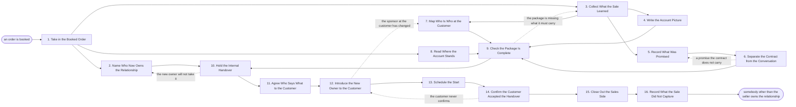

# Reference process: Hand over to Delivery

`ref/sls/hand-over-to-delivery v1`

**value stream:** [Signature-to-Handover](../../streams/sales/signature-to-handover.md)
An order is booked, and the run moves the relationship from the person
who sold it to the person who will deliver it. Everything the sale
learned is collected into one account picture: what the customer bought,
what was promised, who decides and who pays, and where the account
already stands. What the contract binds is separated from what was
merely said, so nobody inherits a promise they cannot keep. The seller
and the new owner meet before the customer hears anything, the customer
is introduced to the new owner once rather than three times, and the
first working session is in diaries before the run closes.

## The activities

| # | Activity | What happens | Agents |
|---|---|---|---|
| 1 | Take in the Booked Order | what was sold, on what terms, and starting when | [handover-coordinator](../../agents/handover-coordinator.md) · [order-check](../../agents/order-check.md) |
| 2 | Name Who Now Owns the Relationship | the person the customer deals with from now on | handover-coordinator · sales leader (person) · delivery lead (person) |
| 3 | Collect What the Sale Learned | notes, mail and calls gathered into one place | handover-coordinator · account owner (person) |
| 4 | Write the Account Picture | who the customer is and what they bought | handover-coordinator |
| 5 | Record What Was Promised | every commitment made during the sale, written down | handover-coordinator · account owner (person) |
| 6 | Separate the Contract from the Conversation | what the contract binds, and what was only said | [signature-manager](../../agents/signature-manager.md) · legal reviewer (person) |
| 7 | Map Who Is Who at the Customer | who decides, who pays, who uses it every day | handover-coordinator · account owner (person) |
| 8 | Read Where the Account Stands | usage, support history, and anything still open | [account-monitor](../../agents/account-monitor.md) |
| 9 | Check the Package Is Complete | the package scored against what it must carry | order-check · handover-coordinator |
| 10 | Hold the Internal Handover | the seller and the new owner in one conversation | handover-coordinator · account owner (person) · delivery lead (person) |
| 11 | Agree Who Says What to the Customer | one message to the customer, not three | handover-coordinator · account owner (person) · delivery lead (person) |
| 12 | Introduce the New Owner to the Customer | the customer hears who they now deal with | account owner (person) · delivery lead (person) · handover-coordinator |
| 13 | Schedule the Start | the first working session put in diaries | handover-coordinator · delivery lead (person) · customer sponsor (person) |
| 14 | Confirm the Customer Accepted the Handover | the customer says they know who to call | handover-coordinator · customer sponsor (person) |
| 15 | Close Out the Sales Side | what the seller still owes, and what they do not | handover-coordinator · account owner (person) |
| 16 | Record What the Sale Did Not Capture | the gaps, so the next handover is fuller | handover-coordinator · account owner (person) · delivery lead (person) |

Activity 6 is the one people skip. A promise made in a meeting and a
clause in the agreement are not the same obligation, and the delivery
side needs both, marked for which is which. Activities 12 through 14 are
the ones a customer actually experiences, and the run does not close on
activity 12 alone: a handover the customer was told about but never
acknowledged is a handover that has not happened.

## The graph



## The document, with the blanks marked

```
PROCESS: hand over to delivery        id: <team>/hand-over-to-delivery   v1
from: ref/sls/hand-over-to-delivery v1
owner: <who>                          effective: <date>
trigger: an order is booked in <your order system>
concurrency: runs may overlap - <how many> handovers open at once, and
             one account is handed over by one run at a time
goal: the customer deals with a named person other than the seller
      within <days> of booking, that person holds everything the sale
      learned, and the first working session is in diaries
phases:
  take-in-order    - runs collect-and-report: what was sold, on what
                     terms, at what price, starting when, and who signed
                     owner: handover-coordinator   after: trigger
                     by: <hours>                   automation: <level>
  name-new-owner   - convenes decide-and-announce: the person who owns
                     the relationship from now on, named in writing,
                     with the date they take it
                     owner: <your delivery leadership role>
                     after: take-in-order
                     by: <days>                    automation: never
  collect-the-sale - runs collect-and-report: the notes, the mail, the
                     call records, the proposal, the answers to the
                     buyer's questions, gathered into one place
                     owner: handover-coordinator   after: take-in-order
                     by: <days>                    automation: <level>
  picture          - runs build-by-talent: who the customer is, what
                     they are trying to do, what they bought and why
                     they bought it
                     owner: handover-coordinator   after: collect-the-sale
                     automation: <level>
  record-promises  - human: every commitment made during the sale,
                     written down one per line with who made it, when,
                     and to whom
                     owner: <your sales role>      after: collect-the-sale
                     automation: <level>
  mark-binding     - runs assessment: each recorded promise marked as
                     carried by the agreement, carried by a side letter,
                     or said and not binding
                     owner: signature-manager      after: record-promises
                     by: <days>                    automation: <level>
  map-people       - runs collect-and-report: who decides, who pays, who
                     uses it every day, who blocked the deal, and how
                     each one prefers to be reached
                     owner: handover-coordinator   after: collect-the-sale
                     automation: <level>
  standing         - runs roll-call: product usage, support history,
                     open tickets, anything in dispute, and where the
                     account sits in its renewal cycle
                     owner: account-monitor        after: take-in-order
                     by: <days>                    automation: <level>
  check-package    - runs assessment: the handover package scored
                     against <your handover checklist> at a version,
                     naming what is missing rather than what is present
                     owner: order-check
                     after: picture + mark-binding + map-people + standing
                     automation: <level>
  internal-brief   - convenes briefing: the seller walks the new owner
                     through the account, and the new owner asks the
                     questions the package did not answer
                     owner: handover-coordinator
                     after: name-new-owner + check-package
                     by: <days>                    automation: <level>
  agree-message    - convenes decide-and-announce: what the customer is
                     told, by whom, on what date, and through which
                     channel
                     owner: handover-coordinator   after: internal-brief
                     automation: <level>
  introduce-owner  - human: the seller introduces the new owner to the
                     customer, and stays in the conversation until the
                     customer answers the new owner directly
                     owner: <your sales role>      after: agree-message
                     by: <days>                    automation: <level>
  schedule-start   - human: the first working session is agreed with the
                     customer and put in diaries on both sides
                     owner: <your delivery role>   after: introduce-owner
                     by: <days>                    automation: <level>
  confirm-accepted - human: the customer confirms they know who they now
                     deal with and how to reach them, and the confirmation
                     is recorded with its date
                     owner: handover-coordinator   after: schedule-start
                     by: <days>                    automation: <level>
  close-seller     - human: what the seller still owes is listed with a
                     date against each item, and everything else moves
                     to the new owner
                     owner: handover-coordinator   after: confirm-accepted
                     automation: <level>
  record-gaps      - convenes debrief: what the new owner had to ask the
                     customer again, and what the sale should have
                     captured the first time
                     owner: handover-coordinator   after: close-seller
                     automation: <level>
run-scoped:
  open-promises - runs allocate-and-reconcile      owner: handover-coordinator
                  from: record-promises   until: run close
  status        - runs roll-call                   owner: handover-coordinator
                  every: <cadence>
                  from: take-in-order   until: confirm-accepted
handoffs:
  take-in-order -> name-new-owner: what was sold and when it starts, so
    the person named can actually deliver it
  take-in-order -> collect-the-sale: the order, its identifier, and the
    opportunity every note hangs off
  take-in-order -> standing: the account and the entity, so standing is
    read for the party that bought
  collect-the-sale -> picture: everything the sale produced, in one
    place, with the date on each item
  collect-the-sale -> record-promises: the notes and the call records
    the promises are read out of
  collect-the-sale -> map-people: the names that appeared during the
    sale, and what each one did
  record-promises -> mark-binding: the promises as the seller remembers
    them, one per line
  mark-binding -> check-package: each promise marked binding or not
    binding, with the clause behind every binding one
  picture -> check-package: the picture as written, with the source
    behind every claim in it
  map-people -> check-package: the people, their roles, and how each
    one is reached
  standing -> check-package: the account's standing, dated, with the
    system every line came from
  check-package -> internal-brief: the scored package, with what is
    missing named and the checklist version it was scored against
  name-new-owner -> internal-brief: the new owner, and the date they
    take the relationship
  internal-brief -> agree-message: the questions the package did not
    answer, and the answers the seller gave in the room
  agree-message -> introduce-owner: who says what, on what date, through
    which channel
  introduce-owner -> schedule-start: the customer's answer, and whoever
    at the customer replied
  schedule-start -> confirm-accepted: the session in diaries on both
    sides, with the people invited to it
  confirm-accepted -> close-seller: the customer's confirmation, dated,
    with what they were told
  close-seller -> record-gaps: what the seller still owes, and what the
    new owner now holds
bindings:
  roster:  <who holds each role - agents claiming the abstract agents
           above, and named people for the account owner, the delivery
           lead, the sales leader and the legal reviewer>
  systems: the order system (read), the CRM (read), the CRM (write),
           the contract repository (read), the handover record (write),
           the delivery system (write), the support system (read),
           product usage data (read), the calendar (write),
           the customer communication channel (write)
  data:    <your handover checklist> <version>, the booked order,
           the executed agreement <version>, <your account picture
           template>, <your escalation list>
policy:
  no customer hears about the handover before the internal handover has
    happened
  a promise made during the sale is recorded whether or not the contract
    carries it, and the ones the contract does not carry are decided by
    <who> before the customer is told anything
  the new owner is a named person, never a queue or a shared mailbox
  the seller stays reachable to the new owner for <days> after the
    customer confirms, and stays out of the customer conversation unless
    the new owner asks them into it
  a handover the customer has not confirmed is not counted as complete,
    however many internal steps are done
  an account with something open in dispute or in support is handed over
    with that item named, and <who> is told before the introduction
  the package is scored against the checklist at a version, and a
    missing item is carried forward with a date rather than waived
    silently
measures:
  cycle time: <target> from booking to the customer's confirmation
  repeat rate: <target> for questions the new owner had to ask the
               customer again in the first <weeks>
  volume: <handovers per period>
  quality gate: no handover closes without the customer's dated
                confirmation and the promise list marked binding or not
```

## The failure edges

- **Nobody will take the account.** Delivery has no capacity, or the
  account needs a skill no team holds. The run holds at the naming step
  rather than moving on, because a handover to nobody is worse than a
  late one. The seller keeps the relationship, the customer is told the
  start date rather than a name, and whoever owns capacity decides who
  takes it.
- **The sale promised something the contract does not carry.** The
  signature-manager agent marks the promise as said and not binding, and
  the run goes back to the promise list. A person decides whether the
  company honours it anyway, and that decision is recorded before the
  customer hears from anyone. Delivery does not discover it in the first
  working session.
- **The package is missing what it must carry.** The order-check agent
  names what is missing and the run goes back to collecting. If the
  missing item cannot be found, it is carried into the internal handover
  as a known gap with a date against it, and the new owner is told what
  they are not being given.
- **The new owner refuses the handover.** The questions the package did
  not answer go back with them. Either the gaps are filled and the
  internal handover runs again, or a different person is named. The
  customer is not introduced to somebody who has not accepted the
  account.
- **The sponsor at the customer has changed.** The person who signed has
  left, moved or handed the project on. The run goes back to mapping the
  people, the introduction is made to whoever holds it now, and the
  account picture is corrected rather than delivered to a name that no
  longer applies.
- **The customer never confirms.** The introduction was sent and nothing
  came back. The run stays open, the reminder goes through the channel
  the customer actually uses, and after <days> the seller makes the
  introduction again in person. A handover with no confirmation is
  recorded as unconfirmed rather than closed.
- **The seller keeps taking the calls.** The customer keeps calling the
  person they know. The new owner is copied on every such contact, the
  seller answers with the new owner in the conversation rather than
  alone, and the pattern is recorded, because it means the introduction
  did not land.
- **The account is in trouble before it starts.** The account-monitor
  agent finds an open dispute, a support crisis or an unpaid balance.
  The handover continues, and the item is named in the internal handover
  and to the person the policy names. The new owner never learns about
  it from the customer.
- **The trigger fires while runs are in flight.** Handovers overlap
  normally, and the concurrency line says how many. One account is
  handed over by one run, so a second booked order for an account
  already in handover joins the open run instead of starting another.
- **A run is abandoned.** The seller keeps the relationship by default,
  and that is written down rather than assumed. The customer is told who
  to call, whatever else is unfinished. The package, however incomplete,
  is filed against the account so the next attempt starts from it, the
  promises already recorded stay on the open-promises list, and the
  delivery lead is told that an order is booked with nobody assigned to
  it.
