# Reference process: Inspect a Deal

`ref/sls/inspect-a-deal v1`

**value stream:** [Pipeline-to-Commitment](../../streams/sales/pipeline-to-commitment.md)
One deal is taken apart and tested against what the record holds. The
activities pull its history, read the activity behind it, name who can
sign and who can stop it, and check that the money exists and belongs
to somebody. Every claim the deal rests on is marked evidenced,
asserted or absent, and the close date is tested against the steps
still to run before it. The owner answers the gaps out loud, actions
are agreed with dates, and the deal leaves with a category and a
written reason. Rolling the pipeline up is arithmetic that arrives
from operations. This process tests one deal inside it.

## The activities

| # | Activity | What happens | Agents |
|---|---|---|---|
| 1 | Take in the Deal | which deal, why now, and what the inspection settles | [deal-inspector](../../agents/deal-inspector.md) · deal owner (person) |
| 2 | Pull the Deal Record | the stage, the amount, the date, and every change | deal-inspector · [analytics](../../agents/analytics.md) |
| 3 | Read the Activity Behind It | who was met, how recently, and by whom | analytics |
| 4 | Name the Buying Group | who signs, who uses it, and who can stop it | deal-inspector · deal owner (person) |
| 5 | Test What the Customer Said | the customer's own words, dated, not the seller's | deal-inspector · analytics |
| 6 | Check the Money Is Real | budget named, approved, and whose it is | deal-inspector · deal owner (person) |
| 7 | Read the Competitive Position | who else is in it, and what the customer says | deal-inspector |
| 8 | Walk the Steps to Signature | what must happen between now and the date | deal-inspector · deal owner (person) |
| 9 | Test the Close Date | whether the remaining steps fit before the date | [forecaster](../../agents/forecaster.md) · deal-inspector |
| 10 | Mark Each Claim | every claim marked evidenced, asserted or absent | deal-inspector |
| 11 | Name What the Deal Rests On | the one or two things that decide it | deal-inspector · forecaster |
| 12 | Put the Findings to the Owner | the owner answers the gaps out loud | deal-inspector · deal owner (person) · sales manager (person) |
| 13 | Agree the Actions and the Dates | who does what by when to close each gap | sales manager (person) · deal owner (person) |
| 14 | Say Where the Deal Stands | the category the deal carries into the call | sales manager (person) · deal-inspector |
| 15 | Record the Inspection | the findings at a version, dated, with the evidence | deal-inspector |

## The graph

```mermaid
flowchart LR
  T([a deal is selected for inspection]) --> A1[1. Take in the Deal]
  A1 --> A2[2. Pull the Deal Record]
  A2 --> A3[3. Read the Activity Behind It]
  A2 --> A4[4. Name the Buying Group]
  A2 --> A6[6. Check the Money Is Real]
  A3 --> A5[5. Test What the Customer Said]
  A4 --> A5
  A4 --> A7[7. Read the Competitive Position]
  A5 -. the customer has said nothing on the record .-> A3
  A5 --> A8[8. Walk the Steps to Signature]
  A6 --> A8
  A7 --> A8
  A8 --> A9[9. Test the Close Date]
  A9 -. the steps do not fit before the date .-> A8
  A9 --> A10[10. Mark Each Claim]
  A10 -. a claim has nothing behind it .-> A5
  A10 --> A11[11. Name What the Deal Rests On]
  A11 --> A12[12. Put the Findings to the Owner]
  A12 -. the owner brings evidence the record never held .-> A10
  A12 --> A13[13. Agree the Actions and the Dates]
  A13 --> A14[14. Say Where the Deal Stands]
  A14 -. the gaps are too large to categorize the deal .-> A13
  A14 --> A15[15. Record the Inspection]
  A15 --> DONE([the deal carries a category and a written reason])
```



## The document, with the blanks marked

```
PROCESS: inspect a deal               id: <team>/inspect-a-deal   v1
from: ref/sls/inspect-a-deal v1
owner: <who>                          effective: <date>
trigger: a deal crosses <your inspection threshold>, or a forecast call
         asks for it
         watch: record=<deal> system=<your CRM>
                change=<a deal crosses the inspection threshold>
         or watch: record=<deal> system=<your CRM>
                change=<a forecast call asks for an inspection>
concurrency: runs may overlap - <how many> inspections run at once, and
             one deal is inspected once per <cycle>
goal: every inspected deal leaves with a category, with each claim it
      rests on marked evidenced, asserted or absent, and with a dated
      action against every gap
phases:
  take-in-deal       - human: which deal, why it is being inspected
                       now, and what the inspection has to settle
                       owner: deal-inspector    after: trigger
                       automation: <level>
  pull-record        - runs collect-and-report: the stage, the amount
                       and the close date as they stand, with every
                       change to them and who made it
                       owner: deal-inspector    after: take-in-deal
                       by: <days>               automation: <level>
  read-activity      - runs collect-and-report: who at the customer was
                       met, how recently, by whom, and what was written
                       down afterwards
                       owner: analytics         after: pull-record
                       by: <days>               automation: <level>
  name-buyers        - human: who signs, who uses it, who pays and who
                       can stop it, each one marked met or unmet
                       owner: deal-inspector    after: pull-record
                       automation: <level>
  test-the-words     - human: what the customer said in their own
                       words, dated, quoted from <your call record>
                       rather than summarized by the seller
                       owner: deal-inspector
                       after: read-activity + name-buyers
                       automation: <level>
  check-money        - human: the budget named, the approver named, and
                       whether the money is already committed elsewhere
                       owner: deal-inspector    after: pull-record
                       automation: <level>
  read-competition   - human: who else the customer is talking to, what
                       the customer says about them, and what would
                       have to be true for this deal to be chosen
                       owner: deal-inspector    after: name-buyers
                       automation: <level>
  walk-steps         - human: every step between today and a signature,
                       each with the person who has to take it and the
                       time <your legal and procurement steps> take
                       owner: deal-inspector
                       after: test-the-words + check-money +
                              read-competition
                       automation: <level>
  test-date          - runs assessment: whether the remaining steps fit
                       before the close date, set against what deals in
                       this position have taken before
                       owner: forecaster        after: walk-steps
                       automation: <level>
  mark-claims        - runs assessment: every claim the deal rests on
                       marked evidenced, asserted or absent, with the
                       record and the date behind each evidenced one
                       owner: deal-inspector    after: test-date
                       automation: <level>
  name-dependency    - human: the one or two things that decide the
                       deal, stated so a person could go and change
                       them
                       owner: deal-inspector    after: mark-claims
                       automation: <level>
  put-to-owner       - convenes assessment: the findings read to the
                       owner, who answers each gap in the room and
                       whose answers are written down as given
                       owner: <your sales management role>
                       after: name-dependency
                       by: <days>               automation: <level>
  agree-actions      - convenes decide-and-announce: who does what by
                       when against each gap, agreed out loud, with a
                       date no later than <days> before the close date
                       owner: <your sales management role>
                       after: put-to-owner      automation: <level>
  set-category       - human: committed, best case or neither, said by
                       <who> with the reason attached. The category is
                       what the deal carries into the forecast call
                       owner: <your sales management role>
                       after: agree-actions     automation: never
  record-inspection  - human: the findings at a version, dated, with
                       the evidence, the gaps, the actions and the
                       category, readable before the next call
                       owner: deal-inspector    after: set-category
                       automation: <level>
run-scoped:
  actions - runs roll-call                   owner: deal-inspector
            every: <cadence>
            from: agree-actions   until: run close
handoffs:
  take-in-deal -> pull-record [inspection-question]: the deal, and the
    question the inspection has to settle
  pull-record -> read-activity [deal-record]: the deal as the system
    holds it, with every change to stage, amount and date carrying its
    author
  pull-record -> name-buyers [deal-contacts]: the same record, plus
    the contacts already attached to the deal
  pull-record -> check-money [amount-and-terms]: the amount and the
    terms as recorded
  read-activity -> test-the-words [meeting-history]: who was met and
    when, with what was written down after each meeting
  name-buyers -> test-the-words [people-who-decide]: the people who
    would have to say yes, so their words can be looked for rather
    than the champion's
  name-buyers -> read-competition [buyer-relationships]: the same
    people, and which of them have a relationship with somebody else
  test-the-words -> walk-steps [customer-words]: what the customer
    said, dated and quoted, and every place the record holds nothing
  check-money -> walk-steps [budget-finding]: whether the money
    exists, whose it is, and which approval it still has to pass
  read-competition -> walk-steps [competitive-position]: who else is
    in it and what would have to be true to win
  walk-steps -> test-date [remaining-steps]: the remaining steps, each
    with an owner and the time it takes
  test-date -> mark-claims [date-test]: whether the steps fit before
    the date, and by how much they miss when they do not
  mark-claims -> name-dependency [marked-claims]: every claim marked
    evidenced, asserted or absent, with the record behind each
    evidenced one
  name-dependency -> put-to-owner [dependencies-and-gaps]: what the
    deal rests on, and the gaps the owner is being asked to answer
  put-to-owner -> agree-actions [owner-answers]: the owner's answers
    as given, and the gaps that are still open after them
  agree-actions -> set-category [dated-actions]: the actions, their
    owners and their dates, and what is left unaddressed
  set-category -> record-inspection [deal-category]: the category, who
    set it, and the reason they gave
deviations:
  test-the-words -> read-activity [no-customer-words]: the record
    holds nothing the customer said, so the activity is read again
    before the deal is marked as resting on assertion
  test-date -> walk-steps [steps-do-not-fit]: the remaining steps do
    not fit before the close date, so the steps are walked again or
    the date moves
  mark-claims -> test-the-words [claim-unsupported]: a claim has
    nothing behind it, so the customer's own words are looked for
    again before it is marked
  put-to-owner -> mark-claims [new-evidence]: the owner brings
    evidence the record never held, so the claims are marked again
    with it and the evidence is written into the record
  set-category -> agree-actions [gaps-too-large]: the gaps are too
    large for a category, so the actions are agreed again rather than
    the category being guessed
bindings:
  roster:  <who holds each role - agents claiming the abstract agents
           above, and named people for the deal owner and the manager
           who sets the category>
  systems: the CRM (read), the call record (read),
           the activity record (read), <your contract system> (read),
           the inspection record (write), the model store (read),
           the notification channel (write)
  data:    the pipeline roll-up as <your pipeline roll-up process>
           published it, <your qualification standard> at a version,
           <your stage definitions>, the close plan template
policy:
  the inspection writes findings and never writes stage, amount or
    close date. Those belong to the deal owner
  a claim with nothing behind it is recorded as asserted, and no
    inspection converts an assertion into evidence
  a deal's category is set by a named person and is never set by an
    agent
  the deal owner is present when the findings are put, and an
    inspection held without them is recorded as unanswered
  the roll-up the inspection reads is the published one, and no figure
    in it is recomputed here
  a deal whose close date fails the test keeps its date only if <who>
    says why in writing, recorded with the inspection
measures:
  cycle time: <days> from selection to the recorded finding
  coverage: <share> of the deals that make up <share> of the period's
            number inspected each <cycle>
  quality gate: no deal carries a category without a dated finding
                under it, and no evidenced claim without its record
```

## The failure edges

- **The record holds no customer words at all.** Everything in the deal
  comes from the seller. The run goes back to the activity read, and if
  nothing turns up there the deal is marked as resting on assertion.
  The category that follows says so, and no amount of confidence from
  the owner changes the marking.
- **The steps do not fit before the close date.** The run returns to
  the walk. Either the steps shorten, with the person who agreed to
  shorten them named, or the date moves. A date that stays put without
  either goes into the record as a date nobody can support.
- **The buying group has nobody who can sign.** The champion is real
  and the signer is unknown or unmet. The gap goes into the actions
  with a date, and until it closes the deal is not eligible for
  committed, whatever the amount.
- **The owner brings evidence that was never in the record.** The
  claims are marked again with the new evidence included, and the
  evidence is written into the record at the same time. An inspection
  never accepts evidence that lives only in the conversation.
- **The owner will not attend.** The inspection is held on its date
  with the record as it stands, the findings say which questions went
  unanswered, and the manager is told before the category is set.
- **The gaps are too large to categorize the deal.** The run returns to
  the actions rather than guessing. If a second pass still leaves the
  deal uncategorizable it goes into the call as neither, and the
  reason travels with it.
- **The deal changes after the inspection.** A change to stage, amount
  or date makes the finding stale. The finding stays where it is at its
  version, the change is recorded against it, and the deal returns to
  inspection if it crosses <your re-inspection threshold> again.
- **A run is abandoned.** The deal keeps whatever category it already
  carried, and that category is marked uninspected in the forecast
  call. The partial findings stay at their version, the owner is told
  the inspection stopped, and the actions already agreed keep their
  dates.
