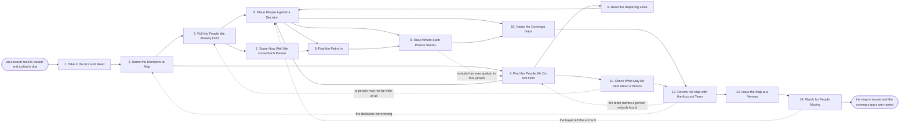

# Reference process: Map the People at an Account

`ref/sls/map-the-account-people v1`

**value stream:** [Account-to-Plan](../../streams/sales/account-to-plan.md)
An account read says what the account is doing. This run says who
decides, who influences, who can stop it, and which of those people we
already know. It starts from the contacts in the record, adds the
people nobody entered, places each one against a named purchase rather
than against the company in general, and scores how well we know them
from when we last spoke and who spoke to them. The map names every
decision with nobody behind it, which is the part a plan has to answer
for. It is corrected by the people who have met them, then issued.

## The activities

| # | Activity | What happens | Agents |
|---|---|---|---|
| 1 | Take in the Account Read | the account picture the mapping starts from | [account-planner](../../agents/account-planner.md) |
| 2 | Name the Decisions to Map | which purchases the map has to cover | account-planner · account owner (person) |
| 3 | Pull the People We Already Hold | contacts in the CRM, with the last contact date | [relationship-mapper](../../agents/relationship-mapper.md) |
| 4 | Find the People We Do Not Hold | org charts, filings, profiles, event lists | [researcher](../../agents/researcher.md) · relationship-mapper |
| 5 | Place People Against a Decision | who decides, who influences, who blocks | relationship-mapper |
| 6 | Read the Reporting Lines | who reports to whom, and what each unit owns | relationship-mapper · researcher |
| 7 | Score How Well We Know Each Person | when we last spoke, and who spoke to them | relationship-mapper · [analytics](../../agents/analytics.md) |
| 8 | Find the Paths In | who at our end already knows whom | relationship-mapper |
| 9 | Read Where Each Person Stands | supportive, neutral, opposed, or unknown | relationship-mapper · account owner (person) |
| 10 | Name the Coverage Gaps | decisions with nobody we know behind them | account-planner · relationship-mapper |
| 11 | Check What May Be Held About a Person | consent, privacy rules, and what gets deleted | relationship-mapper · privacy reviewer (person) |
| 12 | Review the Map with the Account Team | the people who have met them correct the map | account-planner · account owner (person) |
| 13 | Issue the Map at a Version | dated, sourced, handed to the planning work | relationship-mapper |
| 14 | Watch for People Moving | joiners, leavers and title changes | [account-monitor](../../agents/account-monitor.md) · relationship-mapper |

## The graph



## The document, with the blanks marked

```
PROCESS: map the account people       id: <team>/map-the-account-people  v1
from: ref/sls/map-the-account-people v1
owner: <who>                          effective: <date>
trigger: an account read is issued and a plan is due for that account
         watch: record=<account read> system=<your CRM>
                change=<an account read is issued at a version>
         and watch: record=<account plan> system=<your planning system>
                change=<a plan falls due for that account>
concurrency: runs may overlap - <how many> accounts mapped at once, and
             one account is mapped by one run at a time
goal: every decision named in scope has its deciders, influencers and
      blockers written down, each scored for how well we know them,
      each path in named, and every decision with nobody behind it
      called out as a gap
phases:
  take-in-read   - human: read the account read, and write down which
                   part of it the map has to serve
                   owner: account-planner    after: trigger
                   automation: <level>
  name-decisions - convenes briefing: the account owner and the mapping
                   agents agree which purchases this map covers, so
                   people are placed against a decision and not a logo
                   owner: account-planner    after: take-in-read
                   automation: <level>
  pull-known     - runs collect-and-report: everyone already in the
                   record for this account, with the last date anybody
                   at our end spoke to them
                   owner: relationship-mapper
                   after: name-decisions
                   by: <days>                automation: <level>
  find-unknown   - runs collect-and-report: the people the record does
                   not hold, from org charts, filings, public profiles,
                   conference programmes and <your people sources>
                   owner: researcher         after: name-decisions
                   by: <days>                automation: <level>
  place-roles    - human: each person placed against a named decision
                   as decider, influencer, blocker or user
                   owner: relationship-mapper
                   after: pull-known + find-unknown
                   automation: <level>
  read-lines     - human: who reports to whom, which unit owns which
                   budget, and where the line into finance runs
                   owner: relationship-mapper
                   after: find-unknown
                   automation: <level>
  score-strength - runs assessment: how well we know each person, from
                   when we last spoke, how often, and who spoke
                   owner: analytics          after: pull-known
                   automation: <level>
  find-paths     - human: who at our end already knows whom, including
                   past colleagues, customers and <your partners>
                   owner: relationship-mapper
                   after: place-roles + score-strength
                   automation: <level>
  read-stance    - human: where each person stands on what we would
                   sell, said as supportive, neutral, opposed or
                   unknown, with what was said or done behind it
                   owner: relationship-mapper
                   after: place-roles + find-paths
                   by: <days>                automation: <level>
  name-gaps      - human: every decision in scope with no decider
                   found, nobody we know, or nobody who supports us
                   owner: account-planner
                   after: place-roles + read-stance
                   automation: <level>
  check-privacy  - runs assessment: what may be held about each person
                   under <your privacy rule> and the consent record,
                   and what has to come out of the map
                   owner: <your privacy role>
                   after: find-unknown
                   automation: never
  review-map     - convenes approval: the people who have actually met
                   these buyers correct the map, and the account owner
                   signs that it is fit to plan from
                   owner: <your account owner role>
                   after: name-gaps + check-privacy
                   by: <days>                automation: never
  issue-map      - runs decide-and-announce: the map is issued at a
                   version, and every process that reads it is told
                   owner: relationship-mapper
                   after: review-map
                   automation: <level>
  watch-moves    - human: joiners, leavers and title changes at the
                   account, read against the map that is running
                   owner: account-monitor    after: issue-map
                   automation: <level>
run-scoped:
  moves    - runs collect-and-report          owner: account-monitor
             every: <cadence>
             from: issue-map   until: run close
  coverage - runs roll-call                   owner: relationship-mapper
             every: <cadence>
             from: place-roles   until: review-map
handoffs:
  take-in-read -> name-decisions [account-read]: the account read at
    its version, and what the plan needs the map to settle
  name-decisions -> pull-known [decisions-in-scope]: the decisions in
    scope, each one named the way the account itself would name it
  name-decisions -> find-unknown [decisions-to-search]: the same
    decisions, so searching is bounded rather than open-ended
  pull-known -> place-roles [people-held]: everyone already held, with
    the last contact date and the person who made it
  find-unknown -> place-roles [people-found]: the people not held,
    each with the source they were found in and the date it was
    published
  find-unknown -> read-lines [published-titles]: titles, units and
    reporting language as published, so the lines are drawn from
    evidence
  read-lines -> place-roles [reporting-lines]: who reports to whom, so
    a title is not mistaken for authority
  pull-known -> score-strength [contact-history]: the contact history
    each score is computed from
  score-strength -> find-paths [strength-scores]: how well we know
    each person, so the strongest path is chosen rather than the
    nearest
  place-roles -> find-paths [people-to-reach]: who has to be reached,
    and for which decision
  place-roles -> read-stance [stance-subjects]: the people whose
    stance matters, and the decision their stance applies to
  find-paths -> read-stance [paths-in]: who can be asked what a person
    thinks
  read-stance -> name-gaps [stances]: every person whose stance is
    unknown, and every decision where the decider opposes us
  place-roles -> name-gaps [decisions-without-a-decider]: the
    decisions with no decider found at all
  find-unknown -> check-privacy [people-added]: every person added,
    and the source each one came from
  check-privacy -> review-map [privacy-ruling]: what may be held, what
    must come out, and the rule behind each removal
  name-gaps -> review-map [map-with-gaps]: the map with the gaps
    marked as gaps
  review-map -> issue-map [corrected-map]: the map as the account team
    corrected it, naming who corrected what and when they signed
  issue-map -> watch-moves [issued-map]: the issued version, so a move
    is read against a map somebody committed to
  watch-moves -> place-roles [people-moves]: the joiner, leaver or
    title change, and the decision it puts at risk
deviations:
  read-stance -> find-unknown [stance-unknowable]: nobody has ever
    spoken to the person whose stance is needed, so somebody who has
    is looked for before the stance is guessed at
  check-privacy -> pull-known [person-may-not-be-held]: the privacy
    rule says a person may not be held at all, so they come out of the
    map and out of everything downstream that copied it
  review-map -> find-unknown [person-nobody-found]: the account team
    names a person nobody found, so that person alone is searched for
    and arrives with a source like everybody else
  review-map -> name-decisions [decisions-named-wrongly]: the map was
    built against purchases the account does not make that way, so the
    decisions are named again and the placements redone
  watch-moves -> place-roles [buyer-left]: a person in the map leaves,
    joins or changes title, so the decision they sat on is placed
    again
bindings:
  roster:  <who holds each role - agents claiming the abstract agents
           above, the account owner and the sellers who correct the
           map, and the privacy reviewer who rules on what may be held>
  systems: the CRM (write), <your contact database> (read),
           <your people sources> (read, cap: <spend per run>),
           the email and calendar record (read),
           the consent record (read), the account map record (write)
  data:    <your privacy rule> <version>, <your buying roles list>
           <version>, the decisions agreed in scope for this map
policy:
  a person is placed against a named decision, never against the
    account in general
  every person in the map names the source they were found in and the
    date that source was published
  the strength of a relationship is computed from recorded contact, and
    a claim that somebody knows a buyer well is recorded as a claim
    with the person who made it
  what may be held about a person follows <your privacy rule>, and a
    person the check removes is removed from the map and from anything
    downstream that copied it
  the map is never used to contact anyone; contact happens in <your
    outreach process> under the consent record
  a person who asks to be removed is removed within <days>, and the
    removal is recorded without keeping what was removed
measures:
  cycle time: <target> from the account read to the issued map
  coverage: <target> share of decisions in scope with a named decider
            and at least one person we have spoken to in <months>
  volume: <accounts mapped per period>
  quality gate: <sample size> of maps checked each <period> against the
                contact record behind their strength scores
```

## The failure edges

- **Nobody at the account is known to us.** The map is issued anyway,
  with every decision marked as a gap. A map that says we know nobody is
  worth more than a map padded with names somebody found on a website,
  and the plan that reads it has to answer for the gap rather than
  inherit a comfortable picture.
- **The privacy check removes a person.** The person comes out of the
  map, out of the CRM entry that carried them, and out of anything the
  map has already been copied into. The removal is recorded with the
  rule behind it, and the decision that person sat on goes back to
  place-roles so the gap is visible.
- **A title turns out not to mean authority.** The reporting lines
  contradict the org chart, or the person with the title defers to
  somebody else. The map records both, names the person who actually
  decides, and marks the earlier placement as corrected rather than
  deleting it.
- **A seller claims a strong relationship the record does not show.**
  The claim goes into the map as a claim, attributed to the person who
  made it, next to the computed score and the last recorded contact.
  Neither number is quietly replaced by the other.
- **The buyer leaves the account.** The account-monitor agent reports
  the departure, the map goes back to place-roles for that decision, and
  every plan reading the map is told which of its assumptions just lost
  its person. A leaver stays in the map as a leaver, because where they
  went next often matters.
- **The account team names somebody nobody found.** The review sends the
  run back to find-unknown for that person alone. The rest of the map
  does not reopen, and the person arrives with a source like everybody
  else rather than as an exception.
- **The decisions were named wrongly.** If the review finds the map was
  built against purchases the account does not actually make that way,
  the run goes back to name-decisions and the placements are done again.
  Everything gathered about the people themselves is kept.
- **A run is abandoned.** The map is closed as abandoned with whoever
  had been placed so far, and the plan waiting on it is told it is
  planning without a map. Every person added during the run stays under
  the privacy rule, and anything the check had flagged for removal is
  removed before the run closes rather than left in a draft.
