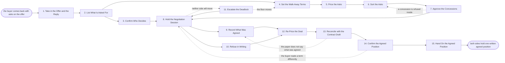

# Reference process: Negotiate the Agreement

`ref/sls/negotiate-the-agreement v1`

**value stream:** [Proposal-to-Signature](../../streams/sales/proposal-to-signature.md)
An offer is with the buyer and the buyer has come back with asks. This
process gathers those asks into one list, prices each of them, and
decides which are given, which are traded and which are refused. The
concessions are approved inside the company before anyone offers them.
Every closed ask carries the answer, the reason behind it, and the name
of the person who agreed. What the two sides settled leaves the run as
one written position, and the redlines and the close plan both work
from that one document rather than from anybody's memory.

## The activities

| # | Activity | What happens | Agents |
|---|---|---|---|
| 1 | Take in the Offer and the Reply | the offer as sent, and what the buyer sent back | [negotiation-coordinator](../../agents/negotiation-coordinator.md) |
| 2 | List What Is Asked For | every ask on the table, gathered into one list | negotiation-coordinator |
| 3 | Confirm Who Decides | who signs on each side, and who they need first | negotiation-coordinator · deal owner (person) |
| 4 | Set the Walk-Away Terms | the floor on price, term and risk, agreed inside | sales leader (person) · negotiation-coordinator |
| 5 | Price the Asks | what each ask costs us, and who carries the cost | negotiation-coordinator · finance approver (person) |
| 6 | Sort the Asks | each ask marked give, trade or refuse | negotiation-coordinator · deal owner (person) |
| 7 | Approve the Concessions | concessions cleared inside before they are offered | sales leader (person) · finance approver (person) |
| 8 | Hold the Negotiation Session | the asks worked through with the buyer | deal owner (person) · negotiation-coordinator |
| 9 | Record What Was Agreed | each closed ask, the answer, and who agreed to it | negotiation-coordinator |
| 10 | Refuse in Writing | a declined ask, with the reason the buyer keeps | negotiation-coordinator · deal owner (person) |
| 11 | Escalate the Deadlock | an ask neither side will move on goes up | sales leader (person) · buyer's procurement lead (person) |
| 12 | Re-Price the Deal | the offer updated to match what was agreed | negotiation-coordinator |
| 13 | Reconcile with the Contract Draft | the agreed terms checked against the paper | [redline-reviewer](../../agents/redline-reviewer.md) · legal reviewer (person) |
| 14 | Confirm the Agreed Position | both sides hold the same list of agreed terms | negotiation-coordinator · buyer's procurement lead (person) |
| 15 | Hand On the Agreed Position | the agreed position goes to redlines and the plan | negotiation-coordinator · [close-plan-keeper](../../agents/close-plan-keeper.md) |

## The graph



## The document, with the blanks marked

```
PROCESS: negotiate the agreement   id: <team>/negotiate-the-agreement   v1
from: ref/sls/negotiate-the-agreement v1
owner: <who>                          effective: <date>
trigger: the buyer replies to an offer with asks, in <your CRM>
         watch: record=<opportunity> system=<your CRM>
                change=<a reply with asks is logged against a sent offer>
concurrency: runs may overlap - <how many> negotiations live at once,
             and one opportunity is negotiated by one run at a time
goal: every ask on the table closed as given, traded or refused, each
      with a reason and a named approver, and one written position both
      sides hold
phases:
  take-in-offer       - human: read the offer as it was sent and what
                        the buyer sent back, and write down what is now
                        in dispute
                        owner: negotiation-coordinator   after: trigger
                        automation: <level>
  list-asks           - runs collect-and-report: every ask, pulled from
                        the reply, the call notes and the markup, into
                        one numbered list with the buyer's own wording
                        owner: negotiation-coordinator
                        after: take-in-offer
                        by: <days>                 automation: <level>
  confirm-deciders    - runs collect-and-report: who signs on each side,
                        who they need first, and what each of those
                        people has to see
                        owner: negotiation-coordinator   after: list-asks
                        by: <days>                 automation: <level>
  set-walk-away       - convenes decide-and-announce: the floor on
                        price, term, liability and payment, below which
                        the deal is refused. <who> sets the floor
                        owner: <your sales leadership role>
                        after: list-asks           automation: never
  price-asks          - runs assessment: what each ask costs, which
                        budget carries it, and what it changes about
                        the deal's margin
                        owner: negotiation-coordinator
                        after: set-walk-away
                        by: <days>                 automation: <level>
  sort-asks           - convenes decide-and-announce: every ask marked
                        give, trade or refuse, and each trade names what
                        we ask for in return
                        owner: negotiation-coordinator
                        after: price-asks          automation: <level>
  approve-concessions - convenes approval: the give and trade list
                        signed inside, by the people whose numbers it
                        moves, before any of it is offered
                        owner: <your sales leadership role>
                        after: sort-asks
                        by: <days>                 automation: never
  hold-session        - human: the asks worked through with the buyer,
                        in the order the list sets, against the approved
                        give and trade positions
                        owner: <your deal owner role>
                        after: confirm-deciders + approve-concessions
                        automation: <level>
  record-agreed       - human: each closed ask written down with the
                        answer, the reason, the date and the person on
                        each side who agreed to it
                        owner: negotiation-coordinator
                        after: hold-session        automation: <level>
  refuse-in-writing   - human: an ask we decline goes back in writing,
                        with the reason, in language the buyer can show
                        their own approvers
                        owner: negotiation-coordinator
                        after: hold-session
                        by: <days>                 automation: <level>
  escalate-deadlock   - convenes decide-and-announce: an ask neither
                        side will move on goes to <who> on our side and
                        the matching person on theirs
                        owner: <your sales leadership role>
                        after: hold-session
                        by: <days>                 automation: never
  re-price            - runs assessment: the offer rebuilt from what was
                        actually agreed, with every changed line traced
                        to the ask that changed it
                        owner: negotiation-coordinator
                        after: record-agreed + refuse-in-writing
                        by: <days>                 automation: <level>
  reconcile-draft     - runs assessment: the agreed terms read against
                        the contract text, term by term, and every gap
                        named
                        owner: redline-reviewer    after: re-price
                        by: <days>                 automation: <level>
  confirm-position    - convenes approval: both sides confirm one list
                        of agreed terms, and the confirmation is dated
                        and kept
                        owner: negotiation-coordinator
                        after: reconcile-draft     automation: never
  hand-on             - human: the agreed position, the concession
                        record and the open items go to the redline
                        review and the close plan
                        owner: negotiation-coordinator
                        after: confirm-position    automation: <level>
run-scoped:
  concessions - runs allocate-and-reconcile
                owner: negotiation-coordinator
                from: sort-asks     until: run close
  status      - runs roll-call
                owner: <your deal owner role>
                every: <cadence>
                from: hold-session  until: run close
handoffs:
  take-in-offer -> list-asks [offer-and-reply]: the offer at its
    version, the buyer's reply, and the notes from the calls since it
    was sent
  list-asks -> confirm-deciders [numbered-asks]: the numbered asks, each
    in the buyer's own words with the person who raised it
  list-asks -> set-walk-away [asks-for-floor]: the same list, so the
    floor is set against what is actually being asked for
  set-walk-away -> price-asks [floor]: the floor on each term, and who
    set it
  price-asks -> sort-asks [ask-costing]: what each ask costs, which
    budget carries it, and the margin after it
  sort-asks -> approve-concessions [give-and-trade-list]: the give and
    trade list, each trade naming what we ask for in return
  approve-concessions -> hold-session [approved-positions]: the approved
    positions, the name of every approver, and the date each approval
    was given
  confirm-deciders -> hold-session [deciders]: who is in the room, who
    they answer to, and what each of them has to see before they can
    agree
  hold-session -> record-agreed [session-outcome]: what the buyer said
    yes to, in the session, with the date
  hold-session -> refuse-in-writing [refusals]: the asks we declined and
    the reason for each one
  hold-session -> escalate-deadlock [deadlocked-terms]: the ask, both
    positions, and what each side says it cannot do
  escalate-deadlock -> hold-session [escalation-answer]: the decision
    from above, and whether the floor moved
  record-agreed -> re-price [closed-asks]: the closed asks and what each
    one changes about price, term or scope
  refuse-in-writing -> re-price [written-refusals]: the refusals, so the
    offer does not quietly carry what we declined
  re-price -> reconcile-draft [rebuilt-offer]: the rebuilt offer, with
    every changed line traced to an ask
  reconcile-draft -> confirm-position [reconciled-paper]: the gaps
    between the agreed terms and the contract text, clause by clause
  confirm-position -> hand-on [confirmed-position]: one dated list of
    agreed terms, held by both sides, and the open items nobody closed
deviations:
  approve-concessions -> sort-asks [concession-refused]: an approver
    refuses a concession, so the give and trade list is sorted again
  hold-session -> escalate-deadlock [neither-side-moves]: the session
    reaches a term neither side will move on
  escalate-deadlock -> set-walk-away [floor-moves]: the escalation moves
    the floor, so the walk-away is set again before anything is repriced
  reconcile-draft -> record-agreed [paper-disagrees]: the contract text
    and the agreed record disagree, and the agreed record governs
  confirm-position -> hold-session [term-read-differently]: the buyer
    reads a term differently, so it goes back to the session
bindings:
  roster:  <who holds each role - agents claiming the abstract agents
           above, and named people for the deal owner, the sales leader
           who sets the floor, the finance approver and the legal
           reviewer>
  systems: the CRM (write), the quoting system (write),
           the contract system (read), the approval system (write),
           the pricing model (read, cap: <n> discount),
           the shared workspace with the buyer (write)
  data:    <your price book> <version>, <your discount policy>
           <version>, <your standard terms> <version>, the offer as
           sent, the concession record
policy:
  no concession is offered to the buyer before it is approved inside,
    and the approval names a person
  a term below the floor is refused, and only <who> may move the floor
  every closed ask records the answer, the reason, the date and the
    person on each side who agreed
  a refusal goes to the buyer in writing, not only in a call
  a discount past <threshold> needs <who> to sign before it is offered
  a term the buyer added and nobody priced does not enter the offer
  the concession record is complete before the position is confirmed
measures:
  cycle time: <target> from the buyer's reply to a confirmed position
  concession depth: <target> for the gap between the offer as sent and
                    the position as agreed
  volume: <negotiations per period>
  quality gate: every closed ask carries an approver, and no offered
                concession is missing its approval
```

## The failure edges

- **A concession is offered before it is approved.** The
  negotiation-coordinator agent finds the offered term with no approval
  behind it, and the run goes back to the approval. The buyer is told
  the term is not confirmed. Nobody treats the term as agreed while the
  approval is missing.
- **The buyer's real decider was never in the room.** The people the
  run confirmed turn out not to be the ones who sign. The run returns
  to confirming who decides, the asks are checked against what the new
  person wants, and the session runs again with them present.
- **An ask lands below the floor.** The ask is refused in writing, with
  the reason, and the run continues on the rest of the list. If the
  buyer will not move, the deadlock goes up. Only the person who set
  the floor may move it, and moving it is recorded as a decision.
- **The paper does not say what the room agreed.** The redline-reviewer
  agent names the gap term by term, and the run goes back to the agreed
  record rather than to the contract. Whichever of the two is wrong is
  corrected on the record before the position is confirmed.
- **The two sides remember the session differently.** Confirming the
  position fails, and the run goes back to the session on the disputed
  terms only. The confirmed list is what both sides signed off in
  writing, not what either side's notes say.
- **A deadlock never resolves.** The escalation runs out its clock, and
  the deal is either refused on our terms or handed to the lost deal
  process. Leaving the ask open and continuing as if it were closed is
  not one of the choices.
- **The buyer changes the asks after the position is confirmed.** New
  asks open a new pass through the list rather than an edit to the
  confirmed document. The confirmed position stays as it is until the
  new pass produces its own confirmation.
- **A run is abandoned.** The offer is withdrawn or marked stale in the
  quoting system, the approvals given for concessions are cancelled so
  they cannot be reused on another deal, the buyer is told the
  negotiation has stopped and who to speak to, and the deal goes to the
  lost deal process with the reason it stopped.
