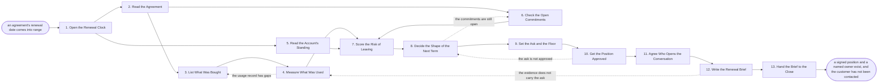

# Reference process: Open a Renewal

`ref/sls/open-a-renewal v1`

**value stream:** [Customer-to-Renewal](../../streams/sales/customer-to-renewal.md)
A renewal starts on a date the agreement already carries, not on the day
somebody remembers it. This process reads the agreement, sets what was
sold against what the customer actually used, checks what was promised
at signature and never delivered, and scores how likely the account is
to leave. It ends with one written position: the term to ask for, the
price to ask for, the least the organization will accept, and the person
who opens the conversation. Nobody has contacted the customer yet, and
that is the point of running it this early.

## The activities

| # | Activity | What happens | Agents |
|---|---|---|---|
| 1 | Open the Renewal Clock | the agreement's own dates start the run | [renewal-manager](../../agents/renewal-manager.md) |
| 2 | Read the Agreement | term, notice date, price terms, what renews itself | renewal-manager · contracts reviewer (person) |
| 3 | List What Was Bought | the entitlements at the level they were signed at | renewal-manager |
| 4 | Measure What Was Used | usage set against the entitlement, period by period | [usage-monitor](../../agents/usage-monitor.md) |
| 5 | Read the Account's Standing | support history, invoices, and who is still there | [account-monitor](../../agents/account-monitor.md) |
| 6 | Check the Open Commitments | what was promised at signature and not delivered | renewal-manager · delivery lead (person) |
| 7 | Score the Risk of Leaving | how likely the account is to leave, and why | [risk-watcher](../../agents/risk-watcher.md) · usage-monitor · account-monitor |
| 8 | Decide the Shape of the Next Term | length, entitlement, and what changes | renewal-manager · account owner (person) |
| 9 | Set the Ask and the Floor | the price asked for and the least accepted | [quote-builder](../../agents/quote-builder.md) · renewal-manager |
| 10 | Get the Position Approved | a person signs the ask, the floor and the term | renewal-manager · deal desk (person) |
| 11 | Agree Who Opens the Conversation | the owner, the date, and the first message | renewal-manager · account owner (person) |
| 12 | Write the Renewal Brief | one record the conversation runs from | renewal-manager |
| 13 | Hand the Brief to the Close | the position, dated, with the evidence attached | renewal-manager |

## The graph



## The document, with the blanks marked

```
PROCESS: open a renewal               id: <team>/open-a-renewal   v1
from: ref/sls/open-a-renewal v1
owner: <who>                          effective: <date>
trigger: an agreement reaches <your notice window> before its end date
         watch: record=<agreement> system=<your agreement store>
                change=<the end date comes within the notice window>
concurrency: runs may overlap - one agreement is worked by one run at a
             time, and <how many> positions are open at once
goal: one written position per agreement - the term, the ask, the floor
      and the owner - held <days> before the notice date, with the usage
      and the standing it was built from attached
phases:
  open-clock       - system: the agreement's dates open a run and set
                     the date the position is due
                     owner: renewal-manager    after: trigger
                     automation: <level>
  read-agreement   - human: the term, the notice date, the price terms,
                     and what renews itself if nobody acts
                     owner: <your contracts role>
                     after: open-clock         by: <days>
                     automation: <level>
  list-bought      - runs collect-and-report: the entitlements at the
                     level they were signed at, with the amendments
                     owner: renewal-manager    after: read-agreement
                     automation: <level>
  read-usage       - runs collect-and-report: usage against the
                     entitlement, period by period, per <your unit of
                     use>
                     owner: usage-monitor      after: list-bought
                     by: <days>                automation: <level>
  read-standing    - runs collect-and-report: support history, invoice
                     history, and which named contacts are still there
                     owner: account-monitor    after: open-clock
                     by: <days>                automation: <level>
  check-promises   - human: what was promised at signature, what was
                     delivered, and what is still open
                     owner: <your delivery role>
                     after: read-agreement     by: <days>
                     automation: <level>
  score-risk       - runs assessment: how likely this account is to
                     leave, scored against <your risk model>, with the
                     inputs recorded beside the score
                     owner: risk-watcher
                     after: read-usage + read-standing + check-promises
                     automation: <level>
  decide-shape     - convenes decide-and-announce: the length, the
                     entitlement and what changes in the next term
                     owner: renewal-manager    after: score-risk
                     automation: <level>
  set-ask          - human: the price to ask for and the least the
                     organization accepts, both written down before
                     anyone speaks to the customer
                     owner: quote-builder      after: decide-shape
                     by: <days>                automation: <level>
  approve-position - convenes approval: <who> signs the ask, the floor
                     and the term, as a named signer, against a version
                     owner: <your commercial approval role>
                     after: set-ask            by: <days>
                     automation: never
  agree-owner      - convenes decide-and-announce: who opens the
                     conversation, on what date, with what first message
                     owner: renewal-manager    after: approve-position
                     automation: <level>
  write-brief      - human: one record holding the position, the usage,
                     the standing, the risk and the open commitments
                     owner: renewal-manager    after: agree-owner
                     by: <days>                automation: <level>
  hand-over        - human: the brief goes to whoever closes the
                     renewal, and the clock for the close starts
                     owner: renewal-manager    after: write-brief
                     automation: <level>
run-scoped:
  usage-watch - runs collect-and-report          owner: usage-monitor
                every: <cadence>
                from: read-usage      until: run close
  clock       - runs roll-call                   owner: renewal-manager
                every: <cadence>
                from: open-clock      until: run close
handoffs:
  open-clock -> read-agreement [agreement-and-dates]: the agreement,
    its end date, and the date the position is due
  open-clock -> read-standing [account-and-period]: the account and the
    period to read
  read-agreement -> list-bought [signed-term]: the signed term, every
    amendment, and the clause that says what happens if nobody acts
  read-agreement -> check-promises [promised-delivery]: what the
    agreement says the organization would deliver
  list-bought -> read-usage [entitlement]: the entitlement at the
    signed level, so use has something to be measured against
  read-usage -> score-risk [usage-reading]: use against entitlement,
    period by period, with the system every number came from
  read-standing -> score-risk [account-standing]: the support and
    invoice history, dated, and every named contact who has left
  check-promises -> score-risk [open-commitments]: the commitments
    still open, each with who owes it and since when
  score-risk -> decide-shape [risk-score]: the score, the model
    version, and the reason behind the score in words
  decide-shape -> set-ask [next-term-shape]: the term, the entitlement
    and the changes the organization intends to ask for
  set-ask -> approve-position [ask-and-floor]: the ask, the floor, and
    what the floor costs compared with the current term
  approve-position -> agree-owner [approved-position]: the position at
    the signed version. A later change to the ask or the floor voids
    the approval
  agree-owner -> write-brief [opening-plan]: the owner, the date and
    the first message
  write-brief -> hand-over [renewal-brief]: the brief, at a version,
    with the usage and the standing attached rather than summarized
deviations:
  read-usage -> list-bought [usage-gaps]: the usage record has periods
    nobody can read, so the entitlement list is worked again and the
    gap is closed or left visible in the brief
  decide-shape -> check-promises [commitments-still-open]: a
    commitment made at signature is still open, so it goes back to the
    delivery side before the next term is decided
  approve-position -> decide-shape [ask-not-approved]: the approver
    will not sign, so the shape of the next term is decided again
    rather than the price alone
  write-brief -> read-usage [evidence-too-thin]: the evidence does not
    carry the ask, so the usage is read again before the brief is
    written
bindings:
  roster:  <who holds each role - agents claiming the abstract agents
           above, and named people for the account owner, the contracts
           reviewer, the delivery lead and the commercial approver>
  systems: the CRM (read, write), the agreement store (read),
           the usage record (read), the billing system (read),
           the support system (read), the pricing record (read),
           the renewal brief store (write)
  data:    the agreement at its signed version, <your price book>
           <version>, <your risk model> <version>, <your unit of use>,
           the entitlement record
policy:
  the customer is not contacted during this run. A conversation that
    starts early is recorded and the run closes into the close process
  a position is never set from usage alone. The standing and the open
    commitments are read before the ask is written
  the floor is written down before the conversation opens, and only
    <who> may move it
  approval is a human gate and is never delegated to an agent
  an agreement that renews itself if nobody acts is flagged to <who>
    <days> before the notice date, whatever the position says
  every number in the brief names the system it was read from and the
    date it was read
measures:
  cycle time: <days> from the clock opening to the approved position
  coverage: <target> share of agreements with a position held before
            their notice date
  volume: <renewals per period>
  quality gate: no position leaves without a floor, a named owner, and
                a usage reading no older than <days>
```

## The failure edges

- **The usage record has gaps.** The usage-monitor agent reports the
  periods it could not read rather than filling them in. The run goes
  back to the entitlement list, the gap is closed from the billing
  record or from the customer's own reporting, and the gap stays visible
  in the brief if it cannot be closed.
- **The agreement cannot be read as written.** An ambiguous notice
  clause or an unrecorded amendment stops the run at read-agreement. A
  contracts reviewer settles what the agreement says, and the settled
  reading is attached to the brief so the close does not argue it again.
- **A commitment made at signature was never delivered.** The delivery
  lead names it, and the run cannot reach an ask until either the
  commitment is closed or the position accounts for it. Asking for a
  higher price over an open commitment is not one of the choices.
- **The account is already leaving.** The risk-watcher agent scores the
  risk high enough that a renewal conversation is the wrong next move.
  The position still gets written, and it is handed to the churn risk
  process instead of to the close, with the reason attached.
- **The position is not approved.** The run goes back to the shape of
  the next term, not to the price. The approver names what they will not
  sign, and the same approval runs again on the changed position.
- **The notice date passes while the run is open.** The agreement does
  whatever it says it does, and the run records that. If it renewed
  itself, the position becomes the opening of a mid-term conversation
  and is marked as such. If it lapsed, the run closes as a departure.
- **The trigger fires while a run is in flight.** One agreement is
  worked by one run at a time. A second clock on the same agreement,
  from an amendment or a co-termed order, joins the open run rather than
  starting a second one.
- **A run is abandoned.** The clock does not stop, so the abandoned run
  is recorded against the agreement with the date it stopped and what it
  had reached. The account owner is told there is no position, and the
  agreement's own notice date is escalated so that nobody discovers the
  lapse from the invoice.
