# Reference process: Open an Expansion Deal

`ref/sls/open-an-expansion-deal v1`

**value stream:** [Account-to-Expansion](../../streams/sales/account-to-expansion.md)
An opening has been written down and somebody has said to pursue it.
This process turns it into a deal, or closes it with a reason. The
approach is drafted, the timing is set against the contract the customer
already holds, and the person who owns the relationship agrees how the
customer will be asked before the customer hears anything. A leader
signs off on the ask, the owner makes it, and what the customer said
comes back in their own words. A deal that opens leaves here for
discovery, proposal and closing like any other deal.

## The activities

| # | Activity | What happens | Agents |
|---|---|---|---|
| 1 | Take in the Recorded Opening | the opening, its evidence and the decision on it | [expansion-spotter](../../agents/expansion-spotter.md) · [upsell-planner](../../agents/upsell-planner.md) |
| 2 | Re-Read the Account | standing, dates and open issues, read again | [account-planner](../../agents/account-planner.md) |
| 3 | Confirm the Opening Still Holds | usage and adoption checked at today's date | [usage-monitor](../../agents/usage-monitor.md) |
| 4 | Draft the Approach | what to propose, to whom, and in what order | upsell-planner |
| 5 | Work Out What They Would Have to Change | what adopting it costs the customer in work | upsell-planner |
| 6 | Set the Timing Against the Contract | renewal date, budget cycle and notice periods | upsell-planner · account-planner |
| 7 | Put a Range on It | an indicative range, with what it assumes | upsell-planner |
| 8 | Agree the Approach with the Owner | the person who owns the relationship agrees it | account owner (person) · upsell-planner |
| 9 | Agree Who Says What | who opens it, who follows, and what each says | account owner (person) · upsell-planner |
| 10 | Check the Delivery Side Can Carry It | whether the work behind it can be staffed | delivery lead (person) · upsell-planner |
| 11 | Get the Internal Go-Ahead | a leader signs off on the ask and the range | sales leader (person) · account-planner |
| 12 | Make the Approach | the customer is asked, by the person who owns them | account owner (person) |
| 13 | Hear the Answer and Record It | what they said, in their words, with the date | account owner (person) · upsell-planner |
| 14 | Open the Deal | an opportunity is created, with the evidence on it | account owner (person) · account-planner |
| 15 | Hand It to Discovery | the deal, its evidence and its people, handed over | upsell-planner · account owner (person) |
| 16 | Tell the Spotter What Happened | the outcome goes back against the opening | expansion-spotter · upsell-planner |

Activity 8 is the gate the rest of the process is arranged around. The
person who owns the relationship carries it after this deal closes or
does not, so they decide how the customer is asked. Activity 16 is what
keeps the spotting honest: without it, the same signal keeps producing
the same opening and nobody learns what the customer actually said.

## The graph

```mermaid
flowchart LR
  T([an opening is marked pursue]) --> A1[1. Take in the Recorded Opening]
  A1 --> A2[2. Re-Read the Account]
  A2 --> A3[3. Confirm the Opening Still Holds]
  A3 -. the opening no longer holds .-> A1
  A3 --> A4[4. Draft the Approach]
  A4 --> A5[5. Work Out What They Would Have to Change]
  A5 --> A6[6. Set the Timing Against the Contract]
  A6 --> A7[7. Put a Range on It]
  A7 --> A8[8. Agree the Approach with the Owner]
  A8 -. the owner wants a different approach .-> A4
  A8 --> A9[9. Agree Who Says What]
  A8 --> A10[10. Check the Delivery Side Can Carry It]
  A10 -. delivery cannot carry it yet .-> A6
  A9 --> A11[11. Get the Internal Go-Ahead]
  A10 --> A11
  A11 -. the range does not justify the ask .-> A7
  A11 --> A12[12. Make the Approach]
  A12 --> A13[13. Hear the Answer and Record It]
  A13 -. not now, ask again later .-> A6
  A13 -. they want something different .-> A4
  A13 --> A14[14. Open the Deal]
  A14 --> A15[15. Hand It to Discovery]
  A15 --> A16[16. Tell the Spotter What Happened]
  A16 --> DONE([the deal is open and with discovery, or the opening is closed with a reason])
```



## The document, with the blanks marked

```
PROCESS: open an expansion deal       id: <team>/open-an-expansion-deal   v1
from: ref/sls/open-an-expansion-deal v1
owner: <who>                          effective: <date>
trigger: an opening in <your opening register> is marked pursue by the
         account owner
concurrency: runs may overlap - one account carries <how many> open
             expansion deals at a time, and one opening is worked by
             one run
goal: every pursued opening either an open deal handed to discovery, or
      closed with what the customer said, within <days>
phases:
  take-in-opening   - human: the opening, its evidence, the decision on
                      it and who made that decision
                      owner: upsell-planner      after: trigger
                      automation: <level>
  re-read-account   - runs collect-and-report: standing, contract dates
                      and open issues, read again at today's date
                      owner: account-planner     after: take-in-opening
                      automation: <level>
  confirm-opening   - runs assessment: the usage and the adoption the
                      opening rests on, checked again over <weeks>
                      owner: usage-monitor       after: re-read-account
                      by: <days>                 automation: <level>
  draft-approach    - human: what to propose, to whom, in what order,
                      and what the customer gets out of it
                      owner: upsell-planner      after: confirm-opening
                      automation: <level>
  work-out-change   - human: what adopting it costs the customer in
                      work, training and disruption, said plainly
                      owner: upsell-planner      after: draft-approach
                      automation: <level>
  set-timing        - human: the ask placed against the renewal date,
                      the budget cycle and any notice period
                      owner: upsell-planner      after: work-out-change
                      automation: <level>
  put-a-range       - human: an indicative range with its assumptions,
                      bounded by <your discount authority>
                      owner: upsell-planner      after: set-timing
                      automation: <level>
  agree-approach    - convenes decide-and-announce: the person who owns
                      the relationship agrees the approach, or names a
                      different one, before the customer hears anything
                      owner: <your account owner role>
                      after: put-a-range
                      by: <days>                 automation: never
  agree-who-says    - convenes briefing: who opens the conversation,
                      who follows, and what each of them says
                      owner: <your account owner role>
                      after: agree-approach
                      automation: <level>
  check-delivery    - convenes assessment: whether the work behind the
                      ask can be staffed in the window it promises
                      owner: <your delivery role>
                      after: agree-approach
                      by: <days>                 automation: <level>
  internal-go-ahead - convenes approval: <who> signs off on the ask,
                      the range and the timing, as a named signer
                      owner: <your sales leadership role>
                      after: agree-who-says + check-delivery
                      by: <days>                 automation: never
  make-approach     - human: the customer is asked, by the person who
                      owns the relationship, in the agreed words
                      owner: <your account owner role>
                      after: internal-go-ahead
                      automation: never
  record-answer     - human: what they said, in their words, with the
                      date, whoever said it and what they asked for
                      owner: upsell-planner      after: make-approach
                      by: <days>                 automation: <level>
  open-the-deal     - human: an opportunity is created at <your first
                      stage>, with the evidence and the words on it
                      owner: <your account owner role>
                      after: record-answer
                      automation: <level>
  hand-to-discovery - convenes briefing: the deal, its evidence and its
                      people handed to <your discovery process>
                      owner: upsell-planner      after: open-the-deal
                      automation: <level>
  tell-the-spotter  - convenes debrief: what the customer said, set
                      against what the signal predicted
                      owner: expansion-spotter
                      after: hand-to-discovery
                      automation: <level>
run-scoped:
  status - runs roll-call                     owner: upsell-planner
           every: <cadence>
           from: agree-approach   until: run close
handoffs:
  take-in-opening -> re-read-account: the opening at its version, its
    evidence, and the date the decision to pursue was made
  re-read-account -> confirm-opening: the account as it stands today,
    with every change since the opening was written marked
  confirm-opening -> draft-approach: the usage and the adoption at
    today's date, and whether each still supports the opening
  draft-approach -> work-out-change: what would be proposed, to whom,
    and in what order
  work-out-change -> set-timing: what the customer would have to do,
    and how long that takes them
  set-timing -> put-a-range: the window the ask lands in, and every
    contract date that constrains it
  put-a-range -> agree-approach: the range, its assumptions, and the
    authority it sits inside
  agree-approach -> agree-who-says: the approach as the owner agreed
    it, at a version, with anything they struck out
  agree-approach -> check-delivery: the same approach, and the window
    it promises
  agree-who-says -> internal-go-ahead: who says what to whom, and when
  check-delivery -> internal-go-ahead: whether the work can be staffed,
    and what it would take from <your delivery team>
  internal-go-ahead -> make-approach: the signed ask, the range and the
    timing. A change to any of them voids the sign-off
  make-approach -> record-answer: the approach as it was actually made,
    to whom, and on what date
  record-answer -> open-the-deal: what the customer said in their own
    words, and what they asked for next
  open-the-deal -> hand-to-discovery: the opportunity, its evidence,
    the named people, and the words the customer used
  hand-to-discovery -> tell-the-spotter: the deal as handed over, or
    the reason the opening closed
bindings:
  roster:  <who holds each role - agents claiming the abstract agents
           above, and named people for the account owner, the delivery
           lead and the leader who signs off the ask>
  systems: the CRM (read, write), the contract record (read),
           <your usage system> (read), the opening register (write),
           the pricing record (read), <your approval system> (write)
  data:    <your product catalog> <version>, the current agreement,
           <your discount authority> <version>, <your account plan>
policy:
  the customer hears nothing until the person who owns the relationship
    has agreed the approach
  the ask, the range and the timing are signed by a person, and the
    sign-off is never delegated to an agent
  a change to the ask, the range or the timing after sign-off goes back
    through sign-off
  no deal opens without a dated record of what the customer said, in
    their own words
  a deal opened here enters the forecast at <your first stage> and no
    further, whatever the range said
  an expansion is not opened inside <days> of a renewal date without
    <who> agreeing to it
  an approach is made once; a second approach on the same opening needs
    <who> to agree
  the outcome goes back to the opening whether the answer was yes or no
measures:
  cycle time: <target> from pursue to an open deal or a closed opening
  coverage: <target> share of pursued openings that reached an answer
            rather than going quiet
  volume: <deals per period>
  quality gate: no opening closes without the customer's own words
                recorded against it
```

## The failure edges

- **The opening has gone stale.** Weeks passed between the decision to
  pursue and the work, and the usage-monitor agent finds the usage has
  fallen back under the limit or the team that adopted has stopped. The
  run goes back to the opening, and the opening is rewritten at what is
  true now or closed.
- **The relationship owner will not have it asked this way.** Their word
  holds at activity 8. The approach is drafted again to what they will
  carry, and the part they struck out is recorded so the same draft does
  not come back next quarter.
- **Delivery cannot staff what the ask promises.** The run goes back to
  the timing rather than to the approach. The ask is moved to a window
  delivery can carry, and what delivery said is attached to the deal so
  the promise made later matches it.
- **The sign-off comes back with a smaller range.** Only the range
  reopens, not the approach. The changed range is signed again before
  the approach is made, because an ask made at an unsigned number is the
  ordinary way a deal gets discounted twice.
- **The customer says not now.** This is an answer, not a failure to get
  one. The words and the date they named are recorded, the run closes,
  and the opening is parked to that date rather than being asked again
  next month.
- **The customer wants something different.** What they asked for goes
  back to the approach, and the run either drafts it or hands it on as a
  new opening. A different product is a different opening, not an
  amendment to this one.
- **The approach lands during the renewal.** An expansion asked next to
  a renewal turns into a discount conversation. The run holds until the
  renewal closes unless <who> agrees otherwise, and the hold and the
  reason are recorded on both.
- **The trigger fires while a run is in flight.** One opening is worked
  by one run. A second pursued opening on the same account waits, or is
  merged into the open run as one ask, because two asks in the same
  month spend the same relationship twice.
- **A run is abandoned.** The deal, if one was opened, is closed with
  the reason and comes out of the forecast. The relationship owner is
  told the ask is not being followed up, anybody at the customer who was
  asked is told the same, and the outcome still goes back to the
  spotting process so the signal that started it is not raised again on
  the same evidence.
