# Reference process: Provide a Reference

`ref/sls/provide-a-reference v1`

**value stream:** [Discovery-to-Solution](../../streams/sales/discovery-to-solution.md)
A prospect asks to speak to somebody who already bought. This process
finds a customer who matches the worry the prospect actually has,
checks how recently that customer was last asked, and checks the
account is in good enough standing to be asked at all. The customer is
asked and may say no. Both sides are briefed, the conversation is held
with the seller listening rather than steering, and the customer is
thanked and put back on a cool-down clock. The clock is what keeps a
reference customer willing to be asked the next time.

## The activities

| # | Activity | What happens | Agents |
|---|---|---|---|
| 1 | Take in the Reference Request | who is asking, and what it turns on | [reference-finder](../../agents/reference-finder.md) · account owner (person) |
| 2 | Say What the Prospect Must Hear | the industry, the size, the specific worry | reference-finder · account owner (person) |
| 3 | Search the Reference Pool | customers who match and have agreed to speak | reference-finder |
| 4 | Check When Each Was Last Asked | the cool-down clock, customer by customer | reference-finder |
| 5 | Check the Account Is Healthy | no open dispute, no crisis, no renewal risk | [researcher](../../agents/researcher.md) · customer success manager (person) |
| 6 | Shortlist the Candidates | a few names, ranked, with a reason for each | reference-finder |
| 7 | Ask the Customer | the customer is asked, and may say no | customer success manager (person) · reference-finder |
| 8 | Agree What May Be Discussed | the numbers, names and terms that stay out | legal reviewer (person) · reference customer (person) |
| 9 | Brief the Reference | what will be asked, and what is off limits | reference-finder · reference customer (person) |
| 10 | Brief the Prospect | how long, who is on, what not to ask for | reference-finder · account owner (person) |
| 11 | Set the Conversation Up | a time both sides kept, and a way to join | reference-finder |
| 12 | Hold the Conversation | the two customers talk and the seller listens | account owner (person) · reference customer (person) |
| 13 | Thank the Reference | the thanks goes out and the ask is recorded | reference-finder · customer success manager (person) |
| 14 | Reset the Cool-Down Clock | the customer comes off the list for a while | reference-finder |
| 15 | Feed Back What the Prospect Heard | what moved them, and what did not | reference-finder · [analytics](../../agents/analytics.md) |

## The graph

```mermaid
flowchart LR
  T([a prospect asks to speak to a customer]) --> A1[1. Take in the Reference Request]
  A1 --> A2[2. Say What the Prospect Must Hear]
  A2 --> A3[3. Search the Reference Pool]
  A3 --> A4[4. Check When Each Was Last Asked]
  A4 -. everyone matching was asked too recently .-> A2
  A4 --> A5[5. Check the Account Is Healthy]
  A5 -. the account is in no state to be asked .-> A3
  A5 --> A6[6. Shortlist the Candidates]
  A6 --> A7[7. Ask the Customer]
  A7 -. the customer says no .-> A6
  A7 --> A8[8. Agree What May Be Discussed]
  A8 -. nothing useful may be discussed .-> A6
  A8 --> A9[9. Brief the Reference]
  A8 --> A10[10. Brief the Prospect]
  A9 --> A11[11. Set the Conversation Up]
  A10 --> A11
  A11 --> A12[12. Hold the Conversation]
  A12 -. nobody joined the call .-> A11
  A12 --> A13[13. Thank the Reference]
  A13 --> A14[14. Reset the Cool-Down Clock]
  A14 --> A15[15. Feed Back What the Prospect Heard]
  A15 --> DONE([the prospect has heard from a customer who stayed willing])
```



## The document, with the blanks marked

```
PROCESS: customer reference           id: <team>/provide-a-reference   v1
from: ref/sls/provide-a-reference v1
owner: <who>                          effective: <date>
trigger: a prospect asks to speak to an existing customer, or a shaping
         run decides a reference would settle a question
concurrency: runs may overlap - <how many> reference requests live at
             once, and one customer takes at most <how many> reference
             calls per <period>
goal: a prospect hears from a customer who matches their worry, inside
      <days>, without any customer being asked more often than the
      cool-down allows
phases:
  take-in-request   - human: who is asking, what decision it turns on,
                      and by when the conversation has to happen
                      owner: reference-finder   after: trigger
                      automation: <level>
  say-what-is-needed - human: the industry, the size, the deployment
                      shape and the specific worry the prospect has,
                      written down before anyone is searched for
                      owner: reference-finder   after: take-in-request
                      automation: <level>
  search-pool       - runs collect-and-report: customers who match and
                      who have already agreed in writing to be asked
                      owner: reference-finder   after: say-what-is-needed
                      by: <days>                automation: <level>
  check-cool-down   - system: when each candidate was last asked, and
                      how many times in the last <period>
                      owner: reference-finder   after: search-pool
                      automation: <level>
  check-health      - runs assessment: open disputes, live support
                      crises, renewal risk and anything else that makes
                      an ask unwelcome
                      owner: <your customer success role>
                      after: check-cool-down
                      by: <days>                automation: <level>
  shortlist         - human: <how many> names, ranked, each with the
                      reason it fits this prospect
                      owner: reference-finder   after: check-health
                      automation: <level>
  ask-the-customer  - human: the customer is asked by the person who
                      owns the relationship, and a no is recorded as a
                      no without a second attempt
                      owner: <your customer success role>
                      after: shortlist
                      by: <days>                automation: never
  agree-the-bounds  - convenes approval: what may be said about
                      numbers, names, terms and dates, and what stays
                      out
                      owner: <your legal role>  after: ask-the-customer
                      by: <days>                automation: never
  brief-reference   - convenes briefing: what the prospect is likely to
                      ask, how long it will take, and what is off
                      limits
                      owner: reference-finder   after: agree-the-bounds
                      automation: <level>
  brief-prospect    - convenes briefing: how long they have, who is on
                      the call, and what they must not ask for
                      owner: reference-finder   after: agree-the-bounds
                      automation: <level>
  set-it-up         - human: a time both sides confirmed, a way to
                      join, and a reminder <hours> before
                      owner: reference-finder
                      after: brief-reference + brief-prospect
                      automation: <level>
  hold-conversation - human: the two customers talk. The seller is on
                      the call to open it and then listens
                      owner: <your account owner role>
                      after: set-it-up
                      automation: never
  thank-reference   - human: the thanks goes out within <hours>, and
                      the ask is written against the customer's record
                      owner: reference-finder   after: hold-conversation
                      automation: <level>
  reset-clock       - system: the customer comes off the available list
                      until <date>, and the count for the period goes up
                      owner: reference-finder   after: thank-reference
                      automation: <level>
  feed-back         - convenes debrief: what the prospect heard that
                      moved them, what did not, and which candidate
                      should have been first
                      owner: reference-finder   after: reset-clock
                      automation: <level>
run-scoped:
  load - runs collect-and-report              owner: reference-finder
         every: <cadence>
         from: trigger   until: run close
handoffs:
  take-in-request -> say-what-is-needed: who is asking and what the
    conversation has to settle for them
  say-what-is-needed -> search-pool: the match the prospect needs,
    written as criteria rather than as a name somebody thought of
  search-pool -> check-cool-down: the candidates, and the written
    agreement each one gave to be asked
  check-cool-down -> check-health: the candidates still inside the
    cool-down rule, with the date each was last asked
  check-health -> shortlist: the accounts that may be asked, and the
    ones that may not, each with the reason
  shortlist -> ask-the-customer: the ranked names, and the reason each
    one fits this prospect
  ask-the-customer -> agree-the-bounds: the customer's yes, in writing,
    and anything they said they will not discuss
  agree-the-bounds -> brief-reference: what may be said and what stays
    out, at a version both the customer and <your legal role> hold
  agree-the-bounds -> brief-prospect: the same bounds, phrased as what
    not to ask for
  brief-reference -> set-it-up: the customer's availability and the
    length they agreed to
  brief-prospect -> set-it-up: the prospect's availability and who will
    join from their side
  set-it-up -> hold-conversation: the time, the joining details, and
    the names on both sides
  hold-conversation -> thank-reference: whether it happened, how long
    it ran, and anything the customer flagged afterwards
  thank-reference -> reset-clock: the ask, dated, against the
    customer's record
  reset-clock -> feed-back: the updated cool-down state, and the
    candidates who were not used
bindings:
  roster:  <who holds each role - agents claiming the abstract agents
           above, and named people for the account owner, the customer
           success manager, the legal reviewer and the reference
           customer>
  systems: the CRM (write), the reference register (write),
           the calendar (write), the meeting tool (write),
           the support history (read), <your renewal record> (read),
           <your contract store> (read)
  data:    <your reference agreement template> <version>, the cool-down
           rule (<how many> asks per <period>, <days> between asks),
           <your list of what may be said publicly>
policy:
  a customer is asked only if they have agreed in writing to be a
    reference, and that agreement is current
  no customer is asked more than <how many> times per <period>, and
    never inside <days> of the last ask
  a customer who says no is not asked again for this opportunity, and
    the no is recorded without a reason being demanded
  an account with an open dispute or a live support crisis is not asked
  what may be discussed is agreed before the call, and the seller does
    not add to it during the call
  the seller does not answer for the reference customer on the call
  a reference conversation is not recorded unless both customers agree
    in writing
measures:
  cycle time: <target> from the request to the conversation
  volume: <references per period>, and asks per customer per <period>
  quality gate: no customer asked inside the cool-down, and every ask
                recorded against the customer's record on the day
```

## The failure edges

- **Every matching customer was asked too recently.** The cool-down
  rule holds. The run goes back to what the prospect needs to hear and
  looks for a different match, or the prospect is offered something
  other than a live call. Burning a willing customer to fill one
  request costs the next five requests.
- **The account is in no state to be asked.** A dispute, an open
  support crisis or a renewal at risk takes the customer off the list
  for this run. The customer success manager decides that, not the
  seller who wants the call.
- **The customer says no.** It is recorded as a no with no reason
  demanded, the run moves to the next name on the shortlist, and the
  customer is not approached again for this opportunity through another
  door.
- **Nothing useful may be discussed.** Legal and the customer narrow
  the bounds until the conversation would tell the prospect nothing.
  The run goes back to the shortlist rather than holding a call that
  wastes two customers' time.
- **The prospect asks for something out of bounds.** The seller on the
  call says the bounds out loud and moves on. The reference customer is
  never left to defend the line alone, and what was asked is recorded
  in the debrief.
- **Nobody joins the call.** The run returns to setting it up. One
  reschedule is normal. A second no-show from the prospect ends the run
  and the reference customer is told why, because their willingness was
  spent on a slot that was not used.
- **The conversation goes badly for the seller.** The reference says
  something unflattering and true. It is recorded as what the prospect
  heard, and it goes to the shaping stage as a finding. Suppressing it
  and asking the prospect to disregard it is not one of the choices.
- **The ask never gets recorded.** The clock never resets, and the same
  customer is asked again next month by somebody who could not see the
  last ask. The run does not close until the ask is written against the
  customer's record.
- **A run is abandoned.** The conversation is cancelled with a reason
  given to both customers, the cool-down clock is reset anyway if the
  customer was asked, and the prospect's account owner is told that no
  reference is coming so they stop waiting on it.
