# Reference process: Qualify an Opportunity

`ref/sls/qualify-an-opportunity v1`

**value stream:** [Inquiry-to-Qualified](../../streams/sales/inquiry-to-qualified.md)
An inquiry has been answered and somebody has to say whether this is an
evaluation or a look around. The account and the company are read again
for what changed, the questions are written down before they are asked,
and a person asks them: what is broken, whether money exists, who signs,
what has to be true by when, and what else is being weighed. The answers
are set against the profile and scored, and the questions that came back
empty are recorded as empty. The run ends when a person says work it,
nurture it or decline it, tells the buyer, and records the reason.

## The activities

| # | Activity | What happens | Agents |
|---|---|---|---|
| 1 | Take in the Answered Inquiry | what was asked, what was answered, what was read | [qualifier](../../agents/qualifier.md) |
| 2 | Read the Account Again | what changed on the account since the inquiry | [account-monitor](../../agents/account-monitor.md) |
| 3 | Read the Company | who they are, what they run, what just changed | [researcher](../../agents/researcher.md) |
| 4 | Write the Questions to Ask | the questions this evaluation actually needs | qualifier · seller (person) |
| 5 | Ask About the Problem | what is broken, since when, and who feels it | seller (person) · qualifier |
| 6 | Ask About the Money | whether money exists, and who releases it | seller (person) |
| 7 | Ask About the Decision | who decides, who signs, and in what order | seller (person) · qualifier |
| 8 | Ask About the Date | what has to be true by when, and why then | seller (person) |
| 9 | Ask About the Alternatives | what else is weighed, including doing nothing | seller (person) · researcher |
| 10 | Check the Fit Against the Profile | the answers set against the customer profile | qualifier |
| 11 | Score What Was Learned | scored against the model, with the inputs kept | [lead-scorer](../../agents/lead-scorer.md) |
| 12 | Record the Gaps | the questions that came back empty or unclear | qualifier |
| 13 | Decide: Work It, Nurture or Decline | a person says which of the three, and why | sales manager (person) · seller (person) |
| 14 | Tell the Person Who Asked | the buyer hears the decision and the next step | seller (person) |
| 15 | Record the Decision and Its Reason | the decision, the reason, the date, the evidence | qualifier · lead-scorer |
| 16 | Record What Was Learned | which questions separated real from browsing | qualifier · sales manager (person) |

Activity 12 is the one people skip. A qualification that reports five
strong answers and stays quiet about the sixth reads as complete, and
the stage after it plans work on a picture with a hole in it. So the
empty answer is a recorded output of this process, with the same weight
as the answers that came back. Activity 13 stays with a person for the
same reason: the score orders the opportunities, and a person decides
which of the three things happens to this one.

## The graph

```mermaid
flowchart LR
  T([an answered inquiry reaches qualification]) --> A1[1. Take in the Answered Inquiry]
  A1 --> A2[2. Read the Account Again]
  A1 --> A3[3. Read the Company]
  A2 --> A4[4. Write the Questions to Ask]
  A3 --> A4
  A4 --> A5[5. Ask About the Problem]
  A5 --> A6[6. Ask About the Money]
  A5 -. no problem anybody owns .-> A12[12. Record the Gaps]
  A6 --> A7[7. Ask About the Decision]
  A6 -. money will not be discussed .-> A12
  A7 --> A8[8. Ask About the Date]
  A7 -. nobody can name who signs .-> A12
  A8 --> A9[9. Ask About the Alternatives]
  A9 --> A10[10. Check the Fit Against the Profile]
  A10 -. the answers do not reach the profile .-> A4
  A10 --> A11[11. Score What Was Learned]
  A11 -. it cannot be scored .-> A12
  A11 --> A12
  A12 --> A13[13. Decide: Work It, Nurture or Decline]
  A13 -. one more question would settle it .-> A4
  A13 --> A14[14. Tell the Person Who Asked]
  A14 --> A15[15. Record the Decision and Its Reason]
  A15 --> A16[16. Record What Was Learned]
  A16 --> DONE([the decision is made and the reason is on the record])
```



## The document, with the blanks marked

```
PROCESS: qualify an opportunity        id: <team>/qualify-an-opportunity   v1
from: ref/sls/qualify-an-opportunity v1
owner: <who>                           effective: <date>
trigger: an answered inquiry is handed to qualification by <your
         inbound answering process>
         watch: record=<answered inquiry>
                system=<your inbound answering process>
                change=<an inquiry is handed to qualification>
concurrency: one run per opportunity - <how many> open at once per
             seller, and a second inquiry from the same buyer joins the
             run that is already open
goal: every answered inquiry decided within <days>, with the questions
      asked, the empty answers recorded as empty, and the decision
      carrying the reason a person gave for it
phases:
  take-in-package  - system: the inquiry, the readings taken when it
                     was answered, and the notes from the first
                     conversation, landed as one record
                     owner: qualifier          after: trigger
                     automation: <level>
  read-account     - runs collect-and-report: what changed on the
                     account since the inquiry was answered, and what
                     work is open on it now
                     owner: account-monitor    after: take-in-package
                     by: <hours>               automation: <level>
  read-company     - runs collect-and-report: what the company runs,
                     how it is organized, and what it has just done
                     owner: researcher         after: take-in-package
                     by: <hours>               automation: <level>
  write-questions  - human: the questions this evaluation needs,
                     written down before the conversation, drawn from
                     <your qualification questions> <version>
                     owner: qualifier
                     after: read-account + read-company
                     automation: <level>
  ask-problem      - human: what is broken, since when, who feels it,
                     and what it costs them to leave it alone
                     owner: <your seller role> after: write-questions
                     by: <days>                automation: never
  ask-money        - human: whether money exists for this, where it
                     sits, and who releases it
                     owner: <your seller role> after: ask-problem
                     by: <days>                automation: never
  ask-decision     - human: who decides, who signs, who can stop it,
                     and the order those people move in
                     owner: <your seller role> after: ask-money
                     by: <days>                automation: never
  ask-date         - human: what has to be true by when, and what
                     happens to them if that date slips
                     owner: <your seller role> after: ask-decision
                     by: <days>                automation: never
  ask-alternatives - human: what else is being weighed, including
                     building it and doing nothing
                     owner: <your seller role> after: ask-date
                     by: <days>                automation: never
  check-fit        - runs assessment: the answers set against <your
                     ideal customer profile> <version>, line by line
                     owner: qualifier          after: ask-alternatives
                     automation: <level>
  score            - system: scored against the model at its current
                     version, with the inputs recorded beside the score
                     owner: lead-scorer        after: check-fit
                     automation: <level>
  record-gaps      - human: every question that came back empty,
                     unclear or contradicted, named as such
                     owner: qualifier          after: score
                     automation: <level>
  decide           - convenes decide-and-announce: <who> says work it,
                     return it to nurture, or decline it, and says why
                     owner: <your sales manager role>
                     after: record-gaps
                     by: <days>                automation: never
  tell-buyer       - human: the buyer hears the decision and the next
                     step, in the words <your seller role> would use
                     owner: <your seller role> after: decide
                     by: <days>                automation: <level>
  record-decision  - runs collect-and-report: the decision, the reason,
                     the date, the person, and the evidence under it
                     owner: qualifier          after: tell-buyer
                     automation: <level>
  record-learnings - convenes debrief: which questions separated a real
                     evaluation from a look around
                     owner: qualifier          after: record-decision
                     automation: <level>
run-scoped:
  standing - runs roll-call                    owner: account-monitor
             every: <cadence>
             from: read-account   until: run close
  status   - runs collect-and-report           owner: qualifier
             every: <cadence>
             from: write-questions   until: decide
handoffs:
  take-in-package -> read-account [account-to-read]: the account the
    inquiry names, and the date its last reading was taken
  take-in-package -> read-company [company-to-read]: the company, and
    what is already known about it, so the same ground is not read
    twice
  read-account -> write-questions [account-changes]: what changed
    since the inquiry, each line naming the system it was read from
    and when
  read-company -> write-questions [company-reading]: how the company
    is put together and what it has just done, each fact citing its
    source
  write-questions -> ask-problem [question-list]: the questions, in
    the order they will be asked, and what an adequate answer looks
    like
  ask-problem -> ask-money [the-problem]: the problem in the buyer's
    own words, and who inside the company owns it
  ask-money -> ask-decision [the-money]: whether money exists, where
    it sits, and who releases it, or a plain no answer
  ask-decision -> ask-date [the-deciders]: the people who decide,
    sign and can stop it, named, with the order they move in
  ask-date -> ask-alternatives [the-date]: the date, and what makes
    that date real
  ask-alternatives -> check-fit [the-alternatives]: what else is
    being weighed, including doing nothing, and how far along each one
    is
  check-fit -> score [fit-reading]: the profile applied line by line,
    with every line the answers did not reach
  score -> record-gaps [the-score]: the score, the model version, and
    the inputs it was computed from
  record-gaps -> decide [answers-and-gaps]: the answers, the score,
    and the questions that came back empty, all in one place
  decide -> tell-buyer [the-decision]: the decision in one line, the
    person who made it, the date, and what the buyer is to be told
  tell-buyer -> record-decision [what-buyer-was-told]: what the buyer
    was told, when, and anything they were promised
  record-decision -> record-learnings [decision-record]: the decision
    as recorded, with the answers behind it
deviations:
  ask-problem -> record-gaps [no-problem-owned]: nobody owns the
    problem, so there is nothing left to qualify. The money, decision,
    date and alternatives questions are not asked, and each is
    recorded as empty on the gap record
  check-fit -> write-questions [answers-miss-profile]: the answers do
    not reach the profile, so the questions are written again and the
    lines nothing answered are asked directly
  decide -> write-questions [one-more-question]: one more question
    would settle the decision, so it is written and asked before the
    decision is taken again
bindings:
  roster:  <who holds each role - agents claiming the abstract agents
           above, and named people for the sellers and the sales
           manager who makes the decision>
  systems: the CRM (write), product usage data (read),
           the support system (read), contract records (read),
           the opportunity record (write),
           the nurture list (write), the calendar (write)
  data:    <your ideal customer profile> <version>,
           <your qualification questions> <version>,
           the scoring model at a version, <your claims register>
policy:
  a question that was not answered is recorded as unanswered, and is
    never filled in with an assumption
  the decision to work an opportunity is made by a person, and the
    score orders the work rather than making the call
  an opportunity is not worked past <which stage> while <how many> of
    the questions are still empty
  a decline is said to the buyer in plain words, and the reason is
    recorded against the record
  a lead returned to nurture goes back with a reason and a date, and
    <your nurture return process> owns it from there
  every score records the model version and the inputs behind it
measures:
  cycle time: <target> from the handover to the decision
  volume: <opportunities per period>, split by the three decisions
  accuracy: <target> share of worked opportunities that reached <which
            stage>, read at <how long> after the decision
  quality gate: no decision recorded without a named person, a reason,
                and the gap list attached
```

## The failure edges

- **The buyer will not discuss money.** The question is recorded as
  unanswered and the run continues to the remaining questions. It is not
  treated as a no, and it is not written down as a yes because the
  conversation felt warm.
- **Nobody can name who signs.** The run records the gap and goes on.
  When the decision comes, an unnamed signer is one of the things the
  person deciding is looking at, and <who> sets how many empty answers
  a work-it decision may carry.
- **The account changed since the inquiry.** The account-monitor agent
  reports a new support crisis, a contract in dispute or a renewal in
  flight, and the questions are written again around what is true now.
- **The answers do not reach the profile.** Check-fit sends the run back
  to the questions with the profile lines nothing answered. The second
  pass asks those lines directly rather than scoring what is there.
- **It cannot be scored.** Missing or contradictory answers send the run
  to the gap record rather than letting the model guess. The person
  deciding sees the gaps instead of a number that was invented.
- **The buyer stops replying midway.** The run holds at the question it
  reached for <how long>, then goes to the decision with what was
  actually learned. Silence is a fact about the evaluation and it is
  recorded as one.
- **The decision is nurture.** The opportunity closes here with the
  reason and the date to look again, and the lead is handed to <your
  nurture return process>. This run does not keep it open waiting.
- **The person who decides does not answer.** The run waits at the
  decision and nothing is worked. After <how long> the wait goes to
  <who>, because an undecided opportunity still occupies a seller.
- **A run is abandoned.** The opportunity record keeps the answers, the
  gaps and the readings at their dates, and the opportunity is marked
  undecided rather than closed. Anything promised to the buyer in the
  questions still has to be met, and the buyer is told that nobody is
  working it.
