# Reference process: Record a Lost Deal

`ref/sls/record-a-lost-deal v1`

**value stream:** [Proposal-to-Signature](../../streams/sales/proposal-to-signature.md)
A deal ends without a signature. This process turns that into a decided
no rather than a deal that quietly stops being worked. Somebody who
actually decided confirms the decision, one recovery attempt is made
and answered, and the loss gets a date. The reason is taken in the
buyer's own words, given one code, and checked against what the deal
looked like on the way through. The open work stops, the buyer's
material goes back, and the deal closes on the record with a follow-up
date and a reason the next deal can read.

## The activities

| # | Activity | What happens | Agents |
|---|---|---|---|
| 1 | Take in the Signal | the buyer says no, or the deal goes quiet | [deal-inspector](../../agents/deal-inspector.md) |
| 2 | Confirm the Decision Is Real | the no confirmed with somebody who decided it | deal owner (person) · deal-inspector |
| 3 | Make One Recovery Attempt | one named attempt to reopen, and its answer | deal owner (person) · [negotiation-coordinator](../../agents/negotiation-coordinator.md) |
| 4 | Set the Loss Date | the date the deal stopped, agreed inside | deal-inspector · sales leader (person) |
| 5 | Ask the Buyer Why | the reason in the buyer's own words | deal owner (person) |
| 6 | Classify the Loss | one reason code, plus the detail behind it | deal-inspector |
| 7 | Name Who Won | the competitor, or the decision to do nothing | deal-inspector · deal owner (person) |
| 8 | Check the Deal Against the Record | what the deal looked like before it was lost | deal-inspector |
| 9 | Stop the Open Work | trials, pilots and pending approvals stopped | [close-plan-keeper](../../agents/close-plan-keeper.md) · [signature-manager](../../agents/signature-manager.md) · [redline-reviewer](../../agents/redline-reviewer.md) |
| 10 | Return the Buyer's Material | what they gave us goes back or is deleted | close-plan-keeper · legal reviewer (person) |
| 11 | Set the Follow-Up Date | when to come back, and what would have to change | deal owner (person) · deal-inspector |
| 12 | Tell the People Who Worked It | everyone on the deal hears the outcome | deal-inspector · sales leader (person) |
| 13 | Close the Record | the deal closed lost, with its reason and date | deal-inspector |
| 14 | Feed the Loss into the Review | the loss read alongside the other losses | deal-inspector · sales leader (person) |

## The graph

```mermaid
flowchart LR
  T([the buyer says no, or the deal stops moving]) --> A1[1. Take in the Signal]
  A1 --> A2[2. Confirm the Decision Is Real]
  A2 -. the no came from somebody who does not decide .-> A1
  A2 --> A3[3. Make One Recovery Attempt]
  A3 --> A4[4. Set the Loss Date]
  A4 --> A5[5. Ask the Buyer Why]
  A4 --> A9[9. Stop the Open Work]
  A5 --> A6[6. Classify the Loss]
  A6 --> A7[7. Name Who Won]
  A7 --> A8[8. Check the Deal Against the Record]
  A8 -. the reason does not match the record .-> A6
  A9 --> A10[10. Return the Buyer's Material]
  A8 --> A11[11. Set the Follow-Up Date]
  A10 --> A11
  A11 --> A12[12. Tell the People Who Worked It]
  A12 --> A13[13. Close the Record]
  A13 --> A14[14. Feed the Loss into the Review]
  A14 --> DONE([the deal is closed lost, with a reason the next deal can read])
```



## The document, with the blanks marked

```
PROCESS: record a lost deal           id: <team>/record-a-lost-deal   v1
from: ref/sls/record-a-lost-deal v1
owner: <who>                          effective: <date>
trigger: the buyer declines, or a deal sits <days> with no movement, in
         <your CRM>
         watch: record=<opportunity> system=<your CRM>
                change=<the buyer declines>
         or watch: record=<opportunity> system=<your CRM>
                change=<the deal passes the no-movement window>
concurrency: runs may overlap freely - one deal is closed by one run,
             and runs never touch each other
goal: every deal that ends without a signature closed on the record
      within <days>, with a dated reason in one code, the open work
      stopped, and a follow-up date
phases:
  take-in-signal    - human: the signal read and written down, whether
                      it was a decline, a silence past <days>, or a
                      budget that was pulled
                      owner: deal-inspector     after: trigger
                      automation: <level>
  confirm-decision  - human: the no confirmed with a person on the
                      buyer's side who took part in the decision, not
                      with whoever answered
                      owner: <your deal owner role>
                      after: take-in-signal
                      by: <days>                automation: <level>
  one-recovery      - human: one attempt to reopen, naming what we
                      would change, and the buyer's answer to it
                      owner: <your deal owner role>
                      after: confirm-decision
                      by: <days>                automation: <level>
  set-loss-date     - convenes decide-and-announce: the date the deal
                      stopped, agreed inside, so the pipeline and the
                      forecast both move on the same day
                      owner: deal-inspector     after: one-recovery
                      automation: never
  ask-why           - human: the reason asked for and written in the
                      buyer's own words, before anybody codes it
                      owner: <your deal owner role>
                      after: set-loss-date
                      by: <days>                automation: <level>
  classify-loss     - runs assessment: one reason code from <your
                      reason list>, with the buyer's words kept beside
                      it rather than replaced by it
                      owner: deal-inspector     after: ask-why
                      automation: <level>
  name-winner       - runs collect-and-report: who won, or that the
                      buyer decided to do nothing, and on what basis we
                      believe it
                      owner: deal-inspector     after: classify-loss
                      automation: <level>
  check-record      - runs assessment: the stated reason read against
                      what the deal looked like on the way through, and
                      any contradiction named
                      owner: deal-inspector     after: name-winner
                      by: <days>                automation: <level>
  stop-open-work    - human: the trial, the pilot, the pending
                      approvals, the document out for signature and the
                      contract draft all closed
                      owner: close-plan-keeper  after: set-loss-date
                      by: <days>                automation: <level>
  return-material   - human: what the buyer gave us returned or
                      deleted, as the agreement between us requires,
                      and the deletion recorded
                      owner: <your legal role>  after: stop-open-work
                      by: <days>                automation: never
  set-follow-up     - human: the date to come back, and the one thing
                      that would have to be different for the answer to
                      change
                      owner: <your deal owner role>
                      after: check-record + return-material
                      automation: <level>
  tell-the-team     - human: everyone who worked the deal hears the
                      outcome and the reason, from us, before they hear
                      it elsewhere
                      owner: deal-inspector     after: set-follow-up
                      by: <days>                automation: <level>
  close-record      - system: the opportunity closed lost with its
                      reason code, its date, the winner and the
                      follow-up date
                      owner: deal-inspector     after: tell-the-team
                      automation: <level>
  feed-review       - convenes debrief: the loss read alongside the
                      other losses in the period, looking for the
                      reason that keeps coming back
                      owner: <your sales leadership role>
                      after: close-record
                      every: <cadence>          automation: <level>
handoffs:
  take-in-signal -> confirm-decision [the-signal]: what was said or
    not said, by whom, and on what date
  confirm-decision -> one-recovery [confirmed-no]: the confirmed no,
    and the reason as first given
  one-recovery -> set-loss-date [recovery-answer]: what we offered to
    change, and the buyer's answer to it
  set-loss-date -> ask-why [loss-date]: the loss date, so the reason
    is asked for while people still remember the deal
  set-loss-date -> stop-open-work [stop-date]: the same date, which
    is when the open work stops costing anything
  ask-why -> classify-loss [buyers-words]: the buyer's own words,
    unedited
  classify-loss -> name-winner [reason-code]: the reason code and the
    detail behind it
  name-winner -> check-record [the-winner]: who won and on what basis
  check-record -> set-follow-up [reason-checked]: the stated reason,
    and any place the deal record contradicts it
  stop-open-work -> return-material [buyer-material]: what the buyer
    gave us and where each of those things now sits
  return-material -> set-follow-up [return-confirmation]: the
    confirmation that nothing of theirs is still held
  set-follow-up -> tell-the-team [follow-up-date]: the date to come
    back and what would have to change
  tell-the-team -> close-record [outcome-told]: the outcome as
    everyone was told it
  close-record -> feed-review [closed-loss]: the closed deal, with
    its code, its date and its winner
deviations:
  confirm-decision -> take-in-signal [no-from-wrong-person]: the no
    came from somebody who does not decide, so the signal is read
    again before anything is closed
  check-record -> classify-loss [reason-contradicts-record]: the
    stated reason and the deal record contradict each other, so the
    loss is classified again with both versions kept readable
bindings:
  roster:  <who holds each role - agents claiming the abstract agents
           above, and named people for the deal owner, the sales leader
           who agrees the loss date and the legal reviewer who signs the
           deletion>
  systems: the CRM (write), the forecast (write),
           the contract system (write), the signature system (write),
           the trial or pilot environment (write),
           the loss record (write), the document store (write)
  data:    <your reason list> <version>, <your data return policy>
           <version>, the agreed position, the close plan as it stood
policy:
  a loss is confirmed with somebody who took part in the decision
  one recovery attempt is made, and only one, before the loss is set
  the buyer's own words are kept beside the reason code, never replaced
    by it
  a deal is closed lost within <days> of the loss date, and a deal past
    <days> with no movement is closed whether or not the buyer replies
  the reason code comes from the list, and <who> approves any new code
  what the buyer gave us is returned or deleted within <days>, and the
    deletion is recorded
  a closed deal is reopened as a new opportunity, never by editing the
    closed one
measures:
  cycle time: <target> from the loss date to the record being closed
  reason quality: <target> share of losses carrying the buyer's own
                  words as well as a code
  volume: <losses per period>
  quality gate: no deal sits open past <days> without movement, and
                every closed loss names a winner or a decision to do
                nothing
```

## The failure edges

- **The no came from somebody who does not decide.** A junior contact
  or a gatekeeper passes on a decline that was never made. Confirming
  fails, the run returns to the signal, and the decision is checked with
  a person who took part in it before anything is closed.
- **The buyer will not say why.** The reason is recorded as not given,
  with the date it was asked for and who was asked. It is never guessed
  and never filled in from the deal owner's opinion. A loss with no
  reason is still closed on time.
- **The stated reason does not match the record.** The deal-inspector
  agent finds the deal was priced under the floor or slipped for
  months, while the buyer says price. The contradiction is named in the
  record and the classification runs again. Both versions stay
  readable.
- **The buyer reopens after the recovery attempt.** The run closes
  without a loss, and the deal goes back to the negotiation as the same
  opportunity. Nothing is coded lost while a live conversation exists.
- **The open work keeps running.** A trial stays up or a document sits
  out for signature after the loss date. The close-plan-keeper agent
  works from the loss date, and the signature-manager agent withdraws
  anything out to sign. A trial still running against a lost deal is a
  cost and a risk, not a courtesy.
- **The buyer's material is still held.** The return or deletion is not
  confirmed within <days>. The run stays open on that step alone,
  because closing the record while holding their data is the one thing
  this process must not do.
- **The deal is closed lost and worked anyway.** Somebody keeps calling
  a closed deal. The follow-up date is the sanctioned way back in, and
  a reopened deal becomes a new opportunity so the loss stays true.
- **A run is abandoned.** The deal is closed lost with the reason
  recorded as not given and a note saying the closing was not finished,
  the open work is stopped anyway, the buyer's material is returned
  anyway, and the sales leader is told which steps were skipped. A
  half-closed loss is worse than a blunt one, so nothing is left in
  the pipeline pretending to be live.
