# Reference process: Record the Requirements

`ref/sls/record-the-requirements v1`

**value stream:** [Discovery-to-Solution](../../streams/sales/discovery-to-solution.md)
Discovery produced notes. This process turns them into a list the next
stage can read without having been in the room. Each requirement is
written in the buyer's own words, carries the name of the person who
asked for it, and is separated from the things that were only wanted.
Contradictions are found and put back to the buyer rather than settled
by the seller. The buyer ranks the list, confirms it, and the record
gets a version and a date. What cannot be met is marked before anything
is shaped, so the shape is never built on a promise nobody made.

## The activities

| # | Activity | What happens | Agents |
|---|---|---|---|
| 1 | Take in the Discovery Notes | the confirmed notes, and who said what | [requirements-recorder](../../agents/requirements-recorder.md) |
| 2 | Split the Needs from the Wants | what must be true, and what would be nice | requirements-recorder · customer sponsor (person) |
| 3 | Write Each One in the Buyer's Words | one line each, quoted, not paraphrased | requirements-recorder |
| 4 | Name Who Asked for Each One | every line carries the person behind it | requirements-recorder |
| 5 | Find the Contradictions | two requirements that cannot both be met | requirements-recorder |
| 6 | Ask the Follow-Up Questions | the gaps and clashes go back to the buyer | [discovery-interviewer](../../agents/discovery-interviewer.md) · requirements-recorder |
| 7 | Check the Hard Constraints | rules, dates and systems that cannot move | [researcher](../../agents/researcher.md) · security reviewer (person) |
| 8 | Have the Buyer Rank the List | the buyer puts it in their own order | requirements-recorder · customer sponsor (person) |
| 9 | Mark What Cannot Be Met | said plainly, before anything is shaped | requirements-recorder · [solution-architect](../../agents/solution-architect.md) |
| 10 | Read the Record Back | the buyer confirms this is what they need | requirements-recorder · customer sponsor (person) |
| 11 | Version the Record | the confirmed list gets a number and a date | requirements-recorder |
| 12 | Hand the Record to Shaping | one record, one version, for the architect | requirements-recorder · solution-architect |
| 13 | Watch for Drift While Shaping | new requirements arrive and are versioned in | requirements-recorder |
| 14 | Record What Was Learned | which questions should have come earlier | requirements-recorder · [analytics](../../agents/analytics.md) |

## The graph

```mermaid
flowchart LR
  T([a confirmed discovery summary arrives]) --> A1[1. Take in the Discovery Notes]
  A1 --> A2[2. Split the Needs from the Wants]
  A2 --> A3[3. Write Each One in the Buyer's Words]
  A3 --> A4[4. Name Who Asked for Each One]
  A4 --> A5[5. Find the Contradictions]
  A5 --> A6[6. Ask the Follow-Up Questions]
  A6 -. the answer changes a line .-> A3
  A6 --> A7[7. Check the Hard Constraints]
  A7 -. a constraint kills a requirement .-> A2
  A7 --> A8[8. Have the Buyer Rank the List]
  A8 --> A9[9. Mark What Cannot Be Met]
  A9 --> A10[10. Read the Record Back]
  A10 -. the buyer does not recognize the record .-> A3
  A10 --> A11[11. Version the Record]
  A11 --> A12[12. Hand the Record to Shaping]
  A12 --> A13[13. Watch for Drift While Shaping]
  A13 -. a new requirement arrives .-> A3
  A13 --> A14[14. Record What Was Learned]
  A14 --> DONE([one versioned record the shaping stage can read])
```



## The document, with the blanks marked

```
PROCESS: requirement record           id: <team>/record-the-requirements   v1
from: ref/sls/record-the-requirements v1
owner: <who>                          effective: <date>
trigger: a discovery summary is confirmed by the buyer in <your
         discovery process>
         watch: record=<discovery summary>
                system=<your discovery process>
                change=<a discovery summary is confirmed by the buyer>
concurrency: runs may overlap - one requirement record per
             opportunity, and <how many> records open at once
goal: every requirement written in the buyer's words, attributed,
      ranked by the buyer, confirmed by the buyer, and versioned, with
      what cannot be met marked before anything is shaped
phases:
  take-in-notes      - human: read the confirmed notes and the
                       unanswered questions that came with them
                       owner: requirements-recorder    after: trigger
                       automation: <level>
  split-needs-wants  - convenes decide-and-announce: what must be true
                       for a purchase to make sense, and what was only
                       wanted. The buyer draws the line, not the seller
                       owner: requirements-recorder    after: take-in-notes
                       by: <days>              automation: <level>
  write-each-one     - human: one line per requirement, in the words
                       the buyer used, with a paraphrase marked as a
                       paraphrase
                       owner: requirements-recorder    after: split-needs-wants
                       by: <days>              automation: <level>
  name-who-asked     - system: every line carries the person who asked
                       for it and the date they asked
                       owner: requirements-recorder    after: write-each-one
                       automation: <level>
  find-clashes       - runs assessment: pairs of requirements that
                       cannot both be met, and requirements that
                       contradict a constraint
                       owner: requirements-recorder    after: name-who-asked
                       automation: <level>
  ask-follow-ups     - human: the gaps and the clashes go back to the
                       buyer as questions. The seller does not settle
                       a clash on the buyer's behalf
                       owner: discovery-interviewer    after: find-clashes
                       by: <days>              automation: <level>
  check-constraints  - runs collect-and-report: the rules the buyer
                       works under, the dates that cannot move, and the
                       systems that have to be lived with
                       owner: researcher       after: ask-follow-ups
                       by: <days>              automation: <level>
  rank-the-list      - convenes decide-and-announce: the buyer puts the
                       list in their own order, and the order is
                       recorded as theirs
                       owner: requirements-recorder    after: check-constraints
                       by: <days>              automation: <level>
  mark-unmeetable    - human: requirements <your organization> cannot
                       meet are marked as such, with the reason, before
                       any shape is drawn
                       owner: solution-architect       after: rank-the-list
                       automation: never
  read-record-back   - convenes approval: the buyer reads the record
                       and confirms it is what they need. Silence is
                       not confirmation
                       owner: requirements-recorder    after: mark-unmeetable
                       by: <days>              automation: never
  version-record     - system: the confirmed list gets a number and a
                       date, and earlier versions stay readable
                       owner: requirements-recorder    after: read-record-back
                       automation: <level>
  hand-to-shaping    - system: one record, at one version, reaches the
                       shaping stage
                       owner: requirements-recorder    after: version-record
                       automation: <level>
  watch-for-drift    - human: requirements that arrive after the record
                       was confirmed are written, attributed and
                       versioned in rather than absorbed quietly
                       owner: requirements-recorder    after: hand-to-shaping
                       automation: <level>
  record-learnings   - convenes debrief: which questions should have
                       been asked in discovery, and which lines had to
                       be rewritten
                       owner: requirements-recorder    after: watch-for-drift
                       automation: <level>
run-scoped:
  changes - runs collect-and-report            owner: requirements-recorder
            every: <cadence>
            from: hand-to-shaping   until: run close
handoffs:
  take-in-notes -> split-needs-wants [discovery-notes]: the confirmed
    notes, and the questions discovery could not answer
  split-needs-wants -> write-each-one [need-want-line]: the line
    between need and want, as the buyer drew it, with the buyer's
    wording for the line
  write-each-one -> name-who-asked [quoted-lines]: one line per
    requirement, quoted
  name-who-asked -> find-clashes [attributed-list]: the list, with a
    person and a date against every line
  find-clashes -> ask-follow-ups [clashes]: the pairs that cannot
    both be met, and the lines nobody can be found to have asked for
  ask-follow-ups -> check-constraints [buyer-answers]: the buyer's
    answers, in writing, and the clashes the buyer chose not to settle
  check-constraints -> rank-the-list [hard-constraints]: the rules,
    the dates and the systems that cannot move, each with its source
  rank-the-list -> mark-unmeetable [buyers-ranking]: the list in the
    buyer's order
  mark-unmeetable -> read-record-back [marked-list]: the same list,
    with every requirement that will not be met marked and reasoned
  read-record-back -> version-record [confirmed-record]: the record
    as the buyer confirmed it, with their corrections kept alongside
    the original
  version-record -> hand-to-shaping [versioned-record]: the record at
    a number and a date
  hand-to-shaping -> watch-for-drift [shaping-baseline]: the version
    the architect is shaping against, so a later change can be seen as
    a change
  watch-for-drift -> record-learnings [late-requirements]: every
    requirement that arrived late, with who asked and when
deviations:
  ask-follow-ups -> write-each-one [answer-changes-a-line]: the
    buyer's answer changes a requirement, so that line is written
    again in the words the buyer just used
  check-constraints -> split-needs-wants [constraint-kills-a-line]: a
    rule the buyer works under makes a requirement impossible, so the
    need and want split is drawn again with the constraint quoted
  read-record-back -> write-each-one [record-not-recognized]: the
    buyer does not recognize the record, so the lines they disowned
    are written again or struck
  watch-for-drift -> write-each-one [requirement-arrives-late]: a
    requirement arrives after the record was confirmed, so it is
    written, attributed and versioned in rather than absorbed quietly
bindings:
  roster:  <who holds each role - agents claiming the abstract agents
           above, and named people for the customer sponsor, the
           security reviewer and whoever signs that a requirement
           cannot be met>
  systems: the CRM (write), the requirement record (write),
           the notes store (read), <your policy register> (read),
           <your product roadmap> (read)
  data:    the confirmed discovery summary <version>, <your constraint
           library> <version>, <your list of things you do not do>
policy:
  a requirement is written in the buyer's words, and a paraphrase says
    that it is one
  every requirement names the person who asked for it
  a contradiction goes back to the buyer, and the seller never picks
    a side on the buyer's behalf
  a requirement <your organization> cannot meet is marked before the
    shaping stage reads the record, never after
  the ranking is the buyer's, and a seller's re-ranking is a separate
    marked opinion
  a requirement that arrives after confirmation raises the version and
    is told to everyone holding the old one
measures:
  cycle time: <target> from a confirmed summary to a versioned record
  volume: <records per period>
  quality gate: <target> share of records confirmed by the buyer with
                no requirement added after shaping started
```

## The failure edges

- **The buyer will not separate needs from wants.** Everything is
  called essential. The requirements-recorder agent records the list as
  unranked, and the shaping stage is told it is reading an unranked
  record. Nobody invents a ranking to fill the gap.
- **Two requirements cannot both be met.** The clash goes back to the
  buyer as a question with both lines quoted. Until the buyer settles
  it, both stay on the record marked as clashing, and the shaping stage
  shapes for neither.
- **A requirement has no owner.** Nobody in the account will claim it.
  The line stays on the record marked unattributed, and it is ranked
  last until somebody claims it. An unattributed requirement never
  drives the shape on its own.
- **A constraint kills a requirement.** A rule the buyer works under
  makes the requirement impossible. The run goes back to the need and
  want split with the constraint quoted, and the buyer decides what
  replaces it.
- **The buyer does not recognize the record.** The read-back comes back
  as an argument rather than a confirmation. The run returns to the
  writing step, and the lines the buyer disowned are struck rather than
  softened.
- **The buyer never replies to the read-back.** The run waits <days>,
  asks once more through the account owner, and then marks the record
  unconfirmed. Every stage that reads it is told it is unconfirmed.
- **A requirement arrives after shaping started.** It is written,
  attributed and dated like the rest, the record's version goes up, and
  the architect is told. A late requirement absorbed silently is how a
  shape ends up answering a question nobody asked.
- **A run is abandoned.** The record is versioned at whatever state it
  reached, marked incomplete, and left readable. The buyer is told
  which of their requirements were captured and which were not, and the
  next run starts from the record rather than from the notes again.
