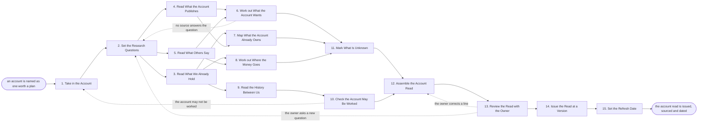

# Reference process: Research an Account

`ref/sls/research-an-account v1`

**value stream:** [Account-to-Plan](../../streams/sales/account-to-plan.md)
An account is named, and the run answers four questions about it: what
the account is trying to do, where its money goes, what it already owns
and from whom, and what has happened between that account and us. It
reads what the account publishes and what outsiders say, then sets both
against the record in our own systems. Every line carries its source
and the date it was current. A question nothing answered is written
down as unknown rather than guessed. The account owner corrects the
read before it is issued at a version.

## The activities

| # | Activity | What happens | Agents |
|---|---|---|---|
| 1 | Take in the Account | why this account was named, and when the read is due | [account-planner](../../agents/account-planner.md) |
| 2 | Set the Research Questions | the questions this read has to answer | account-planner · account owner (person) |
| 3 | Read What We Already Hold | the CRM record, past deals, open tickets | [account-monitor](../../agents/account-monitor.md) |
| 4 | Read What the Account Publishes | filings, the site, product pages, job posts | [researcher](../../agents/researcher.md) |
| 5 | Read What Others Say | analyst notes, press, tender and court records | researcher |
| 6 | Work out What the Account Wants | the stated priorities and the money behind them | researcher · account-planner |
| 7 | Map What the Account Already Owns | the systems in place, the vendors, the dates | researcher · account-monitor |
| 8 | Work out Where the Money Goes | the budget lines, the spend, who signs | [analytics](../../agents/analytics.md) · researcher |
| 9 | Read the History Between Us | every deal, ticket, touch and complaint | account-monitor · analytics |
| 10 | Check the Account May Be Worked | disputes, collections and legal holds | account-monitor · legal reviewer (person) |
| 11 | Mark What Is Unknown | the questions nothing answered, said plainly | account-planner |
| 12 | Assemble the Account Read | one document, every line with its source | account-planner |
| 13 | Review the Read with the Owner | the owner corrects what they know first-hand | account-planner · account owner (person) |
| 14 | Issue the Read at a Version | dated, sourced, handed to the planning work | account-planner |
| 15 | Set the Refresh Date | when the read comes back up, and what forces it | account-planner · account-monitor |

## The graph



## The document, with the blanks marked

```
PROCESS: research an account          id: <team>/research-an-account  v1
from: ref/sls/research-an-account v1
owner: <who>                          effective: <date>
trigger: an account is named as one worth a plan in <your territory or
         account selection process>
concurrency: runs may overlap - <how many> reads run at once, and one
             account is read by one run at a time
goal: one dated read of the account, every line carrying its source,
      the unknowns named as unknowns, corrected by the account owner
      and issued at a version
phases:
  take-in-account  - human: read why the account was named, who asked
                     for the read, and the date the plan needs it
                     owner: account-planner    after: trigger
                     automation: <level>
  set-questions    - convenes briefing: the account owner and the
                     reading agents agree the questions this read has
                     to answer, and which of them are must-answer
                     owner: account-planner    after: take-in-account
                     automation: <level>
  read-own-record  - runs collect-and-report: the CRM record, the deals
                     won and lost, the open tickets, the contract dates
                     owner: account-monitor    after: set-questions
                     by: <days>                automation: <level>
  read-published   - runs collect-and-report: what the account says in
                     its filings, on its site and in its job postings
                     owner: researcher         after: set-questions
                     by: <days>                automation: <level>
  read-outside     - runs collect-and-report: analyst notes, press,
                     tender records, and what is filed in public
                     owner: researcher         after: set-questions
                     by: <days>                automation: <level>
  read-intent      - human: what the account has said it is trying to
                     do, and the money it has put behind saying it
                     owner: researcher
                     after: read-published + read-outside
                     automation: <level>
  map-holdings     - human: the systems the account already runs, who
                     sold them, and when those contracts come up
                     owner: researcher
                     after: read-own-record + read-published
                     automation: <level>
  map-the-spend    - runs collect-and-report: the budget lines this
                     account spends from, and who signs for each one
                     owner: analytics
                     after: read-own-record + read-outside
                     by: <days>                automation: <level>
  read-our-history - runs collect-and-report: every deal, ticket, touch
                     and complaint between this account and us
                     owner: account-monitor    after: read-own-record
                     by: <days>                automation: <level>
  check-standing   - runs assessment: disputes, collections, legal
                     holds, and anything that stops this account being
                     approached at all
                     owner: account-monitor    after: read-our-history
                     automation: <level>
  mark-unknowns    - human: the must-answer questions nothing answered,
                     written down as unknown with what was tried
                     owner: account-planner
                     after: read-intent + map-holdings + map-the-spend
                     automation: <level>
  assemble-read    - human: one document, every line carrying the
                     system or the source it came from and its date
                     owner: account-planner
                     after: mark-unknowns + check-standing
                     by: <days>                automation: <level>
  review-read      - convenes approval: the account owner reads the
                     draft, corrects what they know first-hand, and
                     signs that the read is fit to plan from
                     owner: <your account owner role>
                     after: assemble-read
                     by: <days>                automation: never
  issue-read       - runs decide-and-announce: the read is issued at a
                     version, and every process that reads it is told
                     owner: account-planner    after: review-read
                     automation: <level>
  set-refresh      - human: the date the read comes back up, and the
                     events that force it back up sooner
                     owner: account-planner    after: issue-read
                     automation: <level>
run-scoped:
  spend     - runs allocate-and-reconcile     owner: account-planner
              from: set-questions   until: run close
  freshness - runs collect-and-report         owner: account-monitor
              every: <cadence>
              from: issue-read   until: run close
handoffs:
  take-in-account -> set-questions: the reason the account was named,
    and who is waiting on the read
  set-questions -> read-own-record: the questions, each marked
    must-answer or not, and the date each one is due
  set-questions -> read-published: the same question list
  set-questions -> read-outside: the same question list
  read-published -> read-intent: what the account said, quoted, with
    the document and the date behind each quote
  read-outside -> read-intent: what outsiders said, each source named,
    and whether that source is paid by the account
  read-own-record -> map-holdings: what we already know the account
    runs, and what we sold it
  read-published -> map-holdings: what the account says it runs
  read-own-record -> map-the-spend: what this account has spent with
    us, by line and by year
  read-outside -> map-the-spend: spend visible in public filings
  read-own-record -> read-our-history: the record every history line is
    read from, so nothing is counted twice
  read-our-history -> check-standing: the open tickets, the unpaid
    invoices, and anything still unresolved
  read-intent -> mark-unknowns: what is settled about intent, and what
    the questions still do not settle
  map-holdings -> mark-unknowns: the same, for what the account owns
  map-the-spend -> mark-unknowns: the same, for where the money goes
  check-standing -> assemble-read: whether the account may be worked,
    and the finding behind that answer
  mark-unknowns -> assemble-read: the unknowns, each naming the
    question, what was tried, and what would answer it
  assemble-read -> review-read: the draft read, every line sourced and
    dated
  review-read -> issue-read: the read as the owner corrected it, naming
    the owner and the date they signed
  issue-read -> set-refresh: the issued version, so the refresh date
    hangs off a version and not a document
bindings:
  roster:  <who holds each role - agents claiming the abstract agents
           above, the account owner who signs the read, and the legal
           reviewer who rules on what the standing check turns up>
  systems: the CRM (read), the support system (read),
           contract and renewal records (read),
           <your billing system> (read),
           <your public-record sources> (read),
           <your paid research sources> (read, cap: <spend per run>),
           the account read record (write)
  data:    <your ideal customer profile> <version>,
           <your account tiering rules> <version>,
           the question list agreed for this read
policy:
  every line in the read names the system or document it came from and
    the date that value was current
  a question nothing answered is recorded as unknown, and the read
    never fills the gap with an estimate
  the account owner sees the read before anyone plans from it
  an account the standing check marks as not to be worked goes back to
    <who> before any further research spend
  paid research sources are used inside the spend cap, and anything
    over it waits for <who>
  what is held about a named person at the account follows <your
    privacy rule>, and is deleted after <retention period>
measures:
  cycle time: <target> from the account being named to the issued read
  coverage: <target> share of must-answer questions answered from a
            source rather than left unknown
  volume: <accounts read per period>
  quality gate: <sample size> of issued reads checked each <period>
                against the sources they cite
```

## The failure edges

- **The account turns out not to be workable.** The account-monitor
  agent finds a dispute, an account in collections or a legal hold, and
  the run stops where it is. The finding goes back to whoever named the
  account, the research spend already made is recorded, and no further
  reading happens until a person decides the account is worth it.
- **A must-answer question has no source.** The run does not guess. The
  question goes back to the people who set it, who either drop it,
  accept it as unknown, or fund a source that would answer it. An
  unknown that survives that conversation is written into the read in
  the same words it was asked in.
- **Two systems say different things about the same account.** The read
  carries both readings with the system and the date on each, and names
  which one the account owner told it to believe. A contradiction wider
  than the tolerance the process sets goes to the account owner before
  the read is assembled.
- **The account owner corrects a line.** The read goes back to be
  assembled again, the correction is recorded as a correction rather
  than an overwrite, and the line names the owner as its source. What
  the owner knows first-hand outranks the systems, and the read says so.
- **The paid research spend hits its cap.** Reading stops at the cap.
  What was bought is listed, what it answered is listed, and the
  questions still open go into the unknowns. Going over the cap is a
  person's decision and is recorded as one.
- **The read is issued and then goes stale.** The refresh date and the
  tripwires are set in the last activity for this reason. A tripwire
  event, such as an acquisition or the departure of the executive the
  read rests on, pulls the account back to activity 1 rather than
  letting a plan keep quoting a read nobody rechecked.
- **The account is already being read by another run.** One account is
  read by one run at a time. The second request joins the run in
  flight, its extra questions go to set-questions, and the read is
  issued once.
- **A run is abandoned.** The read is closed as abandoned, with what was
  gathered so far, what it cost, and the reason it stopped. Whatever was
  gathered stays sourced and dated so the next run does not pay for it
  twice, and anything held about a named person is deleted under the
  privacy rule the same as if the read had finished.
