# Reference process: Respond to an RFP

`ref/sls/respond-to-an-rfp v1`

**value stream:** [Solution-to-Proposal](../../streams/sales/solution-to-proposal.md)
A formal request arrives carrying its own rules: a deadline, a format,
a channel, page limits, a question window and a list of requirements
that each have to be answered. This process reads those rules first,
decides whether to bid, and tells the buyer either way. A decline is a
real outcome here, written down with the reason, because a bid nobody
meant to win costs more than a clean no. A yes splits the requirements
to owners, uses the question window, prices the bid, and checks the
response against the rules. The run closes at a receipt or a no bid.

## The activities

| # | Activity | What happens | Agents |
|---|---|---|---|
| 1 | Take in the Request | the document, the buyer, and where it came from | [questionnaire-responder](../../agents/questionnaire-responder.md) |
| 2 | Read the Rules It Sets | deadline, format, channel, limits, question window | questionnaire-responder |
| 3 | Decide Whether to Bid | a go or a no, with the reason written down | [solution-architect](../../agents/solution-architect.md) · sales leader (person) |
| 4 | Tell the Buyer Either Way | a decline in writing, or intent confirmed | account owner (person) |
| 5 | Split the Requirements | every requirement gets one owner and a date | questionnaire-responder |
| 6 | Ask the Buyer's Questions | the clarification window used before it closes | questionnaire-responder · account owner (person) |
| 7 | Answer the Requirements | each one answered by the owner of the fact | questionnaire-responder · solution-architect |
| 8 | Design the Solution Response | how the work would actually be done | solution-architect · [configurator](../../agents/configurator.md) |
| 9 | Price the Bid | priced against the card and the terms asked for | [quote-builder](../../agents/quote-builder.md) · configurator |
| 10 | Answer the Security and Legal Parts | the buyer's standard questions, from the library | questionnaire-responder · [standards-keeper](../../agents/standards-keeper.md) |
| 11 | Write the Narrative | the parts the buyer reads rather than scores | [proposal-writer](../../agents/proposal-writer.md) |
| 12 | Check It Against the Rules | every requirement answered, every limit obeyed | questionnaire-responder |
| 13 | Get the Bid Approved | named signers approve the price and the promises | deal desk reviewer (person) · legal reviewer (person) |
| 14 | Assemble and Submit | one submission, in format, before the deadline | proposal-writer · account owner (person) |
| 15 | Confirm Receipt | a receipt from the buyer, or it is not in | questionnaire-responder |
| 16 | Handle Clarifications | the follow-ups, and the presentation if asked | proposal-writer · solution-architect |
| 17 | Record the Outcome | won, lost or no bid, with what was learned | questionnaire-responder |

## The graph

```mermaid
flowchart LR
  T([a formal request arrives]) --> A1[1. Take in the Request]
  A1 --> A2[2. Read the Rules It Sets]
  A2 --> A3[3. Decide Whether to Bid]
  A3 --> A4[4. Tell the Buyer Either Way]
  A4 -. the answer was no bid .-> A17[17. Record the Outcome]
  A4 --> A5[5. Split the Requirements]
  A5 --> A6[6. Ask the Buyer's Questions]
  A5 --> A7[7. Answer the Requirements]
  A5 --> A8[8. Design the Solution Response]
  A6 -. an answer changes what a requirement means .-> A5
  A6 --> A7
  A8 --> A9[9. Price the Bid]
  A7 --> A10[10. Answer the Security and Legal Parts]
  A7 --> A11[11. Write the Narrative]
  A9 --> A11
  A10 --> A11
  A11 --> A12[12. Check It Against the Rules]
  A12 -. a requirement is unanswered .-> A7
  A12 -. a limit is broken .-> A11
  A12 --> A13[13. Get the Bid Approved]
  A13 -. the price has to change .-> A9
  A13 -. a promise cannot be made .-> A8
  A13 --> A14[14. Assemble and Submit]
  A14 --> A15[15. Confirm Receipt]
  A15 -. no receipt arrives .-> A14
  A15 --> A16[16. Handle Clarifications]
  A16 --> A17
  A17 --> DONE([the bid is submitted and confirmed, or the no bid is on the record])
```



## The document, with the blanks marked

```
PROCESS: respond to an rfp             id: <team>/respond-to-an-rfp   v1
from: ref/sls/respond-to-an-rfp v1
owner: <who>                          effective: <date>
trigger: a formal request for proposal, tender or information arrives
         at <your intake address> or is found in <your sourcing feed>
         watch: record=<request for proposal>
                system=<your intake address>
                change=<a formal request arrives>
         or watch: record=<request for proposal>
                system=<your sourcing feed>
                change=<a formal request is found>
concurrency: runs may overlap - <how many> bids in flight at once, and
             one request is one run from intake to outcome
goal: a submission that answers every requirement, obeys every rule the
      request set, and lands before the deadline - or a decline sent in
      writing within <days> of the request arriving
phases:
  take-in-request     - human: the request, the buyer, the channel it
                        came through, and who inside the organization
                        first saw it
                        owner: questionnaire-responder
                        after: trigger          automation: <level>
  read-rules          - human: the deadline, the format, the channel,
                        the page and word limits, the question window,
                        and how the response will be scored
                        owner: questionnaire-responder
                        after: take-in-request  automation: <level>
  decide-to-bid       - convenes decide-and-announce: bid or no bid,
                        decided by <who> against <your bid criteria>,
                        with the reason written down either way
                        owner: <your sales leadership role>
                        after: read-rules
                        by: <days>              automation: never
  tell-the-buyer      - human: a decline in writing, or intent to
                        respond confirmed the way the request asks for
                        owner: <your account role>
                        after: decide-to-bid
                        by: <days>              automation: <level>
  split-requirements  - human: every requirement given one owner, one
                        date, and the section of the response it lands
                        in
                        owner: questionnaire-responder
                        after: tell-the-buyer   automation: <level>
  ask-questions       - human: the questions the response depends on,
                        asked through the buyer's own channel before
                        the window closes on <date>
                        owner: questionnaire-responder
                        after: split-requirements
                        by: <days>              automation: <level>
  answer-requirements - runs build-by-talent: each requirement answered
                        by the owner of the fact, in the words the
                        request asks for
                        owner: questionnaire-responder
                        after: split-requirements + ask-questions
                        by: <days>              automation: <level>
  design-response     - runs build-by-talent: how the work would
                        actually be done, at the depth the request
                        scores
                        owner: solution-architect
                        after: split-requirements
                        by: <days>              automation: <level>
  price-bid           - human: the bid priced against the rate card at
                        its version, on the commercial terms the
                        request demands
                        owner: quote-builder    after: design-response
                        by: <days>              automation: <level>
  answer-security     - runs collect-and-report: the buyer's security,
                        privacy, legal and procurement sections
                        answered from the library at their versions
                        owner: standards-keeper
                        after: answer-requirements
                        automation: <level>
  write-narrative     - runs build-by-talent: the summary, the
                        approach and the references - the parts a
                        person reads rather than scores
                        owner: proposal-writer
                        after: answer-requirements + price-bid +
                               answer-security
                        by: <days>              automation: <level>
  check-compliance    - runs assessment: every requirement answered,
                        every limit obeyed, every form present, scored
                        against the rules read at the start
                        owner: questionnaire-responder
                        after: write-narrative  automation: <level>
  approve-bid         - convenes approval: named signers approve the
                        price, the commitments and the terms the bid
                        accepts
                        owner: <your deal desk role>
                        after: check-compliance
                        by: <days>              automation: never
  submit              - human: one submission, in the format, through
                        the channel the request names, no later than
                        <hours> before the deadline
                        owner: <your account role>
                        after: approve-bid      automation: <level>
  confirm-receipt     - system: the buyer's receipt, reference number
                        or portal confirmation, recorded against the
                        submission
                        owner: questionnaire-responder
                        after: submit           automation: <level>
  handle-clarify      - human: the buyer's follow-up questions, the
                        shortlist presentation, and any best and final
                        offer the buyer asks for
                        owner: proposal-writer  after: confirm-receipt
                        automation: <level>
  record-outcome      - convenes debrief: won, lost or no bid, the
                        score the buyer gave if they give one, and what
                        to do differently
                        owner: questionnaire-responder
                        after: handle-clarify   automation: <level>
run-scoped:
  countdown - runs roll-call             owner: questionnaire-responder
              every: <cadence>
              from: read-rules   until: submit
  bid-cost  - runs allocate-and-reconcile   owner: <your sales
              leadership role>
              from: decide-to-bid   until: run close
handoffs:
  take-in-request -> read-rules [the-request]: the request as
    received, complete, with every attachment and addendum it arrived
    with
  read-rules -> decide-to-bid [the-rules]: the deadline, the scoring,
    the terms the request imposes, and every requirement the
    organization cannot meet
  decide-to-bid -> tell-the-buyer [bid-decision]: the decision and
    the reason, in the words that go to the buyer
  tell-the-buyer -> split-requirements [confirmed-intent]: the
    confirmed intent to respond, and the date the buyer expects the
    submission
  split-requirements -> ask-questions [questions-to-ask]: the
    requirements nobody can answer as written, and the date the
    question window closes
  split-requirements -> answer-requirements [owned-requirements]:
    every requirement with its owner, its date and its section
  split-requirements -> design-response [work-requirements]: the
    requirements that describe the work rather than the company
  ask-questions -> answer-requirements [buyer-answers]: the buyer's
    answers, as the buyer wrote them, and every question they refused
    to answer
  design-response -> price-bid [solution-design]: the solution as it
    would be delivered, so the price is priced against it
  answer-requirements -> answer-security [security-sections]: the
    security, privacy and procurement sections, with the questions
    already answered elsewhere in the response marked
  answer-requirements -> write-narrative [answered-requirements]:
    the answered requirements, so the narrative says nothing the
    answers contradict
  price-bid -> write-narrative [the-price]: the price, the terms, and
    every assumption the price depends on
  write-narrative -> check-compliance [draft-response]: the complete
    response, at a draft version, in the format the request demands
  check-compliance -> approve-bid [compliance-result]: the scored
    response, with the requirement or the rule behind every failure
  approve-bid -> submit [approved-response]: the approved response at
    the signed version. A later change voids the approval and approval
    runs again
  submit -> confirm-receipt [what-was-submitted]: what was submitted,
    through which channel, at what time
  confirm-receipt -> handle-clarify [the-receipt]: the receipt and
    the reference the buyer gave it
  handle-clarify -> record-outcome [post-submission]: everything said
    after submission, and what the buyer decided
deviations:
  tell-the-buyer -> record-outcome [no-bid]: the decision was no bid,
    so none of the answering, pricing or submission phases run, and
    the run goes straight to the outcome record with the reason
  ask-questions -> split-requirements [answer-changes-meaning]: an
    answer from the buyer changes what a requirement means, so the
    requirements are split again against the new reading
  check-compliance -> answer-requirements [requirement-unanswered]:
    the check finds a requirement nobody answered, so it goes back to
    the owner of the fact with the requirement attached
  check-compliance -> write-narrative [limit-broken]: a page or word
    limit is broken, so the narrative is written again to fit rather
    than the answers being cut
  approve-bid -> price-bid [price-must-change]: the signers will not
    approve the price, so the bid is priced again before it can be
    approved
  approve-bid -> design-response [promise-cannot-be-made]: a
    commitment in the response is one nobody will stand behind, so the
    solution is designed again around what can be promised
  confirm-receipt -> submit [no-receipt]: no receipt, reference
    number or portal confirmation arrives, so the bid is treated as
    not submitted and the submission is made again
bindings:
  roster:  <who holds each role - agents claiming the abstract agents
           above, and named people for the account owner, the sales
           leader, the deal desk reviewer and the legal reviewer>
  systems: the CRM (write), the bid library (read, write),
           the answer library (read), the quoting system (read),
           the buyer's portal (write), the approval record (write),
           the document store (write)
  data:    <your bid criteria> <version>, the answer library <version>,
           the rate card <version>, the standard terms <version>,
           <your reference customer list> <version>, the request and
           every addendum
policy:
  the rules the request sets are read and written down before any
    answer is drafted, and a rule found later reopens the compliance
    check
  no bid is submitted without a decision recorded against <your bid
    criteria>, and a no bid is told to the buyer in writing
  questions go through the buyer's own channel, and nothing is asked
    outside it while the window is open
  every requirement gets a named owner, and an unowned requirement
    blocks the compliance check
  approval is a human gate and is never delegated to an agent
  a response changed after approval goes back through approval
  the submission lands at least <hours> before the deadline, and a
    submission that would miss it is escalated to <who> rather than
    rushed
  nothing is promised in a bid that <who> has not agreed the
    organization will deliver
measures:
  cycle time: <days> from the request arriving to the decision to bid
  win rate: <target> of bids submitted
  no-bid rate: <target> of requests declined, because declining well is
               part of the goal
  volume: <bids per period>
  quality gate: no submission leaves failing its compliance check, and
                no bid leaves unsigned
```

## The failure edges

- **The request is found too late to answer properly.** The countdown
  says the remaining days are less than the work takes. The decision to
  bid is made against that, not around it, and a request that cannot be
  answered well is declined in writing rather than answered badly.
- **The decision is no bid.** The run does not stop quietly. The buyer
  is told in writing, the reason is recorded against <your bid
  criteria>, and the run goes straight to the outcome record so the
  next request from the same buyer starts from what was decided last
  time.
- **A requirement cannot be met.** The owner says so in writing rather
  than answering around it. The bid either takes the exception where
  the request allows one, partners for the gap, or the decision to bid
  is reopened. Answering yes to something the organization cannot do is
  the failure this edge exists to prevent.
- **The question window closes before the questions are asked.** The
  response is written against the request as it stands, every
  assumption the answers depend on is written down inside the response,
  and the assumptions go to approval with the price that rests on them.
- **The buyer issues an addendum mid-flight.** The rules change, and
  the run goes back to reading them. Every requirement the addendum
  touches reopens, the compliance check runs against the new version,
  and a response already assembled against the old rules is not
  submitted.
- **The compliance check fails.** A requirement is unanswered, a page
  limit is broken, or a required form is missing. The findings go back
  with the requirement or the rule attached to each one, and the same
  check runs again on the fixed response before approval.
- **The submission misses the deadline.** The portal closes, the upload
  fails, or the approval lands too late. The submission is not sent
  late and dressed up as on time. The buyer is asked whether a late
  response is accepted, the answer is recorded, and the outcome is
  recorded as a miss either way.
- **No receipt arrives.** The run goes back to submission. Until a
  receipt, a reference number or a portal confirmation exists, the bid
  is treated as not submitted, and the account owner chases it through
  the channel the request named.
- **The bid wins on terms nobody approved.** The buyer accepts
  something the response did not commit to, or accepts an old version.
  The signed version settles it, which is why the submission is kept at
  its version with the approvals attached.
- **A run is abandoned.** The buyer cancels the request, the
  opportunity dies, or the organization withdraws. The buyer is told in
  writing, the draft is marked as never submitted, the approvals
  attached to it are voided, and the answers and the solution design go
  into the bid library anyway, because the next request will ask for
  most of it again.
