# Reference process: Return a Lead to Nurture

`ref/sls/return-a-lead-to-nurture v1`

**value stream:** [Inquiry-to-Qualified](../../streams/sales/inquiry-to-qualified.md)
Qualification ended in a no that is not a never, and the lead has to go
back in a state somebody can pick up. The reason is written in words the
next run can act on, checked against what was actually asked, and given
a date to look again. The events that would end the wait early are named
and watched, the buyer hears the no and what happens next, and the lead,
the reason and the date cross to nurture together. The run stays open
until the date arrives or a signal fires, and it ends when somebody has
said whether the lead comes back.

## The activities

| # | Activity | What happens | Agents |
|---|---|---|---|
| 1 | Take in the Return Decision | which lead, decided by whom, and when | [qualifier](../../agents/qualifier.md) |
| 2 | Read the Reason Given | the reason in words the next run can act on | qualifier |
| 3 | Check the Reason Against the Record | what was actually asked, and what came back | qualifier · seller (person) |
| 4 | Set the Date to Look Again | the date, and what should be true by then | seller (person) · sales manager (person) |
| 5 | Name What Would Bring It Back Early | the events that end the wait before the date | qualifier · [account-monitor](../../agents/account-monitor.md) |
| 6 | Write the Handback Note | the reason, the date, and what to watch for | qualifier |
| 7 | Tell the Person Who Asked | a no that is not a never, said in plain words | seller (person) |
| 8 | Hand the Lead to Nurture | the lead, the reason and the date go across | [lead-scorer](../../agents/lead-scorer.md) · marketing operations (person) |
| 9 | Set the Watch | the signals that end the wait are switched on | account-monitor |
| 10 | Close the Opportunity Record | closed with the reason, the date and the proof | lead-scorer · qualifier |
| 11 | Look Again on the Date | the account and the company are read again | account-monitor · [researcher](../../agents/researcher.md) |
| 12 | Decide Whether It Comes Back | a person says requalify, wait again, or close | sales manager (person) · seller (person) |
| 13 | Record the Outcome | what the wait produced, and on what date | qualifier · lead-scorer |

The reason and the date are the whole point of this process. A lead sent
back with neither is a lead nobody can act on, and the next person to
meet it starts from the beginning. Activity 3 exists because the reason
a seller gives and the answers the record holds do not always agree, and
the record is what the next run reads. Activity 12 belongs to a person:
the watch and the date bring the lead back into view, and somebody says
out loud whether it is worth a seller's time now.

## The graph

```mermaid
flowchart LR
  T([a qualification ends in nurture]) --> A1[1. Take in the Return Decision]
  A1 --> A2[2. Read the Reason Given]
  A2 --> A3[3. Check the Reason Against the Record]
  A3 -. the reason does not match the record .-> A2
  A3 --> A4[4. Set the Date to Look Again]
  A4 --> A5[5. Name What Would Bring It Back Early]
  A5 --> A6[6. Write the Handback Note]
  A6 --> A7[7. Tell the Person Who Asked]
  A6 --> A8[8. Hand the Lead to Nurture]
  A7 -. they ask to be taken up again now .-> A12[12. Decide Whether It Comes Back]
  A8 --> A9[9. Set the Watch]
  A7 --> A10[10. Close the Opportunity Record]
  A9 --> A10
  A9 -. a named signal fires early .-> A11[11. Look Again on the Date]
  A10 --> A11
  A11 --> A12
  A12 -. still not ready .-> A4
  A12 --> A13[13. Record the Outcome]
  A13 --> DONE([the lead sits with nurture, dated, and the outcome is recorded])
```



## The document, with the blanks marked

```
PROCESS: return a lead to nurture      id: <team>/return-a-lead-to-nurture   v1
from: ref/sls/return-a-lead-to-nurture v1
owner: <who>                           effective: <date>
trigger: a qualification decides to return a lead to nurture in <your
         qualification process>
concurrency: one run per lead - a run stays open until its date
             arrives, so <how many> dated leads sit open at once
goal: every returned lead handed back with the reason a person gave, a
      date to look again, the events that would end the wait early, and
      an outcome recorded when that date arrives
phases:
  take-in-return  - system: the lead, the decision, the person who made
                    it, and the date they made it
                    owner: qualifier          after: trigger
                    automation: <level>
  read-reason     - human: the reason written in words the next run can
                    act on, drawn from <your return reason list>
                    owner: qualifier          after: take-in-return
                    by: <hours>               automation: <level>
  check-reason    - runs assessment: the reason set against what was
                    actually asked and what came back
                    owner: qualifier          after: read-reason
                    automation: <level>
  set-date        - convenes decide-and-announce: the date to look
                    again, and what should be true by then
                    owner: <your seller role> after: check-reason
                    by: <days>                automation: never
  name-triggers   - human: the events that end the wait before the
                    date, written as things a system can see
                    owner: qualifier          after: set-date
                    automation: <level>
  write-note      - human: one note carrying the reason, the date, the
                    events to watch, and what was already said
                    owner: qualifier          after: name-triggers
                    by: <hours>               automation: <level>
  tell-buyer      - human: the buyer hears the no, hears that it is not
                    a never, and hears when somebody looks again
                    owner: <your seller role> after: write-note
                    by: <days>                automation: <level>
  hand-to-nurture - human: the lead, the reason, the date and the
                    events cross to <your nurture program> as one
                    owner: lead-scorer        after: write-note
                    automation: <level>
  set-watch       - system: the named events are watched on this
                    account until the date or until one fires
                    owner: account-monitor    after: hand-to-nurture
                    automation: <level>
  close-record    - system: the opportunity record closes with the
                    reason, the date and the evidence attached
                    owner: lead-scorer
                    after: tell-buyer + set-watch
                    automation: <level>
  look-again      - runs collect-and-report: the account and the
                    company read again, set against what was supposed
                    to be true by now
                    owner: account-monitor    after: close-record
                    by: <days>                automation: <level>
  decide-return   - convenes decide-and-announce: <who> says requalify
                    it, wait again with a new date, or close it for
                    good, and says why
                    owner: <your sales manager role>
                    after: look-again
                    by: <days>                automation: never
  record-outcome  - runs collect-and-report: what the wait produced,
                    on what date, and which reason it belonged to
                    owner: qualifier          after: decide-return
                    automation: <level>
run-scoped:
  watch  - runs roll-call                     owner: account-monitor
           every: <cadence>
           from: set-watch     until: look-again
  ageing - runs collect-and-report            owner: qualifier
           every: <cadence>
           from: close-record  until: run close
handoffs:
  take-in-return -> read-reason: the lead, the decision, the person who
    made it, and everything qualification recorded
  read-reason -> check-reason: the reason in one line, chosen from the
    reason list, with what the seller said behind it
  check-reason -> set-date: whether the record supports the reason, and
    every answer that contradicts it
  set-date -> name-triggers: the date, and what has to be true about
    this buyer by then
  name-triggers -> write-note: the events that end the wait early, each
    written so a system can see it happen
  write-note -> tell-buyer: what the buyer is to be told, and what was
    already promised to them
  write-note -> hand-to-nurture: the reason, the date, the events, and
    everything learned in qualification
  hand-to-nurture -> set-watch: the account the events are watched on,
    and the date the watch expires
  tell-buyer -> close-record: what the buyer was told and when
  set-watch -> close-record: the watch as armed, naming each event and
    the system it is read from
  close-record -> look-again: the closed record, the date, and the
    reading the account stood at when it closed
  look-again -> decide-return: what changed since the return, each line
    naming the system it came from and when it was read
  decide-return -> record-outcome: the decision in one line, the person
    who made it, and the date
bindings:
  roster:  <who holds each role - agents claiming the abstract agents
           above, and named people for the seller, the sales manager
           and whoever runs the nurture program>
  systems: the CRM (write), the opportunity record (write),
           <your nurture program> (write), product usage data (read),
           the support system (read), contract records (read),
           the consent record (read), the sending system (write)
  data:    <your return reason list> <version>,
           <your ideal customer profile> <version>,
           <your nurture entry rules>, the scoring model at a version
policy:
  no lead is returned without a reason from the list and a date to look
    again, and <who> may not leave either blank
  the buyer is told, in plain words, that this is a no for now and when
    somebody will look again
  a lead that asked not to be contacted goes to nurture on no channel,
    and the request is recorded against the record
  the reason recorded is the one the record supports, and a reason the
    record contradicts goes back to the seller before it is written
  the date is <how far out> at most, and a longer wait is a close
    rather than a date
  a returned lead is not worked by a seller again until <who> has said
    it comes back
measures:
  cycle time: <target> from the return decision to the lead sitting in
              nurture with its date
  coverage: <target> share of returned leads carrying both a reason
            from the list and a date
  volume: <returns per period>, split by reason
  return rate: <target> share of dated leads that came back and reached
               <which stage>
  quality gate: no lead closes without an outcome recorded on or after
                its date
```

## The failure edges

- **The reason does not match the record.** Check-reason sends the run
  back with the answers that contradict it. The seller either changes
  the reason or says what the record missed, and the record is corrected
  before the lead crosses to nurture.
- **Nobody will name a date.** The run holds at set-date. A lead with no
  date is not handed back, because nurture cannot act on it and nobody
  will look at it again. After <how long> the wait goes to <who>.
- **The buyer asks to be picked up again straight away.** The run goes
  to the return decision early, with everything qualification learned
  attached. The lead is not quietly reopened by whoever took the call.
- **A named event fires before the date.** The watch ends the wait and
  the run reads the account again immediately. The date is not honored
  past evidence that the situation changed.
- **The account is in nurture already.** The lead joins the program it
  is already in rather than starting a second one, and the two dates
  become one, the earlier of them.
- **The buyer asks to stop being contacted.** The run stops where it is,
  the request is recorded against the record, the lead goes to nurture
  on no channel, and anything already scheduled for them is pulled.
- **The date arrives and nobody looks.** The run stays open and the miss
  is recorded. It is never closed to make the ageing report shorter, and
  after <how long> the open date goes to <who>.
- **The look-again finds nothing changed.** The person deciding sets a
  new date or closes the lead for good. Rolling the same date forward
  without a decision is not one of the choices, and <how many> waits is
  the point at which a close is the only option.
- **A run is abandoned.** The lead is left in nurture with whatever
  reason and date it already carries, the watch is switched off, and the
  opportunity record says the outcome was never recorded rather than
  showing a clean close. Anything promised to the buyer still has to be
  met, and the handback note is where the next person finds it.
