# Reference process: Review the Account Plans

`ref/sls/review-the-account-plans v1`

**value stream:** [Account-to-Plan](../../streams/sales/account-to-plan.md)
Plans go stale quietly. This run reads them together on a cadence and
sets each one against what actually happened: which moves were made,
which assumptions held, and who at the account has moved since. Every
plan comes out of the round changed, kept, paused or retired, with the
reason recorded and a version behind it. Effort moves off the plans that
stopped working and onto the ones that did. The round ends by writing
down what it taught about how plans get written, which is the only way
the next round starts from a better draft.

## The activities

| # | Activity | What happens | Agents |
|---|---|---|---|
| 1 | Open the Review Round | the period, the accounts, and who attends | [account-planner](../../agents/account-planner.md) |
| 2 | Pull Every Plan in Scope | each plan at the version it is running at | account-planner |
| 3 | Read What Actually Happened | the moves made, the deals opened, the results | [analytics](../../agents/analytics.md) · [account-monitor](../../agents/account-monitor.md) |
| 4 | Test the Assumptions Again | which assumptions held, and which did not | account-planner · [researcher](../../agents/researcher.md) |
| 5 | Check Whether the People Changed | joiners, leavers and moves since the plan | [relationship-mapper](../../agents/relationship-mapper.md) · account-monitor |
| 6 | Score Each Plan | on track, off track, or overtaken by events | account-planner · analytics |
| 7 | Sort the Plans into What Happens Next | keep, change, pause or retire | account-planner · account owner (person) |
| 8 | Hold the Review | the account team answers for each plan | [decision-coordinator](../../agents/decision-coordinator.md) · sales leader (person) |
| 9 | Decide Each Plan | the call on every plan, with the reason | decision-coordinator · sales leader (person) |
| 10 | Move the Effort | where the people and the money go instead | account-planner · sales leader (person) |
| 11 | Amend the Plans that Change | a new version, not an edit over the old one | account-planner |
| 12 | Retire the Plans that Stop | closed with a reason, and the account tidy | account-planner · account owner (person) |
| 13 | Tell the Readers | everyone acting on a plan hears the decision | decision-coordinator · account-planner |
| 14 | Record What the Round Taught | what to change in how plans get written | account-planner |

## The graph

```mermaid
flowchart LR
  T([the review cadence comes round, or a tripwire fires]) --> A1[1. Open the Review Round]
  A1 --> A2[2. Pull Every Plan in Scope]
  A2 --> A3[3. Read What Actually Happened]
  A2 --> A4[4. Test the Assumptions Again]
  A2 --> A5[5. Check Whether the People Changed]
  A3 --> A6[6. Score Each Plan]
  A4 --> A6
  A5 --> A6
  A4 -. the assumption cannot be tested .-> A3
  A6 --> A7[7. Sort the Plans into What Happens Next]
  A7 --> A8[8. Hold the Review]
  A8 -. the plan is not ready to answer for .-> A7
  A8 --> A9[9. Decide Each Plan]
  A9 -. the evidence does not settle it .-> A3
  A9 --> A10[10. Move the Effort]
  A9 --> A11[11. Amend the Plans that Change]
  A9 --> A12[12. Retire the Plans that Stop]
  A10 --> A13[13. Tell the Readers]
  A11 --> A13
  A12 --> A13
  A13 --> A14[14. Record What the Round Taught]
  A14 --> DONE([every plan in scope is kept, changed, paused or retired])
```



## The document, with the blanks marked

```
PROCESS: review the account plans      id: <team>/review-the-account-plans  v1
from: ref/sls/review-the-account-plans v1
owner: <who>                          effective: <date>
trigger: the review cadence comes round every <cadence>, or a tripwire
         named in a plan fires and pulls that plan in early
         watch: every=<cadence>
         or watch: record=<plan> system=<your plan record>
                change=<a tripwire named in the plan fires>
concurrency: one round at a time for a given <territory or segment>,
             and a plan belongs to one round at a time
goal: every plan in scope read against what actually happened and
      decided as keep, change, pause or retire, with the reason
      recorded, a version behind every change, and the effort moved to
      match the decisions
phases:
  open-round       - human: the period, the accounts in scope, who
                     attends, and what this round has to settle
                     owner: account-planner    after: trigger
                     automation: <level>
  pull-plans       - runs collect-and-report: every plan in scope at
                     the version it is actually running at, with its
                     signers and the date it was signed
                     owner: account-planner    after: open-round
                     by: <days>                automation: <level>
  read-outcomes    - runs collect-and-report: the moves the plan named,
                     which were made, what opened, what closed, and
                     what the account did that nobody planned for
                     owner: analytics          after: pull-plans
                     by: <days>                automation: <level>
  test-assumptions - runs assessment: each assumption in each plan
                     marked held, broken or untestable, with the
                     evidence that settled it
                     owner: account-planner    after: pull-plans
                     by: <days>                automation: <level>
  check-people     - runs collect-and-report: joiners, leavers and
                     title changes at each account since the plan was
                     signed, read against the buyers the plan named
                     owner: relationship-mapper
                     after: pull-plans
                     by: <days>                automation: <level>
  score-plans      - runs assessment: each plan scored on track, off
                     track, or overtaken by events, on <your plan
                     scoring rules>
                     owner: account-planner
                     after: read-outcomes + test-assumptions + check-people
                     automation: <level>
  sort-plans       - human: a proposal for each plan, said as keep,
                     change, pause or retire, with the reason attached
                     owner: account-planner    after: score-plans
                     automation: <level>
  hold-review      - convenes debrief: the account team answers for
                     each plan in front of <your sales leadership
                     role>, against the evidence rather than the story
                     owner: decision-coordinator
                     after: sort-plans
                     by: <days>                automation: <level>
  decide-plans     - convenes decide-and-announce: the call on every
                     plan in scope, naming who decided it, on what
                     evidence, and anyone who disagreed
                     owner: <your sales leadership role>
                     after: hold-review
                     automation: never
  move-effort      - convenes allocate-and-reconcile: the people, the
                     money and the product time released by the paused
                     and retired plans, placed against what was kept
                     owner: <your sales leadership role>
                     after: decide-plans
                     by: <days>                automation: <level>
  amend-plans      - human: every plan that changes is reissued at a
                     new version, and the version it replaces stays
                     where it is
                     owner: account-planner    after: decide-plans
                     by: <days>                automation: <level>
  retire-plans     - human: every plan that stops is closed with the
                     reason, the open moves are cancelled, and the
                     account is left with a record of what happened
                     owner: account-planner    after: decide-plans
                     by: <days>                automation: <level>
  tell-readers     - runs decide-and-announce: everyone acting on a
                     plan is told what changed, from what date, and
                     which of their work stops
                     owner: decision-coordinator
                     after: move-effort + amend-plans + retire-plans
                     automation: <level>
  record-learnings - convenes debrief: what this round says about how
                     plans get written, and what the next plan should
                     do differently
                     owner: account-planner    after: tell-readers
                     automation: <level>
run-scoped:
  attendance - runs roll-call                 owner: account-planner
               every: <cadence>
               from: open-round   until: hold-review
  effort     - runs allocate-and-reconcile    owner: account-planner
               from: move-effort   until: run close
handoffs:
  open-round -> pull-plans [accounts-in-scope]: the accounts in
    scope, and why each one is in this round rather than the next
  pull-plans -> read-outcomes [running-plans]: each plan at its
    running version, with the moves it named and the dates they were
    due
  pull-plans -> test-assumptions [written-assumptions]: the
    assumptions as they were written when the plan was signed, not as
    anyone remembers them
  pull-plans -> check-people [named-buyers]: the buyers each plan
    named, so a move is read against a commitment
  read-outcomes -> score-plans [what-happened]: what was done and
    what happened, each line naming the system it was read from
  test-assumptions -> score-plans [assumption-results]: every
    assumption marked held, broken or untestable, with the evidence
  check-people -> score-plans [people-changes]: the buyers who left,
    moved or arrived, and the plans that depended on them
  score-plans -> sort-plans [plan-scores]: the score for each plan
    and the reasons under it
  sort-plans -> hold-review [proposal-per-plan]: a proposal per plan,
    so the review argues with a recommendation rather than a blank
    page
  hold-review -> decide-plans [review-record]: what the account team
    said, what the evidence said, and where the two did not agree
  decide-plans -> move-effort [released-effort]: the plans paused and
    retired, and what each one was holding
  decide-plans -> amend-plans [plans-to-change]: the plans that
    change, and what the decision said has to change in each
  decide-plans -> retire-plans [plans-to-retire]: the plans that
    stop, and the reason recorded for each
  move-effort -> tell-readers [effort-placements]: where the effort
    went, so the teams losing it and gaining it hear the same thing
  amend-plans -> tell-readers [new-versions]: the new versions and
    the dates they apply from
  retire-plans -> tell-readers [closed-plans]: the closed plans, and
    the work that stops because of them
  tell-readers -> record-learnings [announcements]: what was
    announced, and to whom
deviations:
  test-assumptions -> read-outcomes [assumption-untestable]: an
    assumption cannot be settled from what was read, so the outcomes
    are read again for the evidence that would settle it
  hold-review -> sort-plans [plan-not-ready]: the account team cannot
    answer for a plan, so that plan is sorted again before the room
    decides it
  decide-plans -> read-outcomes [evidence-does-not-settle]: the
    evidence in front of the room does not settle a plan, so what
    actually happened is read again before the call is made
bindings:
  roster:  <who holds each role - agents claiming the abstract agents
           above, the account owners who answer for their plans, and
           the sales leader who decides>
  systems: the plan record (write), the CRM (read),
           <your forecast system> (read), the account read record
           (read), the account map record (read),
           the notification channel (write),
           <your resourcing record> (write)
  data:    <your plan scoring rules> <version>, the plans in scope at
           their running versions, <your review calendar>
policy:
  a plan is scored against what it said when it was signed, and the
    assumptions are never rewritten to fit the result
  every decision names who made it, on what evidence, and anyone who
    disagreed
  a plan that changes is reissued at a new version, and the version it
    replaces stays in the record
  a retired plan is closed with a reason, and the account is not left
    holding open moves nobody owns
  effort released by a paused or retired plan is placed somewhere in
    this round, or is recorded as unplaced
  a plan nobody attends for is not decided in the account team's
    absence beyond <how many> rounds, after which it goes to <who>
  the round changes no forecast; a plan is not a commitment and a
    retired plan does not by itself close a deal
measures:
  cycle time: <target> from the round opening to every plan decided
  coverage: <target> share of plans in force reviewed inside <period>
  volume: <plans reviewed per round>
  quality gate: <sample size> of decisions checked each <period> for a
                recorded reason and named evidence
```

## The failure edges

- **The evidence for a plan is missing.** The moves were made but never
  recorded, or the system that would show the result is unavailable. The
  plan is scored as unread rather than as on track, the run goes back to
  read-outcomes, and a plan that stays unread across the number of
  rounds the policy allows goes to the sales leader as a plan nobody can
  answer for.
- **An assumption cannot be tested.** It was written too loosely to
  settle either way. It is marked untestable, the plan is scored without
  it, and the fact goes into the round's learnings, because an
  untestable assumption is a defect in how the plan was written.
- **The buyer the plan rested on has gone.** The people check finds the
  departure, the plan is scored as overtaken by events regardless of how
  its moves went, and the decision is taken with the gap in front of the
  room rather than found later.
- **The account team does not turn up.** The plan is held over to the
  next round once, with the absence recorded. After that the leader
  decides it without them, and the decision says plainly that the
  account team did not answer for it.
- **The review argues from the story rather than the evidence.** The
  scores, the assumption results and the outcome lines go into the room
  before anyone speaks, and a claim with no line behind it is recorded
  as a claim. The decision-coordinator agent puts any contradiction in
  front of the room and never leaves it out of the record.
- **A plan is retired and the account is left untidy.** Retirement is
  not deletion. The open moves are cancelled by name, whoever was
  expecting them is told, the reason is written down, and the account
  keeps a record showing it once had a plan and why it stopped.
- **The effort released has nowhere to go.** The freed people, money and
  product time are recorded as unplaced rather than quietly reabsorbed,
  and the unplaced total is one of the things the next round opens with.
- **A tripwire fires between rounds.** The single plan comes in on its
  own, runs the same activities against itself alone, and its decision
  is recorded the same way. The round it would have joined reads the
  decision instead of retaking it.
- **A run is abandoned.** Every plan in scope stays at the version it
  was running at, and each account team is told its plan was not
  reviewed and still stands. No plan is left half-decided, no effort is
  moved on a decision that was never announced, and the accounts that
  came in on a tripwire are re-triggered rather than dropped.
