# Reference process: Review the Redlines

`ref/sls/review-the-redlines v1`

**value stream:** [Proposal-to-Signature](../../streams/sales/proposal-to-signature.md)
The buyer sends the contract back with changes in it. This process
takes that markup apart clause by clause, marks each change as standard
language, an approved fallback or something new, and reads it against
the terms the company already agreed to live with. Legal answers the
clauses only legal may answer. The deal side answers price, term and
scope. Every clause leaves the run accepted, countered or rejected,
with a reason. The run produces one clean text both sides call the
agreement, and a record of what we accepted for the next deal to read.

## The activities

| # | Activity | What happens | Agents |
|---|---|---|---|
| 1 | Take in the Buyer's Markup | the marked-up contract arrives, at a version | [redline-reviewer](../../agents/redline-reviewer.md) |
| 2 | Confirm the Terms in Force | which template and which fallbacks apply | redline-reviewer · legal reviewer (person) |
| 3 | Split the Markup into Clauses | every change separated, clause by clause | redline-reviewer |
| 4 | Classify Each Change | each change marked standard, fallback or new | redline-reviewer |
| 5 | Check Against Prior Decisions | changes we have answered before, reused | redline-reviewer · [deal-inspector](../../agents/deal-inspector.md) |
| 6 | Review the Business Terms | price, term and scope changes read by the deal side | [negotiation-coordinator](../../agents/negotiation-coordinator.md) · deal owner (person) |
| 7 | Review the Risk Terms | liability, indemnity and data terms read with legal | redline-reviewer · legal reviewer (person) |
| 8 | Route the Clauses Only Legal Answers | the clauses a lawyer must answer go to legal | legal reviewer (person) · redline-reviewer |
| 9 | Decide Each Clause | accept, counter or reject, with a reason | redline-reviewer · legal reviewer (person) · deal owner (person) |
| 10 | Draft the Counter-Markup | our reply written into the document, tracked | redline-reviewer |
| 11 | Approve the Non-Standard Terms | anything off-template signed for before it is sent | legal reviewer (person) · sales leader (person) |
| 12 | Send the Counter Back | the reply goes to the buyer with a summary | redline-reviewer · deal owner (person) |
| 13 | Work the Round Trips | each further markup read against the last one | redline-reviewer · buyer's counsel (person) |
| 14 | Confirm the Clean Copy | one document both sides call the agreed text | redline-reviewer · buyer's procurement lead (person) |
| 15 | Log the Clause Decisions | what we accepted, so the next deal can see it | deal-inspector · redline-reviewer |
| 16 | Hand the Text to Signature | the agreed text handed on for execution | [signature-manager](../../agents/signature-manager.md) |

## The graph

```mermaid
flowchart LR
  T([the buyer returns a marked-up contract]) --> A1[1. Take in the Buyer's Markup]
  A1 --> A2[2. Confirm the Terms in Force]
  A2 --> A3[3. Split the Markup into Clauses]
  A3 --> A4[4. Classify Each Change]
  A4 --> A5[5. Check Against Prior Decisions]
  A5 --> A6[6. Review the Business Terms]
  A5 --> A7[7. Review the Risk Terms]
  A7 --> A8[8. Route the Clauses Only Legal Answers]
  A6 --> A9[9. Decide Each Clause]
  A8 --> A9
  A9 -. the change is a new commercial ask .-> A4
  A9 --> A10[10. Draft the Counter-Markup]
  A10 --> A11[11. Approve the Non-Standard Terms]
  A11 -. approval refused .-> A9
  A11 --> A12[12. Send the Counter Back]
  A12 --> A13[13. Work the Round Trips]
  A13 -. the buyer marks it up again .-> A3
  A13 --> A14[14. Confirm the Clean Copy]
  A14 -. the two copies do not match .-> A13
  A14 --> A15[15. Log the Clause Decisions]
  A15 --> A16[16. Hand the Text to Signature]
  A16 --> DONE([one agreed text is ready to sign])
```



## The document, with the blanks marked

```
PROCESS: review the redlines          id: <team>/review-the-redlines   v1
from: ref/sls/review-the-redlines v1
owner: <who>                          effective: <date>
trigger: a marked-up contract arrives from the buyer in <your contract
         system>
         watch: record=<contract> system=<your contract system>
                change=<a marked-up contract arrives from the buyer>
concurrency: runs may overlap - <how many> reviews live at once, and one
             agreement is reviewed by one run at a time
goal: every change the buyer made answered as accepted, countered or
      rejected with a reason, nothing off-template sent unapproved, and
      one clean text both sides hold
phases:
  take-in-markup       - human: the markup received, its version fixed,
                         and the copy it was made from identified
                         owner: redline-reviewer   after: trigger
                         automation: <level>
  confirm-terms        - runs collect-and-report: which template
                         version is in force, which fallbacks are
                         pre-approved, and what is not negotiable
                         owner: redline-reviewer   after: take-in-markup
                         automation: <level>
  split-clauses        - system: the markup broken into one item per
                         changed clause, with the original text and the
                         buyer's text side by side
                         owner: redline-reviewer   after: confirm-terms
                         automation: <level>
  classify-changes     - runs assessment: each change marked standard
                         language, an approved fallback, or new text
                         nobody has agreed to before
                         owner: redline-reviewer
                         after: split-clauses
                         by: <days>                automation: <level>
  check-prior          - runs collect-and-report: the changes we have
                         already answered on past deals, with what was
                         decided and who decided it
                         owner: deal-inspector     after: classify-changes
                         automation: <level>
  review-business      - human: the price, term, scope and payment
                         changes read by the people who own the number
                         owner: <your deal owner role>
                         after: check-prior
                         by: <days>                automation: <level>
  review-risk          - human: liability, indemnity, data protection
                         and termination read with legal
                         owner: <your legal role>  after: check-prior
                         by: <days>                automation: <level>
  route-legal          - human: the clauses only a lawyer may answer go
                         to a named lawyer, not to the deal team
                         owner: <your legal role>  after: review-risk
                         by: <days>                automation: never
  decide-clauses       - convenes decide-and-announce: every clause
                         closed as accept, counter or reject, each with
                         the reason recorded against it
                         owner: redline-reviewer
                         after: review-business + route-legal
                         automation: <level>
  draft-counter        - runs build-by-talent: our reply written into
                         the document with changes tracked, and a plain
                         summary of what we changed and why
                         owner: redline-reviewer   after: decide-clauses
                         by: <days>                automation: <level>
  approve-non-standard - convenes approval: every term off the template
                         signed for by <who> before the document leaves
                         owner: <your legal role>  after: draft-counter
                         by: <days>                automation: never
  send-counter         - human: the counter-markup goes back with the
                         summary, and the version we sent is recorded
                         owner: <your deal owner role>
                         after: approve-non-standard
                         automation: <level>
  work-round-trips     - human: each further markup read against the
                         copy we last sent, so no change enters the
                         document unread
                         owner: redline-reviewer   after: send-counter
                         automation: <level>
  confirm-clean-copy   - convenes approval: one document, with changes
                         accepted, that both sides confirm is the text
                         owner: redline-reviewer
                         after: work-round-trips   automation: never
  log-decisions        - runs collect-and-report: the clause decisions
                         written to the record other deals read
                         owner: deal-inspector
                         after: confirm-clean-copy automation: <level>
  hand-to-signature    - human: the agreed text, the approvals behind
                         it, and the signers go to execution
                         owner: signature-manager
                         after: confirm-clean-copy automation: <level>
handoffs:
  take-in-markup -> confirm-terms [the-markup]: the markup, its
    version, and the copy it was made from
  confirm-terms -> split-clauses [terms-in-force]: the template
    version in force and the fallbacks already approved
  split-clauses -> classify-changes [clause-items]: one item per
    changed clause, with both texts side by side
  classify-changes -> check-prior [classified-changes]: each change
    with its class, and the clause number it sits at
  check-prior -> review-business [commercial-changes]: the commercial
    changes, with what was decided last time the same change came up
  check-prior -> review-risk [risk-changes]: the risk changes, with
    the same history
  review-risk -> route-legal [lawyer-only-clauses]: the clauses the
    deal team may not answer, named as such
  review-business -> decide-clauses [commercial-answers]: the
    commercial answers, with the approval behind any that move the
    number
  route-legal -> decide-clauses [legal-answers]: legal's answer per
    clause, in words the buyer can be shown
  decide-clauses -> draft-counter [clause-decisions]: every clause
    closed, with its reason
  draft-counter -> approve-non-standard [counter-markup]: the
    counter-markup, with every off-template term listed separately
  approve-non-standard -> send-counter [approved-counter]: the
    approved document and the name of each approver
  send-counter -> work-round-trips [sent-version]: the version we
    sent, and the date
  work-round-trips -> confirm-clean-copy [differences-named]: the
    last markup read against the copy we sent, with every difference
    named
  confirm-clean-copy -> log-decisions [agreed-text]: the agreed text,
    and what we accepted that is not our standard language
  confirm-clean-copy -> hand-to-signature [text-for-signature]: the
    same text, plus the approvals behind every non-standard term
deviations:
  decide-clauses -> classify-changes [new-commercial-ask]: the
    change turns out to be a new commercial ask rather than legal
    wording, so it is classified again and goes back to the
    negotiation
  approve-non-standard -> decide-clauses [approval-refused]: an
    off-template term is refused inside, so the clause is decided
    again as a counter or a rejection before anything is sent
  work-round-trips -> split-clauses [buyer-marks-up-again]: the buyer
    returns another markup, so it is split clause by clause and read
    against the copy we sent
  confirm-clean-copy -> work-round-trips [copies-do-not-match]: the
    two clean copies differ, so the round trips run again until one
    text stands
bindings:
  roster:  <who holds each role - agents claiming the abstract agents
           above, and named people for the legal reviewer, the deal
           owner, the sales leader who signs commercial exceptions and
           the buyer's counsel>
  systems: the contract system (write), the CRM (write),
           the approval system (write), the clause record (write),
           the document store (read),
           the shared workspace with the buyer (write)
  data:    <your standard terms> <version>, <your approved fallbacks>
           <version>, <your risk policy> <version>, the clause decision
           record, the offer as agreed
policy:
  no term off the template is sent to the buyer before <who> approves it
  a clause a lawyer must answer is never answered by the deal team
  every clause decision records the reason and the person who made it
  liability above <threshold> needs <who> to sign
  a change that arrives after the clean copy is confirmed reopens the
    review rather than being edited in
  the text sent to signature is the text that was approved, byte for
    byte
measures:
  cycle time: <target> from the buyer's markup to the counter going back
  round trips: <target> number of markups before a clean copy
  volume: <reviews per period>
  quality gate: no non-standard term reaches the buyer unapproved, and
                every accepted change is in the clause record
```

## The failure edges

- **The markup was made from the wrong copy.** The buyer edits an old
  version, and the changes do not sit on the text we last sent. The run
  stops at take-in, the correct copy is sent back with the differences
  named, and the review starts again on a markup made from it.
- **A change is buried and not tracked.** The redline-reviewer agent
  compares the document to the copy we sent rather than trusting the
  tracked changes, and any untracked edit is raised with the buyer by
  name. An untracked change is never accepted quietly.
- **The deal team answers a legal clause.** The clause reopens. The
  answer already given is withdrawn in writing, legal answers it, and
  the buyer is told which of our earlier answers no longer stands.
- **An approval for a non-standard term is refused.** The run goes back
  to the clause decision, not to the draft. The clause is countered or
  rejected instead, and the counter-markup is rebuilt before anything
  is sent.
- **A commercial ask arrives dressed as a legal change.** Classifying
  catches it, and it goes back to the negotiation rather than being
  settled in the document. Nothing that moves price, term or scope is
  accepted in a redline pass without the approval that a concession
  needs.
- **The round trips do not converge.** After <how many> passes the run
  escalates to the named people on both sides with the open clauses
  listed. Either the clauses close or the deal goes to the lost deal
  process. Endless passes are treated as a stall, not as progress.
- **The two clean copies differ.** Confirming fails, the run returns to
  the round trips, and the difference is resolved in the document
  before anybody signs. Signing two texts that do not match is the
  failure this gate exists to stop.
- **A run is abandoned.** The document is marked as not agreed in the
  contract system, the approvals given for non-standard terms are
  cancelled so they cannot be reused, the buyer's counsel is told the
  review has stopped, and the clause decisions taken so far are logged
  anyway so the next deal can read them.
