# Reference process: Run a Discovery Call

`ref/sls/run-a-discovery-call v1`

**value stream:** [Discovery-to-Solution](../../streams/sales/discovery-to-solution.md)
A qualified opportunity arrives and nobody yet knows what the buyer is
actually dealing with. Somebody reads the account first, decides which
people feel the problem, and gets them into a conversation with a
purpose the buyer agreed to in advance. The call is recorded with
consent, the answers are captured in the words the buyer used, and the
summary is read back so the buyer can correct it. The run ends with a
written account of the problem and a named list of the questions the
call did not answer. Nothing is proposed, and nothing is priced.

## The activities

| # | Activity | What happens | Agents |
|---|---|---|---|
| 1 | Take in the Opportunity | what must be understood, and by when | [discovery-interviewer](../../agents/discovery-interviewer.md) |
| 2 | Read the Account First | what is already known, and where it came from | [researcher](../../agents/researcher.md) · discovery-interviewer |
| 3 | Decide Who Should Be in the Room | the people who feel the problem, named | discovery-interviewer · account owner (person) |
| 4 | Get the Meeting Agreed | a time, an attendee list, and a stated purpose | account owner (person) |
| 5 | Write the Question Set | the ground to cover, in the order to cover it | discovery-interviewer |
| 6 | Agree How the Call Is Recorded | consent to record, and where the notes will live | discovery-interviewer · customer sponsor (person) |
| 7 | Hold the Call | the conversation runs and the buyer talks most | account owner (person) · discovery-interviewer |
| 8 | Follow the Answers | unplanned ground gets covered when it opens up | discovery-interviewer |
| 9 | Capture What Was Said | the notes, in the words the buyer used | discovery-interviewer |
| 10 | Read the Summary Back | the buyer confirms it or corrects it | discovery-interviewer · customer sponsor (person) |
| 11 | Write Down What Is Not Known | the questions the call did not answer | discovery-interviewer |
| 12 | Decide If Another Call Is Needed | one more conversation, or enough to go on | discovery-interviewer · account owner (person) |
| 13 | Hand the Notes On | the confirmed notes reach the requirement record | discovery-interviewer · [requirements-recorder](../../agents/requirements-recorder.md) |
| 14 | Record What the Call Taught | which questions worked, which wasted the time | discovery-interviewer · [analytics](../../agents/analytics.md) |

## The graph

```mermaid
flowchart LR
  T([a qualified opportunity has to be understood]) --> A1[1. Take in the Opportunity]
  A1 --> A2[2. Read the Account First]
  A2 --> A3[3. Decide Who Should Be in the Room]
  A2 --> A5[5. Write the Question Set]
  A3 --> A4[4. Get the Meeting Agreed]
  A4 -. nobody who feels the problem can attend .-> A3
  A4 --> A6[6. Agree How the Call Is Recorded]
  A5 --> A7[7. Hold the Call]
  A6 --> A7
  A7 --> A8[8. Follow the Answers]
  A8 -. someone else has to be in the room .-> A3
  A8 --> A9[9. Capture What Was Said]
  A9 --> A10[10. Read the Summary Back]
  A10 -. the buyer corrects the summary .-> A9
  A10 --> A11[11. Write Down What Is Not Known]
  A11 --> A12[12. Decide If Another Call Is Needed]
  A12 -. more ground to cover .-> A5
  A12 --> A13[13. Hand the Notes On]
  A13 --> A14[14. Record What the Call Taught]
  A14 --> DONE([the problem is written down in the buyer's words])
```



## The document, with the blanks marked

```
PROCESS: discovery call               id: <team>/run-a-discovery-call   v1
from: ref/sls/run-a-discovery-call v1
owner: <who>                          effective: <date>
trigger: an opportunity reaches <your qualified stage> and nothing has
         been offered against it yet
concurrency: runs may overlap - <how many> discovery calls live at
             once, and one opportunity is worked by one run at a time
goal: the buyer's problem written down in the buyer's own words,
      confirmed by the buyer, with the questions the call did not
      answer named rather than guessed at
phases:
  take-in-opportunity  - human: read the opportunity and write down
                         what has to be understood, for whom, and by
                         when the answer is needed
                         owner: discovery-interviewer  after: trigger
                         automation: <level>
  read-account         - runs collect-and-report: what is already known
                         about the account, from <your CRM>, the
                         support history and the public record
                         owner: researcher       after: take-in-opportunity
                         by: <days>              automation: <level>
  decide-room          - convenes decide-and-announce: which people
                         feel the problem, and which of them has to be
                         in the room for the answer to be worth having
                         owner: discovery-interviewer  after: read-account
                         automation: <level>
  agree-meeting        - human: a time, an attendee list, and a purpose
                         the buyer agreed to before the invitation went
                         owner: <your account owner role>
                         after: decide-room
                         by: <days>              automation: <level>
  write-questions      - runs build-by-talent: the ground to cover, in
                         the order to cover it, with the questions that
                         must not be left unasked marked as such
                         owner: discovery-interviewer  after: read-account
                         by: <days>              automation: <level>
  agree-recording      - human: the buyer says whether the call may be
                         recorded, and is told where the notes will
                         live and who inside <your organization> reads
                         them
                         owner: discovery-interviewer  after: agree-meeting
                         automation: never
  hold-call            - human: the conversation happens, the buyer
                         does most of the talking, and the seller does
                         not present
                         owner: <your account owner role>
                         after: write-questions + agree-recording
                         automation: never
  follow-answers       - human: ground the question set did not plan
                         for gets covered when the buyer opens it, and
                         the questions that were dropped are noted
                         owner: discovery-interviewer  after: hold-call
                         automation: never
  capture-notes        - system: the notes are written into <your
                         record> in the words the buyer used, with the
                         speaker against each line
                         owner: discovery-interviewer  after: follow-answers
                         by: <hours>             automation: <level>
  read-back            - convenes approval: the summary goes to the
                         buyer, and the buyer confirms it or corrects
                         it. Silence is not confirmation
                         owner: discovery-interviewer  after: capture-notes
                         by: <days>              automation: never
  write-unknowns       - human: the questions the call did not answer,
                         listed, with what each one would change
                         owner: discovery-interviewer  after: read-back
                         automation: <level>
  decide-another-call  - convenes decide-and-announce: one more
                         conversation, or enough to shape against.
                         <who> decides when the two sides disagree
                         owner: discovery-interviewer  after: write-unknowns
                         automation: <level>
  hand-notes-on        - system: the confirmed notes, at a version,
                         reach the requirement record
                         owner: requirements-recorder
                         after: decide-another-call
                         automation: <level>
  record-learnings     - convenes debrief: which questions moved the
                         conversation, which ones wasted the time
                         owner: discovery-interviewer  after: hand-notes-on
                         automation: <level>
run-scoped:
  coverage - runs roll-call                   owner: discovery-interviewer
             every: <cadence>
             from: hold-call   until: write-unknowns
handoffs:
  take-in-opportunity -> read-account: the opportunity, and the
    question the discovery has to answer
  read-account -> decide-room: what is already known, dated, with the
    system every line came from, and the gaps marked as gaps
  read-account -> write-questions: the same record. Both branches read
    one version
  decide-room -> agree-meeting: the people who must attend, and the
    ones whose absence means the call is rescheduled
  agree-meeting -> agree-recording: the time, the attendees, and the
    purpose as the buyer agreed it
  write-questions -> hold-call: the ordered question set, and the
    questions that must not be left unasked
  agree-recording -> hold-call: the buyer's answer on recording, in
    writing, and the setting the tools must run at
  hold-call -> follow-answers: what was actually asked and answered,
    against what was planned
  follow-answers -> capture-notes: the raw record of the conversation,
    including the ground the question set did not plan for
  capture-notes -> read-back: the summary, short enough that the buyer
    will read it
  read-back -> write-unknowns: the summary as the buyer confirmed it,
    with every correction they made kept alongside the original
  write-unknowns -> decide-another-call: the unanswered questions, and
    what each one would change if it were answered
  decide-another-call -> hand-notes-on: the confirmed notes at a
    version, and the decision that no more calls are needed
  hand-notes-on -> record-learnings: the notes as delivered, and the
    date the requirement record took them
bindings:
  roster:  <who holds each role - agents claiming the abstract agents
           above, and named people for the account owner, the customer
           sponsor and whoever decides that discovery is finished>
  systems: the CRM (write), the calendar (write),
           the meeting and recording tool (write),
           the notes store (write), the support history (read),
           <your enrichment sources> (read)
  data:    <your discovery question library> <version>, <your
           qualification criteria> <version>, the account record
policy:
  a call is recorded only after the buyer has agreed in writing, and
    the agreement names where the recording is kept
  notes are written in the buyer's words, and a paraphrase is marked as
    a paraphrase
  the summary is confirmed by the buyer before it leaves the run
  nothing is proposed and no price is named on a discovery call
  a question the buyer declines to answer is recorded as declined, not
    as unknown
  the recording and the notes are deleted after <retention period>
    unless the buyer has agreed to longer
measures:
  cycle time: <target> from the qualified opportunity to a confirmed
              summary
  volume: <calls per period>
  quality gate: <target> share of summaries confirmed by the buyer
                without a second read-back
```

## The failure edges

- **The people who feel the problem do not come.** The buyer sends a
  delegate who cannot describe the problem. The call is held anyway
  only if the delegate can name who can, and the run goes back to
  deciding the room. A summary built on a delegate's guess is marked as
  second hand, and the requirement record carries that mark.
- **The buyer refuses to be recorded.** The call goes ahead unrecorded
  and the notes are taken by hand. The read-back matters more, not
  less, and the run does not proceed on a summary the buyer has not
  confirmed.
- **The conversation turns into a demonstration.** The seller starts
  presenting and the buyer stops talking. The discovery-interviewer
  agent records that the ground was not covered, and the unanswered
  questions carry into the next call rather than being written up as
  answered.
- **The buyer corrects the summary.** The corrections go back into the
  notes with the original kept alongside them. What the buyer struck
  out is as useful as what they confirmed, and both travel to the
  requirement record.
- **The buyer never replies to the read-back.** Silence is not
  confirmation. The run waits <days>, then the account owner asks once
  more by another channel. After that the summary is marked unconfirmed
  and every downstream stage is told it is reading an unconfirmed
  record.
- **The call answers nothing.** The problem turns out to be smaller,
  different, or already solved. That is a result. The run closes with
  the finding written down, and the opportunity is closed properly
  rather than kept open on hope.
- **The trigger fires while a run is in flight.** One opportunity is
  worked by one run at a time. A second qualified event on the same
  opportunity joins the open run instead of starting another.
- **A run is abandoned.** The meeting is cancelled with a reason given
  to the buyer, the recording and any partial notes are deleted or kept
  under the same retention rule as a finished run, and the opportunity
  is returned to its owner with whatever was learned before the run
  stopped.
