# Reference process: Run a Proof of Value

`ref/sls/run-a-proof-of-value v1`

**value stream:** [Discovery-to-Solution](../../streams/sales/discovery-to-solution.md)
Sometimes description is not enough and the buyer has to see it work on
their own data. This process turns that into an evaluation with a
shape: criteria agreed before anything is built, a start date, an end
date, named people on both sides, and a written answer at the end. It
is tested against the buyer's awkward records rather than a demo set.
It is watched while it runs, scored line by line against the criteria,
and closed with both sides reading the same score. The environment
comes down and the data goes back. The result corrects the shape.

## The activities

| # | Activity | What happens | Agents |
|---|---|---|---|
| 1 | Decide a Proof Is Warranted | description was not enough, and this is why | [solution-architect](../../agents/solution-architect.md) · account owner (person) |
| 2 | Agree the Success Criteria | what counts as a pass, written before it starts | solution-architect · customer sponsor (person) |
| 3 | Agree the Start and the End | two dates, and what happens on the second one | account owner (person) · customer sponsor (person) |
| 4 | Name Who Does What | people on both sides, by name, with the hours | solution-architect · customer sponsor (person) |
| 5 | Agree the Data and the Access | what the buyer sends, and who may see it | security reviewer (person) · solution-architect |
| 6 | Sign the Terms | scope, cost, ownership, and what goes back | legal reviewer (person) · account owner (person) |
| 7 | Set Up the Environment | built to the agreed shape, and to nothing more | solution engineer (person) · solution-architect |
| 8 | Load the Buyer's Own Case | their data, their volumes, their awkward records | solution engineer (person) |
| 9 | Run the Agreed Tests | only the tests the criteria name | solution engineer (person) · customer tester (person) |
| 10 | Watch It While It Runs | what worked, what failed, what got changed | [analytics](../../agents/analytics.md) · solution-architect |
| 11 | Hold the Midpoint Check | on track, off track, or stopped early | solution-architect · customer sponsor (person) |
| 12 | Score Against the Criteria | pass or fail, line by line, with the evidence | solution-architect · analytics |
| 13 | Hold the Closing Review | both sides read the same score together | solution-architect · account owner (person) |
| 14 | Take It Down and Return the Data | the environment goes, the data goes back | solution engineer (person) · security reviewer (person) |
| 15 | Record the Result and What It Taught | the shape is corrected by what the proof showed | solution-architect · [requirements-recorder](../../agents/requirements-recorder.md) |

## The graph

```mermaid
flowchart LR
  T([the buyer cannot decide from description alone]) --> A1[1. Decide a Proof Is Warranted]
  A1 --> A2[2. Agree the Success Criteria]
  A2 --> A3[3. Agree the Start and the End]
  A2 --> A5[5. Agree the Data and the Access]
  A3 --> A4[4. Name Who Does What]
  A4 --> A6[6. Sign the Terms]
  A5 --> A6
  A5 -. the buyer cannot release the data .-> A2
  A6 --> A7[7. Set Up the Environment]
  A7 --> A8[8. Load the Buyer's Own Case]
  A8 -. the data will not load .-> A7
  A8 --> A9[9. Run the Agreed Tests]
  A9 --> A10[10. Watch It While It Runs]
  A10 --> A11[11. Hold the Midpoint Check]
  A11 -. the criteria were the wrong ones .-> A2
  A11 -. the environment is not the agreed shape .-> A7
  A11 --> A12[12. Score Against the Criteria]
  A12 --> A13[13. Hold the Closing Review]
  A13 -. a criterion was never tested .-> A9
  A13 --> A14[14. Take It Down and Return the Data]
  A14 --> A15[15. Record the Result and What It Taught]
  A15 --> DONE([the proof is scored and closed, and the data is back])
```



## The document, with the blanks marked

```
PROCESS: proof of value               id: <team>/run-a-proof-of-value   v1
from: ref/sls/run-a-proof-of-value v1
owner: <who>                          effective: <date>
trigger: a shaping run decides that description is not enough and <who>
         approves an evaluation
concurrency: runs may overlap - <how many> proofs live at once, and one
             opportunity runs one proof at a time
goal: an evaluation with criteria agreed in advance, a start and an
      end, scored line by line against those criteria, closed on the
      agreed date, with the environment taken down and the data
      returned
phases:
  decide-proof       - convenes decide-and-announce: why description
                       was not enough, and what a proof would settle
                       that a conversation would not
                       owner: solution-architect    after: trigger
                       automation: <level>
  agree-criteria     - convenes approval: what counts as a pass,
                       written and signed by both sides before anything
                       is built. <how many> criteria at most
                       owner: <your account owner role>
                       after: decide-proof
                       by: <days>              automation: never
  agree-dates        - human: a start date, an end date, and what
                       happens on the end date whatever the score says
                       owner: <your account owner role>
                       after: agree-criteria
                       automation: <level>
  name-the-people    - human: who does what on both sides, by name,
                       with the hours each person is committing
                       owner: solution-architect    after: agree-dates
                       by: <days>              automation: <level>
  agree-data-access  - convenes approval: what data the buyer sends,
                       who inside <your organization> may see it, where
                       it sits, and when it is destroyed
                       owner: <your security role>  after: agree-criteria
                       by: <days>              automation: never
  sign-terms         - convenes approval: scope, cost, who owns what is
                       built, and what returns at the end
                       owner: <your legal role>
                       after: name-the-people + agree-data-access
                       by: <days>              automation: never
  set-up-environment - human: built to the agreed shape and to nothing
                       more. Anything extra is a change, not a favour
                       owner: <your solution engineering role>
                       after: sign-terms
                       by: <days>              automation: <level>
  load-buyer-case    - human: the buyer's own data, at the buyer's own
                       volumes, including the records they said were
                       awkward
                       owner: <your solution engineering role>
                       after: set-up-environment
                       by: <days>              automation: <level>
  run-tests          - human: only the tests the criteria name, run by
                       the people named for them, with the buyer's
                       tester present
                       owner: <your solution engineering role>
                       after: load-buyer-case
                       automation: <level>
  watch-it-run       - runs collect-and-report: what worked, what
                       failed, and every change made to the environment
                       while the tests were running
                       owner: analytics        after: run-tests
                       every: <cadence>        automation: <level>
  midpoint-check     - convenes decide-and-announce: on track, off
                       track, or stopped early. Stopping early is a
                       normal outcome, not a defeat
                       owner: solution-architect    after: watch-it-run
                       by: <days>              automation: <level>
  score-criteria     - runs assessment: pass or fail against each
                       criterion, with the evidence for each, and no
                       criterion left unscored
                       owner: solution-architect    after: midpoint-check
                       by: <days>              automation: <level>
  closing-review     - convenes approval: both sides read the same
                       score in the same room and sign what it says
                       owner: <your account owner role>
                       after: score-criteria
                       by: <days>              automation: never
  take-it-down       - human: the environment is removed, the buyer's
                       data is returned or destroyed, and the receipt
                       for that goes to the buyer
                       owner: <your security role>  after: closing-review
                       by: <days>              automation: <level>
  record-result      - convenes debrief: the score against the shape,
                       what the proof changed, and what should have
                       been asked before it started
                       owner: solution-architect    after: take-it-down
                       automation: <level>
run-scoped:
  cost   - runs allocate-and-reconcile         owner: solution-architect
           from: set-up-environment   until: run close
  status - runs roll-call                      owner: solution-architect
           every: <cadence>
           from: run-tests   until: closing-review
handoffs:
  decide-proof -> agree-criteria: the question the proof has to settle,
    and what the buyer said would settle it
  agree-criteria -> agree-dates: the signed criteria, at a version
  agree-criteria -> agree-data-access: the same criteria, so the data
    request covers what the tests actually need and nothing else
  agree-dates -> name-the-people: the start, the end, and what happens
    on the end date
  name-the-people -> sign-terms: the named people and their hours on
    both sides
  agree-data-access -> sign-terms: what data moves, where it sits, who
    may see it, and when it is destroyed
  sign-terms -> set-up-environment: the signed terms, and the shape the
    environment must be built to
  set-up-environment -> load-buyer-case: the environment as built, with
    every difference from the agreed shape listed
  load-buyer-case -> run-tests: the buyer's data in place, with what
    would not load and why
  run-tests -> watch-it-run: what was run, when, and by whom
  watch-it-run -> midpoint-check: the daily record, including every
    change made to the environment mid-run
  midpoint-check -> score-criteria: the decision to continue, and any
    criterion the two sides now read differently
  score-criteria -> closing-review: pass or fail per criterion, with
    the evidence behind each line
  closing-review -> take-it-down: the score as both sides signed it
  take-it-down -> record-result: the receipt for the returned or
    destroyed data, and the date the environment came down
bindings:
  roster:  <who holds each role - agents claiming the abstract agents
           above, and named people for the solution engineer, the
           security reviewer, the legal reviewer, the customer sponsor
           and the buyer's tester>
  systems: the CRM (write), the evaluation environment (write),
           <your data transfer channel> (write),
           the shape library (read), <your contract store> (write),
           the destruction log (write)
  data:    the agreed shape <version>, the requirement record
           <version>, <your evaluation terms> <version>, the success
           criteria at a signed version
policy:
  no environment is built before the criteria and the terms are signed
  the criteria are fixed once signed, and a change to them raises the
    version and is signed again by both sides
  the buyer's data is used only for the tests the criteria name
  the proof ends on the agreed date whatever the score, and an
    extension is a signed change with a new end date
  the environment comes down within <days> of the closing review, and
    the buyer gets a receipt for the returned or destroyed data
  a criterion that was never tested is scored as not tested, never as
    a pass
measures:
  cycle time: <target> from signed criteria to the closing review
  volume: <proofs per period>
  quality gate: <target> share of proofs closed on the agreed date with
                every criterion scored and the data receipted
```

## The failure edges

- **The criteria arrive after the environment does.** Somebody starts
  building to save time and the criteria get written around what was
  built. The run stops until the criteria are signed, and anything
  built before that is rebuilt to the shape the criteria name.
- **The buyer cannot release the data.** Their rules will not let the
  real records leave. The run goes back to the criteria and either the
  criteria change to something testable on data the buyer can send, or
  the proof is cancelled and the shape stands on description alone.
- **The data will not load.** The buyer's records break the environment
  in ways the shape did not anticipate. That is a finding, not a
  setback. It is recorded, the environment is fixed, and the fix is
  reported to the shaping stage because it changes what would have to
  be built.
- **The scope grows while it runs.** The buyer asks for one more thing
  and the engineer says yes. Every change to the environment is written
  down as it happens, and anything outside the agreed shape is a signed
  change with its own end date or it does not happen.
- **The midpoint says it is going to fail.** The proof stops early with
  the reason written down. Stopping early is the point of a midpoint
  check. An evaluation dragged to its end date to avoid an awkward
  conversation costs both sides the same weeks.
- **A criterion was never tested.** The closing review finds a line
  with no evidence. It is scored as not tested, the run goes back to the
  tests if there is time before the end date, and it stays not tested
  if there is not.
- **The proof fails.** The shape does not do what the buyer needed. The
  score says so plainly, the requirement record is corrected by what
  the proof showed, and the opportunity closes or the shaping starts
  again. A failed proof that produces an honest record has done its
  job.
- **The environment stays up after the review.** Nobody takes it down
  and the buyer's data sits in it. The run does not close until the
  destruction receipt exists, and an environment still standing past
  the agreed take-down date is escalated to <who>.
- **A run is abandoned.** The tests stop, the environment comes down on
  the same terms as a finished run, the buyer's data is returned or
  destroyed with a receipt, and the buyer is told which criteria were
  scored before it stopped and which were not. The cost line reconciles
  anyway.
