# Reference process: Run an Outbound Sequence

`ref/sls/run-an-outbound-sequence v1`

**value stream:** [Prospect-to-Meeting](../../streams/sales/prospect-to-meeting.md)
A signed list arrives and becomes a set of touches that actually go
out. The list is split into groups, the mail, the call notes and the
social messages are written for each group, and the consent record
decides what may be sent on which channel. A person signs the wording,
the sending is prepared, and the touches run to a cadence across mail,
phone and social. Every reply is read the same day. A reply stops the
touches for that person, an opt-out suppresses them everywhere, and a
reply that wants a conversation is handed on.

## The activities

| # | Activity | What happens | Agents |
|---|---|---|---|
| 1 | Take in the List | the prospects to work, and what to say to them | [sequence-operator](../../agents/sequence-operator.md) |
| 2 | Split the List into Groups | who hears which version, and in what order | sequence-operator · seller (person) |
| 3 | Write the Touches | the mail, the call notes and the social messages | seller (person) · [researcher](../../agents/researcher.md) · sequence-operator |
| 4 | Check What May Be Sent | consent and suppression applied per channel | [consent-manager](../../agents/consent-manager.md) |
| 5 | Set the Cadence | how many touches, how far apart, on which days | sequence-operator |
| 6 | Get the Sequence Signed | a person accepts the wording before it sends | sales manager (person) |
| 7 | Prepare the Sending | addresses warmed, limits set, replies routed | sequence-operator |
| 8 | Send the First Touch | the sequence starts for the first group | sequence-operator |
| 9 | Make the Calls | the phone touches happen on the days they are due | seller (person) · sequence-operator |
| 10 | Run the Social Touches | the social touches run alongside the mail | seller (person) · sequence-operator |
| 11 | Watch for Replies | every reply is read and sorted the same day | sequence-operator |
| 12 | Stop on a Reply | a person who replied gets no further touches | sequence-operator |
| 13 | Handle Opt-Outs | a person who says stop is suppressed everywhere | consent-manager · sequence-operator |
| 14 | Keep the Sending Healthy | bounces, complaints and limits watched daily | sequence-operator |
| 15 | Hand over the Positive Replies | a reply that wants a conversation goes on | sequence-operator · [meeting-scheduler](../../agents/meeting-scheduler.md) |
| 16 | Close the Sequence | the rest of the list finishes or is stopped | sequence-operator |
| 17 | Report and Record What Was Learned | what was sent, what came back, what to repeat | sequence-operator · seller (person) |

## The graph

```mermaid
flowchart LR
  T([a signed prospect list is handed over]) --> A1[1. Take in the List]
  A1 --> A2[2. Split the List into Groups]
  A2 --> A3[3. Write the Touches]
  A3 --> A4[4. Check What May Be Sent]
  A4 -. a channel does not allow the wording .-> A3
  A2 --> A5[5. Set the Cadence]
  A4 --> A6[6. Get the Sequence Signed]
  A5 --> A6
  A6 -. changes requested .-> A3
  A6 --> A7[7. Prepare the Sending]
  A7 --> A8[8. Send the First Touch]
  A8 --> A9[9. Make the Calls]
  A8 --> A10[10. Run the Social Touches]
  A8 --> A11[11. Watch for Replies]
  A9 --> A11
  A10 --> A11
  A11 -. no reply and the next touch is due .-> A9
  A11 --> A12[12. Stop on a Reply]
  A11 -. somebody says stop .-> A13[13. Handle Opt-Outs]
  A8 --> A14[14. Keep the Sending Healthy]
  A14 -. bounces or complaints over the limit .-> A7
  A12 --> A15[15. Hand over the Positive Replies]
  A12 -. the reply is a no .-> A16[16. Close the Sequence]
  A13 --> A16
  A14 --> A16
  A15 --> A16
  A16 --> A17[17. Report and Record What Was Learned]
  A17 --> DONE([the touches have run and the replies are handed on])
```



## The document, with the blanks marked

```
PROCESS: outbound sequence     id: <team>/run-an-outbound-sequence   v1
from: ref/sls/run-an-outbound-sequence v1
owner: <who>                   effective: <date>
trigger: a signed prospect list is loaded, or <your seller role> starts
         a sequence against an account already on plan
concurrency: runs may overlap - <how many> sequences live at once, and
             one person receives touches from one sequence at a time
goal: every person on the list touched on the channels their group
      calls for, no touch sent outside consent, every reply read within
      <hours>, and the touches stopped the moment somebody replies
phases:
  take-in-list     - human: read the signed list, and write down what
                     the sequence has to achieve, for which groups, and
                     by when
                     owner: sequence-operator    after: trigger
                     automation: assisted
  group-the-list   - convenes decide-and-announce: who hears which
                     version of the sequence, in what order, and how
                     many people go into each group
                     owner: <your seller role>   after: take-in-list
                     automation: <level>
  write-touches    - runs build-by-talent: the mail, the call notes and
                     the social messages, written per group and per
                     position in the cadence
                     owner: <your seller role>   after: group-the-list
                     by: <days>                  automation: <level>
  check-sendable   - runs assessment: the consent record and the
                     suppression list applied to every person and every
                     channel, with the count removed reported
                     owner: consent-manager      after: write-touches
                     automation: <level>
  set-cadence      - human: how many touches, how far apart, on which
                     days and at what hours, and when the sequence
                     gives up on somebody who never answers
                     owner: sequence-operator    after: group-the-list
                     automation: <level>
  sign-sequence    - convenes approval: <who> signs the wording and the
                     cadence as a named signer, at a version, before
                     anything sends
                     owner: <your sales management role>
                     after: check-sendable + set-cadence
                     by: <days>                  automation: never
  prepare-sending  - human: sending addresses warmed, daily limits set
                     at <n>/day, reply routing tested, and every link
                     and unsubscribe checked once by hand
                     owner: sequence-operator    after: sign-sequence
                     by: <days>                  automation: <level>
  send-first       - human: the operator says go and the first group
                     starts, at the version that was signed
                     owner: sequence-operator    after: prepare-sending
                     automation: <level>
  make-calls       - human: the phone touches happen on the days they
                     are due, and what was said is written against the
                     person the same day
                     owner: <your seller role>   after: send-first
                     automation: <level>
  social-touches   - human: the social touches run alongside the mail,
                     never more than <n> in a week to one person
                     owner: <your seller role>   after: send-first
                     automation: <level>
  watch-replies    - system: every reply read and sorted into wants a
                     conversation, not now, wrong person, or stop
                     owner: sequence-operator    after: send-first
                     by: <hours>                 automation: <level>
  stop-on-reply    - system: a person who replied receives no further
                     touch on any channel, and the seller is told
                     owner: sequence-operator    after: watch-replies
                     automation: autonomous
  handle-opt-outs  - system: a person who says stop is suppressed on
                     every channel within <hours>, and the suppression
                     is recorded with the words they used
                     owner: consent-manager      after: watch-replies
                     automation: autonomous
  keep-healthy     - runs collect-and-report: bounces, complaints,
                     blocks and the daily limit, read every day against
                     <your sending thresholds>
                     owner: sequence-operator    after: send-first
                     by: <hours>                 automation: supervised
  hand-over        - human: a reply that wants a conversation goes to
                     the seller and to booking, with the thread and
                     everything that was sent attached
                     owner: sequence-operator    after: stop-on-reply
                     by: <hours>                 automation: <level>
  close-sequence   - human: the people who never answered reach the end
                     of the cadence, or the sequence is stopped early,
                     and every open touch is cancelled
                     owner: sequence-operator
                     after: make-calls + social-touches + hand-over +
                            handle-opt-outs + keep-healthy
                     automation: <level>
  report-and-learn - convenes debrief: what was sent, what came back,
                     from which group, and which wording and cadence to
                     repeat
                     owner: sequence-operator    after: close-sequence
                     by: <days>                  automation: <level>
run-scoped:
  deliverability - runs collect-and-report      owner: sequence-operator
                   every: <cadence>
                   from: send-first   until: run close
  suppression    - runs assessment              owner: consent-manager
                   every: <cadence>
                   from: send-first   until: run close
handoffs:
  take-in-list -> group-the-list: the signed list, with the consent
    finding already attached to every person on it
  group-the-list -> write-touches: the groups, and what each group is
    meant to hear
  group-the-list -> set-cadence: the same groups, and the date the
    first touch is promised
  write-touches -> check-sendable: the wording of every touch, per
    channel, at a version
  check-sendable -> sign-sequence: the people who may be touched,
    channel by channel, and the count the record took out
  set-cadence -> sign-sequence: the number of touches, the gaps, the
    days and the give-up point
  sign-sequence -> prepare-sending: the signed wording and cadence at a
    version. A later change voids the signature
  prepare-sending -> send-first: the sending addresses, the daily
    limit, the reply routing, and a dated test of each
  send-first -> make-calls: which person is due a call on which day,
    and what the mail before it said
  send-first -> social-touches: the same schedule, so the social touch
    does not repeat the mail word for word
  send-first -> watch-replies: everything that was sent, so a reply can
    be read against the touch that caused it
  watch-replies -> stop-on-reply: the person, the reply, and how it was
    sorted
  watch-replies -> handle-opt-outs: the person and the words they used
    to say stop
  stop-on-reply -> hand-over: the person, the whole thread, and every
    touch they received before they answered
  keep-healthy -> close-sequence: the bounces, complaints and blocks,
    and every send that was held back with the reason
  close-sequence -> report-and-learn: the touches as they actually ran,
    the replies as they were sorted, and the people never reached
bindings:
  roster:  <who holds each role - agents claiming the abstract agents
           above, and named people for the seller who calls, the
           manager who signs the wording, and whoever answers a reply
           out of hours>
  systems: the CRM (write), the sending system (write, cap: <n>/day),
           the phone system (write), <your social channels> (write),
           the consent record (read), the suppression list (write),
           the calendar (read)
  data:    the signed prospect list at its version, the wording at its
           version, <your sending thresholds>, <your claims register>,
           the cadence as written for this run
policy:
  a reply stops every remaining touch to that person on every channel,
    and the stop happens before the next scheduled send
  a person who says stop is suppressed on every channel, not only the
    one they said it on
  no touch is sent that the consent record does not cover, and a
    sequence whose consent finding is older than <days> re-runs it
  the wording is signed by a person before it sends, and wording
    changed after signing goes back through sign-sequence
  one person receives no more than <n> touches in a week across all
    channels, counting the calls and the social messages
  sending stops when bounces or complaints pass <threshold>, and starts
    again only after <who> says so
  no touch goes to an account another seller owns without telling them
    first
measures:
  cycle time: <hours> from a reply arriving to a person answering it
  coverage: <target> share of the list that received every touch its
            group called for
  volume: <touches per period> and <replies per period>
  quality gate: no send outside consent, and no touch after a reply
```

## The failure edges

- **A channel does not allow the wording.** The consent-manager agent
  reports which touch fails on which channel, and the wording goes back
  to be rewritten for that channel only. The rest of the sequence keeps
  its signature.
- **The wording is signed and then changed.** A change after the
  signature voids it. Sends already queued at the old version are held,
  not sent, and the sequence waits for the new signature rather than
  running two versions at once.
- **Somebody replies between touches.** The stop is the point of the
  process. Every remaining touch to that person is cancelled on every
  channel before the next scheduled send, and a touch that goes out
  after a reply is treated as a failure and reported, not explained
  away.
- **Somebody says stop.** They are suppressed on every channel within
  the stated window, the words they used are recorded, and no later
  pull from a data source puts them back. The account can still be
  worked through a different person only if the consent record allows
  it.
- **The sending goes unhealthy.** Bounces, complaints or blocks past
  the threshold stop the sending that day. The run goes back to
  prepare-sending, the addresses and the list are fixed, and sending
  restarts only when the named person says so.
- **The seller reaches somebody first.** The seller tells watch-replies
  what they sent and when, and the scheduled touch to that person is
  held or dropped. Sending it anyway and counting it is not one of the
  choices.
- **A positive reply sits unanswered.** A reply that wants a
  conversation and is not answered inside the stated window is
  escalated to the seller's manager, because the cost of a slow answer
  is the meeting. The delay is recorded against the run, not hidden in
  the reply count.
- **Nobody on the list ever answers.** The cadence reaches its give-up
  point and the sequence closes rather than adding touches. The
  people who never answered go back to the list owner with the touches
  they received, so the next list does not simply repeat them.
- **A run is abandoned.** Every queued send is cancelled, the calls due
  are taken off the seller's day, the social touches stop, and the
  people already part way through the cadence are recorded as reached
  once so a later sequence does not start them over. Anybody who
  replied is still answered, and anybody who opted out stays
  suppressed.
