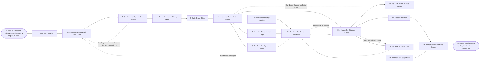

# Reference process: Run the Close Plan

`ref/sls/run-the-close-plan v1`

**value stream:** [Proposal-to-Signature](../../streams/sales/proposal-to-signature.md)
A deal is agreed in substance and now has to get through both companies
to a signature. This process writes down every step still owed, on our
side and the buyer's, puts one name and one date on each of them, and
works the plan until the agreement is executed. The buyer's own
approval path is part of the plan, not a mystery outside it. A step
that slips is chased, re-dated and re-agreed with the buyer rather than
quietly missed. The run closes when the agreement is signed and the
plan is closed on the record with what slipped and why.

## The activities

| # | Activity | What happens | Agents |
|---|---|---|---|
| 1 | Open the Close Plan | the plan starts from the agreed position | [close-plan-keeper](../../agents/close-plan-keeper.md) |
| 2 | Name the Steps Each Side Owes | every step still owed, ours and theirs | close-plan-keeper · deal owner (person) |
| 3 | Confirm the Buyer's Own Process | the buyer's approval path, step by step | close-plan-keeper · buyer's procurement lead (person) |
| 4 | Put an Owner on Every Step | each step gets one named owner on one side | close-plan-keeper |
| 5 | Date Every Step | each step gets a date, counted back from signing | close-plan-keeper |
| 6 | Agree the Plan with the Buyer | both sides hold the same plan and the same dates | deal owner (person) · buyer's procurement lead (person) |
| 7 | Work the Security Review | the buyer's security questions answered | security reviewer (person) · close-plan-keeper |
| 8 | Work the Procurement Steps | vendor forms, supplier setup and the order | close-plan-keeper · finance approver (person) |
| 9 | Confirm the Signature Path | who signs, in what order, and on what | [signature-manager](../../agents/signature-manager.md) |
| 10 | Chase the Slipping Steps | a step past its date is chased and re-dated | close-plan-keeper |
| 11 | Re-Plan When a Date Moves | the steps behind a slipped step move with it | close-plan-keeper |
| 12 | Report the Plan | where the deal stands against its own plan | close-plan-keeper · [deal-inspector](../../agents/deal-inspector.md) |
| 13 | Escalate a Stalled Step | a step nobody will move goes up on both sides | sales leader (person) · [negotiation-coordinator](../../agents/negotiation-coordinator.md) |
| 14 | Confirm the Close Conditions | every step owed before signature is done | close-plan-keeper · [redline-reviewer](../../agents/redline-reviewer.md) |
| 15 | Execute the Signature | the agreement signed by both sides | signature-manager · legal reviewer (person) |
| 16 | Close the Plan on the Record | the plan closed, with what slipped and why | deal-inspector · close-plan-keeper |

## The graph



## The document, with the blanks marked

```
PROCESS: run the close plan           id: <team>/run-the-close-plan   v1
from: ref/sls/run-the-close-plan v1
owner: <who>                          effective: <date>
trigger: a deal reaches an agreed position and <who> asks for a close
         plan, in <your CRM>
concurrency: runs may overlap - <how many> close plans live at once, and
             one opportunity has one close plan at a time
goal: every step both sides still owe named, owned, dated and worked
      until the agreement is signed, with no step past its date
      unchased
phases:
  open-plan             - human: the plan opened from the agreed
                          position, with the signature date both sides
                          are working toward
                          owner: close-plan-keeper   after: trigger
                          automation: <level>
  name-steps            - runs collect-and-report: every step still
                          owed, ours and the buyer's, listed as one set
                          rather than two
                          owner: close-plan-keeper   after: open-plan
                          by: <days>                 automation: <level>
  confirm-buyer-process - convenes briefing: the buyer walks us through
                          their own approval path, committee by
                          committee, with the dates each one meets
                          owner: <your deal owner role>
                          after: name-steps
                          by: <days>                 automation: <level>
  assign-owners         - human: one named owner per step, on the side
                          that actually does the work
                          owner: close-plan-keeper
                          after: confirm-buyer-process
                          automation: <level>
  date-steps            - human: every step dated, counted back from
                          the signature date, with the steps that
                          cannot run in parallel marked
                          owner: close-plan-keeper   after: assign-owners
                          automation: <level>
  agree-plan            - convenes approval: the buyer confirms the
                          plan, the owners and the dates, and the
                          confirmation is kept
                          owner: <your deal owner role>
                          after: date-steps          automation: never
  work-security         - human: the buyer's security review answered
                          from <your answer library>, with anything new
                          answered by a named person
                          owner: <your security role>
                          after: agree-plan
                          by: <days>                 automation: <level>
  work-procurement      - human: vendor forms, supplier onboarding, tax
                          and banking details, and the purchase order
                          owner: close-plan-keeper   after: agree-plan
                          by: <days>                 automation: <level>
  confirm-signers       - runs collect-and-report: who signs on each
                          side, in what order, on which document, and
                          what each signer needs to see first
                          owner: signature-manager   after: agree-plan
                          by: <days>                 automation: <level>
  chase-steps           - human: every step past its date chased with
                          its named owner, and given a new date or an
                          escalation
                          owner: close-plan-keeper   after: agree-plan
                          automation: <level>
  re-plan               - human: when a step slips, the steps behind it
                          move too, and the signature date moves or the
                          slack is named
                          owner: close-plan-keeper   after: chase-steps
                          automation: <level>
  report-plan           - runs collect-and-report: where the deal
                          stands against its own plan, step by step,
                          with the dates that moved
                          owner: close-plan-keeper   after: chase-steps
                          every: <cadence>           automation: <level>
  escalate-stall        - convenes decide-and-announce: a step nobody
                          will move goes to <who> on our side and the
                          matching person on the buyer's
                          owner: <your sales leadership role>
                          after: chase-steps
                          by: <days>                 automation: never
  confirm-conditions    - convenes approval: every step owed before
                          signature is checked as done, with evidence,
                          before the document goes out to sign
                          owner: close-plan-keeper
                          after: work-security + work-procurement +
                                 confirm-signers + chase-steps
                          automation: never
  execute-signature     - human: the agreed text goes to the named
                          signers in order, and the executed copy is
                          filed
                          owner: signature-manager
                          after: confirm-conditions  automation: never
  close-plan            - convenes debrief: the plan closed with what
                          slipped, why, and what to plan differently
                          next time
                          owner: deal-inspector
                          after: execute-signature + report-plan
                          automation: <level>
run-scoped:
  status   - runs roll-call                     owner: close-plan-keeper
             every: <cadence>
             from: agree-plan   until: run close
  slippage - runs collect-and-report            owner: deal-inspector
             every: <cadence>
             from: agree-plan   until: run close
handoffs:
  open-plan -> name-steps: the agreed position, the signature date, and
    the people on both sides who own the deal
  name-steps -> confirm-buyer-process: the steps we know about, so the
    buyer can say what is missing
  confirm-buyer-process -> assign-owners: the buyer's approval path,
    with the committee dates and the person who takes it to each one
  assign-owners -> date-steps: one named owner per step, on the side
    that does the work
  date-steps -> agree-plan: the dated plan, counted back from signature,
    with the steps that block others marked
  agree-plan -> work-security: the security review as a dated step with
    the buyer's questionnaire attached
  agree-plan -> work-procurement: the forms the buyer needs from us, and
    who on their side receives each one
  agree-plan -> confirm-signers: the signature date and the document
    that will be signed
  agree-plan -> chase-steps: the confirmed plan, which is the thing
    chasing is measured against
  chase-steps -> re-plan: the steps past their date, with the reason the
    owner gave
  chase-steps -> report-plan: the plan as it actually stands, not as it
    was agreed
  chase-steps -> escalate-stall: the step, its owner, how long it has
    been late, and what is blocking it
  re-plan -> agree-plan: the moved dates, taken back to the buyer for
    confirmation
  escalate-stall -> chase-steps: the decision, and the new date it
    produced
  work-security -> confirm-conditions: the completed review and any
    condition the buyer attached to it
  work-procurement -> confirm-conditions: the vendor record, the order
    number, and anything still outstanding
  confirm-signers -> confirm-conditions: the signers in order, and what
    each one has to see first
  confirm-conditions -> execute-signature: every pre-signature step
    marked done with its evidence
  execute-signature -> close-plan: the executed agreement, its date, and
    the signers
  report-plan -> close-plan: the dates as they moved through the run
bindings:
  roster:  <who holds each role - agents claiming the abstract agents
           above, and named people for the deal owner, the sales leader
           who escalates, the security reviewer, the finance approver,
           the legal reviewer and the buyer's procurement lead>
  systems: the CRM (write), the close plan record (write),
           the signature system (write), the contract system (read),
           the security answer library (read),
           the buyer's vendor portal (write),
           the shared workspace with the buyer (write)
  data:    <your close plan template> <version>, <your security answer
           library> <version>, the agreed position, the buyer's
           approval path
policy:
  every step in the plan has one named owner and one date
  a step past its date is chased within <hours> and either re-dated or
    escalated
  a moved date is agreed with the buyer, not changed on our copy alone
  no document goes out for signature while a pre-signature condition is
    open, unless <who> accepts it in writing
  the signature path is confirmed before the document is sent, and the
    signers are the people named in the agreement
  a deal past <days> with no movement goes to <who> for a decision on
    whether it is still live
measures:
  cycle time: <target> from the agreed position to the signature
  date accuracy: <target> for the gap between the first agreed
                 signature date and the actual one
  volume: <close plans per period>
  quality gate: no step sits past its date unchased, and every signed
                agreement has its conditions marked done with evidence
```

## The failure edges

- **The buyer's process has a step nobody told us about.** A committee,
  a security review or a board date appears after the plan is agreed.
  The run goes back to naming the steps, the new step is dated, and the
  signature date moves rather than the plan pretending it still holds.
- **A step slips and the dates behind it do not move.** The
  close-plan-keeper agent moves every step that depended on the slipped
  one, and the plan goes back to the buyer for confirmation. A plan
  with a date nobody believes is worse than a later date both sides
  agreed to.
- **A step has no owner on the buyer's side.** Chasing has nobody to
  chase. The step goes to the buyer's procurement lead to be assigned,
  and until it has a name it is treated as stalled rather than as in
  progress.
- **The security review turns up an answer we do not have.** The
  question goes to a named person rather than being answered from the
  library. If the honest answer is no, the term it affects goes back to
  the negotiation, and the plan waits on that decision.
- **A signer is unavailable or has changed.** The signature-manager
  agent confirms the signers again before the document goes out. A
  document signed by somebody without the authority to sign it is not a
  signature, and the run treats it as an open step.
- **A close condition is not met but the deal is signed anyway.** The
  confirmation gate fails and the run returns to chasing. Only <who>
  may accept an open condition, in writing, and the acceptance is
  recorded against the agreement.
- **The deal goes quiet.** Chasing gets no reply from the buyer for
  <days>. The stall goes up on both sides once, and if it stays quiet
  the deal goes to the lost deal process rather than staying on the
  plan as a live step.
- **A run is abandoned.** The plan is closed with every open step marked
  as not done, the buyer is told the plan has stopped and by whom, any
  document out for signature is withdrawn from the signature system,
  the vendor setup started in the buyer's systems is cancelled or left
  with a note saying why, and the slippage record is kept anyway so the
  next plan is dated better.
