# Reference process: Run the Forecast Call

`ref/sls/run-the-forecast-call v1`

**value stream:** [Pipeline-to-Commitment](../../streams/sales/pipeline-to-commitment.md)
The cadence comes round and a room of managers has to agree, out loud,
what is committed, what is best case and what is neither. The call
starts from the roll-up operations published, reads what moved since
last time, and walks only the deals that decide the number. Each
committed deal is defended by the person who owns it, each best case
says what would have to be true, and the deals nobody is claiming are
named as such. Coverage is tested against what is still to find. The
call ends with a category on every deal walked, actions with owners,
and one number published at a version.

## The activities

| # | Activity | What happens | Agents |
|---|---|---|---|
| 1 | Set What the Call Covers | the segment, the period, and who has to attend | [reporting-manager](../../agents/reporting-manager.md) · sales manager (person) |
| 2 | Take in the Roll-Up | the published pipeline view, read at one version | reporting-manager |
| 3 | Read What Moved Since Last Time | deals in, out, up, down, and dates that slipped | [analytics](../../agents/analytics.md) |
| 4 | Flag the Deals the Call Will Walk | the few that decide the number | [deal-inspector](../../agents/deal-inspector.md) · [forecaster](../../agents/forecaster.md) |
| 5 | Send the Inspections Ahead | each flagged deal's findings, read before the call | deal-inspector |
| 6 | Open on the Same Numbers | everybody reads one view, at one version | reporting-manager · sales manager (person) |
| 7 | Walk the Committed Deals | each one defended by the person who owns it | deal-inspector · deal owner (person) · sales manager (person) |
| 8 | Walk the Best Case | what would have to be true for each to land | deal-inspector · deal owner (person) |
| 9 | Say What Is Neither | the deals nobody is claiming this period | sales manager (person) · deal owner (person) |
| 10 | Test the Coverage Against the Gap | what is still to find, and whether it exists | forecaster · analytics |
| 11 | Agree Each Deal's Category | committed, best case or neither, said out loud | sales manager (person) · regional manager (person) |
| 12 | Name the Actions and Their Owners | who does what before the next call | sales manager (person) · deal owner (person) |
| 13 | Publish the Call's Number | the segment's number at a version, on its date | reporting-manager |
| 14 | Record What Moved and Why | the movement, with a reason beside each deal | reporting-manager · analytics |

## The graph

```mermaid
flowchart LR
  T([the forecast cadence comes round]) --> A1[1. Set What the Call Covers]
  A1 --> A2[2. Take in the Roll-Up]
  A2 --> A3[3. Read What Moved Since Last Time]
  A3 -. the view is missing deals the managers hold .-> A2
  A3 --> A4[4. Flag the Deals the Call Will Walk]
  A4 --> A5[5. Send the Inspections Ahead]
  A5 --> A6[6. Open on the Same Numbers]
  A6 --> A7[7. Walk the Committed Deals]
  A7 -. a committed deal has no inspection behind it .-> A5
  A7 --> A8[8. Walk the Best Case]
  A8 -. the best case rests on a deal nobody tested .-> A4
  A8 --> A9[9. Say What Is Neither]
  A9 --> A10[10. Test the Coverage Against the Gap]
  A10 -. the coverage will not carry the gap .-> A8
  A10 --> A11[11. Agree Each Deal's Category]
  A11 -. the categories do not match what was walked .-> A7
  A11 --> A12[12. Name the Actions and Their Owners]
  A12 --> A13[13. Publish the Call's Number]
  A13 -. the number does not reconcile to the roll-up .-> A2
  A13 --> A14[14. Record What Moved and Why]
  A14 --> DONE([the segment's number is agreed out loud and published])
```



## The document, with the blanks marked

```
PROCESS: forecast call                id: <team>/run-the-forecast-call   v1
from: ref/sls/run-the-forecast-call v1
owner: <who>                          effective: <date>
trigger: <your forecast cadence> comes round for <segment>
concurrency: runs may overlap - one call per segment per cycle, and a
             deal is walked in one call at a time
goal: every deal the call walks carrying a category the room agreed out
      loud, coverage tested against the gap, and one number published
      at a version on the call's date
phases:
  set-scope        - human: the segment, the period, the deals in
                     scope, and who has to be in the room
                     owner: reporting-manager  after: trigger
                     automation: <level>
  take-in-rollup   - human: the pipeline view as <your pipeline roll-up
                     process> published it, read at one version, with
                     everything it could not answer noted beside it
                     owner: reporting-manager  after: set-scope
                     by: <days>                automation: <level>
  read-movement    - runs collect-and-report: what entered, what left,
                     what changed amount, and every close date that
                     moved since the last call, with who moved it
                     owner: analytics          after: take-in-rollup
                     by: <days>                automation: <level>
  flag-deals       - runs assessment: the deals that decide the number,
                     picked by <your materiality rule> rather than by
                     who wants to talk about theirs
                     owner: deal-inspector     after: read-movement
                     automation: <level>
  send-inspections - human: the finding for each flagged deal sent to
                     the room <hours> before the call, so the call
                     argues instead of catching up
                     owner: deal-inspector     after: flag-deals
                     automation: <level>
  open-the-call    - convenes briefing: one view on the screen at one
                     version, and the number the last call published
                     read out beside it
                     owner: <your sales management role>
                     after: send-inspections   automation: <level>
  walk-committed   - convenes assessment: every committed deal defended
                     by the person who owns it, against the finding
                     that was sent ahead
                     owner: <your sales management role>
                     after: open-the-call      automation: never
  walk-best-case   - convenes assessment: for each best case deal, what
                     would have to be true for it to land inside the
                     period, and who would have to do it
                     owner: <your sales management role>
                     after: walk-committed     automation: never
  name-neither     - convenes assessment: the deals nobody is claiming
                     this period, said out loud so they stop being
                     counted quietly
                     owner: <your sales management role>
                     after: walk-best-case     automation: never
  test-coverage    - runs assessment: committed and best case set
                     against the target, with what is still to find and
                     whether the pipeline holds it at <coverage ratio>
                     owner: forecaster         after: name-neither
                     automation: <level>
  agree-categories - convenes decide-and-announce: committed, best case
                     or neither on every deal walked, agreed in the
                     room, with the reason recorded next to each change
                     owner: <your sales management role>
                     after: test-coverage      automation: never
  name-actions     - convenes decide-and-announce: who does what before
                     the next call, each action carrying an owner and a
                     date inside the period
                     owner: <your sales management role>
                     after: agree-categories   automation: <level>
  publish-number   - human: the segment's committed and best case
                     numbers at a version, published on the call's date
                     to <who>, complete or not
                     owner: reporting-manager  after: name-actions
                     by: <hours>               automation: <level>
  record-movement  - human: what moved since the last call and why,
                     with a reason beside every deal that changed
                     category or date
                     owner: reporting-manager  after: publish-number
                     automation: <level>
run-scoped:
  actions - runs roll-call                   owner: reporting-manager
            every: <cadence>
            from: name-actions   until: the next call
handoffs:
  set-scope -> take-in-rollup: the segment, the period and the deals in
    scope, in one record
  take-in-rollup -> read-movement: the roll-up at its version, and the
    list of what it could not answer
  read-movement -> flag-deals: everything that entered, left or changed
    since the last call, each change carrying who made it and when
  flag-deals -> send-inspections: the deals the call will walk, and the
    reason each one is on the list
  send-inspections -> open-the-call: the finding for every flagged
    deal, at its version, delivered before the call opens
  open-the-call -> walk-committed: one view, at one version, that
    everybody in the room is reading
  walk-committed -> walk-best-case: what each committed deal was
    defended on, and every defence the room did not accept
  walk-best-case -> name-neither: what would have to be true for each
    best case deal, and who owns making it true
  name-neither -> test-coverage: the deals nobody is claiming, taken
    out of the count rather than left in it quietly
  test-coverage -> agree-categories: committed and best case against
    the target, what is still to find, and whether the pipeline holds
    it at the ratio the segment uses
  agree-categories -> name-actions: the category on every deal walked,
    with the reason beside each one that changed
  name-actions -> publish-number: the actions, their owners and their
    dates
  publish-number -> record-movement: the number as published, at its
    version, and who it went to
bindings:
  roster:  <who holds each role - agents claiming the abstract agents
           above, and named people for the managers who walk the deals
           and the leader the number goes to>
  systems: the CRM (read), the inspection record (read),
           the report store (write), the forecast record (write),
           analytics platforms (read), the notification channel (write)
  data:    the pipeline roll-up at its published version, <your
           category definitions> at a version, <your coverage ratio>,
           <your materiality rule>, the target for the period
policy:
  the call reads the published roll-up and recomputes nothing in the
    room. A figure that looks wrong is raised with <your revenue
    operations role> and the call carries on with the published one
  committed means the deal is defended by name, on evidence, by the
    person who owns it. A deal nobody defends is not committed
  a category is agreed out loud and recorded with the reason, and no
    agent changes a category
  a deal that changes category carries the reason it changed, and the
    reason is a fact about the deal rather than a fact about the gap
  the number is published on the call's date whether or not every deal
    was walked, and the deals that were not walked are named
  a deal walked without its inspection is recorded as uninspected in
    the number it is counted in
measures:
  cycle time: <hours> from the call ending to the published number
  coverage: <share> of the period's committed amount walked by name
  accuracy: committed at the call set against what closed, reported
            every <cycle>
  quality gate: every deal in the published number carries a category,
                a reason and the date it was last inspected
```

## The failure edges

- **The roll-up is late or does not carry every deal.** The call is
  held on its date with the view as it stands. The deals the managers
  hold and the view does not are named in the room, the number says
  which figures were missing, and the correction goes to operations
  rather than being typed into the call's own copy.
- **A committed deal has no inspection behind it.** The deal is walked
  anyway and recorded as uninspected. It can stay committed only if
  <who> says so in the room, and the uninspected marking travels with
  it into the published number.
- **A deal is defended on confidence alone.** The owner has no answer
  to the gaps the finding named. The deal moves to best case, or stays
  committed with the manager's name attached to that choice. Silence
  is not a defence, and the room records which of the two happened.
- **The coverage will not carry the gap.** The run returns to the best
  case walk. Either deals move up with a reason, or the call publishes
  a number below the target and says so. A number that reaches the
  target by moving deals nobody defended is the failure this edge
  exists to prevent.
- **Every manager holds their number back for the leader's call.** The
  categories do not add up to what was walked, and the run returns to
  the committed walk. The call is where the argument happens, and a
  manager who will not argue here has their number recorded as
  unagreed.
- **The published number does not reconcile to the roll-up.** The
  difference is recorded line by line, with the deal behind each line.
  The call's number is published with the difference attached, and
  operations is asked to reconcile before the next cycle.
- **The call is cancelled.** The cadence still produces a number. The
  categories carry forward from the last call, every deal that moved
  since then is listed as unwalked, and the published number says it
  was produced without a call.
- **A run is abandoned.** No number is published for the segment that
  cycle. The last published number stands, is marked stale with its
  date, and the leader who has to commit is told which segment went
  unwalked before they commit anything that rests on it.
