# Reference process: Shape the Solution

`ref/sls/shape-the-solution v1`

**value stream:** [Discovery-to-Solution](../../streams/sales/discovery-to-solution.md)
A versioned requirement record arrives and somebody has to say what
would actually fix the problem. A first shape is drafted and then put
in front of the people who would have to build it, run it and support
it, because a shape they can refuse is worth more than one only the
seller believes. What the product does today is kept separate from
what is planned. The shape is cut to what can ship, mapped line by
line against the requirements, and walked through with the buyer. It
ends at a shape both sides hold at one version, carrying no price.

## The activities

| # | Activity | What happens | Agents |
|---|---|---|---|
| 1 | Take in the Requirement Record | one record, at one version, with its date | [solution-architect](../../agents/solution-architect.md) |
| 2 | Read What Was Shaped Before | shapes for similar problems, and how they went | [researcher](../../agents/researcher.md) · solution-architect |
| 3 | Draft the First Shape | how the parts fit, written down, not drawn live | solution-architect |
| 4 | Check What the Product Does Today | what ships now, and what is only planned | solution-architect · product manager (person) |
| 5 | Test It with the Specialists | the people who would build or run it read it | solution-architect · solution engineer (person) |
| 6 | Name What Would Have to Be Built | the gap between the shape and what exists | solution-architect |
| 7 | Check It Can Be Run and Supported | who operates it, and what breaks at scale | solution-architect · support lead (person) |
| 8 | Check the Security Ground | data, access, and the rules the buyer works under | security reviewer (person) · solution-architect |
| 9 | Cut It to What Is Buildable | the shape shrinks to what can actually ship | solution-architect · solution engineer (person) |
| 10 | Map the Shape to the Requirements | each requirement met, deferred, or refused | solution-architect · [requirements-recorder](../../agents/requirements-recorder.md) |
| 11 | Show the Shape to the Buyer | walked through with the people who felt it | solution-architect · account owner (person) |
| 12 | Take the Buyer's Corrections | what they call wrong, recorded as they said it | solution-architect |
| 13 | Decide Whether a Proof Is Needed | description is enough, or it is not | solution-architect · customer sponsor (person) |
| 14 | Agree the Shape | both sides hold the same version of the answer | solution-architect · account owner (person) |
| 15 | Record What Was Learned | what the specialists caught, and how late | solution-architect · [analytics](../../agents/analytics.md) |

## The graph

```mermaid
flowchart LR
  T([a versioned requirement record arrives]) --> A1[1. Take in the Requirement Record]
  A1 --> A2[2. Read What Was Shaped Before]
  A2 --> A3[3. Draft the First Shape]
  A3 --> A4[4. Check What the Product Does Today]
  A3 --> A5[5. Test It with the Specialists]
  A4 --> A6[6. Name What Would Have to Be Built]
  A5 --> A6
  A5 -. the specialists refuse the shape .-> A3
  A6 --> A7[7. Check It Can Be Run and Supported]
  A7 -. nobody can run it .-> A3
  A7 --> A8[8. Check the Security Ground]
  A8 -. the buyer's rules forbid it .-> A3
  A8 --> A9[9. Cut It to What Is Buildable]
  A9 --> A10[10. Map the Shape to the Requirements]
  A10 -. a ranked requirement is left unmet .-> A3
  A10 --> A11[11. Show the Shape to the Buyer]
  A11 --> A12[12. Take the Buyer's Corrections]
  A12 -. the shape answers the wrong problem .-> A3
  A12 --> A13[13. Decide Whether a Proof Is Needed]
  A13 --> A14[14. Agree the Shape]
  A14 --> A15[15. Record What Was Learned]
  A15 --> DONE([an agreed shape, unpriced, that the offer stream can read])
```



## The document, with the blanks marked

```
PROCESS: solution shaping             id: <team>/shape-the-solution   v1
from: ref/sls/shape-the-solution v1
owner: <who>                          effective: <date>
trigger: a requirement record is confirmed and versioned in <your
         requirement process>
concurrency: runs may overlap - <how many> shapes live at once, and
             one opportunity carries one shape at a time
goal: a shape both sides hold at the same version, every ranked
      requirement marked met, deferred or refused, tested by the people
      who would build and run it, and carrying no price
phases:
  take-in-record     - human: read the record at its version, and the
                       requirements marked as unmeetable
                       owner: solution-architect    after: trigger
                       automation: <level>
  read-prior-shapes  - runs collect-and-report: shapes drawn for
                       similar problems, what shipped, and what the
                       debriefs said afterwards
                       owner: researcher       after: take-in-record
                       by: <days>              automation: <level>
  draft-shape        - runs build-by-talent: how the parts fit, written
                       down so somebody can disagree with a sentence
                       rather than a whiteboard
                       owner: solution-architect    after: read-prior-shapes
                       by: <days>              automation: <level>
  check-product      - runs assessment: what is shipping today, what is
                       committed, and what is only planned. Planned is
                       never presented as shipping
                       owner: solution-architect    after: draft-shape
                       by: <days>              automation: <level>
  test-with-experts  - convenes assessment: the people who would build
                       it and the people who would run it read the
                       shape and say whether it holds
                       owner: <your solution engineering role>
                       after: draft-shape
                       by: <days>              automation: never
  name-the-build     - human: the gap between the shape and what
                       exists, written as work rather than as a promise
                       owner: solution-architect
                       after: check-product + test-with-experts
                       automation: <level>
  check-operability  - convenes assessment: who operates it after it
                       ships, what it costs to run, and what breaks at
                       <the buyer's volume>
                       owner: <your support role>   after: name-the-build
                       by: <days>              automation: <level>
  check-security     - convenes assessment: what data moves, who may
                       see it, and which of the buyer's rules apply
                       owner: <your security role>  after: check-operability
                       by: <days>              automation: never
  cut-to-buildable   - convenes decide-and-announce: the shape shrinks
                       to what can ship. <who> signs what comes out
                       owner: solution-architect    after: check-security
                       automation: never
  map-to-record      - runs assessment: every requirement marked met,
                       deferred or refused, with the reason attached to
                       each refusal
                       owner: requirements-recorder after: cut-to-buildable
                       automation: <level>
  show-the-buyer     - convenes briefing: the shape walked through with
                       the people who described the problem, at the
                       depth they asked for
                       owner: <your account owner role>
                       after: map-to-record
                       by: <days>              automation: <level>
  take-corrections   - human: what the buyer says is wrong, written in
                       their words and kept against the shape
                       owner: solution-architect    after: show-the-buyer
                       automation: <level>
  decide-proof       - convenes decide-and-announce: description is
                       enough, or an evaluation is needed. The reason
                       is recorded either way
                       owner: solution-architect    after: take-corrections
                       automation: <level>
  agree-shape        - convenes approval: both sides sign that they
                       hold the same version. No price appears in it
                       owner: <your account owner role>
                       after: decide-proof
                       by: <days>              automation: never
  record-learnings   - convenes debrief: what the specialists caught,
                       how late it was caught, and which prior shape
                       should have been read first
                       owner: solution-architect    after: agree-shape
                       automation: <level>
run-scoped:
  effort   - runs allocate-and-reconcile       owner: solution-architect
             from: draft-shape   until: run close
  status   - runs roll-call                    owner: solution-architect
             every: <cadence>
             from: draft-shape   until: agree-shape
handoffs:
  take-in-record -> read-prior-shapes: the requirement record at its
    version, and the buyer's ranking
  read-prior-shapes -> draft-shape: the shapes already drawn for this
    kind of problem, with what happened to each after it shipped
  draft-shape -> check-product: the shape, with every part named
  draft-shape -> test-with-experts: the same shape, at the same
    version. Both branches read one draft
  check-product -> name-the-build: what ships today, what is committed,
    and what is only planned, each marked as such
  test-with-experts -> name-the-build: what the specialists refused,
    with the reason, and what they would accept instead
  name-the-build -> check-operability: the work the shape implies, and
    who it lands on
  check-operability -> check-security: the running cost, the operator,
    and what breaks at volume
  check-security -> cut-to-buildable: which of the buyer's rules apply,
    what data moves, and what has to change to satisfy them
  cut-to-buildable -> map-to-record: the shape as cut, and the list of
    what was cut out of it
  map-to-record -> show-the-buyer: every requirement marked met,
    deferred or refused, and the reason for every refusal
  show-the-buyer -> take-corrections: the shape as the buyer saw it,
    and what they asked about
  take-corrections -> decide-proof: what the buyer disputed, and what
    they said would settle it
  decide-proof -> agree-shape: the decision on an evaluation, with its
    reason, so the offer stream knows why
  agree-shape -> record-learnings: the signed shape at its version
bindings:
  roster:  <who holds each role - agents claiming the abstract agents
           above, and named people for the solution engineer, the
           support lead, the security reviewer, the product manager
           and whoever signs the cut>
  systems: the CRM (write), the requirement record (read),
           the shape library (write), <your product roadmap> (read),
           <your architecture standards> (read),
           <your security review queue> (write)
  data:    the requirement record <version>, <your reference
           architectures> <version>, <your list of things you do not
           build>, the operating cost model <version>
policy:
  what is only planned is never shown to a buyer as shipping
  a shape no specialist has read is not shown to a buyer
  a requirement that will not be met is marked refused, with a reason,
    and the buyer sees the mark before they see the shape
  no price, discount or commercial term appears in a shape
  a change to the shape after it is agreed raises the version and is
    sent to everyone holding the old one
  a shape that fails the security review is redrawn, not waived,
    unless <who> accepts the finding in writing
measures:
  cycle time: <target> from a versioned record to an agreed shape
  volume: <shapes per period>
  quality gate: <target> share of shapes with no requirement left
                unmarked, and none shown before a specialist read it
```

## The failure edges

- **The specialists refuse the shape.** The people who would build it
  say it will not hold. The run goes back to the draft with their
  reasons attached. A shape overruled by the seller and shown anyway is
  the failure this activity exists to prevent.
- **The shape depends on something that is only planned.** The product
  check separates shipping from planned, and the planned part comes out
  or is marked as a dependency the buyer must accept in writing. It is
  never described to the buyer as if it exists.
- **Nobody can run it.** The operability check finds no operator, or a
  running cost the buyer will not accept. The run returns to the draft,
  and the shape that comes back names who operates each part.
- **The security ground rules it out.** The buyer's rules forbid where
  the data would sit or who would see it. The shape is redrawn rather
  than waived, and any waiver is signed by a named person and recorded
  against the run.
- **The cut leaves a top-ranked requirement unmet.** The mapping catches
  it before the buyer does. The run goes back to the draft, and if the
  requirement still cannot be met after a second pass it is marked
  refused and the buyer is told before the walk-through, not during it.
- **The buyer says it answers the wrong problem.** The corrections are
  recorded in their words and the run returns to the draft. If the
  problem itself has changed, the requirement record is raised first
  and the shaping starts again against the new version.
- **No viable shape exists.** Nothing that could be built would fix the
  problem at a size the buyer would accept. The run closes with that
  written down and the opportunity is closed properly. This is a
  finished run, not a failed one.
- **A run is abandoned.** The draft is versioned, marked incomplete and
  left in the shape library with the reasons it stopped. The
  specialists who reviewed it are told it will not proceed, the
  security review is withdrawn from the queue, and the buyer is told
  that no shape will be brought back.
