# Reference process: Spot an Expansion

`ref/sls/spot-an-expansion v1`

**value stream:** [Account-to-Expansion](../../streams/sales/account-to-expansion.md)
Something says an existing customer should be buying more: usage running
at a limit, a team that started using what another team bought, or a
product they do not own. This process turns that signal into a written
opening, or throws it away. It checks the account can be approached at
all, names in one sentence what the customer would buy and why now, and
tests that sentence with the people who would live with the change
before anybody approaches whoever signs. A person decides pursue, park
or drop, and the reason is written down next to the evidence.

## The activities

| # | Activity | What happens | Agents |
|---|---|---|---|
| 1 | Take in the Signal | what fired, on which account, and when | [usage-monitor](../../agents/usage-monitor.md) |
| 2 | Check the Account Is Approachable | standing, support, collections and open disputes | [expansion-spotter](../../agents/expansion-spotter.md) · account owner (person) |
| 3 | Read What They Already Own | products, licences and limits on the current agreement | expansion-spotter |
| 4 | Read the Usage Against the Limit | how close each metered thing is to what was bought | usage-monitor |
| 5 | Look for the Teams Newly Adopting | which parts of the customer started using it | usage-monitor · expansion-spotter |
| 6 | Name the Opening in One Sentence | what they would buy, and why now | expansion-spotter |
| 7 | Check It Is Not a Renewal | more of the same term goes back to the renewal | expansion-spotter · account owner (person) |
| 8 | Check Nobody Is Already On It | open deals and plays that cover the same ground | expansion-spotter · [account-planner](../../agents/account-planner.md) |
| 9 | Size What It Could Be Worth | a rough range, marked as not a forecast | expansion-spotter · account-planner |
| 10 | Find the People Who Would Live With It | the teams and named users the change would land on | expansion-spotter · account owner (person) |
| 11 | Test It With Those People | they are asked whether the problem is theirs | account owner (person) · expansion-spotter |
| 12 | Ask the Delivery Side What They See | whether the account is served well enough to grow | delivery lead (person) · expansion-spotter |
| 13 | Check It Against the Account Plan | whether the plan already says to sell this | account-planner |
| 14 | Score the Opening | evidence, timing and fit, with the inputs recorded | expansion-spotter |
| 15 | Decide: Pursue, Park or Drop | a person says which, and the reason is recorded | account owner (person) · expansion-spotter |
| 16 | Record the Finding and Hand It On | the opening, its evidence, and where it goes next | expansion-spotter |

Activity 11 is the one that makes this process worth running. A signal
says a limit was reached; only the people who would live with the change
can say whether reaching it hurt. An opening that skips activity 11 and
goes straight to a deal is the ordinary way this stream produces waste.

## The graph

```mermaid
flowchart LR
  T([a signal says an account should be buying more]) --> A1[1. Take in the Signal]
  A1 --> A2[2. Check the Account Is Approachable]
  A2 -. the account may not be approached .-> A1
  A2 --> A3[3. Read What They Already Own]
  A3 --> A4[4. Read the Usage Against the Limit]
  A3 --> A5[5. Look for the Teams Newly Adopting]
  A4 --> A6[6. Name the Opening in One Sentence]
  A5 --> A6
  A6 --> A7[7. Check It Is Not a Renewal]
  A7 -. it is really a renewal .-> A6
  A7 --> A8[8. Check Nobody Is Already On It]
  A8 -. an open deal covers part of it .-> A6
  A8 --> A9[9. Size What It Could Be Worth]
  A9 --> A10[10. Find the People Who Would Live With It]
  A10 --> A11[11. Test It With Those People]
  A11 -. the problem is not theirs .-> A6
  A11 --> A12[12. Ask the Delivery Side What They See]
  A12 -. the account is not served well enough .-> A2
  A12 --> A13[13. Check It Against the Account Plan]
  A13 --> A14[14. Score the Opening]
  A14 -. the evidence is too thin to score .-> A4
  A14 --> A15[15. Decide: Pursue, Park or Drop]
  A15 -. parked until the signal fires again .-> A1
  A15 --> A16[16. Record the Finding and Hand It On]
  A16 --> DONE([the opening is written down with its evidence and the decision])
```



## The document, with the blanks marked

```
PROCESS: spot an expansion            id: <team>/spot-an-expansion   v1
from: ref/sls/spot-an-expansion v1
owner: <who>                          effective: <date>
trigger: a signal fires on an existing customer in <your usage system>,
         <your support system> or <your account review>, or a person
         raises one
concurrency: runs may overlap - one account carries <how many> open
             openings at a time, and one signal is worked by one run
goal: every signal either written down as an opening that a person has
      decided on, or dropped with the reason, within <days>
phases:
  take-in-signal    - system: what fired, on which account, when, and
                      the reading behind it
                      owner: usage-monitor       after: trigger
                      automation: autonomous
  check-approach    - runs assessment: standing, open support cases,
                      collections and any dispute, read before any
                      other work is done on the account
                      owner: expansion-spotter   after: take-in-signal
                      by: <days>                 automation: <level>
  read-holdings     - runs collect-and-report: products, licences, limits
                      and dates on the agreement they hold today
                      owner: expansion-spotter   after: check-approach
                      automation: <level>
  read-usage        - runs collect-and-report: each metered thing set
                      against what was bought, over <weeks>
                      owner: usage-monitor       after: read-holdings
                      automation: <level>
  read-adoption     - runs collect-and-report: which parts of the
                      customer began using what, and when
                      owner: usage-monitor       after: read-holdings
                      automation: <level>
  name-opening      - human: one sentence saying what the customer
                      would buy and why now, written by a person
                      owner: expansion-spotter
                      after: read-usage + read-adoption
                      automation: <level>
  check-not-renewal - human: an opening that is only more of the same
                      term goes to <your renewal process> instead
                      owner: expansion-spotter   after: name-opening
                      automation: <level>
  check-not-covered - runs assessment: open deals, live plays and other
                      openings that already cover this ground
                      owner: account-planner
                      after: check-not-renewal
                      automation: <level>
  size-opening      - human: a range, with the assumptions written next
                      to it and marked as not a forecast
                      owner: expansion-spotter
                      after: check-not-covered
                      automation: <level>
  find-the-users    - human: the teams and the named people the change
                      would actually land on
                      owner: expansion-spotter   after: size-opening
                      automation: <level>
  test-with-users   - convenes collect-and-report: those people are
                      asked whether the problem is theirs, in their own
                      words, before anyone who signs is approached
                      owner: <your account owner role>
                      after: find-the-users
                      by: <days>                 automation: never
  ask-delivery      - convenes assessment: whether the account is
                      served well enough to be asked for more
                      owner: <your delivery role>
                      after: find-the-users
                      by: <days>                 automation: <level>
  check-plan        - runs assessment: what the account plan already
                      says to sell to this account, and in what order
                      owner: account-planner
                      after: test-with-users + ask-delivery
                      automation: <level>
  score-opening     - runs assessment: evidence, timing and fit scored
                      at <your scoring model> version, inputs recorded
                      owner: expansion-spotter   after: check-plan
                      automation: <level>
  decide-opening    - convenes decide-and-announce: pursue, park or
                      drop, said by <who>, with the reason recorded
                      owner: <your account owner role>
                      after: score-opening
                      by: <days>                 automation: never
  record-finding    - runs collect-and-report: the opening, the
                      evidence, the decision and where it goes next
                      owner: expansion-spotter   after: decide-opening
                      automation: <level>
run-scoped:
  evidence - runs collect-and-report          owner: usage-monitor
             every: <cadence>
             from: read-usage   until: decide-opening
  standing - runs roll-call                   owner: expansion-spotter
             every: <cadence>
             from: check-approach   until: run close
handoffs:
  take-in-signal -> check-approach: the account, the signal, its date
    and the system it was read from
  check-approach -> read-holdings: the account's standing, dated, and
    any reason it may not be approached at all
  read-holdings -> read-usage: what they own today, with the limit on
    every metered line
  read-holdings -> read-adoption: the same holdings, so new use can be
    told apart from use that was always there
  read-usage -> name-opening: usage against limit per line, over the
    window, with the date of every reading
  read-adoption -> name-opening: the teams that started, when they
    started, and how far they have got
  name-opening -> check-not-renewal: the one sentence, at a version
  check-not-renewal -> check-not-covered: the opening, with anything
    the renewal already covers taken out of it
  check-not-covered -> size-opening: the opening, narrowed to what no
    open deal or live play is already working
  size-opening -> find-the-users: the range and the assumptions behind
    it, so the right people can be asked about the right change
  find-the-users -> test-with-users: the named people, and who at
    <your organization> already has a relationship with each one
  find-the-users -> ask-delivery: the same list, so delivery can say
    which of them are unhappy today
  test-with-users -> check-plan: what those people said, in their own
    words, with the date and who heard it
  ask-delivery -> check-plan: the open issues on the account and
    whether they block an ask
  check-plan -> score-opening: what the plan says about this account,
    and where this opening sits against it
  score-opening -> decide-opening: the score, the model version, the
    inputs, and the evidence each input came from
  decide-opening -> record-finding: the decision, who made it, when,
    and the reason in their words
bindings:
  roster:  <who holds each role - agents claiming the abstract agents
           above, and named people for the account owner, the delivery
           lead and whoever decides pursue, park or drop>
  systems: the CRM (read, write), <your usage system> (read),
           <your support system> (read), the billing system (read),
           the contract record (read), the account plan (read),
           the opening register (write)
  data:    <your product catalog> <version>, the current agreement,
           <your scoring model> <version>, <your account plan>
policy:
  nobody who signs is approached until the people who would live with
    the change have been asked
  an account in collections, in dispute, or in an open support crisis
    is not worked until <who> says otherwise
  an opening that is only more of the same term is a renewal, and goes
    to <your renewal process>
  every score records the model version and the inputs behind it
  the size is a range and never enters a forecast at this stage
  the decision to pursue, park or drop is made by a person and is never
    delegated to an agent
  a parked opening carries a date, and is looked at again on that date
  the account owner is told a signal fired on their account within
    <hours>, whatever the run goes on to decide
measures:
  cycle time: <target> from the signal to a recorded decision
  coverage: <target> share of signals that reached a decision rather
            than going stale
  volume: <signals per period>
  quality gate: no opening reaches a deal without a dated record of
                what the people who would live with it said
```

## The failure edges

- **The signal is an artifact of the system, not the customer.** A
  billing change, a backfill or a limit that was lowered can look
  exactly like growth. The usage-monitor agent reports the reading with
  its window and its source, and an opening whose evidence is one
  reading on one day goes back for a longer window before it is scored.
- **The account cannot be approached at all.** A dispute, an unpaid
  invoice or a live support crisis stops the run at activity 2. The
  signal is recorded against the account with the reason, the account
  owner is told, and nothing else in the run happens.
- **The opening is really a renewal.** More sellers on the same term at
  the same renewal date is the renewal conversation. The run hands what
  it found to the renewal and either closes or reopens on the part the
  renewal does not cover.
- **Somebody is already selling it.** The account-planner agent finds an
  open deal or a live play on the same ground. The opening is narrowed
  to what is genuinely uncovered, or it is dropped and the evidence is
  attached to the deal that already exists.
- **The people who would live with it do not have the problem.** This is
  the most valuable failure in the process. The words they used are
  recorded, the opening is dropped or renamed, and the signal that
  produced it is marked so that the same reading does not raise the same
  opening next month.
- **Delivery says the account is not served well enough to grow.** The
  run goes back to the approachability check. The open issues, and who
  owns them, are recorded on the opening, and the opening is parked with
  a date rather than dropped.
- **The account owner will not have the account approached.** Their word
  holds, and the reason is recorded. An owner who parks the same signal
  more than <n> times is a matter for <who>, not for another run.
- **The trigger fires while a run is in flight.** One signal is worked
  by one run. A second signal on the same account joins the open run as
  further evidence rather than starting a second one.
- **A run is abandoned.** The opening is marked abandoned with the date
  and the reason, everything read so far stays attached to the account,
  the account owner is told nothing further is being worked, and anybody
  asked about the problem is told the question is not going anywhere.
  The signal itself stays open, so the next reading can raise it again.
