# Reference process: Work a Churn Risk

`ref/sls/work-a-churn-risk v1`

**value stream:** [Customer-to-Renewal](../../streams/sales/customer-to-renewal.md)
A signal says an account may be leaving. This process confirms the
signal, reads the usage trend and the account standing behind it, and
writes one reason somebody can act on. The reason carries a severity and
a date by which somebody has to act, and it goes to the account owner
with the evidence attached rather than as a score. A plan is agreed, a
person signs what the save is allowed to cost, the work happens, and the
signal is watched to see whether it turns. A departure that happens
anyway closes the run with a reason the rest of the organization reads.

## The activities

| # | Activity | What happens | Agents |
|---|---|---|---|
| 1 | Take in the Risk Signal | a signal says an account may be leaving | [risk-watcher](../../agents/risk-watcher.md) |
| 2 | Confirm the Signal | the signal checked against the account record | risk-watcher · [account-monitor](../../agents/account-monitor.md) |
| 3 | Read the Usage Trend | where use fell, when, and for which team | [usage-monitor](../../agents/usage-monitor.md) |
| 4 | Read the Account's Standing | open tickets, unpaid invoices, and who has left | account-monitor |
| 5 | Name the Reason | one written reason the work can start from | risk-watcher · account owner (person) |
| 6 | Set the Severity and the Clock | how bad it is, and by when somebody must act | risk-watcher · [renewal-manager](../../agents/renewal-manager.md) |
| 7 | Tell the Account Owner | the owner hears it with the evidence attached | risk-watcher · account owner (person) |
| 8 | Agree the Save Plan | what the organization does, and who does it | account owner (person) · renewal-manager · delivery lead (person) |
| 9 | Price What the Save Costs | what the save is allowed to cost, line by line | [quote-builder](../../agents/quote-builder.md) |
| 10 | Get the Cost Approved | a person signs what the save may cost | quote-builder · deal desk (person) |
| 11 | Do the Work | the fixes, the calls and the changes happen | delivery lead (person) · support lead (person) · account-monitor |
| 12 | Take the Plan to the Customer | the owner tells the customer what changes | account owner (person) |
| 13 | Watch for the Signal to Turn | usage and standing read against the reason | usage-monitor · risk-watcher |
| 14 | Close or Escalate the Risk | the risk clears, or it goes up for a decision | risk-watcher · renewal-manager |
| 15 | Record the Save or the Departure | the save or the departure, written for others | risk-watcher · renewal-manager |

## The graph

```mermaid
flowchart LR
  T([a signal says an account may be leaving]) --> A1[1. Take in the Risk Signal]
  A1 --> A2[2. Confirm the Signal]
  A2 -. the signal does not hold up .-> A1
  A2 --> A3[3. Read the Usage Trend]
  A2 --> A4[4. Read the Account's Standing]
  A3 --> A5[5. Name the Reason]
  A4 --> A5
  A5 -. the reason cannot be named from what is known .-> A3
  A5 --> A6[6. Set the Severity and the Clock]
  A6 --> A7[7. Tell the Account Owner]
  A7 --> A8[8. Agree the Save Plan]
  A8 --> A9[9. Price What the Save Costs]
  A9 --> A10[10. Get the Cost Approved]
  A10 -. the cost is not approved .-> A8
  A10 --> A11[11. Do the Work]
  A10 --> A12[12. Take the Plan to the Customer]
  A11 --> A13[13. Watch for the Signal to Turn]
  A12 --> A13
  A13 -. the reason was the wrong one .-> A5
  A13 --> A14[14. Close or Escalate the Risk]
  A14 -. the risk got worse .-> A8
  A14 --> A15[15. Record the Save or the Departure]
  A15 --> DONE([the risk is cleared, or the departure is recorded with its reason])
```



## The document, with the blanks marked

```
PROCESS: work a churn risk            id: <team>/work-a-churn-risk   v1
from: ref/sls/work-a-churn-risk v1
owner: <who>                          effective: <date>
trigger: a risk signal crosses <your threshold> on an account under
         agreement, or a person raises one
concurrency: runs may overlap - one account carries one open risk run,
             and a second signal on that account joins the open run
goal: every confirmed risk carrying a written reason, a severity, a
      named owner and a date, with the owner told within <hours> and
      the plan agreed within <days>
phases:
  take-in-signal    - system: the signal lands with what raised it,
                      when, and against which account
                      owner: risk-watcher       after: trigger
                      automation: <level>
  confirm-signal    - runs assessment: the signal checked against the
                      account record before anybody is told
                      owner: risk-watcher       after: take-in-signal
                      by: <hours>               automation: <level>
  read-usage        - runs collect-and-report: where use fell, over
                      what period, and for which team or product
                      owner: usage-monitor      after: confirm-signal
                      by: <days>                automation: <level>
  read-standing     - runs collect-and-report: open tickets, unpaid
                      invoices, and the named contacts who have left
                      owner: account-monitor    after: confirm-signal
                      by: <days>                automation: <level>
  name-reason       - human: one reason, written in words, that the
                      work can start from. Not a score
                      owner: risk-watcher
                      after: read-usage + read-standing
                      by: <days>                automation: <level>
  set-severity      - runs assessment: how bad this is against <your
                      severity scale>, and the date somebody must act by
                      owner: risk-watcher       after: name-reason
                      automation: <level>
  tell-owner        - human: the account owner hears the reason, the
                      severity and the date, with the evidence attached
                      owner: risk-watcher       after: set-severity
                      by: <hours>               automation: <level>
  agree-plan        - convenes decide-and-announce: what the
                      organization will do, who does it, and by when
                      owner: <your account owner role>
                      after: tell-owner         by: <days>
                      automation: <level>
  price-save        - human: what the plan costs, including any
                      credit, discount or delivery time given away
                      owner: quote-builder      after: agree-plan
                      by: <days>                automation: <level>
  approve-cost      - convenes approval: <who> signs what the save may
                      cost, as a named signer, up to <cap>
                      owner: <your deal desk role>
                      after: price-save         by: <days>
                      automation: never
  do-the-work       - human: the fixes, the calls, the training and the
                      configuration changes the plan named
                      owner: <your delivery role>
                      after: approve-cost       by: <days>
                      automation: <level>
  reach-customer    - human: the account owner tells the customer what
                      changes and when they will see it
                      owner: <your account owner role>
                      after: approve-cost       by: <days>
                      automation: <level>
  watch-signal      - runs collect-and-report: usage and standing read
                      again against the reason that was named
                      owner: usage-monitor
                      after: do-the-work + reach-customer
                      automation: <level>
  close-or-escalate - human: the risk clears, stays open, or goes up to
                      <who> as a decision the account owner cannot make
                      owner: risk-watcher       after: watch-signal
                      by: <days>                automation: <level>
  record-outcome    - convenes debrief: the save or the departure,
                      with the reason, in a form other teams can read
                      owner: renewal-manager    after: close-or-escalate
                      by: <days>                automation: <level>
run-scoped:
  signal-watch - runs collect-and-report        owner: risk-watcher
                 every: <cadence>
                 from: confirm-signal   until: run close
  save-cost    - runs allocate-and-reconcile    owner: quote-builder
                 from: approve-cost     until: run close
handoffs:
  take-in-signal -> confirm-signal: the signal, what raised it, the
    date, and the account it is against
  confirm-signal -> read-usage: the confirmed signal and the period to
    read use over
  confirm-signal -> read-standing: the same confirmed signal, so both
    readings cover the same period
  read-usage -> name-reason: where use fell, by how much, since when,
    and for which team, with the system it was read from
  read-standing -> name-reason: the tickets, the invoices and the
    people who left, each dated
  name-reason -> set-severity: one reason in words, and the evidence
    lines that support it
  set-severity -> tell-owner: the severity, the date somebody must act
    by, and the scale version it was set against
  tell-owner -> agree-plan: the reason and the evidence, as the owner
    received them, with the date they were told
  agree-plan -> price-save: what the organization will do, who does
    each part, and by when
  price-save -> approve-cost: the cost of the plan, including anything
    given away that does not appear as a discount
  approve-cost -> do-the-work: the signed plan and the cap it was
    signed under. Work above the cap needs a new approval
  approve-cost -> reach-customer: the same signed plan, so the customer
    is told only what was approved
  do-the-work -> watch-signal: what was actually done, and on what date
  reach-customer -> watch-signal: what the customer was promised, so
    the signal is read against the promise
  watch-signal -> close-or-escalate: use and standing read again, set
    against the reason and the date
  close-or-escalate -> record-outcome: the outcome, the reason, and
    what the save cost
bindings:
  roster:  <who holds each role - agents claiming the abstract agents
           above, and named people for the account owner, the delivery
           lead, the support lead, the deal desk and the escalation
           decision>
  systems: the CRM (write), the usage record (read),
           the support system (read, write), the billing system (read),
           the agreement store (read), the risk record (write),
           the notification channel (write)
  data:    <your risk model> <version>, <your severity scale>,
           the agreement at its current version, the entitlement
           record
policy:
  a signal is confirmed against the account record before the account
    owner is told, and an unconfirmed signal is never sent on
  a risk is written as a reason in words. A score alone does not open a
    plan
  the account owner is told within <hours> of the severity being set,
    whatever the plan says
  what the save costs is priced and signed before it is offered to the
    customer, including credits and free delivery time
  approval is a human gate and is never delegated to an agent
  nothing is promised to the customer that the signed plan does not
    contain
  a departure is recorded with its reason, and the record is readable
    by everyone who works renewals. A lost account with no reason is
    treated as an unfinished run
measures:
  cycle time: <hours> from a confirmed signal to the owner being told,
              and <days> to an agreed plan
  coverage: <target> share of departures that had an open risk run
            before the agreement ended
  volume: <risks per period>
  quality gate: every closed risk carries a reason, a cost and an
                outcome, and <sample size> are reviewed each period
```

## The failure edges

- **The signal does not hold up.** The account record contradicts what
  raised the signal, and the run closes at confirmation without anybody
  telling the account owner. What the signal got wrong is recorded
  against the model that raised it, because a source that keeps crying
  wolf stops being read.
- **No reason can be named.** Use fell and nobody can say why. The run
  goes back to the readings once. If a reason still cannot be written,
  the account owner is asked directly and their answer becomes the
  reason, marked as unverified.
- **The account owner already knew.** The owner has been working the
  problem for weeks. Their version replaces the named reason, the
  severity is set again against it, and the run continues from the plan
  rather than starting the conversation over.
- **The cost is not approved.** The run goes back to the plan, not to
  the customer. The signer names what they will not fund, the plan is
  agreed again inside that limit, and nothing is offered to the customer
  in the meantime.
- **The work does not happen.** The plan is agreed and the date passes
  with nothing done. The risk-watcher agent reports it against the date
  it was promised, and the risk goes up for a decision rather than
  waiting for the next reading.
- **The signal does not turn.** Use stays down after the plan is
  delivered. The reason was wrong or the plan was too small. The run
  goes back to the reason once, and if the second reason fails the same
  way the risk escalates instead of looping.
- **The customer leaves anyway.** The run does not close as a failure
  without a record. The reason, what was tried, what it cost and what
  the customer said is written down and handed to whoever reads
  departures. A departure with no reason is an unfinished run.
- **A run is abandoned.** The risk stays real whether or not somebody is
  working it. Any commitment already made to the customer is honored or
  withdrawn in writing, the account owner is told the plan has stopped,
  and the abandoned run is recorded against the account with its
  severity and the date it stopped, so the next renewal sees it.
