# Reference process: Write a Proposal

`ref/sls/write-a-proposal v1`

**value stream:** [Solution-to-Proposal](../../streams/sales/solution-to-proposal.md)
An approved quote is a price, not an offer. This process turns it into a
document the buyer can act on: what the customer asked for in their own
words, what is included line by line, what is deliberately not included,
what it costs, and what happens after a yes. The reusable sections come
from the library at their approved versions, and every claim traces back
to something the organization has agreed to say. Legal and the deal desk
sign the version that goes out, and a later change sends it back to them.
The run closes when the buyer holds the offer and knows the next step.

## The activities

| # | Activity | What happens | Agents |
|---|---|---|---|
| 1 | Take in the Approved Quote | the priced offer, and the date it stops holding | [proposal-writer](../../agents/proposal-writer.md) · [quote-builder](../../agents/quote-builder.md) |
| 2 | Read the Buyer's Decision | who signs, who blocks, what each needs to see | proposal-writer · account owner (person) |
| 3 | Agree the Shape of the Document | sections, length and the format the buyer asked for | proposal-writer · account owner (person) |
| 4 | Pull the Reusable Parts | approved sections taken from the library | proposal-writer · [standards-keeper](../../agents/standards-keeper.md) |
| 5 | Write the Problem in Their Words | what the customer said they need, quoted back | proposal-writer |
| 6 | Write What Is Included | the scope, line by line, against the config | proposal-writer · [solution-architect](../../agents/solution-architect.md) |
| 7 | Write What Is Not Included | the exclusions, assumptions and dependencies | proposal-writer · solution-architect |
| 8 | Write the Price and the Terms | what it costs, over what term, paid how | proposal-writer · quote-builder |
| 9 | Write What Happens Next | the steps, the dates and who owns each one | proposal-writer · solution-architect |
| 10 | Check the Claims | every claim traced to the register at a version | standards-keeper |
| 11 | Get Sign-Offs | legal and the deal desk sign a named version | legal reviewer (person) · deal desk reviewer (person) |
| 12 | Assemble and Version the Document | one file, numbered, with the date it was made | proposal-writer |
| 13 | Deliver It to the Buyer | sent the way the buyer asked, to the people named | proposal-writer · account owner (person) |
| 14 | Watch What the Buyer Does | opened, shared, read to the end, or not at all | proposal-writer |
| 15 | Record What Was Sent | the version, the date, the signers, the recipients | proposal-writer |

## The graph

```mermaid
flowchart LR
  T([an approved quote has to become an offer]) --> A1[1. Take in the Approved Quote]
  A1 --> A2[2. Read the Buyer's Decision]
  A2 --> A3[3. Agree the Shape of the Document]
  A3 --> A4[4. Pull the Reusable Parts]
  A3 --> A5[5. Write the Problem in Their Words]
  A4 --> A6[6. Write What Is Included]
  A5 --> A6
  A6 --> A7[7. Write What Is Not Included]
  A7 --> A8[8. Write the Price and the Terms]
  A8 -. the quote no longer holds .-> A1
  A8 --> A9[9. Write What Happens Next]
  A9 --> A10[10. Check the Claims]
  A10 -. a claim is not in the register .-> A6
  A10 --> A11[11. Get Sign-Offs]
  A11 -. changes requested .-> A6
  A11 -. the price has to change .-> A1
  A11 --> A12[12. Assemble and Version the Document]
  A12 --> A13[13. Deliver It to the Buyer]
  A13 --> A14[14. Watch What the Buyer Does]
  A14 -. nobody opened it .-> A13
  A14 -. the buyer asks for a different shape .-> A3
  A14 --> A15[15. Record What Was Sent]
  A15 --> DONE([the buyer holds the offer and knows the next step])
```



## The document, with the blanks marked

```
PROCESS: write a proposal              id: <team>/write-a-proposal   v1
from: ref/sls/write-a-proposal v1
owner: <who>                          effective: <date>
trigger: an approved quote exists in <your quoting system> and the
         buyer has asked for it in writing
         watch: record=<quote> system=<your quoting system>
                change=<a quote is approved>
         and watch: record=<opportunity> system=<your CRM>
                change=<the buyer asks for a proposal in writing>
concurrency: runs may overlap - <how many> proposals live at once, and
             one opportunity has one proposal in flight at a time
goal: a signed-off document in the buyer's hands within <days>, saying
      what is included, what is not, what it costs, and what happens
      after a yes
phases:
  take-in-quote     - human: read the approved quote, its version, and
                      the date it stops being good
                      owner: proposal-writer     after: trigger
                      automation: <level>
  read-decision     - runs collect-and-report: who signs, who can stop
                      it, what each of them has said they need to see,
                      and how this buyer bought last time
                      owner: proposal-writer     after: take-in-quote
                      by: <days>                 automation: <level>
  agree-shape       - convenes briefing: the sections, the length, the
                      format the buyer asked for, and the date the
                      document is promised
                      owner: proposal-writer     after: read-decision
                      automation: <level>
  pull-reusable     - system: the approved sections taken from the
                      library at their current versions, with the
                      version recorded against each one
                      owner: standards-keeper    after: agree-shape
                      automation: <level>
  write-problem     - human: what the customer said they need, written
                      in the words they used, from <your discovery
                      record>
                      owner: proposal-writer     after: agree-shape
                      by: <days>                 automation: <level>
  write-included    - runs build-by-talent: the scope line by line,
                      each line traceable to the configuration that was
                      priced
                      owner: proposal-writer
                      after: pull-reusable + write-problem
                      by: <days>                 automation: <level>
  write-excluded    - human: what is not included, what the customer
                      has to provide, and what the offer assumes to be
                      true
                      owner: solution-architect  after: write-included
                      by: <days>                 automation: <level>
  write-price       - human: what it costs, over what term, paid on
                      what schedule, and the date the offer stops
                      holding
                      owner: quote-builder       after: write-excluded
                      automation: <level>
  write-next-steps  - human: the steps between a yes and the work
                      starting, the dates, and who owns each step on
                      both sides
                      owner: proposal-writer     after: write-price
                      automation: <level>
  check-claims      - runs assessment: every claim, number and
                      reference in the document scored against the
                      claims register at its version
                      owner: standards-keeper    after: write-next-steps
                      automation: <level>
  get-sign-offs     - convenes approval: legal and the deal desk sign,
                      as named signers, against a version of the
                      document
                      owner: <your legal role>   after: check-claims
                      by: <days>                 automation: never
  assemble-document - human: one file at one version, dated, in the
                      format the buyer asked for
                      owner: proposal-writer     after: get-sign-offs
                      automation: <level>
  deliver           - human: sent the way the buyer asked, to the
                      people named in the decision, by <who>
                      owner: <your account role> after: assemble-document
                      by: <days>                 automation: <level>
  watch-buyer       - system: who opened it, who it was shared with,
                      how far they read, and what they asked afterwards
                      owner: proposal-writer     after: deliver
                      automation: <level>
  record-sent       - convenes debrief: the version that went, the date,
                      the signers, the recipients, and what the buyer
                      did with it
                      owner: proposal-writer     after: watch-buyer
                      automation: <level>
run-scoped:
  validity - runs roll-call                      owner: quote-builder
             every: <cadence>
             from: take-in-quote   until: deliver
handoffs:
  take-in-quote -> read-decision [approved-quote]: the quote at its
    version, the price, and the date it stops being good
  read-decision -> agree-shape [buyer-decision]: who signs, who can
    stop it, and what each one has said they need to see
  agree-shape -> pull-reusable [section-list]: the section list, so
    only the sections the document will use are pulled
  agree-shape -> write-problem [section-list-and-date]: the same
    section list and the promised date. Both branches read one record
  pull-reusable -> write-included [library-sections]: the approved
    sections at their versions, and every section the library did not
    have
  write-problem -> write-included [customers-words]: the customer's own
    words, with the conversation and the date each quote came from
  write-included -> write-excluded [scope-as-written]: the scope as
    written, so the exclusions can be written against it rather than
    guessed
  write-excluded -> write-price [in-and-out]: what is in and what is
    out, so the price is priced against the same scope
  write-price -> write-next-steps [price-and-term]: the price, the term
    and the date the offer stops holding
  write-next-steps -> check-claims [draft-document]: the complete
    document, at a draft version, with the source named beside every
    claim
  check-claims -> get-sign-offs [claim-scoring]: the scored document,
    with the register entry or the gap behind every failure
  get-sign-offs -> assemble-document [signed-document]: the approved
    document at the signed version. A later change voids the approval
    and sign-offs run again
  assemble-document -> deliver [assembled-file]: one file, one version,
    in the buyer's format, with the recipients named
  deliver -> watch-buyer [what-was-sent]: what was sent, to whom, and
    when
  watch-buyer -> record-sent [what-the-buyer-did]: what the buyer did
    with the document, and when they did it
deviations:
  write-price -> take-in-quote [quote-expired]: the quote stopped
    holding while the document was being written, so the run goes back
    to the quote rather than sending a price nobody stands behind
  check-claims -> write-included [claim-not-in-register]: a claim is
    not in the register, so what is included is written again with the
    claim cut, softened, or taken through the process that adds one
  get-sign-offs -> write-included [changes-requested]: the signers ask
    for changes, so only the section they named reopens and the
    document goes back through sign-off at a new version
  get-sign-offs -> take-in-quote [price-must-change]: sign-off says the
    price has to change, so the run goes back to the quote and the
    sign-off that covered the old price is void
  watch-buyer -> deliver [nobody-opened-it]: the tracking shows nobody
    opened it, so it is delivered again to the people it was meant for
  watch-buyer -> agree-shape [different-shape-asked-for]: the buyer
    asks for a shape the organization does not write, so the shape is
    agreed again before anything else is written
bindings:
  roster:  <who holds each role - agents claiming the abstract agents
           above, and named people for the account owner, the legal
           signer and the deal desk reviewer>
  systems: the CRM (read), the quoting system (read),
           the content library (read), the claims register (read),
           the document store (write), the approval record (write),
           the sending system (write), the tracking system (read)
  data:    the proposal template <version>, the claims register
           <version>, the standard terms <version>, <your discovery
           record>, <your reference customer list> <version>
policy:
  a proposal names what is not included, and a document without an
    exclusions section does not go to sign-off
  every claim, number and named reference traces to the claims register
    at a version
  the price in the proposal is the price on the approved quote, and no
    other number appears
  sign-off is a human gate and is never delegated to an agent
  a document changed after sign-off goes back through sign-off, even
    when the change is only a date
  the proposal names the date it stops being good, and <days> is the
    longest it holds
  nothing goes to a buyer that <who> has not seen in its final form
measures:
  cycle time: <days> from the approved quote to the buyer's hands
  rework: <target> share of proposals that go back through sign-off
  volume: <proposals per period>
  quality gate: nothing leaves unsigned, and no claim leaves without a
                register entry behind it
```

## The failure edges

- **The quote expires while the document is being written.** The
  quote-builder agent reports the date and the run goes back to the
  quote rather than sending a price nobody stands behind. A re-priced
  quote reopens the price section and the sign-off that covered it.
- **A claim is not in the register.** The standards-keeper agent names
  the sentence and the run goes back to what is included. The claim is
  cut, softened to something the register supports, or taken through
  the process that adds a claim. It is never left in with a note to
  fix it later.
- **Sign-off comes back with changes.** Only the section the signers
  named reopens, and the document goes back through sign-off at a new
  version. A version already sent to the buyer is superseded in
  writing, not quietly replaced.
- **The buyer asks for a shape the organization does not write.** The
  run goes back to agreeing the shape, and the account owner and the
  buyer settle what is actually being asked for. Writing a different
  document and hoping it lands is not one of the choices.
- **Nobody opens the document.** The tracking shows nothing, the run
  goes back to delivery, and the account owner finds out whether it
  reached the right people at all. A proposal in a spam folder is not a
  lost deal.
- **The buyer forwards it to somebody the decision did not name.** The
  proposal-writer agent records who it reached, the account owner is
  told, and the reading of the decision is updated. The next version
  is written for the people who are actually reading it.
- **The price the buyer quotes back is not the price that was sent.**
  The recorded version settles it. What was sent is kept at its
  version, with the date and the recipients, which is why the last
  activity exists.
- **A run is abandoned.** The opportunity is lost or paused before the
  document goes out. The draft is marked as never sent, the sign-offs
  attached to it are voided so no later proposal inherits them, the
  approved quote is released, and the buyer research is kept so the
  next run starts from what was already learned.
