# Reference process: Write an Account Plan

`ref/sls/write-an-account-plan v1`

**value stream:** [Account-to-Plan](../../streams/sales/account-to-plan.md)
The read and the map are in. This run turns them into a plan: what to
sell at this account, to whom, in what order, and what has to be true
for that order to work. Every opportunity is sized, tested against the
evidence in the read, and given a buyer from the map. The assumptions
the order rests on are written down as assumptions so a later review can
check them. The plan commits the account team and asks for whatever it
needs from elsewhere, but it commits nobody outside the account team and
puts no money in a forecast.

## The activities

| # | Activity | What happens | Agents |
|---|---|---|---|
| 1 | Open the Plan | the account, the period, and who the plan is for | [account-planner](../../agents/account-planner.md) |
| 2 | Read the Account Read and the Map | what is already known, and what is not | account-planner · [account-monitor](../../agents/account-monitor.md) |
| 3 | Set What the Plan Is For | the outcome the account team is going after | account-planner · account owner (person) |
| 4 | List What Could Be Sold | every offer that fits what the account needs | account-planner |
| 5 | Size Each Opportunity | money, timing, and how sure the number is | [analytics](../../agents/analytics.md) · account-planner |
| 6 | Test Each Opportunity Against the Read | evidence for it, and evidence against | account-planner · [researcher](../../agents/researcher.md) |
| 7 | Name Who Buys Each One | the decision, the buyer, and the path in | [relationship-mapper](../../agents/relationship-mapper.md) · account-planner |
| 8 | Put the Opportunities in Order | what comes first, and what it unlocks | account-planner · account owner (person) |
| 9 | Write down What Has to Be True | the assumptions the order rests on | account-planner |
| 10 | Name the Risks and What Would Kill It | the competitor, the budget, the incumbent | account-planner · researcher |
| 11 | Say What the Account Team Will Do | the moves, the owner of each, and the date | account-planner · account owner (person) |
| 12 | Ask for What the Plan Needs | people, money and product time from elsewhere | account-planner · sales leader (person) |
| 13 | Choose the Plan | the version the account team commits to | [decision-coordinator](../../agents/decision-coordinator.md) · sales leader (person) |
| 14 | Sign the Plan | the owner and the leader put their names on it | account-planner · account owner (person) · sales leader (person) |
| 15 | Issue the Plan and Tell the Readers | the version, and everyone who acts on it | account-planner · decision-coordinator |
| 16 | Set the Review Date and the Tripwires | when it comes back up, and what forces it | account-planner · account-monitor |

## The graph

```mermaid
flowchart LR
  T([an account read and a people map are issued]) --> A1[1. Open the Plan]
  A1 --> A2[2. Read the Account Read and the Map]
  A2 -. the read is too old to plan from .-> A1
  A2 --> A3[3. Set What the Plan Is For]
  A3 --> A4[4. List What Could Be Sold]
  A4 --> A5[5. Size Each Opportunity]
  A4 --> A6[6. Test Each Opportunity Against the Read]
  A6 -. nothing in the read supports it .-> A4
  A5 --> A7[7. Name Who Buys Each One]
  A6 --> A7
  A7 -. no buyer is known for it .-> A4
  A7 --> A8[8. Put the Opportunities in Order]
  A8 --> A9[9. Write down What Has to Be True]
  A8 --> A10[10. Name the Risks and What Would Kill It]
  A9 --> A11[11. Say What the Account Team Will Do]
  A10 --> A11
  A10 -. a risk breaks the order .-> A8
  A11 --> A12[12. Ask for What the Plan Needs]
  A12 --> A13[13. Choose the Plan]
  A12 -. the ask is refused .-> A11
  A13 -. the plan is sent back .-> A8
  A13 --> A14[14. Sign the Plan]
  A14 --> A15[15. Issue the Plan and Tell the Readers]
  A15 --> A16[16. Set the Review Date and the Tripwires]
  A16 --> DONE([the account plan is signed, issued and dated for review])
```



## The document, with the blanks marked

```
PROCESS: write an account plan        id: <team>/write-an-account-plan  v1
from: ref/sls/write-an-account-plan v1
owner: <who>                          effective: <date>
trigger: an account read and a people map are issued for an account
         that <your account selection> says is worth a plan
         watch: record=<account read> system=<your account read record>
                change=<a read is issued for an account the selection
                says is worth a plan>
         and watch: record=<people map>
                system=<your account map record>
                change=<a map is issued for the same account>
concurrency: runs may overlap - <how many> plans written at once, and
             one account has one plan in force at a time
goal: one signed plan naming what to sell at this account, to whom, in
      what order, what has to be true for that order to work, and what
      the account team will do next, with a date it comes back up
phases:
  open-plan        - human: the account, the period the plan covers,
                     and who the plan is written for
                     owner: account-planner    after: trigger
                     automation: <level>
  read-inputs      - runs collect-and-report: the account read and the
                     people map at their versions, with the unknowns
                     and the coverage gaps carried across as they stand
                     owner: account-monitor    after: open-plan
                     by: <days>                automation: <level>
  set-the-aim      - convenes decide-and-announce: what this plan is
                     trying to achieve at this account by <when>, said
                     as an outcome and not as a number
                     owner: account-planner    after: read-inputs
                     automation: <level>
  list-offers      - human: every offer that fits something the read
                     says the account needs, before any is ruled out
                     owner: account-planner    after: set-the-aim
                     automation: <level>
  size-offers      - runs assessment: the money each opportunity would
                     be worth, when it could land, and how sure that
                     number is, said in <your confidence bands>
                     owner: analytics          after: list-offers
                     by: <days>                automation: <level>
  test-offers      - runs assessment: each opportunity set against the
                     read, with the evidence for it and against it
                     owner: account-planner    after: list-offers
                     by: <days>                automation: <level>
  name-buyers      - human: for each opportunity, the decision it sits
                     under, the buyer from the map, and the path in
                     owner: relationship-mapper
                     after: size-offers + test-offers
                     automation: <level>
  order-the-work   - convenes decide-and-announce: what the team goes
                     after first, what that unlocks, and what waits
                     owner: account-planner    after: name-buyers
                     automation: <level>
  name-assumptions - human: the things that have to be true for the
                     order to work, each written so a later review can
                     say whether it held
                     owner: account-planner    after: order-the-work
                     automation: <level>
  name-risks       - runs assessment: the competitor in place, the
                     budget that may not exist, the incumbent contract,
                     and what would kill the plan outright
                     owner: account-planner    after: order-the-work
                     by: <days>                automation: <level>
  name-the-moves   - human: what the account team will actually do, who
                     owns each move, and the date it is due
                     owner: <your account owner role>
                     after: name-assumptions + name-risks
                     automation: <level>
  ask-for-support  - human: the people, the money and the product time
                     the plan needs from outside the account team, each
                     ask naming who has to agree to it
                     owner: account-planner    after: name-the-moves
                     by: <days>                automation: <level>
  choose-plan      - convenes decide-and-announce: the account team and
                     <your sales leadership role> settle on the version
                     they will run, and the reasons are recorded
                     owner: decision-coordinator
                     after: ask-for-support
                     by: <days>                automation: <level>
  sign-plan        - convenes approval: the account owner and the sales
                     leader sign, as named signers, against a version
                     owner: <your sales leadership role>
                     after: choose-plan
                     by: <days>                automation: never
  issue-plan       - runs decide-and-announce: the plan is issued at a
                     version, and everyone who has to act on it is told
                     what they were given and when it applies from
                     owner: account-planner    after: sign-plan
                     automation: <level>
  set-review       - human: the date the plan comes back up, and the
                     events that pull it back sooner
                     owner: account-planner    after: issue-plan
                     automation: <level>
run-scoped:
  support  - runs allocate-and-reconcile      owner: account-planner
             from: ask-for-support   until: run close
  status   - runs roll-call                   owner: account-planner
             every: <cadence>
             from: list-offers   until: sign-plan
handoffs:
  open-plan -> read-inputs [plan-scope]: the account, the period, and
    the versions of the read and the map the plan is to be built on
  read-inputs -> set-the-aim [what-is-known]: what is known, and the
    unknowns and coverage gaps as the read and the map left them
  set-the-aim -> list-offers [the-aim]: the outcome the plan is for,
    and the date it is wanted by
  list-offers -> size-offers [candidate-offers]: every candidate
    opportunity, none ruled out yet
  list-offers -> test-offers [candidate-offers-for-testing]: the same
    list, so sizing and testing see the same candidates
  size-offers -> name-buyers [offer-sizing]: the money, the timing and
    the confidence band behind each number
  test-offers -> name-buyers [offer-evidence]: the evidence for and
    against each one, each line citing the read
  name-buyers -> order-the-work [buyers-and-paths]: the buyer, the
    decision and the path in for each opportunity, and every one with
    no buyer marked
  order-the-work -> name-assumptions [the-order]: the order, and what
    each step depends on the one before it delivering
  order-the-work -> name-risks [the-order-for-risks]: the same order,
    so risks are named against a sequence rather than in general
  name-assumptions -> name-the-moves [the-assumptions]: the
    assumptions, each written as a statement a review can test
  name-risks -> name-the-moves [the-risks]: the risks, each with what
    would happen and what the plan does about it
  name-the-moves -> ask-for-support [the-moves]: the moves, their
    owners and their dates, and which of them cannot be done by the
    account team alone
  ask-for-support -> choose-plan [support-asks]: the asks, each naming
    who has to agree, and which have been agreed already
  choose-plan -> sign-plan [chosen-version]: the chosen version, the
    reasons behind it, and anyone who disagreed with what was chosen
  sign-plan -> issue-plan [signed-plan]: the signed version, naming
    both signers and the date they signed
  issue-plan -> set-review [issued-plan]: the issued version, so the
    review date and the tripwires attach to a version and not to a
    document
deviations:
  read-inputs -> open-plan [read-too-old]: the read is too old to plan
    from, so the plan waits on a refreshed read rather than quoting one
    nobody rechecked
  test-offers -> list-offers [no-evidence-behind-it]: nothing in the
    read supports an opportunity, so it goes back to the list marked
    unsupported rather than being dropped quietly
  name-buyers -> list-offers [no-buyer-known]: the map has nobody
    behind the decision, so the opportunity goes back to the list with
    the gap named
  name-risks -> order-the-work [risk-breaks-the-order]: a risk breaks
    the order, so the order is set again while the sizing and the
    testing stand
  ask-for-support -> name-the-moves [support-refused]: the ask for
    people or money is refused, so the moves that depended on it are
    written again to what the account team can do alone
  choose-plan -> order-the-work [plan-sent-back]: the plan is sent back
    at the decision, so the order is set again and the version that was
    sent back stays in the record
bindings:
  roster:  <who holds each role - agents claiming the abstract agents
           above, the account owner and the sales leader who sign, and
           whoever must agree to each ask for people or money>
  systems: the CRM (write), the account read record (read),
           the account map record (read), <your pricing system> (read),
           <your product roadmap> (read), the plan record (write),
           the notification channel (write)
  data:    <your offer catalogue> <version>, <your confidence bands>
           <version>, <your account plan template> <version>,
           the account read and the people map at their versions
policy:
  the plan commits the account team only, and nobody outside it is
    committed by being named in it
  no money from this plan appears in a forecast until a deal is open in
    the CRM under <your opportunity rules>
  every opportunity in the plan names a buyer from the map, or is
    marked as having none
  an opportunity the read does not support is written down as
    unsupported rather than dropped quietly
  the assumptions are written before the plan is signed, and are never
    added afterwards to explain a result
  signing is a human gate and is never delegated to an agent
  a plan changed after signing goes back through choose-plan and
    sign-plan, and the version it replaces stays where it is
measures:
  cycle time: <target> from the issued read to the signed plan
  coverage: <target> share of accounts in <your target list> with a
            plan signed inside <period>
  volume: <plans written per period>
  quality gate: <sample size> of plans checked each <period> for
                assumptions written as testable statements
```

## The failure edges

- **The read is too old to plan from.** The versions come in at
  read-inputs with their dates, and a read older than the plan can
  stand sends the run back to activity 1. The plan waits for a refreshed
  read rather than quoting one nobody rechecked.
- **An opportunity has no evidence behind it.** The test finds nothing
  in the read that supports it. It goes back to the list marked
  unsupported, and it stays in the plan only if somebody puts their name
  to the reason it belongs there. Deleting it quietly is not one of the
  choices.
- **An opportunity has no buyer.** The map has nobody behind that
  decision. The opportunity is kept with the gap named, and the plan
  either carries a move to find that buyer or drops the opportunity out
  of the order. A plan with a buyerless first step is sent back.
- **A risk breaks the order.** An incumbent contract that runs longer
  than the plan assumed, or a budget that turns out not to exist, sends
  the run back to order-the-work. Only the order reopens; the sizing and
  the testing stand.
- **The ask for people or money is refused.** The moves that depended on
  it go back to name-the-moves and are rewritten to what the account
  team can do alone, or the plan says plainly that this part cannot be
  done and why. A plan that keeps a move nobody will resource is a plan
  that fails quietly later.
- **The plan is sent back at the decision.** The reasons are recorded
  with the plan, the run returns to the order, and the version that was
  sent back stays in the record. It is not overwritten by the version
  that comes next.
- **A plan is signed and then the account changes.** The tripwires set
  in the last activity carry this: an acquisition, a reorganisation, the
  departure of the buyer the order rests on, or a competitor signing.
  Any of them pulls the plan into the review process ahead of its date.
- **Two plans are written for the same account.** One account has one
  plan in force. A second run for an account that already has a signed
  plan is closed, and the change goes through the review process as an
  amendment to the plan in force.
- **A run is abandoned.** The plan is closed as abandoned with what was
  written so far, and the account is recorded as having no plan rather
  than as having an old one. Every ask made to another team is withdrawn
  in writing, and anyone told a move was coming is told it is not.
